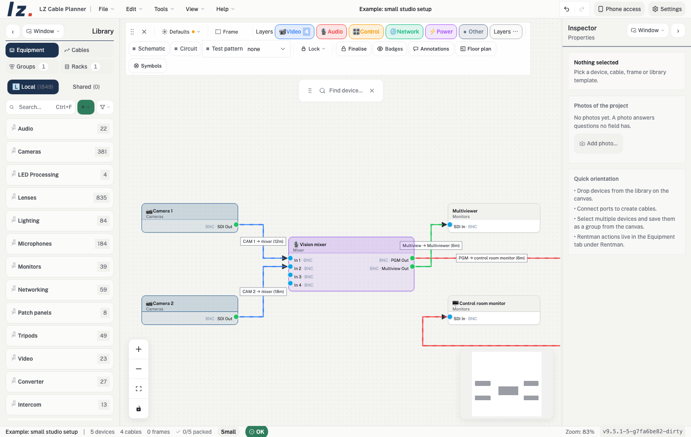
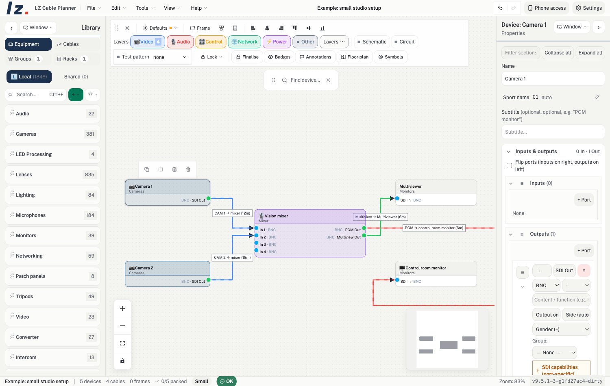
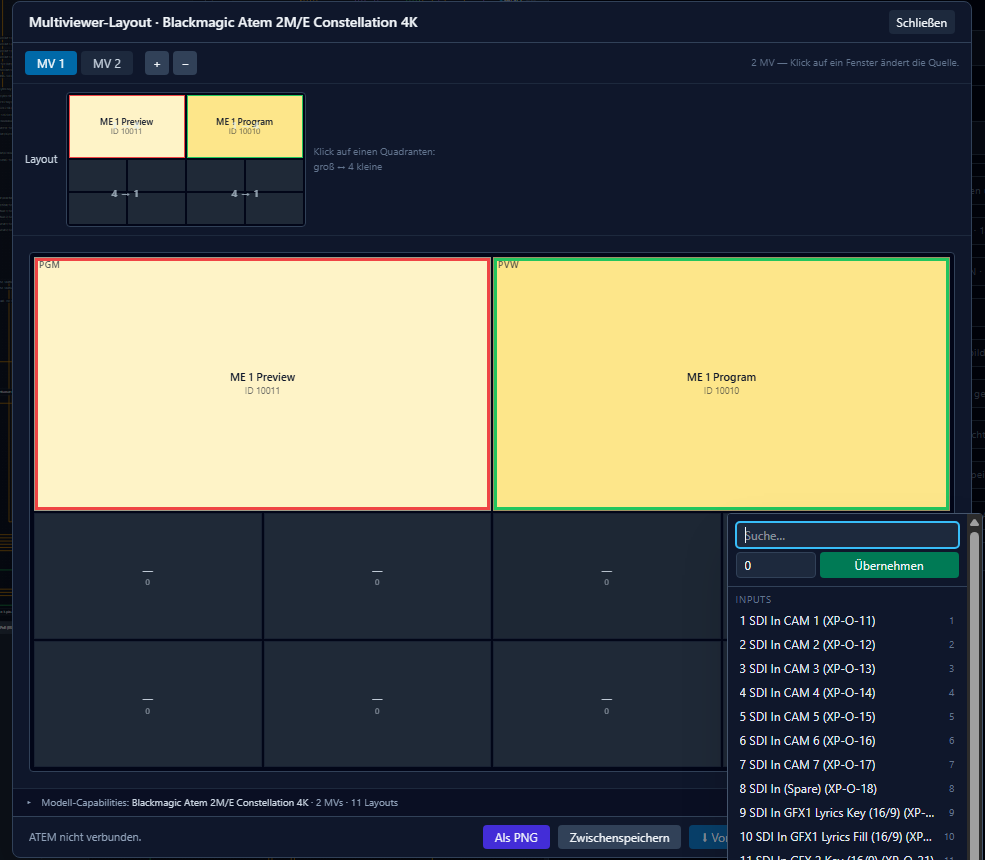
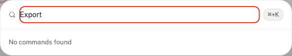
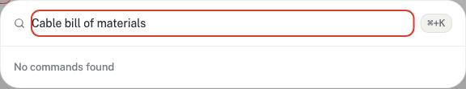
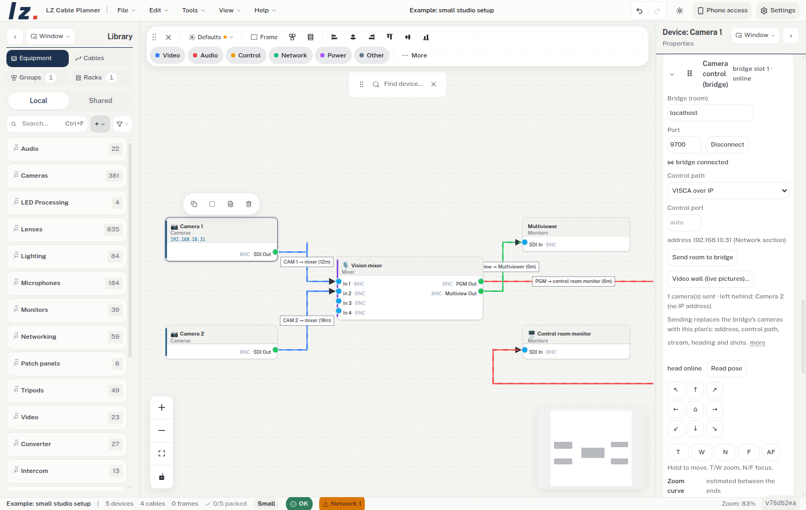
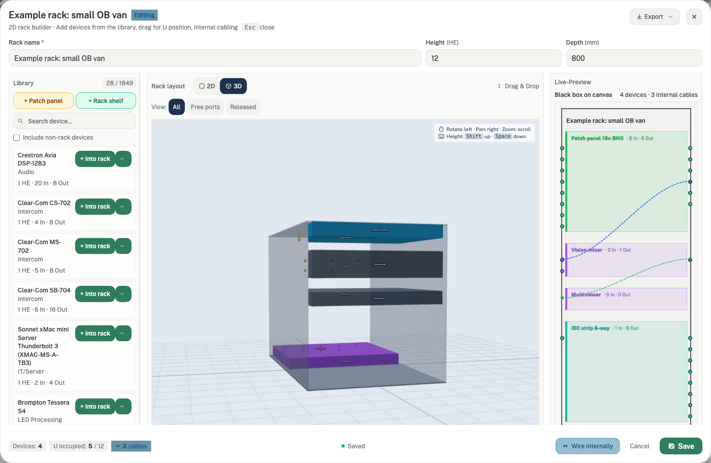

<p align="center">
  <picture>
    <source media="(prefers-color-scheme: dark)" srcset="src/renderer/assets/brand/lzm_hauptlogo_offwhite.svg" />
    
  </picture>
</p>

<h1 align="center">LZ Cable Planner</h1>

<p align="center">
  <b>Broadcast and AV cable planning for macOS and Windows.</b><br />
  Draw the signal flow, get real cable lengths, and hand over every list the build day needs.
</p>

<p align="center">
  <a href="https://github.com/larszu/cable-planner/releases/latest">
    
  </a>
  &nbsp;
  <a href="https://larszu.github.io/cable-planner/">
    
  </a>
</p>

<p align="center">
  <b>User manual:</b>
  <a href="docs/manual/LZ-Cable-Planner-Manual-EN.pdf">English (PDF)</a> ·
  <a href="docs/manual/LZ-Cable-Planner-Handbuch-DE.pdf">Deutsch (PDF)</a>
  <br />
  <sub>Read online: <a href="docs/manual/manual.en.md">manual.en.md</a> · <a href="docs/manual/handbuch.de.md">handbuch.de.md</a></sub>
</p>

<p align="center">
  <picture>
    <source media="(prefers-color-scheme: dark)" srcset="docs/screenshots/hero-dark.png" />
    
  </picture>
</p>

---

## Why LZ Cable Planner

- **Plan in signal flow, not in drawings.** Devices with real ports from 1,800+
  catalogue entries, each linked to its manufacturer datasheet.
  "Controlled via" in the properties panel lists the documented control
  protocols (serial with pinout, baud and network-bridge setup, or IP with
  port); values the manufacturer does not publish are marked as such.
  A new cable starts with the type and length of the last cable drawn
  between the same connectors; its name stays empty and the label shows the
  type. A cable runs from an output to an input, whichever end you start at;
  input to input or output to output is refused, network ports work both ways.
- **Real cable lengths.** Put the floor plan under the canvas, calibrate it, and
  lengths follow the drawn route — split into the stock lengths you own.
  The plan can be an image or a PDF (pick the page), cropped to the part you
  need, and each floor can carry its own plan.
- **Rooms, floors, risers, 3D.** Every cable end reads *floor · room · device ·
  port*; the signal path shows the whole chain through plates and house runs.
  A room carries a room number and an address; with an address set, the
  inspector shows an OpenStreetMap map (no API key; offline it falls back to
  a link that opens the map in the browser).
- **Every list for the build day.** Pull list, patch list, termination list,
  BOM, patch sheets, faceplates, acceptance record, QR labels — one report
  editor, preview equals export. The installation handover hands every
  list out three ways from the same table: CSV as backup, a laid-out PDF
  with bookmarks and a linked table of contents, and an Excel workbook with
  styled header, column widths, frozen header row and filters.
- **Patch panel labels.** The network analysis prints label strips for every
  patch panel at 1:1 (RJ45 24-port, blocks of 12, D-series 16) showing the
  device behind each port, exports them for Brother P-touch or Dymo, and
  checks panels against the rack builder: panel not in a rack, empty panel,
  uneven front/rear, cable on a blank, switch port bypassing the panel.
- **Drum micing in a few clicks.** Pick a technique preset (minimal, Glyn
  Johns, Recorderman, full close-mic) and a subsnake size: channels are
  patched to the subsnake in order, with patch list and cable-end labels
  (P-touch/Dymo CSV) ready to export.
- **Projection & display calculator.** Screen size from diagonal and aspect,
  mounting height, throw distance from throw ratio, lens shift (datasheet
  convention, ±50 % = lens at the image edge) and viewing distances (THX 36°,
  SMPTE 30°, 6 × image height) — with a dimensioned 2D side/front plan and a
  3D view. LED-wall resolution from pixel pitch in the same dialog.
- **Control at the device.** ATEM multiviewer and audio, Videohub routing,
  PTZ cameras through the LZ Camera Bridge (joystick, presets, the shots
  planned in MultiCam driven and stored in the head, one offset on site, live
  picture and a video wall), and Green-GO intercom channels live over OSC —
  each in the properties of the device it belongs to, not in a separate tool.
  ATEM input names can follow the Videohub routing: when a hub output that
  is cabled to an ATEM input is switched, the input takes the name of the
  routed source.
- **Scopes at the device.** Waveform, vectorscope, parade and histogram
  ([LZ Scopes](https://github.com/larszu/lz-scopes)) live from a device's
  RTSP, RTMP, SRT, HLS or MJPEG stream: *Scopes* next to the stream in the
  properties, *Measure signal* on a cable, *Compare scopes* for a selection of
  cameras, an optional live waveform under the device (off by default). Test
  patterns borderless on a screen of this computer, from the display in the
  plan. Desktop app with [ffmpeg](https://ffmpeg.org/) installed.
- **Wireless channels.** Per channel: transmitter, capsule, manufacturer band
  (Sennheiser ew G4 and EW-D, ranges from the spec sheets), frequency and
  occupied bandwidth; the carrier-spacing check takes the bandwidth into
  account. Pick a country to open its frequency table (Germany: BNetzA
  Vfg. 37/2026 and SRD) and see which channels fall outside it. Export the
  list as CSV or print it / save as PDF.
- **LED walls.** Panel types, grid, weight, power and sending-card ports per
  wall, a numbered pixel map, and the source crop: enter a source resolution
  (1920 × 1080 by default) and get the centred X, width, Y and height to type
  into the processor so the source fills the wall undistorted; tap a value to
  copy it. The crop idea follows
  [LedCropCalc](https://github.com/fiverecords/LedCropCalc).
- **On site.** Phones join by QR code, tick off work and send photos back into
  the plan. Photos attach to a single device or to its device type (shown on
  every device of that type); adding one to a device asks whether it also
  applies to the type.
- **Together.** Live co-editing over WebRTC, optional cloud copy with revisions,
  a shared device library across the planner suite.
- **Ask Claude.** A local MCP server answers questions about the open plan.
  With write access switched on, Claude can build a system without touching
  the UI: library devices (`search_library`, `add_device`), custom devices
  from port groups (`create_device`), cables one by one or in batches
  (`connect_ports`, `connect_many` — exact port names, input to input
  refused, reversed pairs flipped, occupied inputs only with `replace`), rack
  heights and racks (`set_rack_units`, `arrange_rack`), device fields from a
  customer list — IP, subnet mask, management VLAN, serial number, notes —
  one by one or in batches (`set_device`, `set_devices`; credentials stay in
  the UI), rooms and floors (`list_locations`, `list_floors`,
  `create_location`, `set_location`, `delete_location`, `place_in_location`,
  `create_floor`, `set_floor`; room number and address included; an ambiguous room name is
  refused), and a
  check against a cable list (`verify_cabling`). Each write call is one undo
  step.
- **Connecting Claude.** *Settings → MCP* starts the server on
  `http://127.0.0.1:4187/mcp` (port changeable there; if it is busy, a random
  one is used and the tab says so). The on/off and write switches are
  remembered across restarts, so a client set up once keeps working. The tab
  copies the ready `claude mcp add --transport http cable-planner … --header
  "Authorization: Bearer …"` command, a `mcpServers` JSON block, and a `curl`
  call for sessions that cannot load a new server:
  `curl -s http://127.0.0.1:4187/mcp -H "Authorization: Bearer <token>"
  -H "Content-Type: application/json" -H "Accept: application/json,
  text/event-stream" -d '{"jsonrpc":"2.0","id":1,"method":"tools/list"}'`
  (`tools/call` with `{"name":…,"arguments":…}` works the same way).
- **Offline first.** One JSON file per project, secrets in the OS keychain.
- **Calm by default.** One single-line toolbar over the plan: defaults,
  frame, selection tools and the layer chips; everything else sits under
  *More*. Devices are neutral cards with their colour as a thin edge.
- **Shortcuts at a glance.** Press `?` (or *Help → Keyboard shortcuts*) for a
  virtual keyboard — QWERTZ in German, QWERTY otherwise, ⌘/⇧ on a Mac —
  with every assigned key highlighted; hover or click a key to see its
  actions. Keys reassigned in *Settings → Hotkeys* show up here as assigned.
  The list view stays one click away.
- **Light and dark.** A neutral interface with the brand blue as the only
  accent. *Auto* follows the system; *Light* and *Dark* are one click away
  with the theme button in the header, in *Settings → Appearance* or the
  *View* menu, and the choice is kept.

## Screenshots

<table>
  <tr>
    <td width="50%" align="center"><br /><b>Device properties</b></td>
    <td width="50%" align="center"><br /><b>ATEM multiviewer</b></td>
  </tr>
  <tr>
    <td width="50%" align="center"><br /><b>Export &amp; print</b></td>
    <td width="50%" align="center"><br /><b>Cable bill of materials</b></td>
  </tr>
  <tr>
    <td width="50%" align="center"><br /><b>Camera control at the device</b></td>
    <td width="50%" align="center"><br /><b>Rack in 3D</b></td>
  </tr>
</table>

## How it compares

| | **LZ Cable Planner** | WireCAD | D-Tools SI | Visio / draw.io |
| --- | --- | --- | --- | --- |
| Price | **Free to use** | ~$1,500–4,500 | $1,000s / yr | Subscription / free |
| Platforms | **macOS + Windows + web** | Windows | Windows + SQL Server | Windows / web |
| File format | **JSON, git-diffable** | Proprietary | Proprietary | VSDX / XML |
| Broadcast-aware (connectors, BOM, patch sheets) | **Yes** | Yes | Partial | No |
| ATEM / Videohub | **Yes** | No | No | No |
| PTZ presets from the plan, Green-GO live | **Yes** | No | No | No |

Full comparison: [`docs/comparison.html`](docs/comparison.html).

## Build from source

Requires [Node.js](https://nodejs.org/) 20+.

```bash
npm install
npm run dev     # Electron with hot reload
npm test        # vitest + guards
npm run build   # renderer, main, preload
npm run dist    # installers for macOS / Windows
```

In a worktree, symlinking the main checkout's `node_modules` is enough:
`vitest.config.ts` allows the resolved link target, so `?url` imports (zxing
wasm) load. Tests use at most half the CPU cores and a 60 s timeout, so several
worktrees can run `npm test` at once.

LZ Scopes is vendored under `src/renderer/vendor/lz-scopes/`
([VENDOR.md](src/renderer/vendor/lz-scopes/VENDOR.md)). Update it with
`npm run scopes:sync -- --upstream ../lz-scopes`; `npm run scopes:check`
reports drift from the commit pinned in VENDOR.md (CI job `scopes`). A daily
workflow (`scopes-sync.yml`) syncs to upstream `main` on the branch
`chore/lz-scopes-sync`, runs the gates and reports in the issue
“lz-scopes: Vendor nachziehen”.

Contributing, maintainer notes and conventions: [CONTRIBUTING.md](CONTRIBUTING.md).
Architecture: [docs/architecture.md](docs/architecture.md). Everything else in
`docs/`: [docs/README.md](docs/README.md).

Built with Electron, React 19, TypeScript, React Flow, three.js, Zustand and Vite.

## Author & support

Built and maintained by **Lars Zumpe** — Lars Zumpe Medienproduktion.
If the planner saves you time on your next show:
[PayPal](https://paypal.me/larszumpe). Donations are optional; the app stays
free to use.

## License

Proprietär — © 2026 Lars Zumpe, alle Rechte vorbehalten. Nutzung der veröffentlichten Builds ist kostenlos; Weiterverbreitung und abgeleitete Werke sind es nicht. Siehe [LICENSE](LICENSE). Not open source: the code is public to read.

Die gebündelten Fremdpakete behalten ihre eigenen Lizenzen; deren Texte und
Copyright-Hinweise stehen vollständig in
[THIRD-PARTY-LICENSES.md](THIRD-PARTY-LICENSES.md) (erzeugt von
`scripts/generate-notices.mjs` aus dem Produktions-Dependency-Baum).
