# LZ Cable Planner — Benutzerhandbuch

Broadcast- und AV-Verkabelung planen, dokumentieren und übergeben:
Signalfluss, Räume und Etagen, Kabellängen, Patch-Listen und die Unterlagen
für den Aufbautag.

English version: [manual.en.md](manual.en.md)

---

## Inhalt

1. [Erste Schritte](#1-erste-schritte)
   - [Installation](#installation)
   - [Erstes Projekt](#erstes-projekt)
2. [Programmoberfläche](#2-programmoberfläche)
   - [Aufbau des Hauptfensters](#aufbau-des-hauptfensters)
   - [Seitenleisten anordnen](#seitenleisten-anordnen)
   - [Menü Bearbeiten](#menü-bearbeiten)
   - [Menü Ansicht](#menü-ansicht)
   - [Menü Hilfe](#menü-hilfe)
   - [Statusleiste](#statusleiste)
   - [Handy-Zugriff](#handy-zugriff)
   - [Erster Start](#erster-start)
3. [Canvas](#3-canvas)
   - [Der leere Plan und das Beispielprojekt](#der-leere-plan-und-das-beispielprojekt)
   - [Die Werkzeugleiste](#die-werkzeugleiste)
   - [Defaults](#defaults)
   - [Geräte auswählen](#geräte-auswählen)
   - [Geräte ausrichten](#geräte-ausrichten)
   - [Gerätegruppe speichern](#gerätegruppe-speichern)
   - [Auswahl im Rack-Builder anordnen](#auswahl-im-rack-builder-anordnen)
   - [Mehrere Kabel zwischen zwei Geräten](#mehrere-kabel-zwischen-zwei-geräten)
   - [Kabel per Sprache](#kabel-per-sprache)
   - [Tastenkürzel auf dem Canvas](#tastenkürzel-auf-dem-canvas)
   - [Kabel ziehen](#kabel-ziehen)
   - [Kabel bearbeiten](#kabel-bearbeiten)
   - [Seitenverbinder](#seitenverbinder)
   - [Rahmen](#rahmen)
   - [Räume, Etagen und 3D-Gebäudeansicht](#räume-etagen-und-3d-gebäudeansicht)
   - [Ebenen](#ebenen)
   - [Signalweg](#signalweg)
   - [Betriebsarten: Schema, Schaltbild, Prüfbild](#betriebsarten-schema-schaltbild-prüfbild)
   - [Sperren](#sperren)
   - [Plan abschließen](#plan-abschließen)
   - [Anmerkungen](#anmerkungen)
   - [Hallenplan](#hallenplan)
   - [Planzeichen](#planzeichen)
   - [Gerätesuche](#gerätesuche)
   - [Zoom und Navigation](#zoom-und-navigation)
   - [Kontextmenüs](#kontextmenüs)
   - [Auswahlleiste am Gerät](#auswahlleiste-am-gerät)
   - [Standbild unter dem Gerät](#standbild-unter-dem-gerät)
   - [Adapter und Wandler im Kabel](#adapter-und-wandler-im-kabel)
4. [Bibliothek](#4-bibliothek)
   - [Die Bibliothek-Spalte](#die-bibliothek-spalte)
   - [Geräte](#geräte)
   - [Kabel](#kabel)
   - [Gruppen](#gruppen)
   - [Racks](#racks)
5. [Inspector](#5-inspector)
   - [Nichts ausgewählt](#nichts-ausgewählt)
   - [Geräteeigenschaften](#geräteeigenschaften)
   - [Kabeleigenschaften](#kabeleigenschaften)
   - [Rahmen-Eigenschaften](#rahmen-eigenschaften)
6. [Datei und Import](#6-datei-und-import)
   - [Neues Projekt](#neues-projekt)
   - [Neu aus Vorlage](#neu-aus-vorlage)
   - [Öffnen](#öffnen)
   - [Speichern und Speichern unter](#speichern-und-speichern-unter)
   - [Autosave und Statusleiste](#autosave-und-statusleiste)
   - [Das Dateiformat `.cableplan`](#das-dateiformat-cableplan)
   - [Import yEd / GraphML](#import-yed--graphml)
   - [Import MultiCam-Kameras](#import-multicam-kameras)
   - [Import Equipment aus CSV](#import-equipment-aus-csv)
   - [Rentman-Import](#rentman-import)
   - [NetBox-Import](#netbox-import)
   - [Gesamtprojekt exportieren und importieren (`.avplan`)](#gesamtprojekt-exportieren-und-importieren-avplan)
   - [Identitäts-Karte (`.avsourcemap`)](#identitäts-karte-avsourcemap)
   - [Verknüpfte Venue-Planung ansehen](#verknüpfte-venue-planung-ansehen)
7. [Exportieren und Drucken](#7-exportieren-und-drucken)
   - [Patch-Liste](#patch-liste)
   - [Festinstallation: Doku & Übergabe](#festinstallation-doku--übergabe)
   - [Stage-Plot](#stage-plot)
   - [Exportieren & Drucken](#exportieren--drucken)
   - [Cloud & Lese-Link](#cloud--lese-link)
   - [Viewer-Datei](#viewer-datei)
   - [Anmerkungen importieren](#anmerkungen-importieren)
   - [Plan-Stände vergleichen](#plan-stände-vergleichen)
   - [Ausgegebene Dokumente](#ausgegebene-dokumente)
   - [Rückweg nach Rentman](#rückweg-nach-rentman)
8. [Werkzeuge: Planen](#8-werkzeuge-planen)
   - [Berechnen](#berechnen)
   - [Prüfen](#prüfen)
   - [Planen](#planen)
9. [Werkzeuge: Bauen](#9-werkzeuge-bauen)
   - [LED-Wand](#led-wand)
   - [Frontplatten-Editor](#frontplatten-editor)
   - [Berichts-Editor](#berichts-editor)
   - [Adern und Farbnormen](#adern-und-farbnormen)
   - [Empfangene Show-Control-Nachrichten](#empfangene-show-control-nachrichten)
   - [Mehrere Kabel verbinden](#mehrere-kabel-verbinden)
   - [Neues Rack erstellen](#neues-rack-erstellen)
   - [KI-Plan generieren](#ki-plan-generieren)
   - [Revisionen & Snapshots](#revisionen--snapshots)
   - [Lager / Bestand](#lager--bestand)
   - [Geräte-Konfiguration](#geräte-konfiguration)
10. [Einstellungen](#10-einstellungen)
   - [Einstellungen öffnen](#einstellungen-öffnen)
   - [Projekt](#projekt)
   - [Module](#module)
   - [Darstellung](#darstellung)
   - [Bearbeiten](#bearbeiten)
   - [Hotkeys](#hotkeys)
   - [Integrationen](#integrationen)
   - [Gerätebibliothek](#gerätebibliothek)
   - [MCP](#mcp)
   - [Konfigurationen](#konfigurationen)
   - [Kabeltypen](#kabeltypen)
   - [Stammdaten](#stammdaten)
   - [Kategorien & Felder](#kategorien--felder)
   - [Netzwerk-Sync](#netzwerk-sync)
   - [Nachweise](#nachweise)
   - [Erweitert](#erweitert)
11. [Claude (MCP)](#11-claude-mcp)
12. [Web-Ausgabe und Tablet](#12-web-ausgabe-und-tablet)
13. [Daten, Sicherheit und Fehlerbehebung](#13-daten-sicherheit-und-fehlerbehebung)

---

## 1. Erste Schritte

### Installation

Das Installationsprogramm liegt im
[neuesten Release](https://github.com/larszu/cable-planner/releases/latest):

- **macOS**: `.dmg` für Apple Silicon und Intel
- **Windows**: `.exe`

Die App läuft vollständig offline. Internet braucht nur die Gerätebibliothek,
die Cloud-Kopie und die Live-Sitzung über Netzgrenzen hinweg.

Ohne Installation läuft die Web-Ausgabe unter
**https://larszu.github.io/cable-planner/** (was sie nicht kann: Kapitel 21).

### Erstes Projekt

- **Datei → Neues Projekt** beginnt einen leeren Plan. **Öffnen…**,
  **Speichern** und **Speichern unter…** wie gewohnt; die Liste der letzten
  Projekte füllt sich selbst.
- Ein Projekt ist eine einzelne JSON-Datei (`.cableplan`). Sie lässt sich mit
  git versionieren und wie Text vergleichen.
- Während der Arbeit schreibt die App alle paar hundert Millisekunden eine
  Sicherungskopie. Wird das Projekt größer als dieser Speicher (etwa 5 MB),
  zeigt die Statusleiste **„Keine Sicherungskopie"** mit der Projektgröße —
  dann in eine Datei speichern. Der Plan selbst ist davon nicht betroffen.
- Rückgängig und Wiederholen reichen 100 Schritte zurück.


---

## 2. Programmoberfläche

### Aufbau des Hauptfensters

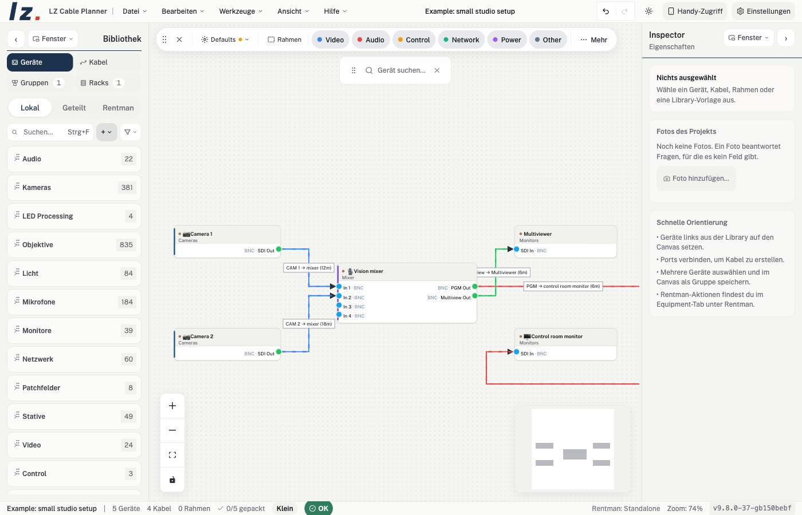

Das Hauptfenster hat fünf Bereiche:

| Bereich | Lage | Inhalt |
|---|---|---|
| Kopfleiste | oben | Menüs *Datei*, *Bearbeiten*, *Werkzeuge*, *Ansicht*, *Hilfe*, Projektname, Rückgängig/Wiederherstellen, Darstellungs-Knopf, *Handy-Zugriff*, *Einstellungen* |
| Bibliothek | links | Geräte, Kabel, Gruppen und Racks zum Einsetzen in den Plan |
| Canvas | Mitte | der Plan mit Geräten und Kabeln, Werkzeugleiste, Suchfeld, Zoom-Knöpfe, Übersichtskarte |
| Inspector | rechts | Eigenschaften der Auswahl |
| Statusleiste | unten | Kennzahlen und Hinweise zum Projekt |

#### Kopfleiste


Ein Klick auf den Projektnamen in der Mitte öffnet den Dialog *Projektdaten bearbeiten*.

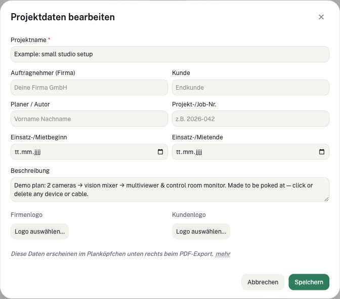

| Feld | Wirkung |
|---|---|
| Projektname (Pflichtfeld) | Name in Kopfleiste, Statusleiste und Ausdrucken |
| Auftragnehmer (Firma), Kunde, Planer / Autor, Projekt-/Job-Nr. | Angaben für das Planköpfchen |
| Einsatz-/Mietbeginn, Einsatz-/Mietende | Zeitraum des Einsatzes |
| Beschreibung | freier Text |
| Firmenlogo, Kundenlogo | Bilddatei über *Logo auswählen…* |

Die Daten erscheinen im Planköpfchen unten rechts beim PDF-Export. *Speichern* übernimmt sie, *Abbrechen* verwirft sie.

Rechts in der Kopfleiste liegen die Knöpfe für Rückgängig und Wiederherstellen. Sie sind ausgegraut, solange es keinen Schritt gibt.


In einem schmalen Fenster rückt die Kopfleiste zusammen; die Menüs bleiben erreichbar.


#### Menüs Datei und Werkzeuge

Das Menü *Datei* enthält Anlegen, Öffnen, Speichern, die Importe und die Exporte. Die Einträge beschreiben die Kapitel [Datei und Import](#6-datei-und-import) und [Exportieren und Drucken](#7-exportieren-und-drucken).

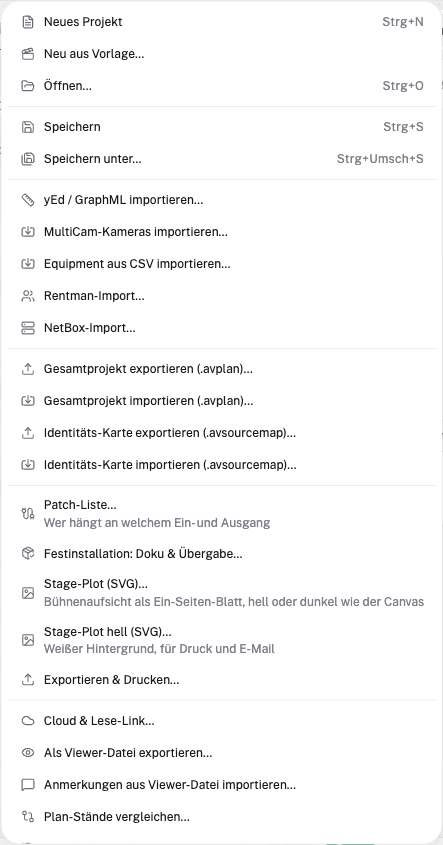

Das Menü *Werkzeuge* ist in Gruppen gegliedert, darunter *Berechnen*, *Prüfen* und *Planen*. Die Werkzeuge beschreiben die Kapitel zu den Werkzeugen.

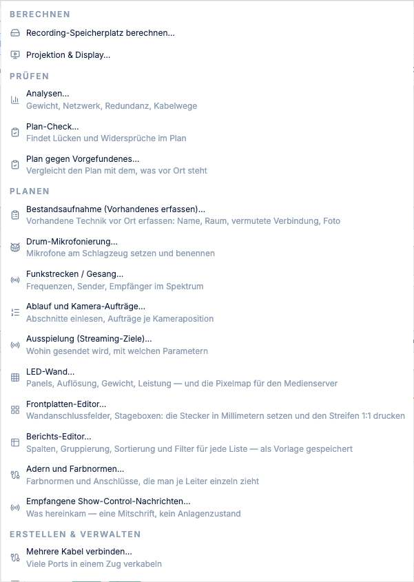

#### Inspector ohne Auswahl

Ist nichts ausgewählt, zeigt der Inspector *Nichts ausgewählt*, den Block *Fotos des Projekts* mit *Foto hinzufügen…* und die *Schnelle Orientierung* mit vier Hinweisen zum Einstieg.

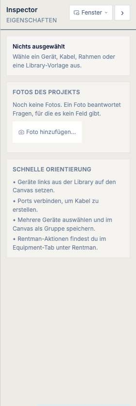

### Seitenleisten anordnen

Bibliothek und Inspector lassen sich einklappen, abdocken, in ein eigenes Fenster legen und in der Breite ändern.

#### Fenster-Menü

1. Klicken Sie oben in der Seitenleiste auf *Fenster*.

   

2. Wählen Sie *Abdocken (schwebend)*. Die Bibliothek schwebt als verschiebbares Feld über dem Canvas. *Andocken* setzt sie zurück an ihren Platz.

   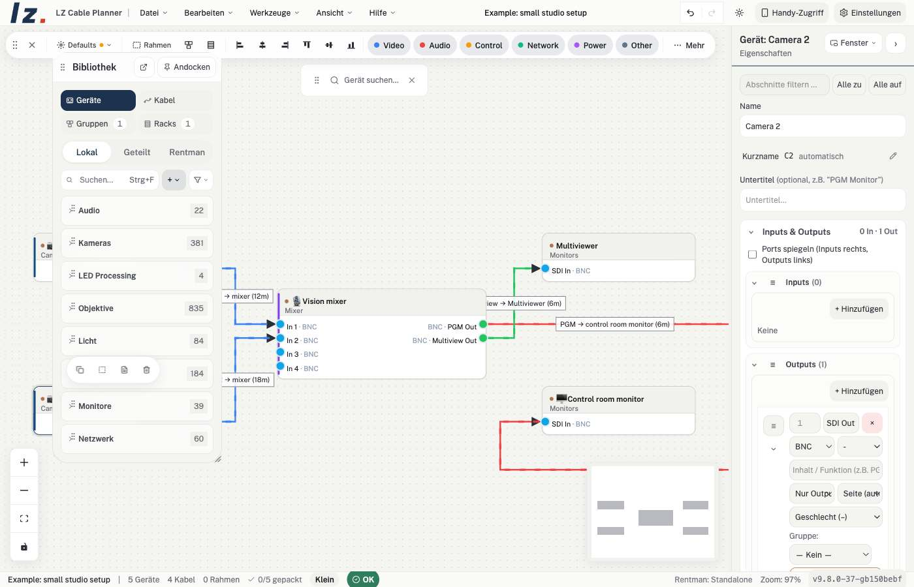

*In eigenes Fenster* öffnet die Seitenleiste als eigenes Programmfenster. Der Knopf *Fenster* lässt sich auch ziehen. Das Menü des Inspectors und das des Anmerkungen-Panels bieten dieselben Einträge.

#### Einklappen und Breite

- Der Pfeil-Knopf neben *Fenster* klappt die Seitenleiste ein. Ein Klick auf den Pfeil am Rand klappt sie wieder aus.

  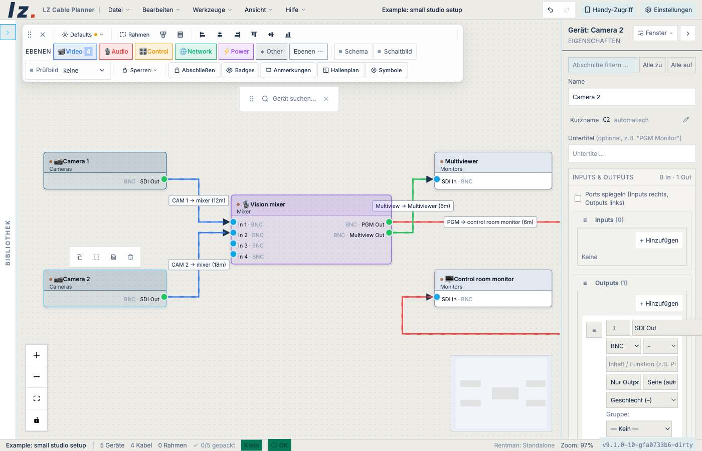

  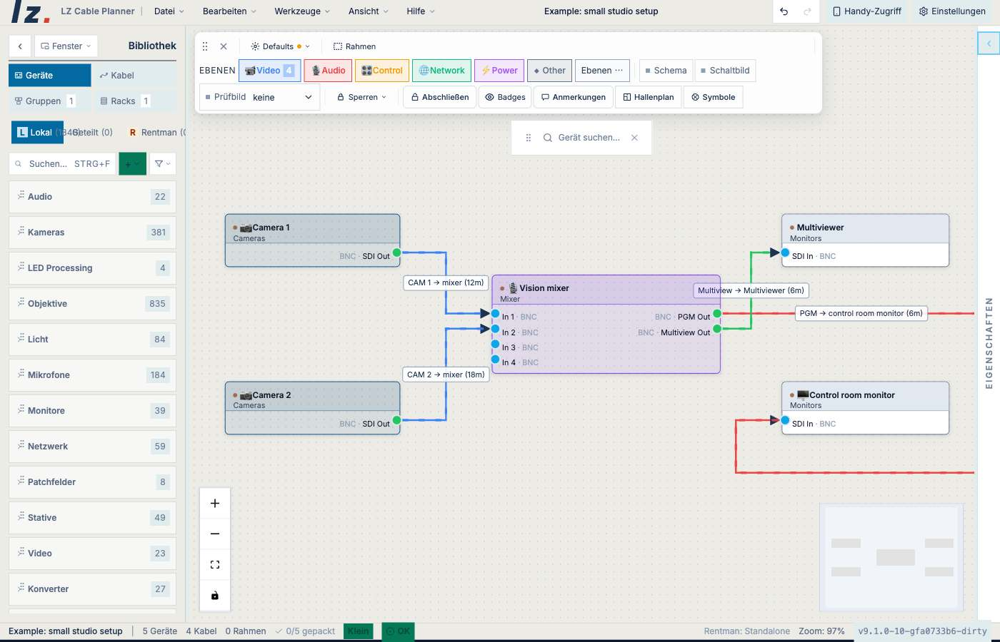

- Die Trennleiste zwischen Seitenleiste und Canvas lässt sich mit der Maus ziehen und ändert die Breite.

  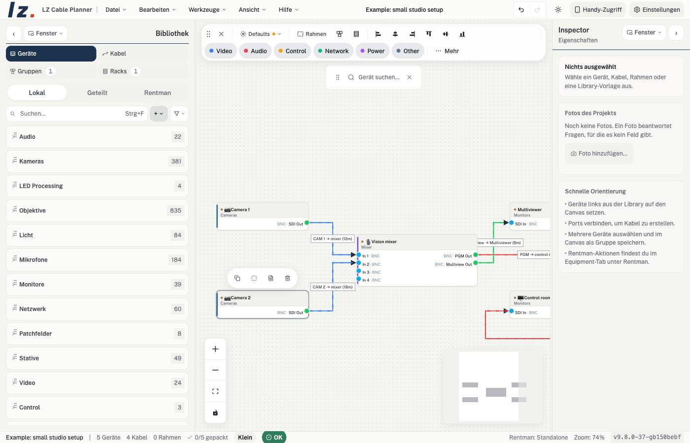

- **Strg+B** blendet die Bibliothek aus und ein, **Strg+I** den Inspector.

Die Taste **P** öffnet die Patchliste.

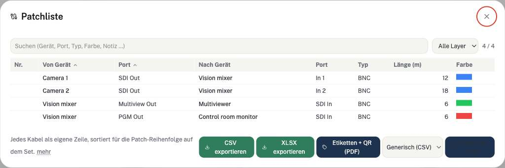

### Menü Bearbeiten

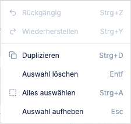

| Eintrag | Kürzel | Wirkung |
|---|---|---|
| Rückgängig | Strg+Z | nimmt den letzten Schritt zurück |
| Wiederherstellen | Strg+Y | stellt den zurückgenommenen Schritt wieder her |
| Duplizieren | Strg+D | kopiert die ausgewählten Elemente |
| Auswahl löschen | Entf | löscht die ausgewählten Elemente |
| Alles auswählen | Strg+A | wählt alle Elemente des Plans aus |
| Auswahl aufheben | Esc | hebt die Auswahl auf |

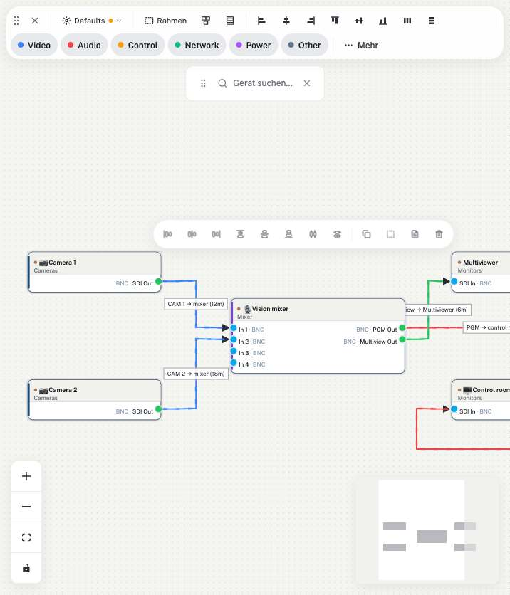

### Menü Ansicht

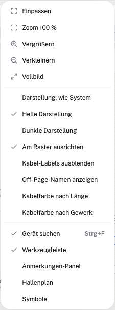

#### Zoom

| Eintrag | Wirkung |
|---|---|
| Einpassen | zoomt so, dass alle Elemente sichtbar sind |
| Zoom 100 % | setzt den Zoom auf 100 % |
| Vergrößern | zoomt hinein |
| Verkleinern | zoomt heraus |
| Vollbild | schaltet das Fenster in den Vollbildmodus und zurück |

Die aktuelle Zoomstufe steht in der Statusleiste.

#### Darstellung

| Eintrag | Wirkung |
|---|---|
| Darstellung: wie System | hell oder dunkel nach der Einstellung des Betriebssystems |
| Helle Darstellung | immer hell |
| Dunkle Darstellung | immer dunkel |

Dieselbe Wahl bieten der Darstellungs-Knopf in der Kopfleiste (Sonne, Mond oder Bildschirm) und *Einstellungen → Darstellung*. Die Wahl bleibt gespeichert.

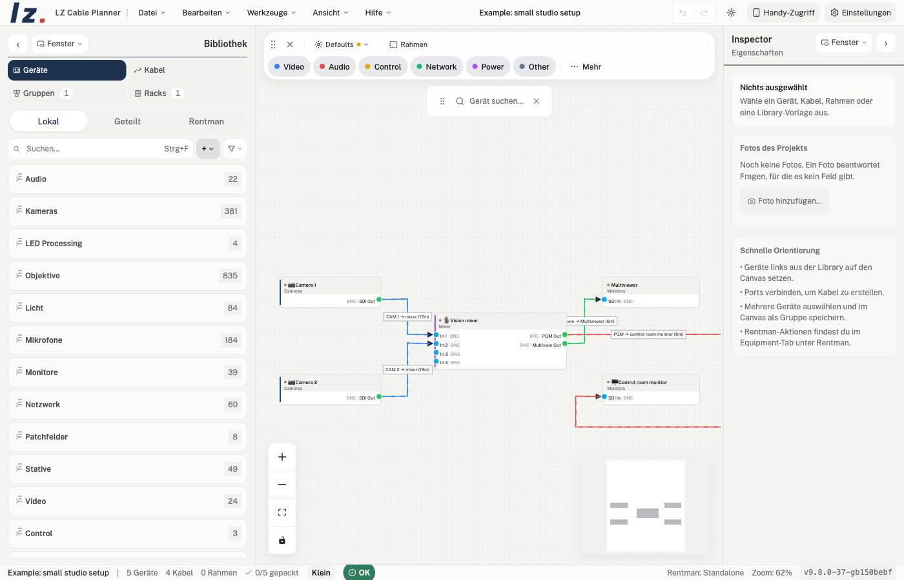

#### Raster und Beschriftungen

| Eintrag | Wirkung |
|---|---|
| Am Raster ausrichten | Geräte rasten beim Verschieben auf dem Raster ein |
| Kabel-Labels ausblenden | blendet die Beschriftungen an den Kabeln aus |
| Off-Page-Namen anzeigen | zeigt an Off-Page-Verbindern die Kabelnummer bzw. den Kabelnamen dauerhaft; ohne die Option erscheint sie nur beim Überfahren mit der Maus |

Ein Häkchen vor dem Eintrag zeigt, dass die Option eingeschaltet ist.

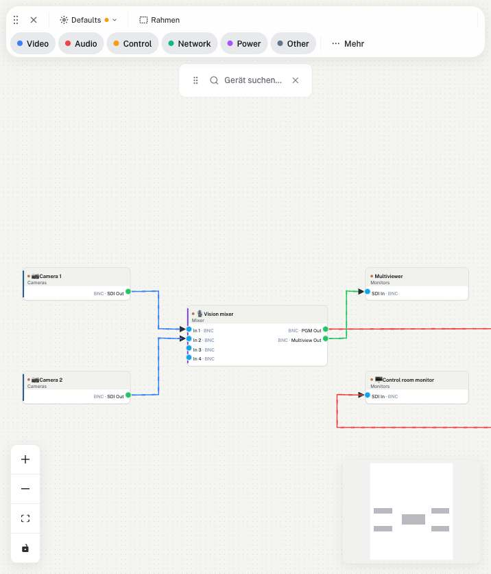

#### Kabelfarbe nach Länge

*Kabelfarbe nach Länge* färbt die Kabel nach dem Längen-Farbcode der Rundfunktechnik. Die gespeicherte Farbe jedes Kabels bleibt unverändert; ein zweiter Klick schaltet zurück.

| Länge | Farbe |
|---|---|
| 1 m | rot |
| 2 m | gelb |
| 3 m | grün |
| 5 m | weiß |
| 10 m | rot |
| 20 m | gelb |
| 25 m | gelb/weiß gestrichelt |
| 50 m | weiß |
| 100 m | rot |

Kabel mit einer anderen Länge erscheinen grau.

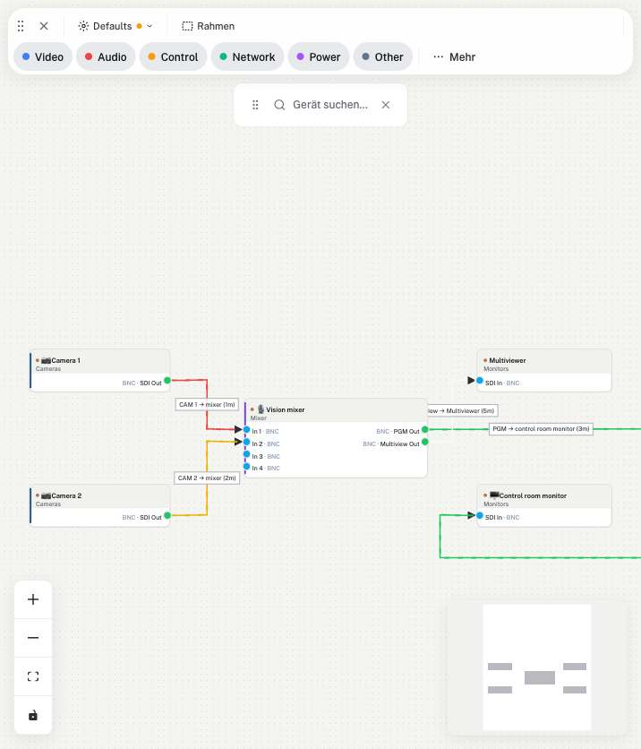

#### Kabelfarbe nach Gewerk

*Kabelfarbe nach Gewerk* färbt jedes Kabel nach seinem Gewerk: Video blau, Audio rot, Control orange, Network grün, Power violett, Other grau. Auch hier bleibt die gespeicherte Farbe unverändert. Die beiden Farbmodi schließen sich aus.

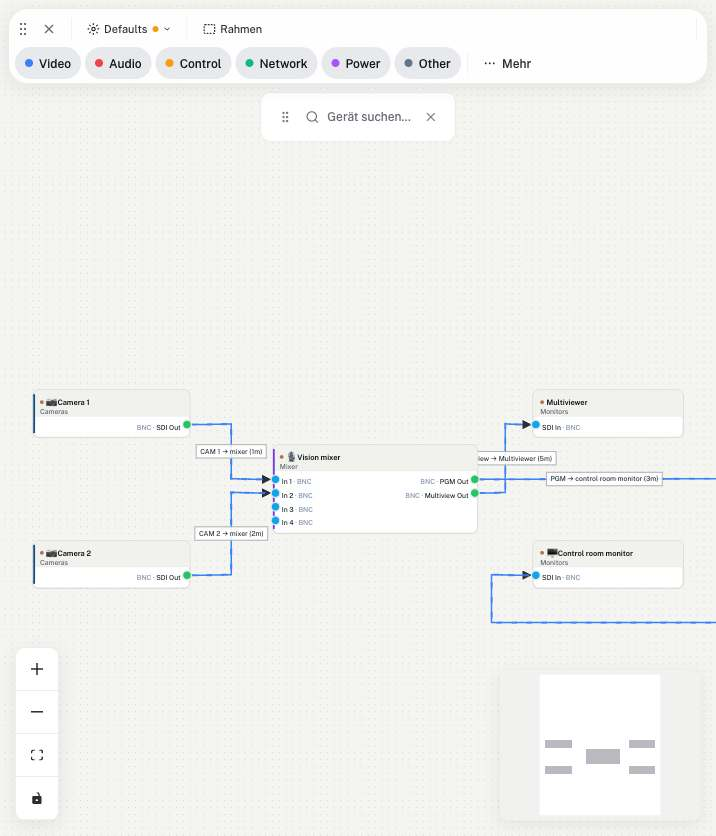

#### Suchfeld, Werkzeugleiste und Panels

| Eintrag | Kürzel | Wirkung |
|---|---|---|
| Gerät suchen | Strg+F | blendet das Suchfeld über dem Canvas ein und aus |
| Werkzeugleiste | | blendet die Werkzeugleiste des Canvas ein und aus |
| Anmerkungen-Panel | | öffnet und schließt das Panel *Anmerkungen* |
| Hallenplan | | blendet das Hallenplan-Panel ein und aus |
| Symbole | | blendet das Symbol-Panel ein und aus |

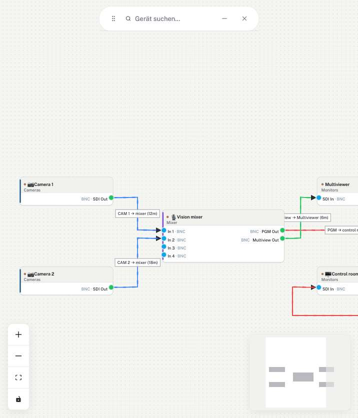

Das Panel *Anmerkungen* erscheint rechts. Es filtert nach *alle*, *offen*, *gebaut* und *erledigt*; *+ Neue Anmerkung* legt eine Anmerkung an. *Schließen* blendet es aus.

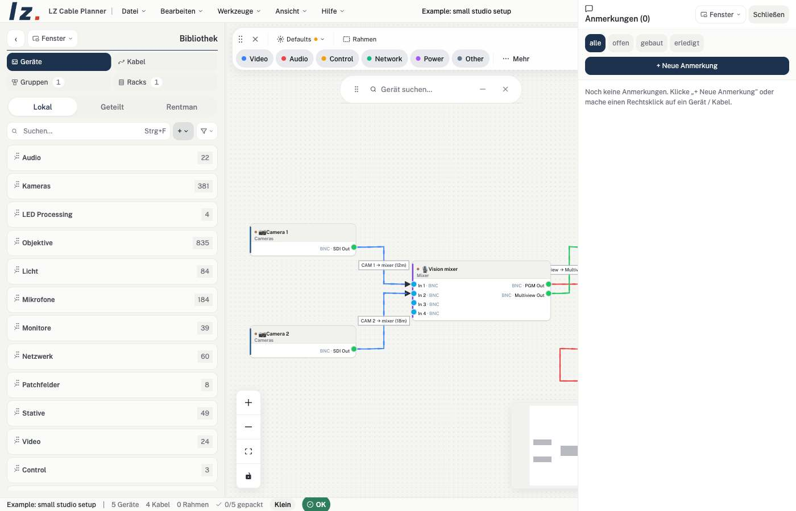

### Menü Hilfe

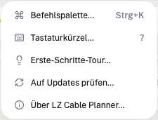

| Eintrag | Kürzel | Wirkung |
|---|---|---|
| Befehlspalette… | Strg+K | öffnet die Befehlspalette |
| Tastaturkürzel… | ? | öffnet die Übersicht der Tastaturkürzel |
| Erste-Schritte-Tour… | | startet die Tour durch die Oberfläche |
| Auf Updates prüfen… | | fragt nach einer neueren Version und meldet das Ergebnis |
| Über LZ Cable Planner… | | öffnet den Dialog mit Version und Build |

#### Befehlspalette

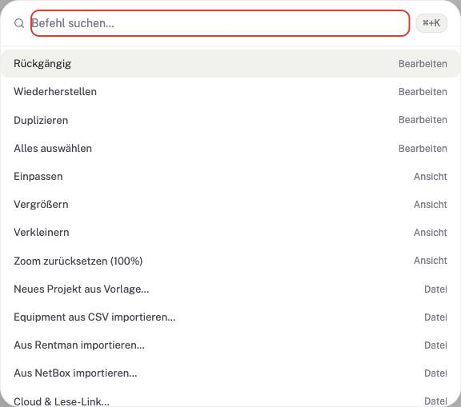

Die Befehlspalette listet die Befehle aus *Bearbeiten*, *Ansicht*, *Datei*, *Werkzeuge* und *Hilfe*; rechts neben jedem Befehl steht seine Gruppe, unter manchen eine Kurzbeschreibung. Befehle abgeschalteter Module fehlen.

1. Öffnen Sie die Palette mit **Strg+K** oder über *Hilfe → Befehlspalette…*.
2. Tippen Sie ein oder mehrere Suchwörter. Die Suche prüft Befehlsname, Gruppe, Kurzbeschreibung und hinterlegte Synonyme; jedes Wort muss vorkommen. Treffer im Befehlsnamen stehen vorn.

   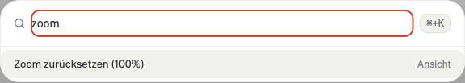

3. Wählen Sie mit den Pfeiltasten einen Befehl und führen Sie ihn mit **Enter** aus.

Synonyme gelten in beiden Sprachen: *qr* findet zum Beispiel *Aufs Handy teilen…*.

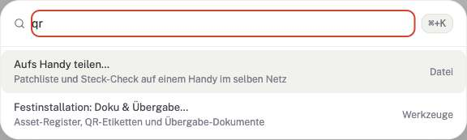

Passt nichts, steht *Keine Befehle gefunden* in der Liste.

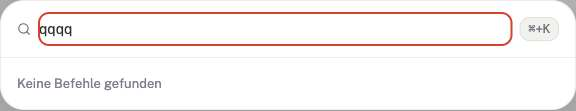

#### Tastaturkürzel

*Hilfe → Tastaturkürzel…* oder die Taste **?** öffnet die Übersicht.

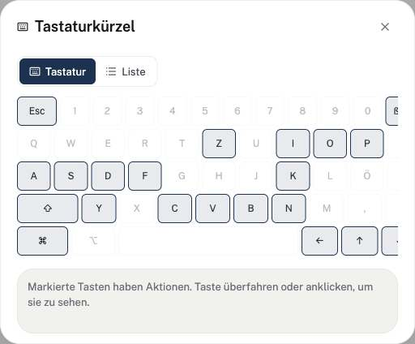

Die Ansicht *Tastatur* zeigt eine Tastatur; markierte Tasten haben eine Aktion, die beim Überfahren oder Anklicken erscheint. Die Ansicht *Liste* führt alle Kürzel als Liste. Dazu gehören unter anderem:

| Kürzel | Aktion |
|---|---|
| Strg+N, Strg+O, Strg+S, Strg+Umsch+S | Neues Projekt, Öffnen, Speichern, Speichern unter |
| Strg+C, Strg+V | Kopieren, Einfügen |
| Strg+K | Befehlspalette |
| Strg+F | Gerät suchen |
| Strg++ | Neues Gerät an der Mausposition |
| Strg+B, Strg+I | Bibliothek bzw. Inspector ein- und ausblenden |
| P | Patchliste öffnen |
| A | Pfeildarstellung umschalten |
| ? | diese Übersicht |

#### Erste-Schritte-Tour

Die Tour führt in fünf Schritten durch die Oberfläche: Bibliothek links, Eigenschaften rechts, Plan-Prüfung, Export-Menü, Jede Funktion finden. *Weiter* und *Zurück* blättern, *Tour beenden* bricht ab. Der letzte Schritt schließt mit *Befehlspalette öffnen* die Tour und öffnet die Befehlspalette. Beim ersten Start öffnet sich die Tour von selbst.


#### Über LZ Cable Planner

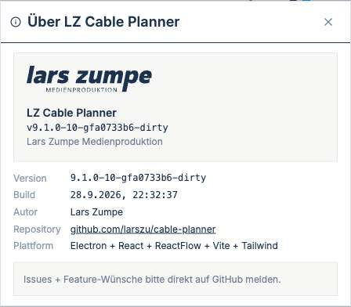

Der Dialog zeigt:

- Version
- Build: Datum und Uhrzeit, zu der das Programm gebaut wurde
- Autor
- Repository (github.com/larszu/cable-planner)
- Plattform (Electron, React, ReactFlow, Vite, Tailwind)
- den Hinweis, Fehler und Wünsche auf GitHub zu melden

Derselbe Dialog öffnet sich mit einem Klick auf die Versionsnummer rechts in der Statusleiste.

### Statusleiste

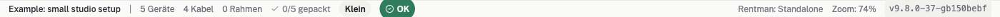

Die Statusleiste zeigt von links nach rechts:

| Element | Bedeutung | Klick |
|---|---|---|
| Projektname | Name des Projekts | |
| Geräte, Kabel | Anzahl im Plan | |
| Rahmen | Anzahl der Raum-Rahmen | |
| gepackt | Geräte, die in ihren Eigenschaften als gepackt markiert sind, z. B. *0/5 gepackt*; grau bei keinem, gelb bei einigen, grün bei allen | |
| Komplexität | Größeneinschätzung des Plans | |
| Plan-Check | Ergebnis der laufenden Planprüfung | öffnet den Plan-Check |
| Rentman | Verbindung zu Rentman | |
| Zoom | aktuelle Zoomstufe | |
| Version | Programmversion | öffnet *Über LZ Cable Planner* |

In einem schmalen Fenster blendet die Statusleiste Rahmen, gepackt und Rentman aus.

#### Komplexität

Das Abzeichen zählt Geräte und Kabel zusammen:

| Summe | Abzeichen |
|---|---|
| unter 8 | Neu |
| ab 8 | Klein |
| ab 30 | Mittel |
| ab 80 | Groß |
| ab 200 | XL |

Das Abzeichen dient nur der Orientierung über Lesbarkeit und Arbeitstempo.

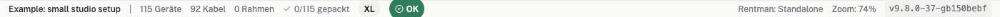

#### Plan-Check

Das Abzeichen hat drei Zustände:

| Farbe | Bedeutung |
|---|---|
| grün, *OK* | keine Befunde |
| gelb mit Zahl | nur Warnungen |
| rot mit Zahl | mindestens ein Fehler |

Die Zahl ist die Summe aus Fehlern und Warnungen.

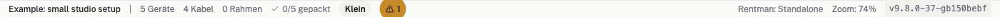

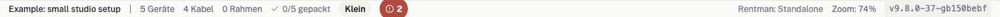

Ein Klick öffnet den Plan-Check mit allen Befunden. Ein Klick auf einen Befund wählt das betroffene Element aus.

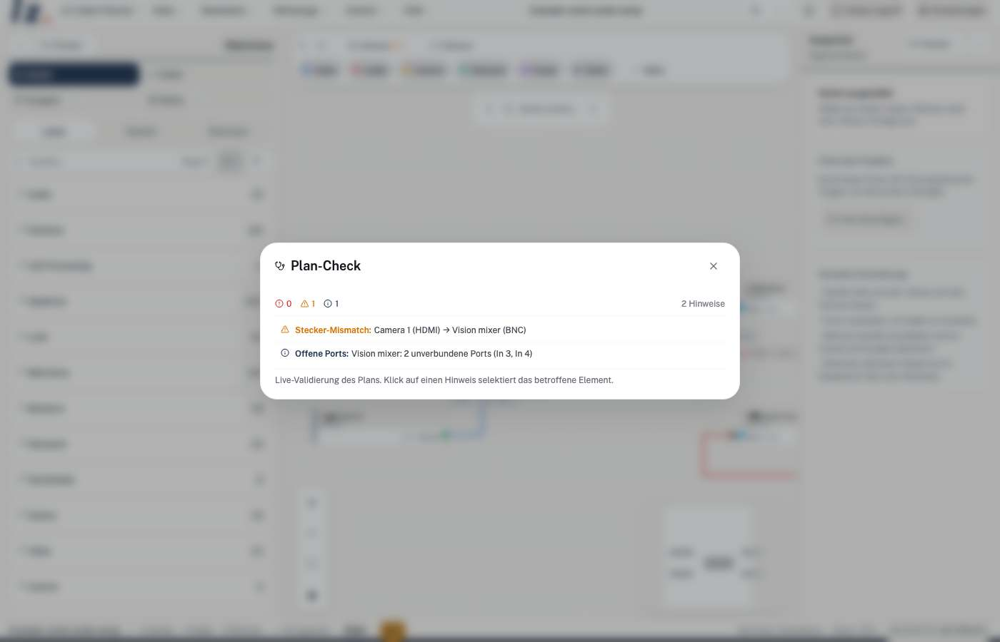

#### Hinweise, die nur bei Bedarf erscheinen

| Abzeichen | Erscheint, wenn | Klick |
|---|---|---|
| *Netz* mit Zahl | Netzwerk-Befunde vorliegen: fehlende oder doppelte Adressen, Masken, Segmente | öffnet die Analysen auf dem Netzwerk-Reiter |
| *Keine Sicherungskopie* | der Browser-Speicher die Sicherungskopie des Projekts abgelehnt hat; der Plan selbst ist nicht betroffen, speichern Sie ihn in eine Datei | |
| *Fotos* mit MB | die Fotos im Plan mehr als 40 MB ausmachen; die Datei öffnet weiterhin, ist aber schwer per Mail zu verschicken | |
| *Fällig* mit Zahl | Rückgaben, Ausgaben, Stunden, Belege oder Kosten überfällig oder heute fällig sind | öffnet die Analysen auf *Was ansteht* |
| *Live* mit Teilnehmerzahl | eine Live-Zusammenarbeit läuft | öffnet die Einstellungen auf dem Netzwerk-Sync-Reiter |
| *MCP* | der lokale MCP-Server läuft; daneben *· nur lesen* oder *· darf ändern*, bei aktiver Anfrage *MCP · fragt* | öffnet die Einstellungen auf dem MCP-Reiter |

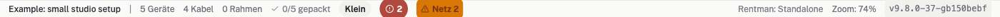

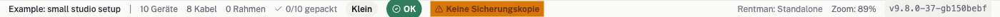

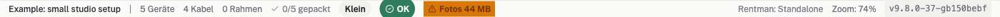

#### Rentman-Anzeige

Die Rentman-Anzeige erscheint nur, wenn das Modul Rentman eingeschaltet ist. Sie zeigt den Namen des verknüpften Rentman-Projekts, sonst *Token bereit*, wenn ein Zugangstoken hinterlegt ist, sonst *Standalone*.

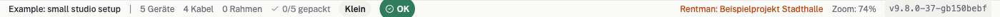

### Handy-Zugriff

Der Knopf *Handy-Zugriff* in der Kopfleiste öffnet den gleichnamigen Dialog. Er startet einen kleinen Webserver im lokalen Netzwerk; ein Handy öffnet über den QR-Code die mobile Ansicht des Projekts.

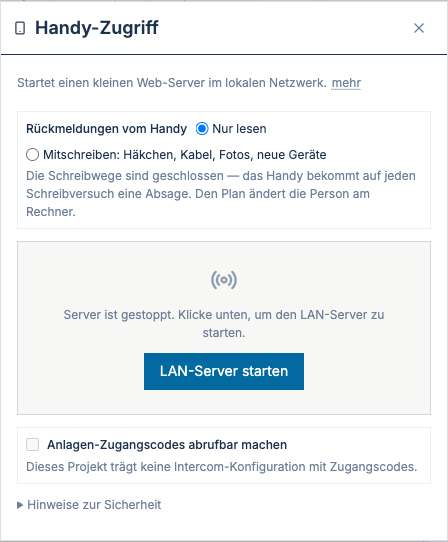

| Element | Wirkung |
|---|---|
| Rückmeldungen vom Handy: *Nur lesen* | das Handy kann nichts zurückschreiben |
| Rückmeldungen vom Handy: *Mitschreiben: Häkchen, Kabel, Fotos, neue Geräte* | das Handy darf Häkchen, Kabel, Fotos und neue Geräte zurückschicken |
| *LAN-Server starten* | startet den Server und zeigt den QR-Code |
| *Anlagen-Zugangscodes abrufbar machen* | gibt Intercom-Zugangscodes über einen zweiten Code frei; nur bei Projekten mit Intercom-Konfiguration wählbar |
| *Hinweise zur Sicherheit* | klappt die Sicherheitshinweise auf |

Der Server stoppt beim Schließen der App oder über den Stop-Knopf. Die mobile Ansicht beschreibt das Kapitel [Web-Ausgabe und Tablet](#12-web-ausgabe-und-tablet).

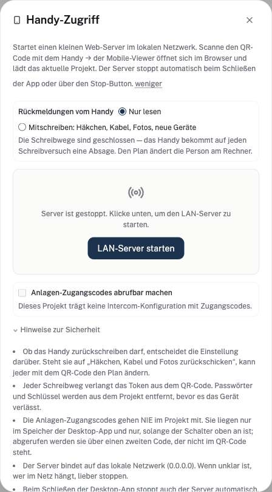

### Erster Start

Beim ersten Start mit leerem Projekt erscheint der Dialog *Willkommen — was planst du?*.

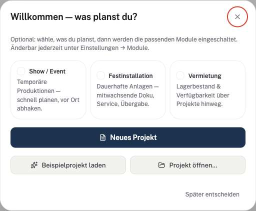

1. Wählen Sie optional einen oder mehrere Anwendungsfälle. Sie schalten die passenden Module ein:

   | Anwendungsfall | schaltet die Module ein |
   |---|---|
   | Show / Event | Mobile-Companion, Rentman |
   | Festinstallation | Festinstallation, Mobile-Companion, NetBox |
   | Vermietung | Vermietung / Lager, Rentman |

   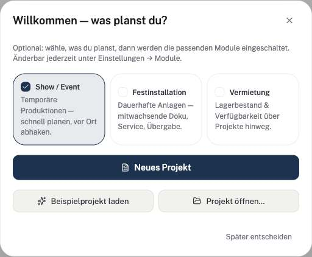

2. Wählen Sie, wie Sie beginnen:

   | Knopf | Wirkung |
   |---|---|
   | Neues Projekt | öffnet die Projektdaten für ein neues Projekt |
   | Beispielprojekt laden | lädt das Beispielprojekt und passt die Ansicht ein |
   | Projekt öffnen… | öffnet eine vorhandene `.cableplan`-Datei |
   | Später entscheiden | schließt den Dialog |

   Ohne gewählten Anwendungsfall bleiben die Module, wie sie sind. Ändern lässt sich alles unter *Einstellungen → Module*.

3. Danach startet die [Erste-Schritte-Tour](#erste-schritte-tour).

   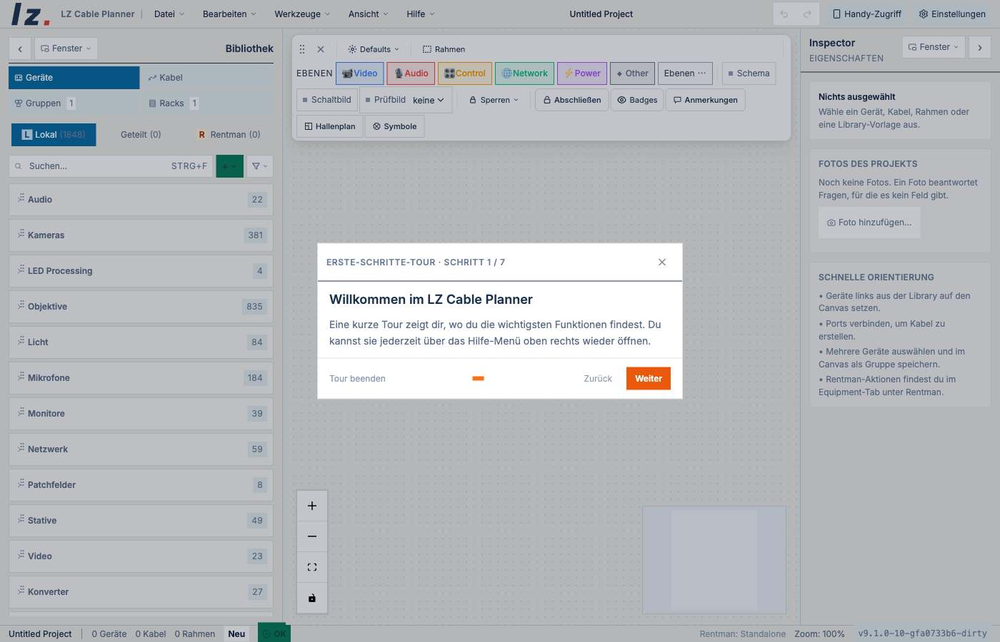

---

## 3. Canvas

Der Canvas ist die Arbeitsfläche, auf der Geräte stehen, Kabel verlaufen und Rahmen Räume bilden. Dieses Kapitel beschreibt die Fläche selbst, die schwebende Werkzeugleiste, die Auswahl, das Zeichnen und Bearbeiten von Kabeln, Rahmen, Etagen, Ebenen, Betriebsarten, Anmerkungen, Hallenplan und Planzeichen. Die Eigenschaften eines markierten Geräts, Kabels oder Rahmens stehen im Kapitel [Inspector](#5-inspector); die Bibliothek links im Kapitel [Bibliothek](#4-bibliothek).

### Der leere Plan und das Beispielprojekt

Ein Plan ohne Geräte zeigt in der Mitte den Hinweis *Noch keine Geräte im Plan*: Ein Gerät aus der Bibliothek links auf die Fläche ziehen. Darunter steht *Beispielprojekt laden*.

1. Starten Sie mit einem leeren Plan.

   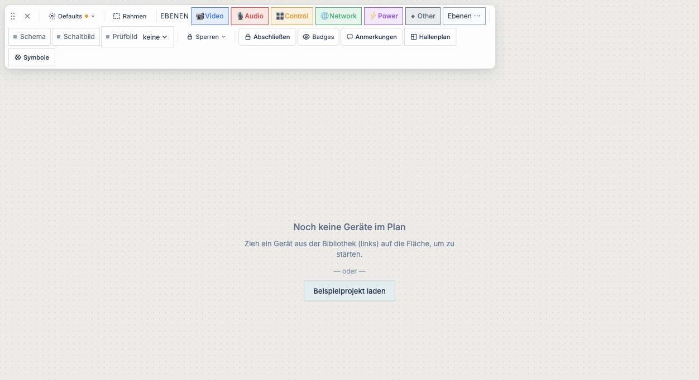

2. Klicken Sie auf *Beispielprojekt laden*. Der Plan zeigt dann Camera 1, Camera 2, Vision mixer, Multiviewer und Control room monitor mit vier Kabeln. Die weiteren Abschnitte dieses Kapitels arbeiten an diesem Beispiel.

   

Die Fläche lässt sich mit gedrückter Maustaste auf freiem Grund verschieben, mit dem Mausrad zoomen und zeigt unten rechts eine Übersichtskarte.

### Die Werkzeugleiste

Die Werkzeugleiste schwebt oben links über dem Plan. In der Leiste stehen von links nach rechts:

- der Griff zum Verschieben und der Schließen-Knopf,
- *Defaults* (Voreinstellungen für neue Kabel und die Darstellung),
- *Rahmen*,
- *Sprache* (Kabel aus einem Satz anlegen),
- Knöpfe für die Auswahl, solange Geräte markiert sind (Kabel verbinden, Gruppe speichern, Rack, Ausrichten),
- die Ebenen-Chips *Video*, *Audio*, *Control*, *Network*, *Power*, *Other* und eigene Ebenen,
- der Chip der gerade eingeschalteten Betriebsart (Signalweg, Schaltbild, Prüfbild),
- *Mehr*.


Unter *Mehr* stehen die selteneren Schalter: *Ebenen ⋯* (Ebenen verwalten), *Sperren*, *Schema* beziehungsweise *Live*, *Schaltbild*, *Prüfbild*, *Abschließen*, *Badges*, *Anmerkungen*, *Hallenplan* und *Symbole*. Die Knöpfe *Räume* und *3D* erscheinen dort, sobald der Plan Rahmen enthält.

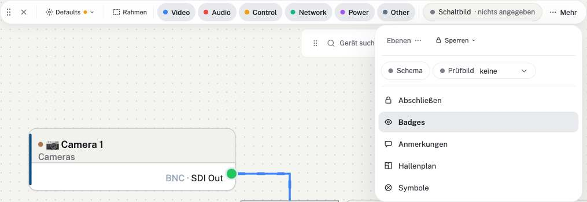

Auf einem Telefon zeigt die Leiste nur den Griff, *Defaults* und *Mehr*; Rahmen, Ebenen und Auswahl-Knöpfe stehen dann unter *Mehr*.

#### Leiste verschieben, schließen und wieder öffnen

1. Ziehen Sie die Leiste am Griff (sechs Punkte links) an eine andere Stelle.

2. Mit dem **×** neben dem Griff schließen Sie die Leiste.

3. Öffnen Sie das Menü *Ansicht*.

   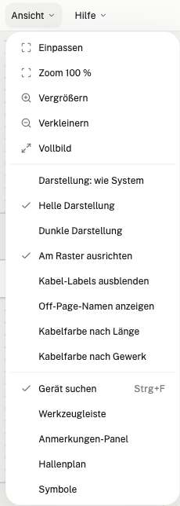

4. Wählen Sie *Werkzeugleiste*. Die Leiste erscheint wieder.

### Defaults

*Defaults* (Tooltip: *Standard-Verhalten für neue Kabel + Darstellung*) legt fest, wie neue Kabel entstehen und wie der Plan aussieht. Ein Punkt am Knopf zeigt, dass mindestens ein Wert verändert ist.

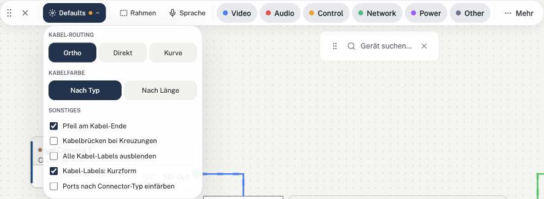

| Gruppe | Option | Wirkung |
|---|---|---|
| *Kabel-Routing* | *Ortho* | Neue Kabel verlaufen waagerecht und senkrecht. |
| | *Direkt* | Neue Kabel verlaufen geradlinig. |
| | *Kurve* | Neue Kabel verlaufen als Kurve. |
| *Kabelfarbe* | *Nach Typ* | Die Farbe kommt vom Kabeltyp. |
| | *Nach Länge* | Die Farbe richtet sich nach der Länge; der Knopf *?* zeigt die Legende *Längenfarben*. |
| *Sonstiges* | *Pfeil am Kabel-Ende* | Frisch gezogene Kabel bekommen einen Pfeil. |
| | *Kabelbrücken bei Kreuzungen* | Kreuzungen werden als kleine Brücke gezeichnet. Pro Kabel lässt sich das im Kontextmenü überschreiben. |
| | *Alle Kabel-Labels ausblenden* | Die Beschriftungen aller Kabel verschwinden; ihre Lage bleibt gespeichert. |
| | *Kabel-Labels: Kurzform* | Das Format-Suffix (zum Beispiel „(1080p50/60)") wird aus der Anzeige entfernt. Der volle Name bleibt in den Kabel-Eigenschaften. |
| | *Ports nach Connector-Typ einfärben* | Anschlüsse erhalten die Farbe ihres Steckertyps (SDI amber, HDMI violett, Ethernet grün und so weiter). |

Das Routing wirkt auf Kabel, die danach entstehen. Bereits gezeichnete Kabel behalten ihre Form (siehe [Kabel bearbeiten](#kabel-bearbeiten)).

1. Wählen Sie unter *Kabel-Routing* zum Beispiel *Kurve*.

2. Wählen Sie unter *Kabelfarbe* *Nach Länge*. Die Kabel erscheinen in Längenfarben.

   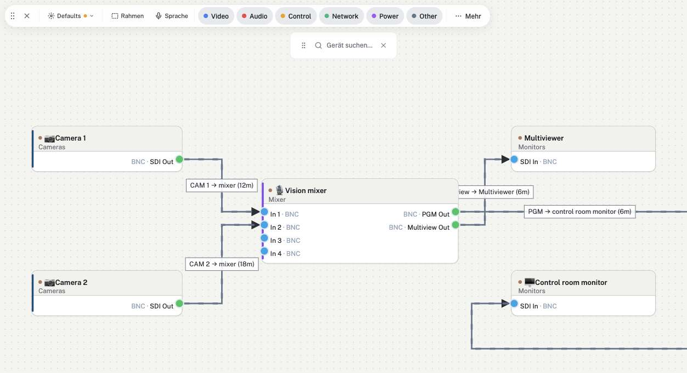

3. Der Knopf *?* neben *Nach Länge* blendet die Legende *Längenfarben* ein: 1 m rot, 2 m gelb, 3 m grün, 5 m weiß, 10 m rot, 20 m gelb, 25 m gelb/weiß gestrichelt, 50 m weiß, 100 m rot. *Schließen* blendet sie aus.

   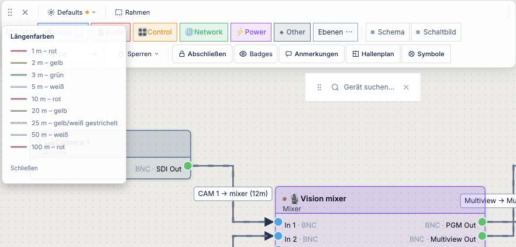

4. *Kabelbrücken bei Kreuzungen* zeichnet an Kreuzungen eine Brücke.

   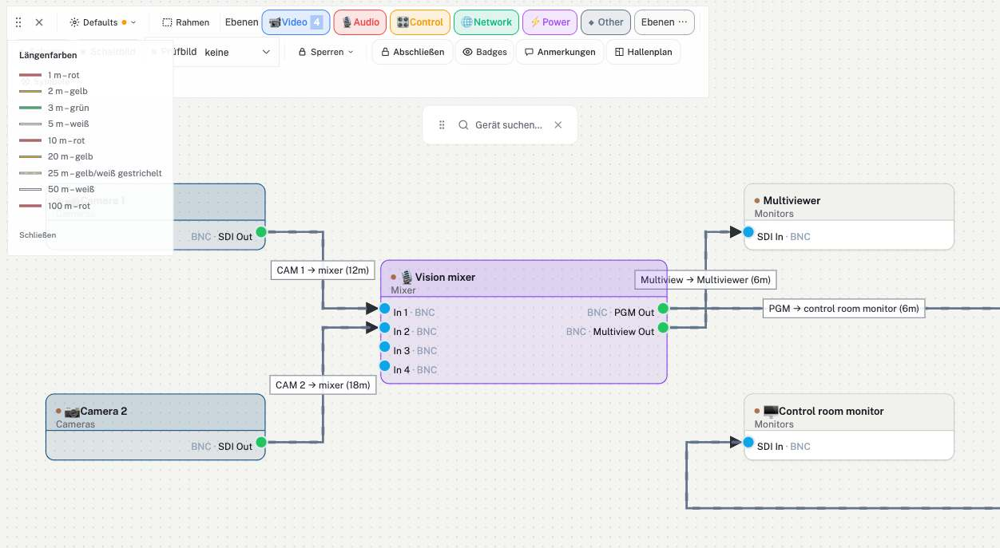

5. *Alle Kabel-Labels ausblenden* entfernt die Beschriftungen vom Plan.

6. *Ports nach Connector-Typ einfärben* färbt die Anschlüsse nach Steckertyp.

   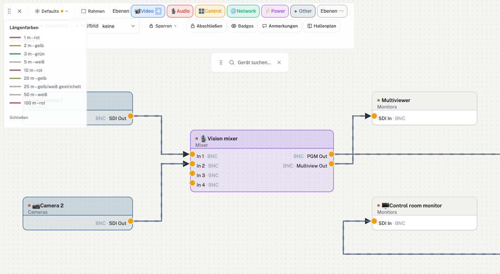

Zusätzlich färbt der Eintrag *Kabelfarbe nach Gewerk* im Menü *Ansicht* die Kabel nach ihrer Ebene (Video, Audio und so weiter).

### Geräte auswählen

- **Klick** auf ein Gerät markiert es; der Inspector rechts zeigt seine Eigenschaften.
- **Umschalt**, **Strg** oder **Cmd** plus Klick fügt weitere Geräte hinzu oder nimmt sie wieder heraus.
- **Umschalt** gedrückt halten und auf freier Fläche ziehen spannt ein Auswahlrechteck auf.
- *Bearbeiten → Alles auswählen* markiert alle Geräte.
- Ein Klick auf freie Fläche hebt die Auswahl auf.

1. Klicken Sie auf den Kopf von Camera 2.

   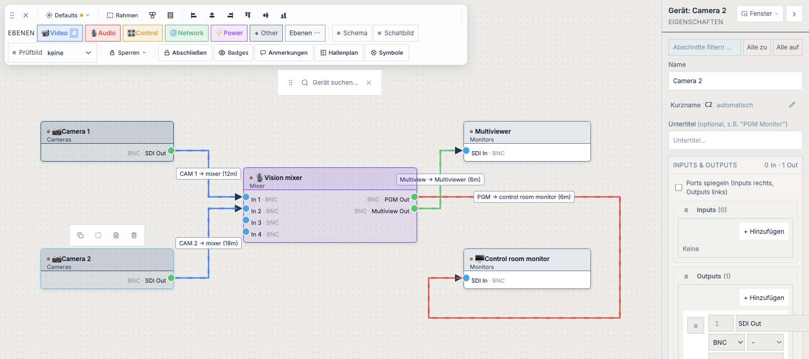

2. Klicken Sie mit gedrückter Umschalt-Taste auf den Vision mixer.

   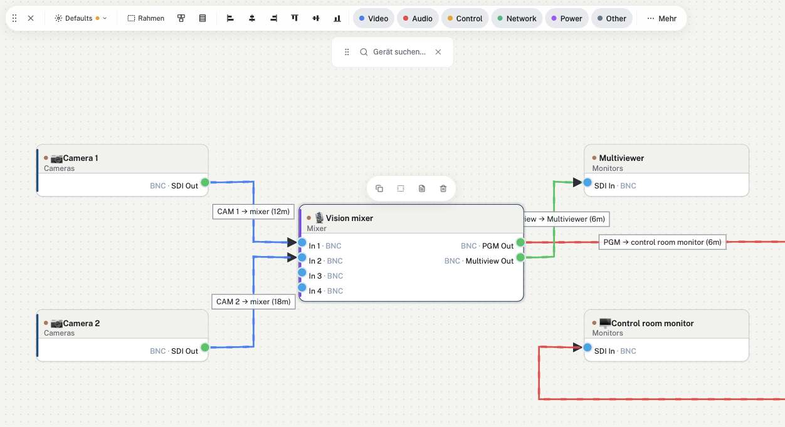

3. Ziehen Sie mit gedrückter Umschalt-Taste ein Rechteck über mehrere Geräte.

   

4. *Bearbeiten → Alles auswählen* markiert alle fünf Geräte.

Sobald Geräte markiert sind, erscheinen in der Leiste die Knöpfe für Auswahl-Aktionen und über der Auswahl die [Auswahlleiste](#auswahlleiste-am-gerät).

### Geräte ausrichten

Die Ausrichte-Knöpfe stehen in der Leiste, sobald mindestens ein Gerät markiert ist. Alle Ergebnisse rasten auf das Raster ein, wenn *Am Raster ausrichten* eingeschaltet ist.

| Knopf (Tooltip) | Bei einem Gerät | Bei mehreren Geräten |
|---|---|---|
| *Linksbündig* / *An linkem Viewport-Rand ausrichten* | Am linken Rand des sichtbaren Ausschnitts | Linke Kanten bündig |
| *Horizontal zentrieren* | In der Mitte des sichtbaren Ausschnitts | Auf eine gemeinsame senkrechte Mittelachse |
| *Rechtsbündig* | Am rechten Rand des Ausschnitts | Rechte Kanten bündig |
| *Oben ausrichten* | Am oberen Rand des Ausschnitts | Obere Kanten bündig |
| *Vertikal zentrieren* | In der Mitte des Ausschnitts | Auf eine gemeinsame waagerechte Mittelachse |
| *Unten ausrichten* | Am unteren Rand des Ausschnitts | Untere Kanten bündig |
| *Horizontal gleichmäßig verteilen* | – | Ab drei Geräten: gleiche Abstände |
| *Vertikal gleichmäßig verteilen* | – | Ab drei Geräten: gleiche Abstände |

1. Mit einem markierten Gerät richtet *An linkem Viewport-Rand ausrichten* es am Rand des sichtbaren Ausschnitts aus.

   

2. Markieren Sie Camera 2, Vision mixer und Multiviewer und klicken Sie *Linksbündig*.

   

3. *Horizontal gleichmäßig verteilen* gleicht die Abstände aus.

   

Ausrichten lässt sich mit *Bearbeiten → Rückgängig* zurücknehmen.

### Gerätegruppe speichern

Der Knopf *N markierte Geräte als Gruppe speichern* legt die Auswahl samt Kabeln als Vorlage ab. Die Gruppe steht danach in der Bibliothek unter *Gruppen* und lässt sich auf den Plan ziehen.

1. Markieren Sie mehrere Geräte und klicken Sie auf den Knopf mit den drei Rechtecken. In der Leiste erscheint das Feld *Gruppenname…*.

   

2. Geben Sie einen Namen ein und klicken Sie auf den grünen Haken (*Gruppe speichern*). In der Bibliothek erscheint die Gruppe unter *Gruppen*.

   

3. Existiert der Name schon, fragt die App *Es existiert bereits eine Vorlage namens „…". Überschreiben?* Mit *Überschreiben* ersetzen Sie die Vorlage.

### Auswahl im Rack-Builder anordnen

Der Knopf *N markierte Geräte im 2D-Rack-Builder anordnen* öffnet den Rack-Builder mit der Auswahl (dasselbe steht im Kontextmenü eines Geräts als *Im Rack-Builder anordnen*). Enthält die Auswahl bereits ein Rack, fehlt der Knopf; ist genau ein Rack markiert, öffnet stattdessen der Knopf *Dieses Rack im 2D-Rack-Builder bearbeiten* den Builder für dieses Rack. Der Builder selbst ist im Kapitel [Rack-Builder](#rack-builder) beschrieben.


### Mehrere Kabel zwischen zwei Geräten

Sind genau zwei Geräte markiert, erscheint in der Leiste der Knopf *Kabel verbinden* (Tooltip: *Mehrere Kabel zwischen den zwei markierten Geräten auf einmal anlegen*). Ohne Auswahl öffnet *Werkzeuge → Mehrere Kabel verbinden…* denselben Dialog mit zwei Auswahllisten für Quelle und Ziel.

1. Markieren Sie zwei Geräte, zum Beispiel Camera 2 und Vision mixer.

2. Klicken Sie auf *Kabel verbinden*. Der Dialog *Mehrere Kabel verbinden* erklärt: Er erstellt N Kabel auf einmal, Quell-Port i zu Ziel-Port i; belegte Ziel-Ports werden übersprungen.

   

| Feld | Bedeutung |
|---|---|
| *Quelle → Gerät*, *Seite* | Gerät und Seite (*Outputs* oder *Inputs*), von der die Kabel ausgehen. |
| *Start-Output (1..n)* | Nummer des ersten Quell-Anschlusses. |
| *Ziel → Gerät*, *Seite* | Gerät und Seite (*Inputs* oder *Outputs*), an der sie enden. |
| *Start-Input (1..n)* | Nummer des ersten Ziel-Anschlusses. |
| *Anzahl Kabel* | Wie viele Kabel entstehen. |
| *Kabel-Typ* | Der Kabeltyp aller neuen Kabel; die Farbe kommt vom Typ. |
| *Länge pro Kabel (m)* | Länge aller neuen Kabel. |
| *Vorschau (x/y Kabel)* | Listet die Paare. Übersteigt die Anzahl die freien Anschlüsse, steht dort *Anzahl überschreitet verfügbare Ports — überzählige werden ausgelassen.* |

3. Stellen Sie *Start-Input* und *Anzahl Kabel* ein. Die Vorschau zeigt, welche Paare entstehen.

   

4. Klicken Sie auf *N Kabel erstellen*. Eine Meldung nennt, wie viele Kabel entstanden und wie viele übersprungen wurden (*Ziel-Port belegt oder ungültig*).

   

### Kabel per Sprache

Der Knopf *Sprache* (Tooltip: *Kabel aus einem gesprochenen oder getippten Satz anlegen*) öffnet den Dialog *Kabel per Sprache*. Ein Satz der Form „<Quelle> nach <Ziel>" wird gegen die Namen der Geräte, ihrer Räume und Anschlüsse im Plan gelesen. Es gibt kein Sprachmodell und keine Netzverbindung. Mehrere Kabel trennen Sie mit einem Punkt.

1. Klicken Sie auf *Sprache*. Das Eingabefeld ist aktiv; mit dem Mikrofon-Knopf diktieren Sie, wenn die Spracherkennung verfügbar ist, sonst tippen Sie oder nutzen die Systemdiktierfunktion (macOS: zweimal Fn, Windows: Win+H).

2. Geben Sie einen Satz ein, zum Beispiel „SDI 1 von Camera 1 nach Vision mixer In 3".

3. Klicken Sie auf *Vorschau* oder drücken Sie die Eingabetaste. Die Vorschau zeigt je Satz Quellgerät und -anschluss, Zielgerät und -anschluss. Jede Auswahl lässt sich ändern. Der Knopf unten nennt die Zahl der bereiten Kabel (*N Kabel verbinden*).

   

4. Mehrere Sätze erscheinen untereinander. Ein Satz ohne Treffer zeigt *Kein Treffer – Gerät wählen*; solange dort nichts gewählt ist, zählt er nicht mit. Passen mehrere Geräte, fragt die Vorschau *Welches? (n Treffer)*. Steht ein genanntes Gerät nur in der Bibliothek, bietet die Vorschau *Aus Bibliothek hinzufügen: Name* an; es wird beim Verbinden im Plan angelegt. Ist ein Zielanschluss belegt, fragt die Vorschau *Dieser Eingang hat schon Kabel …. Ersetzen?*. Passen die Signalfamilien nicht zusammen, erscheint der Hinweis, dass wahrscheinlich ein Wandler nötig ist, und es lässt sich ein Wandler einsetzen.

   

5. *N Kabel verbinden* legt die Kabel in einem Schritt an. Ein Rückgängig nimmt alle wieder zurück.

   

### Tastenkürzel auf dem Canvas

| Taste | Wirkung |
|---|---|
| Klick, Umschalt/Strg/Cmd + Klick | Auswählen, zur Auswahl hinzufügen |
| Pfeiltasten | Markierte Geräte um eine Rasterzelle verschieben |
| Umschalt + Pfeiltasten | Um vier Rasterzellen verschieben |
| Strg/Cmd + C, Strg/Cmd + V | Markierte Geräte kopieren und einfügen |
| Strg/Cmd + D | Auswahl duplizieren |
| Strg/Cmd + Plus (oder =) | Ein neues Gerät an der Mausposition anlegen; ein Dialog fragt den Namen. Das Gerät erhält die Kategorie *Other* und keine Anschlüsse. |
| Entf oder Rücktaste | Auswahl löschen (Geräte und Kabel zusammen in einem Schritt) |
| Esc | Ein begonnenes Kabel abbrechen |
| Strg/Cmd + F | Gerätesuche |

Die Tasten wirken nicht, solange der Cursor in einem Textfeld steht.

1. Markieren Sie Camera 2 und drücken Sie die Pfeiltaste nach rechts.

2. Strg/Cmd + D dupliziert das markierte Gerät.

3. Strg/Cmd + Plus fragt nach dem Namen des neuen Geräts.

   

### Kabel ziehen

Kabel entstehen, indem Sie von einem Anschluss zu einem anderen ziehen.

1. Drücken Sie auf den Anschlusspunkt eines Ausgangs (zum Beispiel SDI Out von Camera 2) und ziehen Sie ihn auf einen freien Eingang (zum Beispiel In 3 am Vision mixer).

   

2. Beim Loslassen öffnet sich der Dialog *Neues Kabel*. Oben stehen *Von:* und *Nach:*. Die Liste *Kabel* zeigt alle Kabeltypen; ✓ kennzeichnet Typen, die zu beiden Steckern passen, ✕ solche, die nicht passen. *★ Custom-Kabel…* legt einen eigenen Typ an. Weitere Felder sind *Signal-Standard*, *Name*, *Länge (m)*, *Farbe* und *Notizen*; ein grüner Hinweis bestätigt, dass der Typ zu den Steckern passt (zum Beispiel *SDI 3G (1080p50/60) passt zu BNC ↔ BNC.*).

   

3. Wählen Sie einen Typ und klicken Sie auf *Erstellen*. Das Kabel erscheint mit Beschriftung und Länge.

   

Besonderheiten beim Ziehen:

- Ein **belegter Eingang** wird nicht stillschweigend überschrieben. Nach *Erstellen* meldet die App *Port bereits belegt* und nennt das vorhandene Kabel. *Ersetzen* löscht das bestehende Kabel und legt die neue Verbindung an, *Abbrechen* verwirft die neue Verbindung, alles bleibt wie es ist.

  

- Wer **auf freier Fläche** loslässt, bekommt ein offenes Ende: Die App legt dort ein Gerät „Open …" mit einem Anschluss *Open End* desselben Steckertyps an und öffnet den Dialog *Neues Kabel* dafür.

  

- Wer auf den **Körper eines anderen Geräts** loslässt, bekommt dort einen passenden Anschluss neu angelegt und verbunden. So lässt sich auch ein Gerät verkabeln, das erst einen Namen hat.

  

- **Zwei Klicks statt Ziehen:** Ein Klick auf einen Anschluss beginnt das Kabel; Klicks auf freie Fläche setzen Knickpunkte, ein Klick auf einen Anschluss beendet es. Das Banner nennt *Kabel zeichnen: Tippen auf die Fläche setzt einen Knick, Tippen auf einen Port beendet.* *Knick zurück* nimmt den letzten Knick zurück, *Abbrechen* verwirft das Kabel; Esc bricht ebenfalls ab. Ein Eingang lässt sich nur mit einem Ausgang verbinden, nicht mit einem anderen Eingang. Während das Kabel aussteht, zeigt die rechte Seite *Schnelle Vorschläge (Steckertyp)*: bis zu acht Bibliotheksgeräte mit passendem Anschluss, die im Projekt am häufigsten verbunden sind zuerst. Ein Klick auf einen Vorschlag setzt das Gerät an die Mausposition und beendet das Kabel am ersten passenden Anschluss.

  

Der Standard für *Kabel-Routing* und *Pfeil am Kabel-Ende* aus [Defaults](#defaults) gilt für jedes neue Kabel.

### Kabel bearbeiten

Ein Klick auf ein Kabel markiert es; der Inspector zeigt seine Eigenschaften, ein Doppelklick öffnet den Bearbeiten-Dialog. Am markierten Kabel erscheinen Griffe.

1. Klicken Sie auf ein Kabel.

   

2. Ziehen Sie ein Segment, um den Verlauf zu verschieben.

3. Ziehen Sie eine Ecke, um den Knick zu verlegen.

   

4. Rechtsklick auf das Kabel öffnet das Kabel-Menü.

   

| Eintrag | Wirkung |
|---|---|
| *Bezeichnung ändern…* | Fragt die Beschriftung des Kabels ab. |
| *Anmerkung hinzufügen…* | Heftet eine Anmerkung an das Kabel. |
| *In Plan übernehmen (Handy-Vorschlag akzeptieren)* / *Mobile-Haken entfernen* | Nur bei Kabeln, die vom Handy vorgeschlagen oder abgehakt wurden. |
| *Signal messen* | Öffnet die Scopes für den Strom, den das Gerät am Kabelanfang sendet. Ausgegraut, wenn das Quellgerät keinen Strom hat, den die App öffnen kann (RTSP, RTMP, SRT, HLS, MJPEG; Eigenschaften → Streams). |
| *Wegpunkt hier hinzufügen* | Fügt am Klickpunkt einen Wegpunkt ein. |
| *Nächsten Wegpunkt entfernen* | Entfernt den Wegpunkt, der dem Klick am nächsten liegt. |
| *Alle Wegpunkte löschen (n)* | Entfernt alle Wegpunkte des Kabels. |
| *Automatisch neu routen* | Berechnet den Verlauf neu. |
| *Routing:* *Orthogonal* / *Direkt* / *Geschwungen* | Stellt die Form dieses Kabels ein. |
| *Kabelbrücken für dieses Kabel* | Überschreibt die globale Einstellung; *Override entfernen (global folgen)* nimmt das zurück. |
| *Pfeil am Ende*, *Pfeil am Anfang* | Blendet den Pfeil ein oder aus. |
| *Bidirektional* | Schaltet Pfeile an beiden Enden ein oder aus. |
| *Off-Page-Verbindung erstellen…* | Siehe [Seitenverbinder](#seitenverbinder). |
| *Kabel löschen* | Fragt *Kabel „…" löschen?* und entfernt es nach Bestätigung. |

5. *Wegpunkt hier hinzufügen* setzt einen Wegpunkt auf das Kabel.

6. Unter *Routing:* wählen Sie die Form des Kabels.

7. *Pfeil am Ende* blendet den Pfeil aus.

8. *Bezeichnung ändern…* öffnet ein Eingabefeld für die Beschriftung.

9. Ein Doppelklick auf ein Kabel öffnet den Dialog zum Bearbeiten des Kabels; die Felder sind im Kapitel [Inspector](#5-inspector) beschrieben.

   

### Seitenverbinder

Eine Off-Page-Verbindung ersetzt die durchgehende Linie eines Kabels an jedem Ende durch ein kleines Verbindersymbol. Das hält Pläne lesbar, in denen zwei Geräte weit auseinanderstehen. Alle Off-Page-Kabel mit demselben Netznamen bilden ein Netz.

1. Rechtsklick auf das Kabel, *Off-Page-Verbindung erstellen…*. Die App fragt *Netzname / Signalname für die Off-Page-Verbindung:*; vorbelegt ist der Kabelname.

   

2. Mit *OK* wird das Kabel zur Off-Page-Verbindung. Jedes Verbindersymbol nennt das Gegenstück (*Gerät · Port*), ein Pfeil zeigt die Signalrichtung. Ein Klick auf den Pfeil springt zum nächstgelegenen Gegenstück.
3. Der Netzname erscheint beim Zeigen auf das Symbol; der Eintrag *Off-Page-Namen anzeigen* im Menü *Ansicht* blendet ihn dauerhaft ein.
4. Rechtsklick auf ein Symbol öffnet die Netz-Info: Zahl der Endpunkte, eine Sprungliste und *Off-Page auflösen*, das die Linie wiederherstellt.

### Rahmen

Ein Rahmen ist ein farbiges Rechteck, das Geräte zu einem Ort oder Raum zusammenfasst. Der Knopf *Rahmen* der Leiste legt einen neuen Rahmen („Neue Location") in der Mitte des sichtbaren Ausschnitts an. Sind Geräte markiert, trägt der Knopf den Tooltip *Rahmen um die N markierten Geräte* und zieht den Rahmen um sie.

1. Klicken Sie ohne Auswahl auf *Rahmen*.

   

2. Ein Doppelklick auf den Rahmen fragt *Location umbenennen:*.

3. Ein Klick auf den Rahmen zeigt im Inspector die Rahmen-Eigenschaften (Name, Breite, Tiefe, Fläche, Stockwerk, Farbe, Steigschacht, Raumnummer, Adresse, Notizen); sie sind im Kapitel [Inspector](#5-inspector) beschrieben.

4. An den Griffen des markierten Rahmens ändern Sie die Größe.

5. Ziehen Sie den Rahmen an seinem Titel. Die Geräte, deren Mittelpunkt im Rahmen liegt, wandern mit.

   

6. Das Schloss am Rahmentitel sperrt Verschieben und Größenänderung; die Einstellungen bleiben erreichbar.

7. Rechtsklick auf den Rahmen öffnet das Menü mit *Position sperren* (beziehungsweise *Position entsperren*) und *Rahmen löschen*.

   

8. *Rahmen löschen* fragt *Rahmen „…" löschen?* — nur der Rahmen verschwindet, die Geräte bleiben.

9. Markieren Sie mehrere Geräte und klicken Sie *Rahmen*, um einen Rahmen um sie zu ziehen.

   

### Räume, Etagen und 3D-Gebäudeansicht

Jeder Rahmen ist ein Raum. Rahmen lassen sich Etagen zuordnen; sie bestimmen die Sichtbarkeit im Plan und die Stapelung in der 3D-Ansicht. Die Knöpfe *Räume* und *3D* stehen unter *Mehr*, sobald der Plan mindestens einen Rahmen enthält.

1. Legen Sie Rahmen an (hier Studio, Regie, Technik).

2. Markieren Sie einen Rahmen. Im Inspector öffnet die Auswahl *Stockwerk* mit dem Eintrag *Etage hinzufügen…* eine Abfrage *Name der neuen Etage (z. B. „3. OG")*.

   

3. Die Etage steht danach im Feld *Stockwerk*.

4. Im Inspector zeigt der Abschnitt *Etagen (n)* die Etagen von unten nach oben mit ihrer Fußbodenhöhe in Metern; mit den Pfeilen ändern Sie die Reihenfolge, der Papierkorb entfernt eine Etage, *Etage hinzufügen…* ergänzt eine weitere.

   

5. *Steigschacht / senkrechte Trasse* kennzeichnet einen Rahmen, der in der 3D-Ansicht durch alle Etagen geht; Kabel zwischen Etagen verlaufen dann durch ihn statt als Luftlinie.

6. *Mehr → Räume* öffnet eine Liste, gegliedert nach Etagen (oberste zuerst). Jede Etage und jeder Raum hat ein Häkchen; Räume ohne Etage stehen unter *Ohne Etage*.

   

7. Nehmen Sie das Häkchen bei einem Raum weg: Seine Geräte und Kabel verschwinden vom Plan. Die Beschriftung des Knopfes lautet dann *Räume (n ausgeblendet)*.

8. Das Häkchen einer Etage blendet alle Räume dieser Etage aus.

9. *Alle zeigen* blendet alles wieder ein. Mehrere Räume lassen sich gleichzeitig ausblenden.

10. *Mehr → 3D* öffnet *Gebäude 3D*: die Räume nach Etagen gestapelt, dazwischen die Verbindungen.

    

11. Unter *Anzeigen* wechseln Sie zwischen *Raumverbindungen* und *Einzelne Kabel*.

    

12. *Beschriftung* blendet die Namen ein oder aus. *Geschosshöhe (m)* gilt nur für Etagen ohne eingetragene Höhe; die Ansicht weist darauf hin, dass dies eine Annahme ist.

Geräte lassen sich in der 3D-Ansicht ziehen. Bodentanks erscheinen als flache Platte im Boden, andere Geräte als Würfel. Ziehen neben ein Gerät dreht die Ansicht, das Mausrad zoomt.

### Ebenen

Die Ebenen-Chips blenden die Kabel einer Ebene ein und aus. Nur die Kabel werden gefiltert, die Geräte bleiben. Ein farbiger Punkt kennzeichnet die Signalart; der Tooltip nennt die Zahl der Kabel (zum Beispiel *Video — 4 Kabel · sichtbar (klick: ausblenden)*).

1. Die Leiste zeigt *Video*, *Audio*, *Control*, *Network*, *Power* und *Other*.

   

2. Klicken Sie auf *Video*: Die Videokabel verschwinden.

   

3. *Mehr → Ebenen ⋯* öffnet das Verwaltungsmenü: *Custom-Layer anlegen…* und *Alle Ebenen wieder einblenden*.

   

4. *Custom-Layer anlegen…* fragt den Namen (zum Beispiel „intercom"). Die neue Ebene erscheint als Chip mit Rautensymbol.

   

5. Rechtsklick (auf dem Telefon langer Druck) auf den Chip einer eigenen Ebene fragt *Custom-Layer „…" entfernen?*.

### Signalweg

Der Signalweg hebt die ganze Kette hervor, in der ein Kabel liegt, und dunkelt den Rest ab.

1. Markieren Sie ein Kabel.

2. Klicken Sie im Inspector auf *Signalweg zeigen*.

   

3. In der Leiste steht der Chip *Signalweg: n Kabel, m Geräte*. Ein Klick darauf oder Esc beendet die Ansicht.


### Betriebsarten: Schema, Schaltbild, Prüfbild

#### Schema und Live

Der Knopf *Schema* unter *Mehr* zeigt, woher der Plan sein Bild nimmt: *Schema* heißt, es ist der geplante Weg ohne Verbindung zu einer Anlage; *Live* heißt, der beobachtete Zustand eines Mischers oder einer Kreuzschiene wird gezeigt (mit Alter in Sekunden). Reißt die Verbindung ab, steht *· Verbindung verloren* und die Ansicht fällt auf den geplanten Weg zurück. Ein Klick auf den Chip schaltet nicht die Betriebsart um, sondern die Bewegung der Darstellung ein oder aus; hat das Betriebssystem Bewegung abgeschaltet, bleibt die Ansicht ruhig.


#### Schaltbild

*Schaltbild* rechnet Stromkreise: welche Leuchten brennen, welche Schalterstellungen gelten, welche Leitungen unter Spannung stehen. Das Ergebnis ist gerechnet und nicht gemessen; die Schalterstellungen gehören nicht zum Plan. Berücksichtigt werden nur Geräte, die in ihren Eigenschaften eine Schaltbild-Bauart tragen; sie wird nicht aus der Kategorie geraten. Steht kein Gerät mit Bauart im Plan, zeigt der Chip *· nichts angegeben*.

1. Schalten Sie *Schaltbild* ein. Der Chip nennt die brennenden von allen Leuchten (zum Beispiel „1/1").


2. Mit *Schalter zurück* gehen alle Schalter in ihre Grundstellung; der Plan ändert sich dadurch nicht. *Vorschläge* erklärt, warum die Schaltung nicht tut, was sie soll, und welche Ader das ändern würde; jeder Vorschlag bringt seine Wahrheitstafel mit, nichts wird ohne Klick eingetragen.


#### Prüfbild

*Prüfbild* ist eine Erwartung, kein Videobild: Nach der Wahl einer Quelle zeigt der Plan an jedem Ankunftsort, welches Bild dort stehen müsste. Die App sieht nicht, was wirklich ankommt.

1. Öffnen Sie *Mehr* und wählen Sie unter *Prüfbild* eine Quelle (die Liste enthält jedes Gerät mit einem Ausgang, zuerst *keine*).

2. Der Plan zeigt das Prüfbild an der Quelle und an jedem Ankunftsort, mit der Aufschrift *Erwartung laut Plan*. Die Leiste zeigt den Chip *Prüfbild* mit Quelle, Zahl der Ankunftsorte und den Zählern *· n offen*, *· n vertauscht*, *· n ungeprüft*.

   

3. An jedem Ankunftsort tragen Sie ein, was Sie vor Ort gesehen haben: *stimmt*, *anderes Bild…* (dann den Namen, der darauf steht, und *merken*), *kein Bild* oder *kein Monitor*. Der Befund steht danach farbig am Ankunftsort (stimmt, noch offen, vertauscht oder eine andere Abweichung) und fließt in die Zähler der Leiste ein.

   

4. *Sichern…* bietet drei Dateien an: *Prüfbild (SVG)* für Mediaplayer, Standbild-Speicher oder Laptop (die App speist nichts ein), *Prüfblatt (CSV)* als Liste zum Abgehen, auch mit Wegen, die der Plan nicht zu Ende kennt, und *Abnahmeblatt (CSV)* mit dem, was gesehen wurde, samt Zeitpunkt.

5. *Weg schalten…* erscheint, wenn auf einem Weg der Quelle eine Kreuzschiene liegt. Der Dialog setzt die Kreuzpunkte des Plans an der laufenden Anlage.


   Unter *Wohin soll das Bild?* wählen Sie das Ziel; der Dialog zeigt den Weg (zum Beispiel Camera 1 → Videohub 12x12 → Control room monitor) und die gesendeten Befehle. Ist für das Gerät kein Steuer-Protokoll erklärt (Eigenschaften → Steuerung), wird nichts gesendet. *Wer schaltet* nimmt einen Namen auf. *jetzt schalten* ist nur möglich, wenn der Plan Befehle enthält, nichts im Weg steht (zum Beispiel ein fehlendes Steuer-Protokoll) und der Haken *Ich habe gelesen, welche Ausgänge umgeschaltet werden, und schalte an der laufenden Anlage.* gesetzt ist.

Die Wahl *keine* beendet das Prüfbild.

### Sperren

*Mehr → Sperren* schützt vor versehentlichem Verschieben. Das Menü hat drei Schalter:

| Schalter | Wirkung |
|---|---|
| *Rahmen* | Keine Frame-Verschiebung |
| *Geräte* | Keine Geräte-Verschiebung |
| *Kabel* | Keine Waypoint-Bearbeitung (die Griffe am Kabel entfallen) |

Der Knopf zeigt die Zahl der aktiven Schalter (zum Beispiel *Sperren 1/3*).

1. Öffnen Sie *Sperren*.

   

2. Schalten Sie *Geräte* ein. Die Geräte lassen sich nicht mehr ziehen.

   

3. Mit *Kabel* gesperrt zeigt ein markiertes Kabel keine Griffe.

   

Einzelne Geräte und Rahmen lassen sich außerdem im Kontextmenü mit *Position sperren* festsetzen.

### Plan abschließen

*Mehr → Abschließen* sperrt den ganzen Plan: keine Verschiebungen, keine neuen Verbindungen, keine Löschungen. Der Eintrag zeigt danach *Abgeschlossen*.

1. Klicken Sie auf *Abschließen*. Die App fragt *Planung abschließen?* und erklärt, dass der Canvas gesperrt wird und die Sperre jederzeit aufgehoben werden kann.

   

2. Nach *Abschließen* erscheint über dem Plan das Banner *Plan ist abgeschlossen — Änderungen sind gesperrt.* mit dem Knopf *Bearbeitung freigeben*.

   

3. *Bearbeitung freigeben* (oder erneut der Eintrag unter *Mehr*) fragt *Planung wieder zur Bearbeitung freigeben?*; *Freigeben* hebt die Sperre auf.

   

Eine Viewer-Datei (`.cpviewer`) ist dauerhaft schreibgeschützt; der Eintrag heißt dann *Viewer* und ist nicht bedienbar.

### Anmerkungen

Anmerkungen sind Notizen am Plan, frei oder an ein Gerät oder Kabel geheftet. Zwei Einträge unter *Mehr* gehören dazu: *Badges* blendet die Marken der Anmerkungen auf dem Plan ein oder aus (die Daten bleiben), *Anmerkungen* öffnet das Panel.

1. Öffnen Sie *Anmerkungen*. Das Panel zeigt oben die Filter *alle*, *offen*, *gebaut*, *erledigt* und den Knopf *+ Neue Anmerkung*.

   

2. Klicken Sie auf *+ Neue Anmerkung* und schreiben Sie den Text.

3. *Hinzufügen* fragt beim ersten Mal nach Ihrem Namen; er wird allen Anmerkungen angeheftet, die Sie erstellen.

4. Die Anmerkung steht danach in der Liste.

   

5. Jede Anmerkung hat einen Status (*offen*, *gebaut*, *erledigt*); die Filter zeigen nur die Anmerkungen eines Status.

6. Mit dem Knopf zum Platzieren in der Mitte erscheint die Marke in der Mitte des Plans; ziehen Sie den Griff einer Anmerkung auf ein Gerät, um sie dort anzuheften.

   

7. Ein Klick auf die Marke auf dem Plan zeigt die Anmerkung.

8. *Badges* blendet die Marken aus.

9. Löschen fragt *Anmerkung löschen?*.

Rechtsklick auf ein Gerät oder ein Kabel bietet außerdem *Anmerkung hinzufügen…*: Nach der Frage nach Text (und beim ersten Mal nach Ihrem Namen) wird die Anmerkung an das Gerät oder Kabel geheftet. Im Viewer-Modus lädt der Eintrag *Anmerkungen* Prüfer ein, Notizen zu hinterlassen (Tooltip: *Anmerkungen — als Reviewer Notizen hinterlassen*).

### Hallenplan

*Mehr → Hallenplan* (auch im Menü *Ansicht*) legt ein Bild oder ein PDF unter den Plan. Es dient als Maßstab für Kabellängen und als räumliche Vorlage.

1. Öffnen Sie *Hallenplan*. Das Panel bietet *Hallenplan als Bild oder PDF laden…*, *Venue aus MultiCam / Light Planner importieren…* und den Hinweis, dass sich ein Bild oder PDF auch hierher oder auf den Canvas ziehen lässt.

   

2. Laden Sie ein Bild (PNG, JPG, WebP, GIF, BMP oder AVIF bis 40 MB). Es liegt unter den Geräten. Die App meldet *Hallenplan geladen. Als Nächstes den Maßstab setzen — bis dahin rechnen die Längen mit „Meter pro 100 px".*

   

3. *Deckkraft* regelt, wie stark das Bild durchscheint.

4. *Position sperren (Klicks gehen an die Geräte durch)* macht das Bild unempfindlich für Klicks.

Den **Maßstab** setzen Sie auf zwei Wegen.

5. *Zwei Punkte* (für Pläne von oben, CAD-Export, Scan): Tragen Sie die bekannte Strecke in Metern ein und klicken Sie *Zwei Punkte*. Die App sagt *Klicke beide Enden einer Strecke von N m an.*

6. Nach dem zweiten Klick steht im Panel *Maßstab aus N m Referenz: … cm je Canvas-Pixel.*

   

7. *Vier Ecken* (für Fotos, Schilder und isometrische Zeichnungen): Tragen Sie Breite × Tiefe einer rechteckigen Bodenfläche in Metern ein und klicken Sie nacheinander die vier Ecken an: links oben, rechts oben, rechts unten, links unten. Bilden die Punkte kein Rechteck, meldet die App das.

   

8. Danach steht *Perspektivischer Maßstab aus einer B × T m großen Fläche.*

9. *Kabellängen neu berechnen* ermittelt die Längen entlang der gezeichneten Wege (*n Kabellängen entlang ihres gezeichneten Wegs neu berechnet.*).

10. *Bild ersetzen…* fragt *Hallenplan ersetzen?* — die Maßstab-Kalibrierung geht verloren und muss neu gesetzt werden.

11. Eine Datei, die kein Bild ist, weist die App ab: *Diese Datei ist kein Hallenplan-Bild. Verwende PNG, JPG, WebP, GIF, BMP oder AVIF.*

**PDF.** Ein PDF wird als Bild der Seite geladen. Hat es mehrere Seiten, erscheint im Panel *PDF-Seite* mit der Seitennummer und *von n*; eine andere Seite ersetzt den Plan an derselben Stelle mit derselben Deckkraft.

12. Laden Sie ein PDF.

13. Wählen Sie eine andere Seite.

    

14. *Zuschneiden…* öffnet im Panel eine Vorschau mit dem Hinweis *Ein Rechteck über den Teil des Plans ziehen, der bleiben soll.* Ziehen Sie das Rechteck auf und klicken Sie *Plan zuschneiden*; *Abbrechen* verwirft es.

    

15. Der Plan zeigt nur noch den gewählten Ausschnitt.

    

**Eine Etage je Plan.** Sobald der Plan Etagen hat, steht im Panel oben die Auswahl *Etage* mit *Alle Etagen* und den Etagennamen; jede Etage hat ihren eigenen Hallenplan. Für Kabellängen gilt der Maßstab des Plans für alle Etagen (*Kabellängen nutzen den Maßstab des Plans für alle Etagen.*).

**Venue-Austausch.** *Venue aus MultiCam / Light Planner importieren…* liest eine Venue-Datei der Schwester-Apps samt Hallenplan und Maßstab. Fehlerfälle meldet das Panel: *Das ist keine Venue-Austauschdatei (MultiCam / Light Planner).*, *Die Venue-Datei enthält kein Hallenplan-Bild.*, *Die Venue-Datei enthält einen Hallenplan ohne reale Maße.* *Venue für MultiCam / Light Planner exportieren* schreibt den Plan zurück; der Austausch kennt einen Maßstab je Plan, deshalb ist der Knopf nach einer Vier-Ecken-Kalibrierung gesperrt.

16. Import einer Venue-Datei.

17. *Hallenplan entfernen* nimmt das Bild wieder weg.

### Planzeichen

*Mehr → Symbole* (auch im Menü *Ansicht*) öffnet das Panel *Symbole* mit Planzeichen, die nicht zu den Geräten zählen: Steckdosen, Melder, Lautsprecher, Netzwerkdosen und Ähnliches.

1. Öffnen Sie *Symbole*. Oben stehen die Kategorien *Elektro*, *EMA*, *BMA*, *SAA / ELA*, *IT / Netzwerk*, *Automation*, *AV* und *Eigene*; darunter das Suchfeld *Symbole suchen…* und die Symbole der Kategorie.

   

2. Jede Kategorie enthält feste Symbole, zum Beispiel unter *Elektro* Steckdose, Schutzkontakt-Steckdose, Schalter, Taster, Leuchte, Verteiler, Sicherung, FI-Schutzschalter, Zähler, Erdung, Motor, Transformator, Abzweigdose und CEE-Steckdose; unter *AV* Kamera, Monitor, Beamer, Leinwand, Stagebox, Rack, Bodentank und Kabelbrücke.

   

3. Ein Klick auf ein Symbol (Tooltip *Auf dem Canvas platzieren*) setzt es auf den Plan.

   

4. Ein markiertes Symbol hat die Felder *Beschriftung*, *Größe*, *Drehung* (0°, 90°, 180°, 270°), *Position sperren* und *Symbol löschen*.

   

5. *Symbol importieren (SVG, PNG, JPG, WebP)…* legt eigene Zeichen unter *Eigene* ab. SVG darf höchstens 200 KB haben, Rasterbilder höchstens 512 KB. Ein ungenutztes eigenes Symbol lässt sich mit dem **×** an seiner Kachel wieder aus der Bibliothek entfernen.

6. Mit hinterlegtem KI-Anbieter erzeugt *Symbol erzeugen* aus einer Beschreibung ein Symbol und legt es unter *Eigene* ab. Die App weist darauf hin, das Ergebnis zu prüfen: Es ist die Zeichnung eines Modells, kein Normzeichen.

7. *Symbolliste als CSV (n)* exportiert die platzierten Symbole mit Kategorie, Anzahl und Beschriftungen.

   

### Gerätesuche

*Strg/Cmd + F* oder *Ansicht → Gerät suchen* öffnet über dem Plan die Suchleiste *Gerät suchen…*. Sie lässt sich verschieben, zu einer Pille einklappen und schließen (*Suche schließen*); Strg/Cmd + F und das Menü *Ansicht* holen sie zurück.

1. Die Suche steht als Pille über dem Plan.

   

2. Strg/Cmd + F klappt sie auf.

3. Tippen Sie einen Begriff. Die Liste zeigt Treffer mit dem Feld, in dem er gefunden wurde. Durchsucht werden Name, Kurzname, IP, MAC, VLAN, Asset-Tag, Interne Nr., Seriennummer, Etiketten-Code, Switch-Port, Kategorie, Untertitel und Notiz.

   

4. Ein Klick auf einen Treffer zentriert den Plan auf das Gerät und schließt die Suche. Ohne Treffer steht *Keine Treffer*.

   

### Zoom und Navigation

Unten links stehen die Regler *Vergrößern*, *Verkleinern*, *Einpassen* und der Knopf zum Sperren der Interaktion. Unten rechts zeigt die Übersichtskarte den ganzen Plan; ein Klick darauf oder Ziehen springt zur Stelle. Das Mausrad zoomt zwischen 10 % und 400 %; mit gedrückter Maustaste auf freier Fläche verschieben Sie den Plan. Das Menü *Ansicht* bietet *Einpassen*, *Zoom 100 %*, *Vergrößern*, *Verkleinern* und *Vollbild*.


1. *Vergrößern* zoomt hinein.

2. *Einpassen* zeigt alle Geräte.

   

3. Der Schloss-Knopf sperrt die Interaktion: Der Plan lässt sich dann weder verschieben noch zoomen.

4. *Ansicht → Zoom 100 %* setzt den Maßstab zurück.

### Kontextmenüs

**Gerät** (Rechtsklick auf ein Gerät):

| Eintrag | Wirkung |
|---|---|
| *Rack-Editor öffnen* | Nur bei einem Rack: öffnet den Rack-Builder dafür. |
| *Anmerkung hinzufügen…* | Fragt (beim ersten Mal) Ihren Namen und den Text und heftet die Anmerkung an das Gerät. |
| *Geräte-Datenblatt…* | Öffnet das Datenblatt (eine A4-Seite) für das Gerät beziehungsweise die Auswahl. |
| *Scopes…* / *Scopes vergleichen* | Nur in der Desktop-App und wenn die Geräte Ströme haben, die die App öffnen kann. |
| *Im Rack-Builder anordnen* / *N Geräte im Rack-Builder anordnen* | Öffnet den Rack-Builder mit dem Gerät beziehungsweise der Auswahl. |
| *Position sperren* / *Position entsperren* | Hält das Gerät an seinem Ort. |
| *Gerät löschen* | Fragt *Gerät „…" löschen?* — das Gerät und alle angeschlossenen Kabel werden gelöscht. |


**Freie Fläche:** Rechtsklick bietet *Neues Gerät hier …*. Es öffnet *Eigenes Gerät anlegen* mit Name, Kategorie, Port-Gruppen und den Knöpfen *In Bibliothek speichern*, *Nur im Projekt platzieren* und *Speichern + Platzieren*; der Dialog ist im Kapitel [Eigenes Gerät anlegen](#eigenes-gerät-anlegen) beschrieben.


**Kabel** und **Rahmen**: siehe [Kabel bearbeiten](#kabel-bearbeiten) und [Rahmen](#rahmen).

### Auswahlleiste am Gerät

Über einer Auswahl erscheint eine kleine Leiste mit Schnellaktionen.

| Auswahl | Knöpfe |
|---|---|
| Ein Gerät | *Duplizieren*, *Rahmen um Auswahl*, *Geräte-Datenblatt (A4-PDF / Druck)*, *Löschen* |
| Zwei Geräte | zusätzlich die sechs Ausrichte-Knöpfe |
| Drei und mehr Geräte | zusätzlich *Horizontal verteilen* und *Vertikal verteilen* |

Bei Geräten mit lesbaren Strömen kommt *Scopes vergleichen (ein Parade je Quelle)* hinzu.


### Standbild unter dem Gerät

Für ein Gerät, das einen Stream oder ein Standbild liefert, zeigt der Canvas unter dem Gerät eine Kachel. Sie wird im Inspector unter *Streams* eingeschaltet (*Standbild unter dem Gerät im Canvas zeigen*, mit einer *Standbild-Adresse für die Vorschau*). Die Kachel startet nicht von selbst: *Vorschau starten · Name* holt ein Standbild, danach alle 10 Sekunden, solange die Kachel sichtbar ist. Ist es ein Live-Stream, spielt die Kachel ihn ab, bis *Live beenden* gewählt wird. Die Kachel nennt den Grund, wenn kein Bild kommt, zum Beispiel *Keine Vorschau: die Adresse liegt nicht im lokalen Netz.*, *Keine Vorschau: ffmpeg wurde nicht gefunden …* oder *Keine Vorschau: das Gerät ist nicht erreichbar.* Standbilder holt nur die Desktop-App.


### Adapter und Wandler im Kabel

Beim Anlegen eines Kabels prüft die App, ob die Stecker zusammenpassen. Der Dialog *Neues Kabel* nennt dann den Grund und was dazwischengehört:

- gleiches Geschlecht an beiden Enden: ein Geschlechtswandler,
- Stecker, die nicht ineinandergehen: ein Adapter,
- verschiedene Signalfamilien: ein Konverter, ein Gerät mit Strom und Bandbreitengrenze, das Sie selbst wählen.

Nach dem Anlegen bietet der Inspector des Kabels *Einsetzen*; es setzt den Adapter als eigenes Gerät in die Strecke (*In diesen Lauf einsetzen — ein Undo nimmt es wieder heraus*). Ein Adapter gehört als Gerät in den Plan, sonst steht er weder im Signalweg noch auf der Packliste.


---

## 4. Bibliothek

Die Bibliothek ist die Spalte links neben dem Plan. Sie hält die Vorlagen, aus denen der Plan gebaut wird: Geräte (lokal, aus der gemeinsamen Gerätebibliothek und aus Rentman), Kabeltypen, Gerätegruppen und Racks. Vorlagen werden per Klick oder Ziehen auf den [Canvas](#3-canvas) gesetzt; die Eigenschaften eines Eintrags erscheinen im [Inspector](#5-inspector).


### Die Bibliothek-Spalte

Der Kopf der Spalte trägt links den Pfeil *Library ausblenden* und daneben das Menü *Fenster*. Darunter stehen die vier Reiter *Geräte*, *Kabel*, *Gruppen* und *Racks*; bei Gruppen und Racks zeigt eine Zahl, wie viele Einträge es gibt.

1. Der Pfeil links oben blendet die Spalte aus und gibt dem Plan die Breite.

   

2. Am Rand erscheint ein Knopf *Library einblenden*; er holt die Spalte zurück.

   

3. Das Menü *Fenster* bietet *Abdocken (schwebend)* und *In eigenes Fenster*. Der Knopf lässt sich auch ziehen.

   

4. Abgedockt schwebt die Bibliothek über dem Plan; *Andocken* (zurück zur Seiten-Spalte) setzt sie wieder an ihren Platz.

   

5. Die Breite der Spalte ändern Sie, indem Sie ihre Trennlinie zum Plan ziehen.

   

### Geräte

Der Reiter *Geräte* hat drei Unterreiter für die Quelle der Vorlagen: *Lokal* (eigene und importierte Vorlagen sowie der eingebaute Katalog), *Geteilt* (die gemeinsame Gerätebibliothek, schreibgeschützt) und *Rentman* (nur wenn das Rentman-Modul eingeschaltet ist).

#### Lokal

Der Unterreiter *Lokal* zeigt die Vorlagen nach Kategorien. Jede Kategorie ist ein aufklappbarer Streifen mit der Zahl der Einträge; ein Klick klappt sie auf oder zu.


Jeder Eintrag zeigt den Namen und darunter die Kategorie mit der Zahl der Ein- und Ausgänge. Das **L** vor dem Namen kennzeichnet ein lokales Gerät (nicht aus Rentman). Ein Klick markiert den Eintrag und zeigt seine Vorlage im Inspector; ein Doppelklick oder Ziehen auf den Canvas platziert das Gerät. Beim Zeigen auf einen Eintrag erscheinen vier Knöpfe:

| Knopf | Wirkung |
|---|---|
| Stern (*Als Favorit markieren* / *Favorit entfernen*) | Hebt den Eintrag mit einem Stern hervor. |
| Auge (*Ausblenden* / *Wieder anzeigen*) | Blendet den Eintrag aus der Liste aus; mit *Versteckte zeigen* im Filtermenü erscheint er abgeblendet wieder. |
| Pfeil nach unten (*Exportieren*) | Speichert den Eintrag als Datei (`.cpdevice`) in den Downloads-Ordner. |
| Rotes **×** (*Aus der Bibliothek entfernen*) | Fragt „… aus der Bibliothek entfernen?" und löscht die Vorlage nach *OK*. |


#### Suchen

Das Suchfeld über der Liste filtert in Echtzeit nach Name und Kategorie. Es trägt den Hinweis *Strg+F*: Solange der Unterreiter *Lokal* offen ist, setzt Strg+F den Cursor in dieses Feld. Mit dem **×** im Feld löschen Sie den Suchbegriff.


Findet die Suche nichts, steht *Keine Geräte gefunden* mit *Suche zurücksetzen*.


#### Filtermenü

Das Trichter-Symbol öffnet das Filtermenü.


| Eintrag | Wirkung |
|---|---|
| *Alle Kategorien einklappen* / *Alle Kategorien ausklappen* | Klappt alle Kategorien auf einmal zu oder auf. |
| *Sortierung* → *Manuell (Drag&Drop)* | Die Kategorien stehen in der Reihenfolge, in die Sie sie ziehen. |
| *Sortierung* → *Alphabetisch A → Z* / *Z → A* | Sortiert die Kategorien nach dem Namen. |
| *Versteckte zeigen (n)* | Zeigt die ausgeblendeten Einträge abgeblendet; die Zahl nennt, wie viele es sind. |
| *Leere Kategorien zeigen* | Zeigt auch Kategorien ohne Einträge. |
| *Nur eigenes Material* | Zeigt nur Geräte, die zum eigenen Lagerbestand passen (nach Modell). Der Eintrag ist ausgegraut, solange der Bestand nichts Passendes enthält. |


#### Kategorien

Kategorien ordnen die Vorlagen. Beim Zeigen auf den Kategoriestreifen erscheint ein Stift.

1. Der Stift öffnet *Kategorie umbenennen*. Das Fenster hat zwei Felder, *Deutsch* und *Englisch*; beim Umschalten der Oberflächensprache erscheint der jeweilige Name. Ein leeres Feld ist erlaubt, dann fällt die Anzeige auf die andere Sprache zurück.

   

2. Mit dem Griff links vom Namen ziehen Sie eine Kategorie an eine andere Stelle (bei der Sortierung *Manuell*).

   

3. Einträge lassen sich auf eine andere Kategorie ziehen; eine leere Kategorie sagt dazu *Gerät hierher ziehen zum Verschieben*.

   

4. Neue Kategorien entstehen über das Menü **+** (siehe unten).

   

#### Das Menü +

Der Knopf **+** neben dem Suchfeld (Tooltip: *Neues Gerät oder neue Kategorie anlegen*) öffnet ein Menü mit fünf Einträgen.


| Eintrag | Wirkung |
|---|---|
| *Neues Gerät…* | Öffnet den Dialog [Eigenes Gerät anlegen](#eigenes-gerät-anlegen). |
| *Neue Kategorie…* | Zeigt in der Liste ein Feld *Kategoriename…*; *OK* legt die Kategorie an, **×** bricht ab. |
| *Datei importieren…* | Liest eine `.cpdevice`- oder `.cpgroup`-Datei (siehe unten). |
| *Vorlagen einreichen…* | Öffnet den Dialog [Vorlagen einreichen](#vorlagen-einreichen). |
| *Bibliotheks-Ordner öffnen…* | Öffnet den Ordner der Bibliothek im Dateimanager. |

1. *Neue Kategorie…* zeigt das Namensfeld über der Liste.

   

2. Nach *OK* steht die Kategorie in der Liste und lässt sich mit dem Stift zweisprachig benennen.

   

##### Eigenes Gerät anlegen

*Neues Gerät…* öffnet den Dialog *Eigenes Gerät anlegen*. Er ist ein einziges durchlaufendes Formular ohne Reiter. Ein Rechtsklick auf freie Fläche des Plans (*Neues Gerät hier …*) und die Tastenkombination Strg/Cmd + Plus am Plan führen zum selben Formular beziehungsweise zu einem Namensdialog.


| Feld | Bedeutung |
|---|---|
| *Name* | Name des Geräts. Während Sie tippen, listet das Formular passende Geräte der Bibliothek (*Name*, Kategorie, Zahl der Ein- und Ausgänge) mit *Als Vorlage nutzen*. |
| *Kategorie* | Auswahl aus den vorhandenen Kategorien; *+ Neue Kategorie…* legt eine weitere an. Voreinstellung ist *Sonstiges*. |
| *19" Rack-Gerät* → *Ist Rack-Gerät* | Markiert das Gerät als Rack-Gerät; dann erscheint das Feld *HE* für die Höhe. |
| *Ports aus Foto erkennen* | Erscheint, sobald ein KI-Anbieter hinterlegt ist; sonst steht dort der Hinweis, ihn unter *Einstellungen → Integrationen → AI* einzutragen, mit dem Knopf *Einstellungen öffnen*. |
| *Die Ports aus dem Geräte-Namen raten* | Die Knöpfe *Ausfüllen* (füllt die Port-Gruppen aus der in den Einstellungen gewählten Quelle) und *Datenblatt…* (liest die Port-Gruppen aus einer PDF-, HTML- oder Textdatei). Die Quelle steht daneben: *aus einer Web-Suche — ohne API-Schlüssel* oder *vom KI-Modell — braucht einen API-Schlüssel*. *API-Schlüssel hinterlegen (KI)* öffnet ein Feld für den Schlüssel; er wird nur lokal gespeichert. |
| *Port-Gruppen* | Die Anschlüsse in Gruppen. *+ Input-Gruppe* und *+ Output-Gruppe* fügen eine Zeile hinzu. |

Eine Port-Gruppe hat vier Angaben: die Richtung (*Input* oder *Output*), die Anzahl, den Steckertyp und den Namen (Beschriftungspräfix). Beim Speichern entstehen daraus einzelne Anschlüsse. Eine Gruppe ohne Anzahl erzeugt keine Anschlüsse; die Meldung *Noch keine Anschlüsse — das ist in Ordnung.* sagt, dass sich Anschlüsse auch später ergänzen lassen: Ein Kabel, das auf das Gerät gezogen wird, legt einen an.

1. Tippen Sie einen Namen. Passende Geräte der Bibliothek erscheinen unter dem Feld.

   

2. *Als Vorlage nutzen* übernimmt Kategorie und Port-Gruppen des Eintrags; der Name erhält den Zusatz *(Kopie)*. Das Formular sagt *Felder aus „…" übernommen. Passe an, was abweicht.*

   

3. Mit dem Haken bei *Ist Rack-Gerät* erscheint das Feld *HE*.

   

4. *+ Output-Gruppe* fügt eine weitere Zeile hinzu; das rote **×** entfernt eine Gruppe.

   

Unten stehen vier Knöpfe:

| Knopf | Wirkung |
|---|---|
| *Abbrechen* | Schließt den Dialog ohne zu speichern. |
| *In Bibliothek speichern* | Legt die Vorlage in der lokalen Bibliothek ab (zur Wiederverwendung); das Gerät kommt nicht auf den Plan. |
| *Nur im Projekt platzieren* | Setzt das Gerät in dieses Projekt, ohne eine Vorlage anzulegen. Gedacht für Leihgeräte, Platzhalter und Einzelstücke; nichts wird hochgeladen. |
| *Speichern + Platzieren* | Beides. |

Mit Foto-Erkennung erscheint der Abschnitt *Ports aus Foto erkennen*: *Fotos wählen* oder *Foto aufnehmen* (Fotos der Anschlussseite lassen sich auch hineinziehen oder einfügen; sie werden zur Erkennung an den gewählten Anbieter gesendet), *Erkennen*, *Foto entfernen* und der Haken *Fotos beim Platzieren am Gerät speichern*. Die Vorschläge stehen als Tabelle (*Übernehmen*, *Richtung*, *Anzahl*, *Stecker*, *Beschriftung*, bei Bedarf *Gelesen als: …*); unsichere Zeilen sind abgewählt und mit *unsicher* gekennzeichnet. Erkennt die App das Modell, nennt sie das Katalog-Gerät mit Datenblatt-Anschlüssen und bietet *Katalog-Gerät platzieren* an. *N Port-Gruppe(n) ins Formular übernehmen* trägt die gewählten Zeilen in die Port-Gruppen ein.

#### Datei importieren

*Datei importieren…* liest ausschließlich `.cpdevice`- und `.cpgroup`-Dateien (das Format, in das *Exportieren* Einträge schreibt).

1. Nach der Dateiwahl meldet die App *Gerät importiert: „…" wurde der Library hinzugefügt.*

   

2. Existiert der Name schon, fragt sie *Ein Gerät mit dem Namen „…" existiert bereits. Überschreiben?* — *Abbrechen* oder *Überschreiben*.

   

3. Eine andere Datei lehnt die App ab: *Datei nicht erkannt: Diese Datei ist kein gültiger .cpdevice- oder .cpgroup-Export.*

   

Eine importierte Gruppe erscheint im Reiter *Gruppen* (siehe dort).

#### Vorlagen einreichen

*Vorlagen einreichen…* prüft die eigenen Vorlagen und sendet sie an die Gerätebibliothek oder speichert sie als Einreichungsdatei. Der Dialog nennt oben, wie viele der Vorlagen eingereicht werden können (*3 von 3 Vorlagen können eingereicht werden.*), und weist darauf hin, dass die Gerätebibliothek Hersteller und Modell getrennt führt: Die aus dem Vorlagennamen vorgeschlagene Trennung ist zu prüfen. Je Vorlage stehen ein Haken, die Felder für Hersteller und Modell, der Datenblatt-Link und Hinweise, zum Beispiel *Leistungsaufnahme nicht angegeben.*

Der **Datenblatt-Link ist Pflicht**: Eine Vorlage ohne Link lässt sich nicht einreichen. Zum Senden an die Gerätebibliothek müssen Sie angemeldet sein (*Anmelden…*); eine Einreichungsdatei lässt sich auch ohne Konto speichern. Die Knöpfe unten sind *Schließen*, *Einreichungsdatei speichern* und *N an die Gerätebibliothek senden*.


#### Einträge ändern, platzieren, entfernen

1. Suchen Sie den Eintrag.

   

2. Der Knopf *Aus der Bibliothek entfernen* (rotes **×**) fragt nach.

   

3. Ein Doppelklick auf einen Eintrag setzt das Gerät auf den Plan; ein Klick zeigt die Vorlage im Inspector.

   

4. Ziehen Sie einen Eintrag auf den Plan, um ihn an der Ablageposition zu platzieren.

   

#### Geteilt

Der Unterreiter *Geteilt* zeigt die gemeinsame Gerätebibliothek (devices.zumpelars.de), schreibgeschützt. Zum Holen oder Aktualisieren der Geräte ist eine Anmeldung nötig (*Anmelden…*); bereits geholte Geräte bleiben nutzbar. *Aktualisieren* holt den aktuellen Stand. Die Zeile *N Geräte lokal gespeichert* nennt, wie viele Geräte auf diesem Rechner liegen; sie stehen nach Kategorie geordnet. Jeder Eintrag trägt den Namen, den Status (*verifiziert*, *bestätigt*, *unbestätigt* oder *umstritten*), die Zahl der Bestätigungen und den Link *Seite* zur Detailseite. Den Status setzt die Gerätebibliothek, nicht der Planer.


*Anmelden…* öffnet *Einstellungen → Gerätebibliothek* mit dem Server und dem Konto.


#### Rentman in der Bibliothek

Der Unterreiter *Rentman* gehört zum Rentman-Modul. Ohne verknüpftes Projekt steht dort *Kein Rentman-Projekt verknüpft.* mit dem Knopf *Rentman-Projekt verknüpfen…*; darunter wählen die Ansichten *Importiert*, *Katalog* und *Abgleich*.


1. *Rentman-Projekt verknüpfen…* öffnet *Aus Rentman importieren*, wo die Projekte geladen und eines ausgewählt wird.

   

2. Mit verknüpftem Projekt zeigt der Reiter oben *Aktuell verknüpftes Rentman-Projekt* mit den Zählern *n importiert*, *n ohne Rentman-ID* und *n entfernt*, dazu die Knöpfe *Aus Rentman aktualisieren / neue Items importieren* und, falls nötig, *N fehlende Library-Einträge nachbauen* (rekonstruiert die Vorlagen aus den Daten des Plans).

   

3. Die Ansicht *Importiert* listet die importierten Geräte nach Projekt (das aktive trägt *AKTIV*) und Kategorie. Mit *Alle einklappen* / *Alle ausklappen* und dem Suchfeld *In Rentman-Geräten suchen…* behalten Sie den Überblick.

   

4. Die Ansicht *Katalog* zeigt nach *Katalog laden* alle in Ihrem Rentman-Account angelegten Equipments, gegliedert nach den Rentman-Ordnern, mit der Rentman-ID. *+ Projekt* fragt *„…" zu Rentman hinzufügen?* und weist darauf hin, dass dies das Rentman-Projekt ändert und nicht automatisch rückgängig zu machen ist.

   

   

5. Die Ansicht *Abgleich* (*Abgleich Canvas ↔ Rentman*) nennt, wie viele Geräte des Plans nicht erfasst sind: zuerst die *Nicht mehr in Rentman vorhanden* (*entfernt*), dann die Geräte ohne Rentman-ID (*kein Rentman-ID*).

   

Ein Rentman-Gerät, zu dem es ein gleichnamiges lokales Gerät gibt, lässt sich mit dessen Anschlüssen verknüpfen (Knopf *Verknüpfen* am Eintrag).

### Kabel

Der Reiter *Kabel* (*Kabel-Library*) listet die Kabeltypen, gruppiert nach Steckertyp (zum Beispiel *Audio / XLR*, *SDI*, *Ethernet*, *Fiber*). Hinter jeder Gruppe steht die Zahl der Typen. Oben nennt die Zeile *N verbaut*, wie viele Kabel im Plan liegen, wie viele eigene Kabeltypen es gibt und welche SDI-Empfehlung gilt.


1. Ein Klick auf eine Gruppe klappt sie auf. Jeder Typ zeigt Farbe, Namen, Stecker mit Höchstlänge und Signal-Standards.

   

2. Eigene Typen tragen das Zeichen *Eigen*, angepasste eingebaute Typen das Zeichen *Angepasst*.

   

3. Der Stift öffnet *Kabeltyp bearbeiten*. Das Formular hat die Felder *Name*, *Stecker-Typ* (mit **+** für einen neuen Steckertyp), *Kabel-Farbe*, *Auch kompatibel mit (optional)*, *Signal-Standards* (mit *+ Standard* für einen neuen Standard), *Max. Länge (m) – optional* und *Notiz (optional)*. *Speichern* ist erst möglich, wenn ein Name und mindestens ein Standard gesetzt sind. Bei einem eingebauten Typ wird die Änderung als lokale Anpassung gespeichert (*Angepasst*); der Knopf mit dem Pfeil (*Override entfernen*) fragt *Override für „…" zurücksetzen?* und stellt mit *Zurücksetzen* die ursprünglichen Werte wieder her.

   

4. Das rote **×** an einem eigenen Typ fragt *Kabeltyp „…" löschen?* — bereits verlegte Kabel sind nicht betroffen (verweist ein Kabel auf den Typ, behält es Stecker und Standard, verliert aber die Verknüpfung zur Vorlage).

   

5. Die Gruppen lassen sich am Griff vor dem Namen verschieben.

   

Neue eigene Kabeltypen legen Sie unter *Einstellungen → Kabeltypen* an.

### Gruppen

Der Reiter *Gruppen* (*Gerätegruppen: Mehrere Geräte + Kabel als Vorlage*) zeigt gespeicherte Gerätegruppen. Eine Karte nennt Namen, Zahl der Geräte und Kabel, die Höhe in HE und die Gerätenamen. Eine Gruppe entsteht auf dem Canvas: mehrere Geräte markieren und den Knopf *N markierte Geräte als Gruppe speichern* in der Werkzeugleiste klicken (siehe [Gerätegruppe speichern](#gerätegruppe-speichern)).


1. Beim Zeigen auf eine Karte erscheinen *Umbenennen* (Stift), *Exportieren* (Pfeil nach unten) und *Gruppe aus Library entfernen* (rotes **×**).

   

2. Ein Klick auf die Karte platziert die Gruppe auf dem Canvas; beim Ziehen landet sie an der Ablageposition.

   

3. *Umbenennen* fragt *Neuer Name der Vorlage:*. Existiert der Name schon, bittet die App um einen anderen.

   

4. *Exportieren* speichert die Gruppe als `.cpgroup`-Datei in den Downloads-Ordner; *Datei importieren…* im Menü **+** des Reiters *Geräte* liest sie wieder ein. Ist der Name schon vergeben, fragt die App nach dem Überschreiben.

5. Das rote **×** fragt *Gruppe „…" löschen?*.

   

6. Die Karten lassen sich am Griff vor dem Namen umsortieren.

   

Ohne Gruppen steht dort *Noch keine Gruppen gespeichert.*


### Racks

Der Reiter *Racks* (*2D Rack Builder: Rack-Slots in HE, als platzierbare Gruppe gespeichert*) zeigt gespeicherte Rack-Layouts als Karten mit Zahl der Geräte, HE und Kabel sowie den Gerätenamen. Oben stehen die Knöpfe *Fürs Lager* und *+ Neues Rack*.


1. Ein Klick auf die Karte platziert das Rack als Black-Box auf dem Canvas; beim Ziehen landet es an der Ablageposition. Beim Zeigen erscheinen *Bearbeiten* (Stift, öffnet den Rack-Builder), *Exportieren* und das rote **×** (*Rack aus Library entfernen*, fragt *Rack „…" löschen?*).

   

2. *Fürs Lager* sichert, was in jedem Rack sitzt, als Datei für den Inventory Planner, der es gegen das Rack-Case prüft. Die App meldet danach, wie viele Racks übergeben wurden und wie viele Geräte außerhalb ihres Racks sitzen und weggelassen wurden. Ohne Racks steht *Noch kein Rack-Layout zum Übergeben.*

   

3. Ohne gespeicherte Racks steht *Noch kein Rack-Layout gespeichert.*

   

#### Rack Builder

*+ Neues Rack* öffnet den 2D-Rack-Builder mit einem leeren Rack; der Stift an einer Karte öffnet ihn mit diesem Rack. Der Builder hat links die Bibliothek der Geräte (*Patchblende*, *Rack-Shelf*, Suche, *Auch Nicht-Rack-Geräte*), in der Mitte das Rack-Layout (*2D* oder *3D*; *Vorne*, *Hinten*, *Beide*, *Seite*) und rechts die Live-Vorschau als Black-Box auf dem Canvas. Oben stehen *Rack-Name*, *Höhe (HE)* und *Tiefe (mm)*, unten *Intern verkabeln*, *Abbrechen* und *Rack speichern*. Geräte kommen mit *+ Ins Rack* oder per Ziehen in einen Slot; *Konflikte* nennt, was nicht passt. Das gespeicherte Rack ist eine platzierbare Gruppe.


---

## 5. Inspector

Der Inspector ist die rechte Seitenleiste. Er zeigt die Eigenschaften dessen, was ausgewählt ist: eines Geräts, eines Kabels, eines Rahmens oder einer Bibliotheks-Vorlage. Die Kopfzeile nennt die Auswahl, zum Beispiel *Gerät: Camera 1*, *Kabel: CAM 1 → mixer* oder *Rahmen: Regie*.

### Nichts ausgewählt


Ohne Auswahl zeigt der Inspector:

- *Nichts ausgewählt* mit dem Hinweis, ein Gerät, Kabel, einen Rahmen oder eine Library-Vorlage auszuwählen.
- *Fotos des Projekts*: Fotos, die dem ganzen Plan gehören und keinem einzelnen Gerät. *Foto hinzufügen…* öffnet die Dateiauswahl. Jedes Foto zeigt Größe und Herkunft (*vom Planer* oder *vom Handy*) und hat ein Feld *Notiz*.
- *Schnelle Orientierung* mit vier Hinweisen: Geräte aus der Library auf den Canvas setzen, Ports verbinden, um Kabel zu erstellen, mehrere Geräte auswählen und im Canvas als Gruppe speichern, Rentman-Aktionen im Equipment-Tab unter Rentman.


Der Knopf *Fenster* oben bietet *Abdocken (schwebend)* und *In eigenes Fenster*; der Pfeil daneben klappt den Inspector ein. Beides beschreibt [Seitenleisten anordnen](#seitenleisten-anordnen).


### Geräteeigenschaften

Ein Klick auf ein Gerät im Canvas zeigt seine Eigenschaften.


Im Viewer-Modus und in einem abgeschlossenen Plan sind die Felder gesperrt; der Inspector sagt es oben. Ein abgeschlossener Plan wird über *Bearbeitung freigeben* im Canvas-Banner wieder bearbeitbar. Filtern und Auf- und Zuklappen gehen auch dann.

Oben stehen fest, in dieser Reihenfolge: Name, Kurzname, Untertitel, *Inputs & Outputs* und *Notiz*. Darunter folgen die aufklappbaren Abschnitte. Welche Abschnitte erscheinen, hängt von Kategorie, Gerät und eingeschalteten Modulen ab.

#### Abschnitte filtern, auf- und zuklappen

- Das Feld *Abschnitte filtern …* blendet alle Abschnitte aus, deren Titel, Untertitel oder Kennung den Suchtext nicht enthalten. Passende Abschnitte klappen auf. Das × leert das Feld.
- *Alle zu* klappt alle Abschnitte zu, *Alle auf* klappt alle auf.


#### Abschnitte umsortieren

Abschnitte mit dem Griff ⠿ lassen sich mit der Maus an eine andere Stelle ziehen. Die Reihenfolge gilt für alle Geräte und bleibt gespeichert. Name, Kurzname, Untertitel, *Inputs & Outputs* und *Notiz* stehen fest und haben keinen Griff.

#### Name, Kurzname, Untertitel

| Feld | Wirkung |
|---|---|
| Name | Bezeichnung des Geräts im Plan |
| Kurzname | kurze Form für Port- und Endpunkt-Beschriftungen; ohne eigene Eingabe wird er aus dem Namen gebildet (*automatisch*). Der Stift öffnet das Feld; *auto* stellt den gebildeten Kurznamen wieder her |
| Untertitel | optionale Zeile unter dem Namen am Knoten, z. B. „PGM Monitor“ |


#### Inputs & Outputs

Der Abschnitt hat zwei Listen, *Inputs* und *Outputs*. Die Kopfzeile zählt sie, z. B. *0 In · 1 Out*.


1. *+ Hinzufügen* legt einen Port in der Liste an.

   

2. Tragen Sie Nummer und Name ein und wählen Sie Steckertyp und Signalstandard.

   

3. Weitere Felder je Port:

   | Feld | Werte |
   |---|---|
   | Inhalt / Funktion | freier Text, z. B. „PGM“ |
   | Richtung | Richtung (auto), Nur Input, Nur Output, Bidirektional (z.B. Netzwerk) |
   | Seite | Seite (auto), Links, Rechts |
   | Geschlecht | Geschlecht (–), ♂ Male / Stecker, ♀ Female / Buchse |
   | Gruppe | — Kein —, vorhandene Gruppen, *+ Neue Gruppe …* |

   

4. Bei SDI-Ports klappt *SDI-Fähigkeiten (port-spezifisch)* auf: *Max Single-Link* überschreibt den Wert des Geräts für diesen Port; *Quad-Link Set* und *Dual-Link Set* fassen Ports zu einem Set zusammen (*+ Neues Set…*). Ein neues Set meldet, wie viele Ports ihm schon zugewiesen sind.

   

Eine Gruppe fasst zusammengehörige Ports zusammen. Ihre Art ist *Stereo (L/R)*, *M/S*, *Summe (A/B)*, *Gebrückt (+/-)*, *Powerlock-Satz (L1/L2/L3/N/PE)* oder *Sonstige*; je Port wird die Rolle in der Gruppe gewählt, bei Stereo L oder R.

Bei Glasfaser-Ports erscheinen zusätzlich *Breakout* (*DUO (2)*, *QUAD (4)*) mit einer Zeile je Faser (*TX (sendend)*, *RX (empfangend)*, *nicht angegeben*, *Faser hinzufügen*) sowie das *SFP-Modul* mit Stecker (LC, SC, ST, FC, E2000, MPO-MTP, opticalCON, LEMO) und Faserklasse (OM1–OM5, OS1, OS2).

Am Ende der Steckertyp-Liste legt ein eigener Eintrag einen neuen Stecker-Typ an; die App fragt nach dem Namen. Das × löscht einen Port.

Der Griff ≡ vor *Inputs* und *Outputs* tauscht die beiden Listen; *Ports spiegeln (Inputs rechts, Outputs links)* setzt die Eingänge an die rechte Seite des Knotens.


#### Notiz

Freies Feld für alles, was kein eigenes Feld hat, etwa Web-Oberfläche, Firmware oder Standort.

#### Rentman-Hinweis und Kategorie

Ist das Modul Rentman eingeschaltet und das Gerät nicht im verknüpften Rentman-Plan, steht dort *Nicht im Rentman-Plan erfasst*. Darunter wählt *Kategorie* die Geräteart; *+ Neue Kategorie…* legt eine eigene an. Der Abschnitt *Fachdaten — <Kategorie>* zeigt die Felder dieser Art, bei Monitoren etwa Panel-Typ, HDR, Helligkeit, Bildrate und Farbraum.


#### Optionale Felder


| Feld | Wirkung |
|---|---|
| Als korrekt verifizieren | bestätigt mit Ihrem Namen, dass die Ports stimmen; die Zahl der Bestätigungen steht daneben |
| Mietpreis / Tag | Preis mit Währung |
| Hersteller-Link | Adresse des Datenblatts; *Öffnen* ruft sie auf |
| Preis / Miete (€) | Wert für den Angebots-Export |
| Referenzbild | Bild, z. B. der Port-Belegung (*Auswählen…*) |
| Icon | Zeichen oder Emoji am Knoten, höchstens 2 Zeichen; leer bedeutet automatisch |


#### Fotos

*Foto hinzufügen…* hängt ein Foto an das Gerät. Hat das Gerät einen Gerätetyp aus der Bibliothek, fragt die App *Auch für den Gerätetyp übernehmen?*. Mit *Auch für den Gerätetyp* erscheint das Foto an jedem Gerät dieses Typs im Plan und wird nur einmal gespeichert; *Nur dieses Gerät* hängt es nur hier an. Der Abschnitt zeigt dann zwei Listen: *Dieses Gerät* und *Gerätetyp* mit der Zahl der Geräte dieses Typs.


#### Darstellung & Flags


| Feld | Wirkung |
|---|---|
| Kompakte Darstellung | Knoten zeigt nur Icon und Name, Ports als Punkte |
| Gerätefarbe | Farbe des Knotens; *Reset* setzt sie zurück |
| Gepackt / Pack-Status | markiert das Gerät als gepackt: ✓ im Canvas und Spalte in der Geräteliste |
| Wandler (Patchliste folgt Durchgangskabel) | die Patchliste überspringt das Gerät und zeigt das nächste echte Ziel |
| Patchfeld (Durchgang folgt der Position) | Ein- und Ausgang gleicher Position gelten als durchverbunden |
| Verteilverstärker (1→N) | ein Eingang wird auf mehrere Ausgänge derselben Quelle verteilt |
| Timecode | —, Quelle, Senke |
| Tally | —, Quelle, Senke |
| Embedding | —, Embedder, De-Embedder |


#### Signalquelle (Rolle)

Eine Rolle ist der redaktionelle Name einer Quelle, z. B. „Kamera 1“. Sie bleibt beim Gerätetausch erhalten. *Rolle* wählt eine vorhandene Rolle oder *Neue Rolle aus Gerätename anlegen…*. Eine Rolle hat Name, Nummer und eine TSL-UMD-Adresse; *Umbenennen* und *Verwerfen* ändern den Namen, *Rolle löschen* gibt alle Bindungen frei.


#### Network & Access


| Feld | Inhalt |
|---|---|
| IP Address, Subnet Mask, Gateway, VLAN-ID, MAC-Adresse | Netzdaten der ersten Schnittstelle |
| Seriennummer, Asset-Tag, Interne Nummer | Kennungen des Geräts |
| Einheit aus dem Bestand | die konkrete Einheit, die an diesem Platz steht |
| Username, Password | Anmeldedaten des Geräts |
| Rolle der ersten Schnittstelle | Medien primär, Medien sekundär, Steuerung, Management, nicht angegeben |
| Weitere Netzwerk-Schnittstellen | *Hinzufügen* legt weitere Schnittstellen an, je mit Rolle, Switch, PTP-Profil (ST 2059-2, AES67, IEEE 1588 Default) und PTP-Rolle (Grandmaster, Boundary Clock, Slave) |

Username und Password stehen in der Projektdatei. Beim Export und beim Teilen entfernt die App sie.


#### Streams

Streams, die das Gerät sendet oder empfängt. Benutzername, Passwort oder Passphrase in einer Adresse trennt die App heraus und legt sie im Schlüsselbund des Rechners ab, nie im Plan.

1. *Stream hinzufügen* legt einen Eintrag an.
2. Wählen Sie Protokoll (RTSP, SRT, RTMP, NDI, NDI-HX, HLS, MJPEG, WebRTC, WHIP, WHEP, RTP, ST 2110, Dante, AES67, Anderes) und Richtung (*Sendet*, *Empfängt*, *Sendet und empfängt*), dann Name, Adresse, Vorschau-Adresse, Port, Codec und Format.

   

3. Auswahl:

   | Element | Wirkung |
   |---|---|
   | Standbild unter dem Gerät im Canvas zeigen | zeigt das Vorschaubild am Knoten |
   | Live-Bild | spielt den Stream ab, solange die Anzeige offen ist |
   | Scopes | zeigt Waveform und Vectorscope des Streams live; *Große Scopes* zeigt Waveform, Vectorscope, Parade und Histogramm in einem großen Panel |
   | Live-Waveform unter dem Gerät im Canvas zeigen | zeigt die Waveform am Knoten |

Das Live-Bild spielt die Desktop-App für RTSP, RTMP, SRT, HLS und MJPEG ab (braucht ffmpeg), der Browser HLS, MJPEG und WebRTC (WHEP). Die Adresse muss im lokalen Netz liegen; höchstens vier Streams laufen gleichzeitig. Geht es nicht, nennt die Anzeige den Grund.

#### Lebenszyklus / Wartung

Erscheint, wenn das Modul Festinstallation oder Vermietung eingeschaltet ist.


| Feld | Werte |
|---|---|
| Status | — kein Status —, Geplant, Installiert, Getestet, In Betrieb, Störung, Außer Betrieb |
| Garantie bis | Datum |
| Wartungsintervall (Tage) | Zahl |
| Eigentum (nur Vermietung) | — k.A. —, Eigenbestand, Angemietet, Sub-Hire |
| Anschaffung, Lagerort, Lieferant (nur Vermietung) | Datum bzw. Text |
| Service-Historie | Einträge mit Datum, Art (Installation, Inspektion, Reparatur, Austausch, Notiz), Text und Autor; *Hinzufügen* legt einen an |


#### Optik (MultiCam-Plan)

Bei Kameras aus einem MultiCam-Plan zeigt dieser Abschnitt nur lesend: Objektiv, Brennweitenbereich, eingestellte Brennweite, Extender, horizontalen Bildwinkel, Objektiv- und Kamera-Anschluss, Höhe, Schwenk, Neigung und eine Tabelle der Presets. Die Werte setzt der MultiCam-Planer; der nächste Kamera-Import aktualisiert sie.

#### Steuerbare Funktionen

Bei Kameras listet der Abschnitt je Steuerfunktion (Schwenken und Neigen, Zoom, Schärfe, Blende, Verstärkung, Verschluss, ND-Filter, Weißabgleich, Farbtemperatur, Rot- und Blau-Anteil, Detail, Preset abrufen und speichern), ob das Modell sie unterstützt. *nicht belegt* heißt, dass dazu keine Angabe vorliegt.


#### Steuerung über

Für Geräte, deren Steuerschnittstellen die App kennt (etwa Kameras mit VISCA oder AW-Protokoll, HyperDeck, KUMO), zeigt dieser Abschnitt nur lesend je Schnittstelle: Protokoll, Übertragung (seriell, SDI oder IP), Anschluss, Baud, Format, Pinbelegung, Flusssteuerung, Mehrpunkt, Netzwerk-Port und für eine Netzwerk-Bridge Modus, Port und Pakete. Angaben, die nicht in der Herstellerdoku stehen, sind als *Nicht in der Herstellerdoku* markiert. *Quelle* verweist auf die Dokumentation.

#### Stromverbrauch

Felder Spannung (V), Stromstärke (A) und Leistung (W). Sind Spannung und Stromstärke gesetzt, berechnet die App die Leistung (P = U × I).


#### Schaltbild (Strom)

*Bauart im Stromkreis* legt fest, als was das Gerät im Stromschaltbild zählt: keine, Einspeisung, Aus-Schalter, Wechselschalter, Kreuzschalter, Dimmer, Leuchte, Klemmstelle / Dose, Stromverteiler, Taster, Schütz, Relais, Not-Aus, FI-Schutzschalter, Leitungsschutzschalter. Danach wird jeder Anschluss einer Klemme der Bauart zugeordnet. Die Klemme hängt am Anschluss, nicht an seiner Position in der Liste.


#### Adapter

*Dieses Gerät ist ein Adapter* öffnet die Felder:

| Feld | Werte |
|---|---|
| Seite zur Quelle, Seite zur Senke | Steckertypen |
| Richtung | nur in eine Richtung, in beide Richtungen, nicht erklärt |
| Speisung | passiv (kein Strom), aktiv, eigene Einspeisung, aktiv, Strom aus der Quelle, nicht erklärt |
| Lässt höchstens durch | höchster Signalstandard |
| Setzt an der Quelle voraus | Merkmal, das das Quellgerät unter *Kann* führen muss |
| Notiz | Text |

*Kann* führt die Merkmale, die ein Gerät erklärt. Leer heißt „nicht erklärt“, nicht „kann nicht“.


#### DMX

*Dieses Gerät wird über DMX adressiert* öffnet Hersteller, Modell, die Liste der Modi und Universe und Adresse. *+ Modus* legt einen Modus mit Name, Kanalzahl und Herkunft an (Von Hand, GDTF-Datei, Pult-Patch, Am Gerät abgelesen, Geschätzt). Mit gewähltem Modus zeigt die Kopfzeile Modus, Kanalzahl und Adresse. *Diese Adresse behalten* schützt die Adresse vor der automatischen Vergabe.


#### Hausanschluss

*Gebäude-Datei laden…* liest eine `.avfacility`-Datei aus dem Gebäude-Werkzeug. Danach wählt *Hausanschluss* eine Dose oder Einspeisung des Hauses; die App zeigt Absicherung, Dauerleistung und ob die Dose geschaltet oder gedimmt ist. *Steueradresse* verknüpft eine Adresse des Hauses, etwa KNX oder DALI.


#### Formatprofil (Senke)

*Für dieses Gerät ist erklärt, welche Formate es annimmt* öffnet das Profil. *Herkunft (Pflicht)* sagt, woher die Angabe stammt; ohne Herkunft verwirft die App das Profil beim nächsten Laden. *+ Format* legt eine Zeile an: Format, Bittiefe (8, 10, 12 bit), Farbformat (RGB, YCbCr 4:4:4, 4:2:2, 4:2:0) und Dynamik (SDR, HDR10, HLG, Dolby Vision). Ohne Profil sagt der Plan „nicht erklärt“.


#### Dimensionen

Breite, Höhe und Tiefe in mm. Die Kopfzeile zeigt die Maße.


#### Betriebsmodi

Ein Betriebsmodus ist ein eigenes Port-Layout des Geräts.

1. *+ Neuer Modus (Editor)* öffnet *Neuer Betriebsmodus* mit Name, Beschreibung, Leistung und Gewicht in diesem Modus und eigenen Listen für Inputs und Outputs (*+ Port*). *Aus aktuellem Geräte-Layout übernehmen* kopiert die Ports des Geräts. *Modus anlegen* speichert.

   

2. *+ aus aktuellem Layout speichern* legt einen Modus aus den aktuellen Ports an; die App fragt nach dem Namen.
3. Je Modus öffnet *Editor* den Dialog; *Ports übernehmen* setzt das Layout des Modus am Gerät. Beim Löschen bleiben die Ports am Gerät erhalten.


#### Bibliothek

*Als neue Standard-Vorlage speichern* überschreibt nach Rückfrage die Vorlage dieses Geräts in der Bibliothek. *Als neues Gerät in Library speichern* fragt nach einem Namen und legt eine neue Vorlage an.


#### Katalog & Herkunft

Verknüpft das Gerät mit einem Modell aus dem eingebauten Katalog; Datenblatt-Link, Lager-Abgleich und Stückliste nutzen das. *Von Hand wählen* öffnet eine Liste aller Katalogmodelle.


#### Gerät ersetzen

*↔ Anderes Gerät wählen…* öffnet eine Liste der Bibliothek mit Kategoriefilter und Suche. Nach der Wahl zeigt die App, wie viele verkabelte Verbindungen bestehen und wie viele Eingänge und Ausgänge sie überträgt. *Ersetzen* tauscht das Gerät und erhält die Verkabelung.


#### Druck / Dokumentation

| Knopf | Wirkung |
|---|---|
| Geräte-Datenblatt (A4) … | öffnet das Datenblatt dieses Geräts |
| Patch-Sheet (A4 PDF) drucken | druckt das Patch-Sheet A4 |
| Patch-Sheet (A3 PDF) drucken | druckt das Patch-Sheet A3 |

Das Geräte-Datenblatt ist eine A4-Seite. Es gliedert sich in Fotos, Allgemein, Technische Daten, Fachdaten, Betrieb und Tabellen; jedes Feld hat ein Häkchen. *Ausgefüllte*, *Alle* und *Keine* setzen die Häkchen; *Drucken* und *PDF speichern* geben das Blatt aus.


#### Schaltung (Signalweg)

Bei Geräten mit Ein- und Ausgängen, etwa Mischern und Kreuzschienen, legt dieser Abschnitt je Ausgang fest, welcher Eingang darauf liegt. Die Kopfzeile zählt die geplanten Ausgänge.


*Steuer-Protokoll* bestimmt, wohin geschaltet wird:

| Protokoll | Zusatzfelder |
|---|---|
| keins — es wird nicht gesendet | keine |
| Blackmagic Videohub | Ziel; Schalter *ATEM-Eingangsnamen folgen der Route dieses Videohubs* |
| Blackmagic ATEM | Ziel; *Nummern am Gerät* je Ein- und Ausgang (Programm, Vorschau, Aux) |
| Bitfocus Companion | Companion-IP, Port, *Verbindungen abrufen*, Seite, Zeile, Spalte und zwei Variablen für Ausgang und Eingang |
| Erklärtes Text-Protokoll | Befehlszeile aus dem Handbuch des Geräts, Zeilenanfang, Zeilenende, Zählbeginn, Nummern, Ebene, Quittung, Port und Vorlagen, etwa Quartz / Evertz; eine Vorschau zeigt die gesendete Zeile |

*Ziel* ist *Anlage* (das Gerät im Netz) oder *Prüfstand (Emulator)*.


Ist bei einem Videohub *ATEM-Eingangsnamen folgen der Route dieses Videohubs* eingeschaltet, listet der Abschnitt jeden Hub-Ausgang, der über Kabel an einem ATEM-Eingang endet. *Folgen starten* hält die Verbindung zum Hub offen; bei jedem Umschalten bekommt der ATEM-Eingang den Namen der neuen Hub-Quelle (Langname bis 20 Zeichen, Kurzname 4 Zeichen). Geschrieben werden nur Namen. Nur in der Desktop-App.

#### Rack / 19" Einstellungen

*Ist ein 19" Rack-Gerät* öffnet Höhe in HE, *Ansicht* (Nur vorne, Nur hinten, Vorne + hinten), *Frontgrafik importieren + zuschneiden*, *Reargrafik importieren + zuschneiden* und eine 2D-Vorschau mit den Ports.


#### Display

Bei Monitoren: Auflösung und Diagonale in Zoll.


#### Mehrere Geräte ausgewählt

Der Inspector bearbeitet immer ein Gerät. Aktionen für mehrere ausgewählte Geräte, etwa als Gruppe speichern oder ausrichten, liegen im Canvas.

### Kabeleigenschaften

Ein Klick auf ein Kabel zeigt seine Eigenschaften.


| Feld | Wirkung |
|---|---|
| Kabeltyp / Standard festlegen | öffnet die Wahl von Kabeltyp und Standard |
| Fotos | Fotos dieses Kabels |
| Name | Bezeichnung; *↳ aus Quelle → Ziel* bildet sie aus Quelle und Ziel |
| Länge (m) | Länge des Kabels |
| Farbe | Farbe im Canvas |
| Ebene (Layer) | Video, Audio, Control, Network, Power, Other; wirkt mit dem Layer-Filter der Werkzeugleiste |
| Multicore / Snake | Name des Multicores, zu dem das Kabel gehört |
| Tie-Line / Festverbindung (permanent) | markiert eine feste Verbindung |
| Off-Page-Verbindung (Pfeil-Connector) | zeichnet statt der Linie zwei Pfeil-Verbinder mit *Netzname / Signalname* |
| Signalweg zeigen | hebt den Weg des Signals im Canvas hervor |
| Hausstrecke | ordnet das Kabel einer Strecke des Hauses zu |
| Notiz | Text |
| Kabel löschen | entfernt das Kabel |


#### Signalweg zeigen

*Signalweg zeigen* hebt im Canvas alle Kabel und Geräte des Signalwegs hervor und blendet den Rest ab. Die Werkzeugleiste zeigt *Signalweg: n Kabel, n Geräte*; das × dort beendet die Hervorhebung.


#### Festinstallation / Lebenszyklus

| Feld | Werte |
|---|---|
| Status | — kein Status —, Geplant, Installiert, Getestet, In Betrieb, Störung, Außer Betrieb |
| Trasse / Pfad | Text |
| Mantel/Brandklasse | Text |
| Term. A, Term. B | Terminierung an beiden Enden |
| Faser A, Faser B | bei Glasfaser die belegte Faser je Ende |
| Mess-/Test-Ergebnis | — nicht getestet —, PASS, FAIL; dazu *Marge dB*, *Standard/Limit* und *Report-Datei*; *Löschen* leert das Ergebnis |


#### Adern (Strom)

*Gehört zum Anschluss* ordnet das Kabel einem Anschluss aus *Werkzeuge → Adern und Farbnormen* zu. *+ Leiter* legt einen Leiter an: Rolle (L1, L2, L3, N, PE, frei), Farbe (leer bedeutet aus der Norm) und Grund für eine Abweichung.


#### Verbindung

Zeigt Quelle und Ziel. *Von Gerät*, *Port*, *Nach Gerät* und *Port* ändern die Enden; belegte Ports tragen den Zusatz *belegt*, und die App warnt, wenn ein Port schon belegt ist.


#### Darstellung des Kabels

| Feld | Werte |
|---|---|
| Routing | Ortho, Linie, Kurve |
| Stroke width | Linienstärke in px, Regler |
| Label Position | Start, Mitte, End; ein Klick auf die aktive Position blendet die Beschriftung aus; der Regler verschiebt sie fein entlang des Kabels |
| Endpoint-Labels (→ zum anderen Ende) | Auto (folgt *Einstellungen → Bearbeiten*), Anzeigen, Ausblenden |
| Dashed, Arrow ◄, Arrow ► | gestrichelte Linie und Pfeile |
| Bidirektional ⇌ | Pfeile an beiden Enden |


#### Funkverbindung

*Wireless Verbindung (kein Kabel)* macht aus dem Kabel eine Funkstrecke. Statt der Länge steht *Max. Reichweite (m)*; dazu kommen Frequenz und Kanal.


#### Adapter-Vorschlag

Passen die Stecker beider Enden nicht zusammen oder haben sie dasselbe Geschlecht, zeigt das Kabel einen Hinweis und passende Adapter oder Wandler aus der Bibliothek. *Einsetzen* fügt den Adapter in die Strecke ein; ein Rückgängig-Schritt entfernt ihn wieder.


### Rahmen-Eigenschaften

Ein Klick auf einen Rahmen zeigt seine Eigenschaften.


| Feld | Wirkung |
|---|---|
| Name | Name des Raums |
| Breite (m), Tiefe (m) | Größe; darunter die Fläche |
| Stockwerk | Etage des Raums; *Etage hinzufügen…* legt eine an |
| Farbe | Farbe des Rahmens |
| Steigschacht / senkrechte Trasse | markiert den Rahmen als senkrechte Trasse zwischen Etagen |
| Raumnummer, Adresse, Notizen | Text |
| Etagen | Liste der Etagen von unten nach oben mit Fußbodenhöhe in Metern; die 3D-Ansicht stapelt die Räume danach. *Etagen aus der Gebäude-Auskunft übernehmen* liest sie aus einer Gebäude-Datei |


| Knopf | Wirkung |
|---|---|
| Stückliste exportieren | öffnet die Stückliste des Raums mit Geräten, internen Kabeln und externen Verbindungen; *Kabel zusammenfassen*, *Plan einbetten* und *PDF exportieren* |
| Nur Rahmen löschen | löscht den Rahmen, die Geräte bleiben |
| Rahmen + Inhalt löschen | löscht nach Rückfrage den Rahmen mit allen Geräten und deren Kabeln |


---

## 6. Datei und Import

Das Menü *Datei* hat vier Teile. Oben stehen Projekt anlegen, öffnen und speichern, darunter die Importe (*yEd / GraphML*, *MultiCam-Kameras*, *Equipment aus CSV*, *Rentman-Import*, *NetBox-Import*) und der Austausch ganzer Projekte (*.avplan*, *.avsourcemap*). Darauf folgen die Ausgaben *Patch-Liste…*, *Festinstallation: Doku & Übergabe…*, *Stage-Plot*, *Exportieren & Drucken…*, die Cloud, die Viewer-Datei und die Einträge für Rentman. Diese Ausgaben beschreibt das Kapitel *Exportieren und Drucken*. *Rentman-Import…* und *NetBox-Import…* stehen nur im Menü, wenn die Integration unter *Einstellungen → Integrationen* eingeschaltet ist. *Verknüpfte Venue-Planung ansehen…* erscheint nur, wenn das Projekt eine verknüpfte Venue-Planung enthält.


### Neues Projekt

*Datei → Neues Projekt* (`Strg+N`) öffnet das Formular *Neues Projekt*. Es verlangt einen Projektnamen; ohne ihn bleibt *Projekt anlegen* gesperrt. Enthält der aktuelle Plan Geräte, Kabel oder Standorte, steht darüber der Hinweis, dass ein neues Projekt das aktuelle verwirft und ungespeicherte Änderungen verloren gehen. Bei einem leeren Plan entfällt der Hinweis.


Das Formular fragt neben dem Namen *Auftragnehmer (Firma)*, *Kunde*, *Planer / Autor*, *Projekt-/Job-Nr.*, *Einsatz-/Mietbeginn*, *Einsatz-/Mietende*, *Beschreibung*, *Firmenlogo* und *Kundenlogo* ab. Diese Angaben erscheinen im Plankopf unten rechts beim PDF-Export. Sie lassen sich später über *Projektdaten bearbeiten* in der Kopfleiste ändern.


*Projekt anlegen* ersetzt den aktuellen Plan durch einen leeren mit diesen Angaben. Bei einem leeren Plan zeigt das Formular keine Warnung.


### Neu aus Vorlage

*Datei → Neu aus Vorlage…* öffnet den Dialog *Neu aus Vorlage*. Er lädt eine Kopie der gewählten Vorlage als neues Projekt.


Unter *Mitgelieferte Vorlagen* liegen fünf Show-Setups. Jede Karte nennt die Zahl der Geräte, Kabel und Standorte.

| Vorlage | Inhalt |
|---|---|
| *OB van* | Übertragungswagen mit Bühne und FOH, getrennte Standort-Rahmen |
| *TV-Studio* | Studio mit Regie und Studioboden |
| *Live stage* | Bühne, FOH und Monitorwelt für Live-Events |
| *Konferenz / Corporate* | Saal und Regie für Tagungen und Corporate-Events |
| *Houses of Worship* | Altarraum/Bühne und Technikempore für Gottesdienste |

Unter *Eigene Vorlagen* stehen die Vorlagen, die Sie selbst gespeichert haben. Sie liegen im lokalen Speicher dieser App auf diesem Rechner, nicht in der Projektdatei.

**Eine Vorlage laden**

1. Klicken Sie auf *Verwenden*. Enthält der aktuelle Plan Inhalt, fragt *Aktuelles Projekt verwerfen?* nach. *Vorlage laden* bestätigt.

   

2. Tragen Sie den Namen des neuen Projekts ein. Vorbelegt ist der Name der Vorlage.

   

3. *Vorlage geladen* meldet das neue Projekt. Es ist ungespeichert und hat noch keinen Dateipfad.

   

Bringt eine Haus-Vorlage Antworten für ein anderes Haus mit, als das aktuelle Projekt trägt, fragt vor dem Namen *Antworten aus einem anderen Haus* nach. *Trotzdem laden* führt fort.

**Das aktuelle Projekt als Vorlage speichern**

*Aktuelles Projekt als Vorlage* fragt nach dem Namen der Vorlage; vorbelegt ist der Projektname.


Hängen am Projekt ortsgebundene Angaben, also Antworten der Haus-IT oder die Adresse, fragt *Vorlage an dieses Haus binden?* nach. *Neutral (nur die Form)* lässt sie weg. *Für dieses Haus* nimmt sie mit und merkt sich, für welches Haus sie gelten. Ohne ortsgebundene Angaben entfällt die Frage.


*Als Vorlage gespeichert* bestätigt das Speichern.


Die Vorlage steht danach unter *Eigene Vorlagen*. Eine Haus-Vorlage zeigt *Haus-Vorlage* mit dem Haus und der Zahl der Antworten, eine aus dem As-Built gebildete zeigt *Grundlage*. Das Papierkorb-Symbol an der Karte löscht die Vorlage nach einer Rückfrage.


**As-Built als Vorlage**

*As-Built als Vorlage* nimmt nicht den aktuellen Plan, sondern den als „wie gebaut" festgeschriebenen Stand. Die Schaltfläche bleibt immer aktiv; der Hinweis am Knopf nennt den Unterschied. Zuerst fragt der Dialog nach dem Namen der Vorlage.


Ist nichts als As-Built festgeschrieben, lehnt *Kein As-Built festgeschrieben* ab: Schreiben Sie zuerst eine As-Built-Revision fest, sonst wäre die Vorlage der Plan von vor dem Aufbau unter anderem Namen. Die Revisionen beschreibt das Kapitel *Werkzeuge: Bauen*. Mit festgeschriebenem As-Built meldet der Dialog *Vorlage … aus dem As-Built … erstellt*.


### Öffnen

*Datei → Öffnen…* (`Strg+O`) öffnet den Dateidialog des Betriebssystems. Er zeigt Dateien mit den Endungen `.cableplan`, `.json` und `.cpviewer`. Die gewählte Datei ersetzt den aktuellen Plan im Fenster.

Die App prüft die Datei, bevor sie sie lädt. Gültiges JSON, das keine Geräte- und Kabelliste enthält, lehnt sie ab. *Diese Datei ist kein LZ-Cable-Planner-Projekt* meldet das; der geöffnete Plan bleibt unverändert.


Eine `.cpviewer`-Datei, oder ein Projekt mit dem Modus *viewer*, öffnet die App als Prüfdatei. Zuerst fragt *Viewer-Datei — Name eingeben* nach Ihrem Namen. Er wird an jede Anmerkung gehängt, die Sie in dieser Sitzung anlegen.


Ohne Namen lädt die App die Datei nicht. *Name fehlt* sagt: ohne Namen können keine Anmerkungen gemacht werden. Wie Sie Viewer-Dateien erzeugen und Anmerkungen zurückholen, beschreibt das Kapitel *Exportieren und Drucken*.


Trägt das geöffnete Projekt den Namen *Untitled Project* oder gar keinen, übernimmt die App den Dateinamen als Projektnamen.

### Speichern und Speichern unter

*Datei → Speichern* (`Strg+S`) schreibt das Projekt in seine Datei. Hat das Projekt noch keinen Dateipfad, öffnet sich zuerst der Dialog *Speichern unter*. Als Endung hängt die App `.cableplan` an, wenn Sie keine `.cableplan` oder `.json` angeben.

*Datei → Speichern unter…* (`Strg+Umschalt+S`) schreibt das Projekt unter einem neuen Namen oder Pfad. Das neue Projekt ist danach das aktive; die Datei davor bleibt unverändert. Der Dateiname wird zum neuen Projektnamen.

Jede Schreibung ist atomar. Die App schreibt zuerst eine temporäre Datei, benennt die bisherige Datei in `<name>.cableplan.bak` um und setzt dann die temporäre Datei an ihre Stelle. Nach dem zweiten Speichern liegt neben der Projektdatei darum die `.bak`-Datei mit dem Stand davor. Ein Abbruch mitten im Schreiben zerstört weder die alte noch die neue Datei.

### Autosave und Statusleiste

Unabhängig vom Speichern in eine Datei sichert die App den offenen Plan fortlaufend im lokalen Speicher des Programms. Nach einer Änderung wartet sie kurz, bevor sie schreibt; Standard sind 400 ms. Das Intervall steht unter *Einstellungen → Erweitert* im Feld *Autosave-Intervall (ms)*. Beim nächsten Start lädt die App diese Sicherung wieder, wenn sie gültig ist.


Der lokale Speicher fasst nur etwa 5 MB. Wird der Plan größer, lehnt der Speicher die Sicherung ab. Die Statusleiste unten zeigt dann *Keine Sicherungskopie*. Ein Hinhalten mit dem Mauszeiger nennt die Größe des Plans. Am Plan selbst fehlt nichts; speichern Sie in eine Datei. Sobald eine Sicherung wieder gelingt, verschwindet die Anzeige.


### Das Dateiformat `.cableplan`

Eine `.cableplan`-Datei ist ein JSON-Dokument. Die App schreibt es mit zwei Leerzeichen Einrückung. Die obersten Felder sind: `metadata` (Name, Beschreibung, Zeitstempel, Standardwerte, `projectId`), `equipment`, `cables`, `locations`, `canvasState`, `floors`, `revisions`, `changelog`, `sourceIdentities`, `tallyPositions`, `patternChecks`, `hubSwitches`, `cableStock`, `ledPanelTypes`, `ledWalls`, `fotos` und weitere für Normen, Berichtsvorlagen, Adressebenen und Ausspielziele. Neue Felder bekommen beim Laden einen Vorgabewert, auch in älteren Dateien. Fotos liegen in der Datei; mit vielen Fotos wird sie entsprechend groß.

Passwörter und Schlüssel externer Dienste (Rentman, NetBox, Gerätebibliothek, Stream-Keys) stehen nicht in der Datei, sondern im Schlüsselbund des Betriebssystems.

### Import yEd / GraphML

*Datei → yEd / GraphML importieren…* liest ein Diagramm aus yEd oder eine andere GraphML-Datei. Aus Knoten werden Geräte, aus Anschlusszellen Ports und aus Kanten Kabel. Der Dialog zeigt erst eine Vorschau; in den Plan geht nichts, bevor Sie den Import auslösen.


*Datei auswählen…* öffnet den Dateidialog. Der Parser braucht etwa 250 ms je MB. Danach zeigt der Kopf des Dialogs den Dateinamen, die Zahl der Nodes und Edges und die Zähler *Geräte*, *Kabel*, *Übersprungen* und *Edges ohne Ziel*. *Geräte: 3/3* heißt: drei von drei Geräten sind zum Import gewählt. *Andere Datei* kehrt zur Dateiwahl zurück.


Der Reiter *yEd-Vorschau* zeigt die gelesene Zeichnung. Das Mausrad zoomt, Ziehen verschiebt. Der Reiter *Geräte* listet die erkannten Geräte.


| Spalte | Bedeutung |
|---|---|
| Kontrollkästchen | Gerät importieren oder auslassen |
| *Name* | Name aus dem Diagramm; im Feld änderbar |
| *Kategorie* | erkannte Kategorie; im Feld änderbar |
| *IP* | die im Diagramm gefundene IP-Adresse |
| *In/Out* | Zahl der erkannten Eingänge und Ausgänge |
| *Status* | Erkennungssicherheit: *HIGH*, wenn Name und mindestens ein Port erkannt sind, *MED*, wenn der Name erkannt ist, aber kein Port, *LOW*, wenn sich kein Name ermitteln ließ |

Ein abgewähltes Gerät erscheint grau. Seine Kabel übernimmt der Import nicht.


Name und Kategorie lassen sich vor dem Import ändern.


Der Reiter *Kabel* zeigt für jede Kante *Quelle*, *Ziel*, *Typ*, *Standard* und *Länge*. Den Typ leitet die App aus der Beschriftung ab. Fehlt eine Länge, setzt der Import 1 m. Knickpunkte der Linien aus yEd übernimmt der Import als Wegpunkte der Kabel.


Das Feld *Filter: Name / IP / Kategorie / Kabeltyp* oben rechts blendet nicht passende Zeilen aus.


Der Reiter *Übersprungen* nennt, was nicht importiert wird. *Nodes übersprungen* führt Knoten wie Legenden und Zierformen auf, mit dem Grund. *Edges ohne aufgelöste Ports* führt Kanten auf, deren Enden sich keinem Anschluss zuordnen ließen.


**Ziel und Modus**

*Ziel* bestimmt, wohin der Import schreibt.

- *Canvas* platziert die Geräte samt Kabeln im Plan.
- *Library* legt die Geräte nur als wiederverwendbare Vorlagen in der lokalen Bibliothek ab. Kabel und Canvas-Platzierung entfallen.


Bei *Canvas* gilt zusätzlich der *Modus*. *An Projekt anhängen* fügt die Geräte und Kabel zum Plan hinzu. *GraphML-Import ersetzen* ersetzt nur Geräte, die ein früherer GraphML-Import angelegt hat; von Hand angelegte Geräte bleiben unberührt.


Der Knopf unten rechts nennt, was passiert, zum Beispiel *3 Geräte & 2 Kabel auf Canvas importieren* oder *2 Geräte in Library übernehmen*. Der Import auf den Canvas ist ein einziger Schritt für *Rückgängig*. Danach wählt die App das erste neue Gerät aus und zeigt den Ausschnitt mit den importierten Geräten.


Beim Import in die Library meldet *In die Library übernommen*, wie viele Geräte neu angelegt wurden und welche Namen es schon gab. Vorhandene Vorlagen überschreibt der Import nie.


Beim zweiten Durchlauf mit derselben Datei legt der Import nichts an und nennt die vorhandenen Namen.


Klicken Sie neben den Dialog auf den Hintergrund, fragt *Import verwerfen?* nach: Was hier noch nicht übernommen wurde, geht verloren. *Weiter bearbeiten* kehrt zurück, *Verwerfen* schließt. Das Kreuz oben rechts schließt den Dialog ohne Rückfrage.


Eine Datei, die kein gültiges XML ist, zeigt *Import fehlgeschlagen* mit dem Dateinamen und der Meldung des Parsers.


### Import MultiCam-Kameras

*Datei → MultiCam-Kameras importieren…* öffnet direkt den Dateidialog; einen eigenen Dialog gibt es nicht. Gelesen wird die Kameraliste (`camera-list`, Version 1 bis 3), die der MultiCam-Planer exportiert. Aus jedem Eintrag wird ein Gerät der Kategorie *Kameras*.

Passt das Modell eindeutig zu einem Katalogeintrag, erbt die Kamera dessen Anschlüsse. Passt es nicht eindeutig, bleibt sie ohne Ports und gilt als „Ports unbekannt". Die App erfindet keine Anschlüsse; der Plan-Check verlangt dann die Datenblattwerte.

Eine Meldung nennt das Ergebnis: *MultiCam-Kameras: 2 neu, 0 aktualisiert, 0 unverändert.*


Ein weiterer Import ist ein Abgleich, kein Anhängen. Die App erkennt Kameras an der Herkunft aus dem MultiCam-Plan wieder. Aus der Liste übernimmt sie Name, Optik und, ab Version 3, die PTZ-Presets. Lage, Ports und Kabel bleiben, wie Sie sie gesetzt haben. Kameras, die im MultiCam-Plan nicht mehr stehen, markiert die App und löscht sie nicht, weil Kabel daran hängen können. Hat sich das Modell geändert, bleiben Ports und Kabel erhalten; den Körper tauschen Sie über *Anderes Gerät wählen…* in den Eigenschaften.


Eine Datei, die keine gültige Kameraliste ist, meldet *Kamera-Import fehlgeschlagen — keine gültige MultiCam-Kameraliste.*


### Import Equipment aus CSV

*Datei → Equipment aus CSV importieren…* legt Gerätevorlagen in der lokalen Bibliothek an. Es entstehen nur Vorlagen; auf den Canvas kommt nichts.


Sie fügen den CSV-Text in das Feld ein oder wählen mit *CSV-Datei wählen…* eine Datei. Die erste Zeile enthält die Spaltenüberschriften. Als Trenner gilt Semikolon oder Komma, je nachdem, was in der Kopfzeile häufiger vorkommt. Anführungszeichen und eine BOM am Dateianfang liest die App.


Die App ordnet die Überschriften einem Feld zu. Verglichen wird der ganze Text in Kleinschrift, nicht ein Teilstück.

| Feld | erkannte Überschriften |
|---|---|
| Name | `name`, `gerät`, `geraet`, `device`, `bezeichnung`, `artikel` |
| Kategorie | `kategorie`, `category`, `typ`, `type`, `gruppe` |
| Leistung (W) | `watt`, `watts`, `leistung`, `power`, `w` |
| Gewicht (kg) | `gewicht`, `weight`, `kg` |
| Seriennummer | `seriennummer`, `serial`, `s/n`, `sn` |
| Asset-Tag | `asset-tag`, `asset tag`, `assettag`, `asset_tag`, `inventarnummer`, `inventar-nr`, `inventar-nr.` |
| Interne Nummer | `interne nummer`, `interne nr`, `interne nr.`, `internal number`, `internal no`, `internal no.`, `hausnummer` |
| IP | `ip`, `ip-adresse`, `ipaddress`, `ip address`, `ip adresse` |
| Höheneinheiten | `he`, `rackunits`, `ru`, `höheneinheiten`, `hoeheneinheiten` |
| Untertitel | `untertitel`, `subtitle`, `hersteller`, `manufacturer`, `marke`, `brand` |

Ein Gerät mit Höheneinheiten gilt als Rack-Gerät. Fehlt die Kategorie, setzt die App *Importiert*. Fehlt die Namensspalte, gilt die erste Spalte als Name.

Der Kasten *Was mit dem Rest passiert* legt offen, was nicht als Feld ankommt:

- Spalten ohne Zuordnung wandern in die Notizen des Geräts, als Zeilen der Form `Überschrift: Wert`. Leere Zellen entfallen.
- Eine zweite Spalte auf dasselbe Feld verliert die Zuordnung: die erste gewinnt, die zweite wird zur Notiz.
- Zeilen ohne Namen werden übersprungen; der Kasten nennt ihre Nummern.
- Namen, die es in der Bibliothek schon gibt, bleiben unverändert. Das gilt auch für Namen, die in der Datei doppelt vorkommen: nur die erste Zeile zählt.

Der Knopf *2 importieren* nennt die Zahl der neuen Vorlagen. Danach meldet *CSV importiert*, wie viele Geräte neu angelegt wurden, wie viele Namen schon existierten und wie viele Zeilen ohne Namen übersprungen wurden.


Wiederholen Sie den Import mit denselben Namen, bleiben die Vorlagen unverändert, und der Dialog führt die vorhandenen Namen auf.


Die Datei kann auch über *CSV-Datei wählen…* kommen; der Inhalt landet im selben Feld.


### Rentman-Import

*Datei → Rentman-Import…* lädt die Geräte eines Rentman-Projekts in die Bibliothek. Der Import legt Vorlagen an, platziert aber nichts auf dem Canvas.

**Einrichten.** Schalten Sie unter *Einstellungen → Integrationen* die *Rentman-Integration aktivieren* ein. Auf der Karte *Rentman* tragen Sie den API-Token ein und speichern ihn. Er liegt im Schlüsselbund des Betriebssystems.

**Projekt wählen.** *Projekte laden* ruft die Projekte des Kontos ab. Die Liste zeigt Nummer, Name, Zeitraum und Status; *Sortierung* ordnet nach Nummer oder Datum, das Suchfeld filtert nach Name, Nummer oder Status.


Ein Klick auf ein Projekt lädt dessen Equipment. Der Kopf zeigt das Projekt; *ändern* kehrt zur Liste zurück, *Neu laden & Abgleichen* ruft die Stückzahlen neu ab.


Der Kasten *Plan gegen Reservierung* vergleicht den Plan mit der Rentman-Reservierung: Geräte, die nur im Plan stehen, nur reserviert sind oder deren Menge abweicht. Zeilen ohne Gerätecharakter (Kommentare, Set-Inhalte, gestrichene) zählt er nicht. *CSV* speichert den Vergleich.

**Auswahl.** Die Liste führt die Geräte gruppiert nach Kategorie. Neben jeder Zeile stehen die Stückzahl im Rentman-Projekt und die Auswahl *Verknüpfen…*, die ein Rentman-Gerät mit einem vorhandenen lokalen Gerät verbindet. Abzeichen zeigen, was die App zum Gerät weiß:

| Abzeichen | Bedeutung |
|---|---|
| *⊕ Katalog* | Treffer im eingebauten Katalog; der Import legt die Vorlage daraus an |
| *verknüpft* | schon per Rentman-ID mit einer lokalen Vorlage verbunden; ein erneuter Import ändert nur Kategorie und Projektverknüpfung, die Ports bleiben |
| *schon in Lib* | lokale Vorlage mit demselben Namen, aber ohne Rentman-ID; der Import fragt dann nach |

*Alle auswählen* und *Alle abwählen* setzen alle Häkchen. Kombinationen erscheinen als *Physische Kombi*, *Virtuelle Kombi* oder *Set*. Eine physische Kombination ist eine Bestandseinheit und wird als ein Gerät übernommen. *+ als Rack* übernimmt sie als Rack, *+ nur Hauptgerät* lässt das Zubehör aus. *Alle Sets ausklappen* zeigt die Inhalte.


**Kabelmengen.** Der Block *Kabelmengen aus Rentman* fasst die Kabelzeilen nach Typ und Länge zusammen. Er lässt sich öffnen. Pro Typ stehen ein Häkchen, die Länge, eine änderbare Menge und die Zahl der Rentman-Einträge.


*Kabelmengen übernehmen* speichert die gewählten Typen mit ihren Mengen als Kabelplan im Projekt und verknüpft das Projekt mit dem Rentman-Projekt. Das geht auch ohne Geräteimport. Die Meldung lautet *2 Kabeltyp(en) als Plan übernommen.* Mit *Kabel an Rentman senden…* im Datei-Menü gelangen diese Mengen später zurück; das beschreibt das Kapitel *Exportieren und Drucken*.


**Übernehmen.** *Zur Library hinzufügen (n)* nennt die Zahl der gewählten Geräte.


Danach öffnet *Kategorie-Zuordnung vor Import*. Jedem Gerät ordnen Sie eine lokale Kategorie zu. Passende Kategorien erkennt und merkt sich die App; fehlende legen Sie mit *+ Neu* an. *Zurück* behält die Auswahl.


*Weiter* ohne vollständige Zuordnung meldet *Kategorie fehlt*.


Gibt es Geräte schon unter demselben Namen, erscheint pro Gerät ein Konflikt-Dialog. Vorgabe ist *Lokale Version beibehalten (empfohlen)*, damit eigene Port-Belegungen erhalten bleiben. Weitere Aktionen sind *Mit anderem lokalem Gerät verknüpfen*, *Mit Rentman-Version überschreiben*, *Ports mergen* und *Überspringen (nicht importieren)*. *Alle setzen:* wendet *Lokal beibehalten*, *Rentman übernehmen* oder *Überspringen* auf alle Zeilen an. Die Meldung am Ende nennt, wie viele Geräte zur Library hinzugefügt wurden.

### NetBox-Import

*Datei → NetBox-Import…* liest eine Site oder ein Rack aus NetBox und legt Geräte, Ports und Verbindungen als Kabelplan an.

**Einrichten.** Schalten Sie unter *Einstellungen → Integrationen* die *NetBox-Integration aktivieren* ein. Auf der Karte *NetBox API* tragen Sie die *Instanz-URL* und den *API-Token* ein. Der Token liegt im Schlüsselbund. *Verbindung testen* prüft die Verbindung. Ohne URL zeigt der Dialog *Bitte zuerst unter Einstellungen → Integrationen → NetBox die Instanz-URL und ein API-Token hinterlegen.* Der Knopf *Vorschau erstellen* bleibt gesperrt.


**Auswählen.** Unter *Site* wählen Sie die Site, optional unter *Rack (optional)* ein einzelnes Rack. Die Zahl in Klammern ist die Zahl der Geräte. Das Symbol neben der Site lädt die Listen neu. Die Standardwahl *— ganze Site importieren —* nimmt alle Racks.


Unter *Optionen* stehen drei Schalter:

- *Nur verkabelte Ports importieren* lässt unbenutzte Ports weg. Empfohlen: ein 48-Port-Switch brächte sonst 48 unbenutzte Ports mit.
- *Verbindungen importieren* legt die Kabel an.
- *Rahmen je Rack anlegen* erzeugt für jedes Rack einen Rahmen im Plan.


**Vorschau.** *Vorschau erstellen* lädt die Daten und rechnet den Abgleich. Vier Zähler stehen oben: *Neue Geräte*, *Neue Verbindungen*, *Neue Ports an Bestand* und *Unverändert*. Darunter nennt die Zeile die Zahlen aus NetBox. *übersprungene Objekte* lässt sich aufklappen und nennt jedes Objekt mit dem Grund; im Beispiel liegt ein Kabelende außerhalb des importierten Bereichs. *Geräte, die angelegt werden* listet Name, Typ und Portzahl.


*Zurück* kehrt zur Auswahl zurück, *In Projekt übernehmen* schreibt.

**Abgleich statt Anhängen.** Der Abgleich fügt immer nur hinzu: vorhandene Geräte und Kabel bleiben mit allen Anpassungen erhalten. Das Projekt merkt sich die Site. Beim nächsten Öffnen zeigt der Dialog *Dieses Projekt ist mit Site „…" verknüpft. Letzter Abgleich: …*.


Im Beispiel ist in NetBox ein Gerät hinzugekommen. Die zweite Vorschau zeigt nur dieses Gerät als neu; die fünf Geräte aus dem ersten Lauf stehen unter *Unverändert*.


### Gesamtprojekt exportieren und importieren (`.avplan`)

*Datei → Gesamtprojekt exportieren (.avplan)…* schreibt das Projekt im Austauschformat `.avplan`. Die Datei ist JSON mit den Feldern `kind` (*avplan*), `formatVersion`, `app`, `appVersion`, `exportedAt`, `venue` und `domains`. Der Cable Planner trägt seinen Teil unter `domains.cabling` ein. Teile anderer Planer (Kameras, Licht, Venue) bewahrt er unverändert. Der Dateiname ist `<Projektname>.avplan`; Zeichen außer Buchstaben, Ziffern, `_` und `-` ersetzt die App durch `_`. Die Datei wird als Download des Programmfensters geschrieben.

Tragen Geräte Benutzername oder Passwort, fragt *Zugangsdaten mitgeben?* nach: Die `.avplan` geht an andere Gewerke. *Ohne Zugangsdaten* entfernt sie; ein Rück-Import in diesen Planer verliert sie dann. *Mitgeben* behält sie, *Abbrechen* bricht den Export ab. Die Frage entfällt, wenn kein Gerät Zugangsdaten trägt.


*Datei → Gesamtprojekt importieren (.avplan)…* lädt eine `.avplan`- oder `.json`-Datei und ersetzt den aktuellen Plan. Kennt die Datei Bereiche, die diese App nicht kennt, etwa von einer neueren Version, fragt *Diese Datei enthält unbekannte Bereiche* je Bereich nach. Zur Wahl stehen *Mitführen (unverändert, bleibt beim Export erhalten)*, *Übernehmen als* in einen freien bekannten Bereich und *Verwerfen*. *Alle mitführen* ist die vorsichtige Vorgabe; schließen Sie den Dialog ohne Wahl, gilt sie ebenfalls.


Enthält die Datei die Kameraliste des MultiCam-Plans, fragt *Diese Datei enthält die Kameras des MultiCam-Plans. In den Signalplan übernehmen?* nach. Der Text darunter nennt das Abgleichsergebnis wie beim MultiCam-Import. Gefragt wird, weil eine bewusst gelöschte Kamera sonst bei jedem Öffnen zurückkäme.


Eine Datei ohne gültiges `.avplan`-Format meldet *Import fehlgeschlagen — keine gültige .avplan-Datei.*


### Identitäts-Karte (`.avsourcemap`)

Die Identitäts-Karte ist ein kleines, flaches Format für Laufzeit-Programme wie einen Tally-Rechner oder einen UMD-Sender. Sie soll nicht das ganze Projekt lesen müssen, um zu erfahren, dass „Kamera 1" auf Mischer-Eingang 3 liegt. Die Datei trägt `kind` *av-source-map*, `formatVersion`, `app`, `appVersion`, `exportedAt`, die Quellen (`sources`) und die ungeklärten Punkte (`unresolved`). Jeder Wert nennt seine Herkunft: *planned* (aus der Planung), *commanded* (an ein Gerät gesendet) oder *confirmed* (vom Gerät zurückgemeldet). Der Cable Planner schreibt nur *planned*.

*Datei → Identitäts-Karte exportieren (.avsourcemap)…* schreibt `<Projektname>.avsourcemap` auf demselben Weg als Download. Zwei Hinweise erscheinen nach dem Schreiben, wenn sie zutreffen. *Karte geschrieben — mit einer Einschränkung* nennt Rollen mit mehreren Geräten: die Datei trägt die Ziel-Beschriftung nur einmal je Rolle. *Karte geschrieben — ohne Mischer-Eingang* nennt Rollen, die einen Router erreichen, ohne dass der Kreuzpunkt zum Mischer geplant ist; für sie steht keine Eingangsnummer in der Datei.

*Datei → Identitäts-Karte importieren (.avsourcemap)…* liest eine Karte und gleicht sie mit den Quellen des Plans ab. Ein Bericht *Identitäts-Karte importiert* listet das Ergebnis:

| Zeile | Bedeutung |
|---|---|
| *Neu angelegt* | Quellen, die der Plan noch nicht kannte |
| *Ergänzt* | Felder, die im Plan leer waren |
| *Nicht übernommen* | Felder, in denen Plan und Datei verschiedene Werte tragen; der Plan behält seinen Wert |
| *Verworfen* | Werte, die die App ablehnt, mit Grund (zum Beispiel eine UMD-Adresse außerhalb des Bereichs 0 bis 126) |
| *Kein Feld dafür in dieser App* | Angaben, die nur in der Datei bleiben |
| *Nichts zu tun* | die Karte sagt dasselbe wie der Plan |


Eine Datei, die keine Identitäts-Karte ist, meldet *Import fehlgeschlagen* mit dem Grund.


### Verknüpfte Venue-Planung ansehen

Stammt ein Projekt aus einer `.avplan`, die Raum-, Kamera- oder Lichtdaten eines anderen Planers trägt, steht im Menü *Verknüpfte Venue-Planung ansehen…*. Der Dialog *Verknüpfte Venue-Planung (nur Ansicht)* nennt den Raum, die Zahl der Wände, Personen und Bühnenelemente sowie die Kameras und Lampen. Er ändert nichts.


---

## 7. Exportieren und Drucken

Alles, was den Plan als Blatt, Liste oder Datei verlässt, steht im Menü *Datei*. Die Einträge im Überblick:

| Eintrag | Ergebnis |
|---|---|
| *Patch-Liste…* | jedes Kabel als Zeile; CSV, Excel, Etiketten, Kanallisten |
| *Festinstallation: Doku & Übergabe…* | Listen und Dokumente für Installateur und Betreiber, QR-Etiketten |
| *Stage-Plot (SVG)…* und *Stage-Plot hell (SVG)…* | die Bühnenaufsicht als Ein-Seiten-Blatt |
| *Exportieren & Drucken…* | die Export-Zentrale mit sieben Bereichen |
| *Cloud & Lese-Link…* | Kopie mit Revisionen und Lese-Links |
| *Als Viewer-Datei exportieren…* | Prüfdatei für Reviewer |
| *Anmerkungen aus Viewer-Datei importieren…* | Anmerkungen der Reviewer zurückholen |
| *Plan-Stände vergleichen…* | Unterschiede zwischen zwei Ständen |
| *Ausgegebene Dokumente…* | Register der ausgegebenen Blätter |
| *Plan an Rentman anhängen…*, *Kabel an Rentman senden…* | Rückweg nach Rentman |


Die Befehlspalette (`Strg+K`) findet Einträge wie *Patch-Liste…* über ihren Namen.


**Dateinamen.** Dateien, die die App herunterlädt, heißen `JJJJMMTT_<Projektname>_NNN.<Endung>`, bei Listen mit dem Blattnamen dahinter, zum Beispiel `20260519_Demo-Show_007_patchliste.csv`. `NNN` zählt je Tag hoch. Zeichen, die ein Dateisystem nicht verträgt, ersetzt die App durch `_`.

**Stempel.** Die Listen der Festinstallation, die Blätter des Unterlagen-Stapels und das Raster-PDF des Plans tragen einen Stempel mit dem Stand des Plans. Daran lässt sich später prüfen, ob ein ausgegebenes Blatt noch zum Plan passt; das Register *Ausgegebene Dokumente* nutzt ihn dafür.

### Patch-Liste

*Datei → Patch-Liste…* zeigt jedes Kabel als eigene Zeile, sortiert für die Reihenfolge beim Stecken.


Die Spalten sind *Nr.*, *Von Gerät*, *Port*, *Nach Gerät*, *Port*, *Typ*, *Länge (m)* und *Farbe*. Ein Klick auf eine Überschrift sortiert. Hat ein Port eine Inhaltsbezeichnung wie *PGM*, steht sie als Hauptzeile und die Portbezeichnung darunter. Das Geschlecht des Steckers (♂/♀) steht am Port, wo es gesetzt ist. Führt ein Kabel in ein Gerät, das als Wandler markiert ist und nur ein Folgekabel hat, zeigt die Zeile das Endgerät mit dem Zusatz *via* und dem Wandler; das Folgekabel erscheint dann nicht noch einmal. Die Spalte *Faser* erscheint nur, wenn der Plan eine aufgeteilte Buchse (Breakout) enthält.

Das Suchfeld filtert nach Gerät, Port, Typ, Farbe und Notiz.


Hat der Plan Kabel mit einem Layer, erscheint daneben die Auswahl *Alle Layer*.


Rechts neben dem Filter steht die Zahl der gezeigten und aller Kabel, zum Beispiel *12 / 12*. Passt keine Zeile, steht *Keine Kabel passen zum Filter.*


**Ausgaben.** Die Fußzeile bietet vier Ausgaben. Alle nehmen die gerade gefilterten Zeilen.


- *CSV exportieren* schreibt die Tabelle mit Semikolon als Trenner und UTF-8-BOM für Excel. Sie hat 13 Spalten: *Nr.*, *Von Gerät*, *Von Port*, *Nach Gerät*, *Nach Port*, *Typ*, *Länge (m)*, *Layer*, *Multicore*, *Faser*, *Farbe*, *Kabelname* und *Notizen*; die Port-Spalten tragen die Inhaltsbezeichnung in Klammern und das Steckergeschlecht.
- *XLSX exportieren* schreibt dieselben 13 Spalten als Excel-Datei mit fetter Kopfzeile.
- *Etiketten + QR (PDF)* druckt einen A4-Bogen mit zwei Spalten und neun Reihen. Je Kabel entstehen zwei Etiketten, eines je Ende, mit Nummer, Typ, Kabelname, Strecke, Länge, Farbstreifen und einem QR-Code. Der QR-Code trägt Kabelnummer oder -name sowie die Strecke; beide Enden teilen ihn.
- *Etiketten-CSV* schreibt je Kabelende eine Zeile für Etikettendrucker. Das Format wählen Sie links daneben: *Generisch (CSV)*, *Brother P-touch (TXT)* oder *Dymo (CSV)*. Die Texte sind ASCII-tauglich, das Steckergeschlecht steht als *(M)* oder *(F)*.


Die Beschriftung von Patchfeldern (Streifen und Etiketten) steht im Kapitel *Werkzeuge: Planen* bei den Analysen.

**Kanalliste.** Enthält der Plan Audiokanäle, erscheinen in der Fußzeile die Auswahl *Sicht auf die Kanalliste* und der Knopf *Kanalliste*. Eine Kanalliste, fünf Sichten, je als CSV:

| Sicht | Für wen |
|---|---|
| *Band (Rider)* | Rider der Band |
| *Haus (Patch)* | Patch am Haus-Eingang |
| *Bühne (Position)* | Aufstellung auf der Bühne |
| *Pult (Namen)* | Kanalnamen fürs Pult |
| *Monitor-Wege* | Wege zu den Monitoren; nur wenn der Plan solche hat |
| *Haus / Band (wem gehört was)* | stellt beide Hälften nebeneinander: der Stagebox-Eingang gehört dem Haus, das Mikrofon der Band |

Die Monitor-Sicht zeigt Wege, nicht die Mischung; die kennt der Plan nicht.


Über der Tabelle meldet der Dialog drei Auffälligkeiten an den Kanälen, bevor ein Blatt gedruckt ist: ein Kanal ohne Haus-Port, eine Nummer, die als Name auftritt, und zwei Kanäle auf derselben Buchse.

**Szenendatei des Pults.** *Szene einlesen* liest die Datei, die ein Mischpult schreibt (X32, M32, WING; Endungen `.scn`, `.txt`, `.snap`, `.shw`). Die App liest nur und schreibt nichts zurück ans Pult. Über der Tabelle steht danach *Szenendatei des Pults* mit Format und Zahl der Kanäle, bei nicht lesbaren Zeilen mit deren Zahl. *Zuordnung zum Plan* gleicht die Kanäle *über den Namen* oder *über die Kanalnummer (nur wenn sie stimmt)* mit dem Plan ab.


Drei Knöpfe schreiben CSV: *Kanäle* (die gelesenen Kanäle), *Zuordnung* und, ab dem zweiten Einlesen, *Änderungen*. Der erste Import bleibt der Bezugsstand; jeder weitere wird gegen ihn verglichen. So entsteht aus der Probe die Änderungsliste, die sonst nur im Kopf von jemandem steht. Ändert sich nichts, steht dort *Nichts geändert in den Kanalnamen zwischen den beiden Ständen.*


### Festinstallation: Doku & Übergabe

*Datei → Festinstallation: Doku & Übergabe…* sammelt die Unterlagen, die ein Installateur und ein Betreiber brauchen. Der Dialog hat keine Reiter, sondern Abschnitte von oben nach unten.


**Grundlage dieser Übergabe.** Der Kasten ganz oben sagt, ob die Übergabe den gebauten Stand trägt (*As-Built*) oder den Angebotsstand (*Wie geplant (kein As-Built)*), und nennt dazu die Befunde, etwa *Kein As-Built festgeschrieben* oder *Kein Ort genannt*; ohne Ort lässt sich die Datei nächstes Jahr nicht dem Haus zuordnen, und die Antworten der Haus-IT gelten nirgends. Der Grund steht dabei: Nächstes Jahr wird dieselbe Veranstaltung aus dieser Datei geplant. Trägt sie den Plan von vor dem Aufbau, wird jede Änderung vor Ort neu entdeckt. Schreiben Sie dazu eine As-Built-Revision fest; das Kapitel *Werkzeuge: Bauen* beschreibt die Revisionen.

**Bearbeiter.** Das Feld *Bearbeiter (Autor für Änderungsprotokoll & Service)* hält den Namen, der in Protokoll- und Service-Einträgen steht. Er gilt für die ganze App.


**Empfänger und Reserve.** *Empfänger dieses Blattes (Abteilung oder Person)* ist ein Freitext, kein Pflichtfeld. Der Eintrag steht im Register *Ausgegebene Dokumente*; ohne Eintrag steht dort *Empfänger nicht genannt*. *Reserve-Aufschlag für Stückliste (%)* (0 bis 100, Vorgabe 10) schlägt auf die Mengen der Kabel-Stückliste auf.


**Listen und Dokumente.** Jede Karte unter *Listen & Übergabe-Dokumente* erzeugt eine Datei mit dem Stempel des Plans. Ein Klick auf den Titel schreibt die Datei im Grundformat. Eine CSV trägt am Ende ein Spaltenlexikon (*# Spaltenlexikon — was die Spalten oben bedeuten*) und eine Stempelzeile mit Projekt, Zeitpunkt und der Kennung des Stands.

| Karte | Format | Inhalt |
|---|---|---|
| *Pull-/Verlege-Liste* | CSV | je Kabel: Von→Nach, Länge, Trasse, Status |
| *Termination-Liste* | CSV | je Kabelende: Gerät, Port, Steckverbinder |
| *Kabel-Schedule (Register)* | CSV | Master-Register aller Kabel |
| *Kabel-Stückliste + Reserve* | CSV | nach Typ und Länge, mit Reserve-Aufschlag |
| *Asset-Register* | CSV | Geräte: Asset-Tag, Standort, Serie, Garantie, Service |
| *Übergabe-Dokument* | Markdown | Betreiber-Übersicht: Umfang, Status, Stückliste, Assets |
| *Abnahmeprotokoll* | HTML, als PDF druckbar | Umfang, Messergebnisse, Mängel und Restpunkte aus dem Plan, Ergebnis-Kästchen und Unterschriftenblock |
| *Mängel und Restpunkte* | CSV | Störungen, nicht bestandene Messungen, offene Feld-Meldungen, noch geplante Punkte |
| *Wartungs- und Prüfplan* | CSV | nächste Fälligkeit je Gerät aus Intervall und letztem Service oder Übergabe-Datum |
| *Konfigurationsvorgaben* | CSV | je Gerät und Schnittstelle: Adresse, Maske, Gateway, VLAN, Switch-Port, Blenden dazwischen, Web-Oberfläche |
| *Geräte-Steckbrief* | HTML, als PDF druckbar | eine Karte je Gerät: Standort, Kennung, Netz, Mischer-Eingang, Kabel, Service-Historie |
| *Bedien-Kurzübersicht* | HTML, als PDF druckbar | welche Quelle auf welchem Mischer-Eingang liegt, wohin die Ausgänge gehen, Kontakte, Web-Oberflächen |
| *Kamera-Positionsblatt* | HTML, als PDF druckbar | je Kamera: Standort, Höhe, Ausrichtung, Optik, Mischer-Eingang und die PTZ-Presets aus dem Kameraplan |
| *Anhänge-Verzeichnis* | CSV | jeder Anhang mit Art, Ziel, abgelegter Datei und SHA-256, dazu Kabel, deren Messergebnis kein Protokoll hat |
| *Signalwege* | CSV | jede Kette von der Quelle bis zum Ziel, mit Etage und Raum an jeder Station |
| *Trassenplan je Etage* | HTML, als PDF druckbar | Draufsicht je Etage: Räume, Steigschacht, die Verbindungen dazwischen und die Durchgangsliste |
| *Durchgänge (Brandschutz)* | CSV | jede Raumgrenze, jeder Schachtzugang und jede Geschossdecke, die ein Kabel passiert, mit Mantel-/Brandklasse und Trasse |
| *Hausstrecken-Belegung* | CSV | je Ader jeder Hausstrecke: welches Kabel sie benutzt, welche frei sind; nur wenn der Plan Hausstrecken kennt |

Die Dateien der Karten werden im Dialog ohne Bild gezeigt; eine Auswahl zeigen die folgenden Aufnahmen.


**PDF und Excel.** Die Karten, die Tabellen sind (Pull-Liste, Termination-Liste, Kabel-Schedule, Kabel-Stückliste, Asset-Register, Mängel und Restpunkte, Wartungsplan, Konfigurationsvorgaben, Anhänge-Verzeichnis, Signalwege, Durchgänge und Hausstrecken), tragen unter dem Titel die Knöpfe *PDF* und *Excel*. Sie schreiben dieselbe Tabelle gestaltet statt als CSV; die CSV bleibt die Sicherung. Das PDF steht im Querformat A4, wiederholt den Tabellenkopf auf jeder Seite, trägt Lesezeichen sowie Stempel und Seitenzahl und ist in Public Sans gesetzt. Die Excel-Datei hat ein Blatt je Tabelle mit fixierter Kopfzeile und Autofilter. *Alle Listen als ein PDF* und *Alle Listen als eine Excel-Mappe* fassen alle diese Karten zusammen. Das PDF bekommt dann ein Deckblatt mit verlinktem Inhaltsverzeichnis.


**QR-/Asset-IDs und Etiketten.** Der Abschnitt *QR-/Asset-IDs & Etiketten* vergibt kurze, stabile IDs und druckt Etiketten, die das Gerät am Rack mit seinem Datensatz verbinden.


- *QR-/Asset-IDs vergeben* gibt Kabeln und Geräten ohne ID eine. Die Meldung nennt die Zahl; hat alles schon eine ID, steht dort *Alle Elemente haben bereits eine ID.*
- *QR-Etiketten (PDF)* druckt einen A4-Bogen mit drei Spalten, ein Etikett je Kabel und je Gerät. Beim Kabel trägt der QR-Code die ID. Beim Gerät führt er auf die Seite des Geräts in der Gerätebibliothek, wenn es dort bekannt ist, sonst auf die hinterlegte Hersteller- oder Datenblatt-URL, sonst trägt er Klartext mit Name, Hersteller, Modell und Asset-Tag, den jedes Handy ohne Netz liest. Das Etikett nennt Hersteller und Modell auch ohne Link. Der Scan in der App findet den Datensatz in allen drei Fällen.
- *Kabel-Labels „Quelle → Ziel" (AVIXA F501.01)* benennt Kabel nach der Strecke. Hat ein Kabel schon einen Namen, bleibt er, solange *vorhandene Namen überschreiben* nicht angehakt ist. Die Meldung nennt die Zahl der Labels; wurde nichts geändert, sagt sie es.


**Anhänge.** Der Abschnitt *Anhänge* verwaltet Dateien, die dem Plan angehängt sind, und füttert das *Anhänge-Verzeichnis*. Wählen Sie die *Art* (*Messprotokoll*, *Herstellerunterlage*, *Konfigurations-Sicherung*, *Sonstiges*) und wozu die Datei gehört (*Ganze Anlage*, *Kabel*, *Geräte*) und klicken Sie *Dateien anhängen …*. Das gibt es nur in der Desktop-App. Die Dateien liegen in einem Ordner beim Projekt; ein noch nicht gespeichertes Projekt hat keinen. Dateien über 100 MB nimmt die App nicht an. Ein Eintrag zeigt die Datei im Ordner (*Im Ordner zeigen*) oder wird entfernt, wobei die Datei im Ordner bleibt. Kabel mit Messergebnis, aber ohne Protokoll, nennt der Abschnitt.


**Feld-Rückmeldungen.** Meldet die Handy-Ansicht Korrekturen aus dem Feld, landen sie als offene Einträge im Abschnitt *Feld-Rückmeldungen*, geordnet mit dem jüngsten oben. Jeder Eintrag nennt das Kabel, das Gerät oder die Notiz. *Übernehmen (mergt + protokolliert)* führt die Änderung in den Plan ein und trägt sie ins Änderungsprotokoll ein, *Verwerfen* löscht den Eintrag.


**Änderungsprotokoll.** Der letzte Abschnitt führt die jüngsten 30 Einträge: wer, was, wann. *Leeren* löscht sie. Ohne Einträge steht dort, dass Status- und Service-Änderungen hier protokolliert werden.


### Stage-Plot

*Datei → Stage-Plot (SVG)…* schreibt die Bühnenaufsicht als SVG auf ein Blatt. *Stage-Plot hell (SVG)…* schreibt dieselbe Grafik mit weißem Grund und dunkler Schrift, für Druck und E-Mail. Der Eintrag ohne Zusatz folgt dem Thema des Canvas.

Das Blatt enthält Zeichnung und Legende aus denselben Objekten. Die Nummer am Gerät ist die Kanalnummer der Kanalliste, dieselbe wie in der Patch-Liste. Geräte, die kein Kanal sind, etwa Stagebox, Pult oder Wedge, tragen keine Nummer; sie sind Ziel, nicht Quelle. Die Legende führt die Eingangsliste. Hat der Plan keine Audio-Kabel, zeigt das Blatt alle Geräte ohne Nummern und sagt das in der Unterzeile.


### Exportieren & Drucken

*Datei → Exportieren & Drucken…* öffnet die Export-Zentrale. Links wählen Sie einen von sieben Bereichen: *Plan*, *Patch-Sheets*, *Kabel-Stückliste*, *Geräte-Stückliste*, *Racks & Gruppen*, *Tally-Karte* und *Unterlagen-Stapel*. Jeder Bereich trägt oben eine Zeile, die sagt, was er tut. Nach einer Ausgabe schließt sich der Dialog.


#### Plan als Datei

*Plan* gibt den Canvas als Datei aus. Fünf Formate stehen zur Wahl.

| Format | Eigenschaft |
|---|---|
| *PDF* | druckbar; der Titelblock steht nur im Raster-Modus (siehe unten) |
| *PNG* | transparent möglich, scharf |
| *JPEG* | kleiner, gut für E-Mail |
| *SVG* | skalierbar, für Web und Weiterverarbeitung |
| *DXF* | CAD/Plotter: Geräte, Kabel und Text auf Layern |

Für PDF kommen diese Einstellungen dazu:

- *PDF-Thema*: *Dunkles Thema (wie Canvas)* oder *Helles Thema (für Ausdruck empfohlen)*.
- *Monochrom sicher (Ebene im Klartext, eine Strichfarbe)* schreibt die Ebene im Klartext an jedes Kabel und färbt alle Striche gleich. Auf einem Schwarzweiß-Drucker lassen sich sonst Video und Audio kaum unterscheiden.
- *Render-Modus*: *Raster (klassisch)* ist ein JPEG-Abbild des Canvas, zuverlässig, aber der Text wird bei hohem Zoom unscharf. Es trägt den Titelblock mit den Projektdaten und dem Stempel. *Vektor* nutzt den Druckweg von Chromium: Text bleibt wählbar und scharf bei jedem Zoom, die Datei bleibt klein. Es hat keinen Titelblock; Revision, Stand-Fingerprint und QR-Code stehen nur im Raster-PDF.
- *Page-Size* gibt es nur beim Vektor-PDF: *Auto — A0 Landscape (kompatibel mit allen Viewern)*, *A4 Landscape* bis *A0 Landscape*, *A0+ Plotter* und *Original — volle Canvas-Größe für Plotter*. Seiten über A0 zeigen Edge und Vorschau manchmal weiß an; Acrobat und Plotter-Software drucken sie. Der Canvas wird vektoriell auf die Seite skaliert, Text bleibt scharf.
- *Ebenen (im PDF enthalten)*: Die Chips Video, Audio, Control, Network, Power und Other schalten eine Ebene für Canvas und PDF um. Für ein PDF nur mit Video schalten Sie die anderen aus, exportieren und schalten sie wieder ein.


Unten zeigt der Dialog, unter welchem Namen die Datei gespeichert wird. *Als PDF herunterladen* schreibt die Datei. *Drucken* öffnet das Plan-PDF im Druckdialog des Systems und gilt nur für PDF; bei PNG, JPEG, SVG und DXF ist der Knopf gesperrt.


Die Ergebnisse, hier als Vorschau der geschriebenen Datei:


Jede PDF-Ausgabe des Plans, auch der Druck, trägt das Register *Ausgegebene Dokumente* ein. PNG, JPEG, SVG und DXF tragen nichts ein.

#### Patch-Sheets

*Patch-Sheets* erzeugt je Gerät eine Port-Belegungsliste, gedacht zum Aufkleben am Gerät.


Oben steht die kompakte Patch-Liste: eine Zeile je Kabel, nach Quellgerät sortiert, für den Techniker vor Ort. *Patchliste öffnen…* springt in den Dialog *Patch-Liste*. Darunter wählen Sie Geräte: Haken je Gerät, *Alle wählen*, *Alle abwählen* und ein Filter nach Name oder Kategorie.


Mit gewählten Geräten bieten drei Knöpfe die Ausgabe an: *Einzel-PDF (n)* eine PDF je Gerät, *Sammel-PDF (n)* eine PDF mit einem Gerät je Seite und *Drucken* die Sammel-PDF im Druckdialog. Nach dem Klick fragt eine Leiste, zum Beispiel *Einzel-PDFs — Papier-Format wählen:*, mit *A4*, *A3* und *Abbrechen*.


*Datenblätter (n)…* öffnet das Geräte-Datenblatt: Fotos und gewählte Eigenschaften, eine A4-Seite je Gerät. Die Eigenschaften sind in Gruppen geordnet (*Allgemein*, *Technische Daten*, *Fachdaten*, *Betrieb*, *Tabellen*). Vorausgewählt sind die Eigenschaften, die mindestens ein Gerät ausgefüllt hat. *Ausgefüllte*, *Alle* und *Keine* ändern die Auswahl. Eine angehakte, aber leere Eigenschaft druckt als Strich. *Drucken* öffnet den Druckdialog, *PDF speichern* schreibt die Datei.


#### Kabel-Stückliste

*Kabel-Stückliste* ist die Stückliste aller Kabel, nach Typ und Länge zusammengefasst.


Die Tabelle nennt je Zeile *Typ*, *Länge (m)*, *Verbaut*, *Gesamt (m)*, die Rentman-Planung (*Rentman geplant*, editierbar) und die *Differenz*. Die Spalte *Stückelung* kommt hinzu, sobald Lagerlängen hinterlegt sind. Die Differenz zeigt, ob mehr oder weniger verbaut ist als geplant. Darunter steht die Summe je Gewerk und die Zahl der Steckverbinder nach Typ.


Eine geänderte Planung bleibt ein Entwurf. *Rentman-Planung speichern* übernimmt sie ins Projekt, *Verwerfen* nimmt sie zurück. Die Planungsmengen stammen aus dem Rentman-Import; das Kapitel *Datei und Import* beschreibt ihn.


*Als CSV herunterladen* schreibt die Tabelle als CSV in UTF-8 mit BOM für Excel, *Als PDF herunterladen* als PDF, *Drucken* öffnet sie im Druckdialog.


Sind im Projekt Lagerlängen hinterlegt (*Einstellungen → Projekt*, Abschnitt *Verfügbare Lagerlängen*), teilt die Stückliste einen Lauf in vorhandene Stücke auf. Die Spalte *Stückelung* nennt die Teile, dazu die Kupplungen je Lauf und die Überlänge. Reicht der Bestand nicht, steht *Bestand reicht nicht* mit dem Fehlbestand dabei; CSV und PDF tragen die Spalten *Stückelung*, *Kupplungen* und *Fehlbestand*.


#### Geräte-Stückliste

*Geräte-Stückliste* zählt die Geräte, die der Plan braucht, nach Modell und prüft sie gegen den Lagerbestand. Drei Zustände bleiben getrennt: *gedeckt* (über die Katalog-Identität), *Vorschläge* (Namenstreffer, wartet auf Bestätigung) und *nicht im Lager*. Die Zeilen nennen *Menge*, *Modell*, *Deckung*, *Bestand* und *Lagerort*. *Typ zuweisen…* ordnet einem Gerät ohne Katalogtyp einen zu, *Bestätigen* übernimmt einen Vorschlag. *Stückliste als CSV* schreibt die Liste; *Kommissionier-Liste (CSV)* enthält nur sicher gedeckte Posten, nach Lagerort sortiert, zum Packen.


#### Racks & Gruppen

*Racks & Gruppen* gibt gespeicherte Racks und Gruppen einzeln als PDF aus: je enthaltenem Gerät eine Patch-Seite mit der internen Verkabelung. Ein Filter sucht Racks und Gruppen; die Karte zeigt *Rack · n HE* oder *Gruppe* und die Zahl der Geräte. *Format* wählt das Papier, *PDF* schreibt, *Drucken* öffnet den Druckdialog. Ohne gespeicherte Racks oder Gruppen steht dort, wie man sie anlegt: Geräte auf dem Canvas wählen und *Als Rack speichern* oder *Gruppe speichern*.


#### Tally-Karte

*Tally-Karte* zeigt die Kette Rolle, Gerät, Mischer-Eingang und UMD-Adresse, aus dem Plan abgeleitet und geprüft. Die Tabelle hat die Spalten *Nr.*, *Rolle*, *Gerät(e)*, *Mischer*, *Eingang* und *UMD*. Die Lampe selbst, also welcher GPIO-Pin an welcher Box hängt, gehört zur Hardware und ist absichtlich nicht enthalten.


Der Kasten *Prüfung: n Fehler, m Hinweise* nennt, was an der Karte nicht stimmt, zum Beispiel eine Rolle ohne Mischer-Eingang, eine Rolle ohne Gerät oder ein Gerät ohne UMD-Adresse. *Tally-Karte als CSV* schreibt die Tabelle zum Gegenlesen. *tally-pi-Geräte (JSON)* schreibt den Teil der `tally.json`, der dem Plan gehört: ID, Name, Eingang. ATEM-Adresse und GPIO-Pins bleiben an der Box. Neben der JSON-Datei legt die App eine Herkunftsdatei (`.herkunft.txt`) mit Prüfsumme und Stand ab.


Hat der Plan Geräte mit Multiviewer, zeigt der Kasten *Multiviewer-Bild (wer steht in welchem Fenster)* je Gerät einen Knopf, der das Fensterbild als CSV schreibt: Multiviewer, Fenster, Position, Größe, Quelle (ATEM) und Rolle. Die Namen kommen aus denselben Rollen wie Tally und UMD, nicht aus einer zweiten, von Hand geführten Liste. Darunter stehen Befunde, etwa ein Fenster, dessen Quelle keine Rolle im Plan hat.


Der Kasten *Vor-Show-Prüfung: Weg, Lampe, und was zu sehen war* hält fest, was der Plan nicht ableiten kann. Je Position wählen Sie den *Weg* des Tally, tragen die *Adresse* und die *Lampe* ein und notieren, was *Programm* und *Vorschau* gezeigt haben. Der Knopf *gesehen* schreibt die Beobachtung mit Zeitstempel in die Spalte *Zuletzt*. Darunter steht, wie viele Positionen geprüft sind, und die Befunde, etwa ein fehlender Tally-Weg. *Vor-Show-Liste* schreibt die Prüfung als CSV.


Sind in den Einstellungen der Direktweg und die Adresse des Pi eingetragen, steht darunter ein Block *Direkt an den Pi*. *Pi lesen* holt die Liste vom Pi und zeigt den Unterschied (*n bleiben, m kommen dazu*), und welche Rollen vom Pi verschwinden, auch samt ihrer GPIO-Zuordnung. Erst danach ist *An den Pi senden* frei. Ohne diese Einstellungen fehlt der Block; die Datei bleibt der Vorgabeweg.

#### Unterlagen-Stapel

*Unterlagen-Stapel* stellt mehrere Blätter zu einem druckbaren Stapel zusammen, für den Ordner, der zur Veranstaltung mitreist. Je Blatt eine Seite, der Spaltenkopf wiederholt sich auf jeder Folgeseite. Jedes Blatt trägt seinen Stempel, sodass sich ein Stapel gestempelter Blätter morgen gegen den Plan halten lässt.


Angeboten werden die Blätter, die einen Stempel tragen, zum Beispiel *Zug-Liste*, *Auflege-Liste*, *Kabel-Schedule*, *Geräte-Register*, *Netz-Merkblatt*, *Spektrum-Plan*, *Ausspielung*, *Tally-Karte*, *Übergabe an die Post*, *Frontplatten*, *Signalwege*, *Hausstrecken-Belegung*, *Durchgänge (Brandschutz)*, *Mängel und Restpunkte*, *Wartungs- und Prüfplan*, *Konfigurationsvorgaben* und *Anhänge-Verzeichnis*. Gewählt sind zunächst die Zug-Liste und der Kabel-Schedule.


*Papier* wählt A4, Letter oder A3. *Farbe* wählt *farbig* oder *schwarzweiß*; im Schwarzweiß-Modus bleibt der Name einer Gruppe stehen, auch wo im Farbmodus ein Farbfeld steht. *Spaltenlexikon mitdrucken* hängt ein Lexikon der Spalten an. Ein Blatt, dessen Spalten das Lexikon nicht erklärt, meldet die App als Befund, weil der Stapel an jemanden geht, der die Spalten nicht kennt. *Stapel drucken* öffnet den Druckdialog.


### Cloud & Lese-Link

*Datei → Cloud & Lese-Link…* ist freiwillig. Die Datei bleibt das Original; der Server hält eine Kopie mit Revisionen, verschlüsselt gespeichert. Zugangsdaten werden vor dem Hochladen entfernt. Die Cloud nutzt das Konto der Gerätebibliothek.

Ohne Anmeldung zeigt der Dialog *Cloud-Projekte nutzen dein Konto der Gerätebibliothek.* und den Knopf *Anmelden unter Einstellungen → Gerätebibliothek…*, der die Einstellungen öffnet.


Mit Anmeldung hat der Dialog drei Abschnitte. Diese Abschnitte sind nicht aufgenommen, weil dafür ein Konto nötig ist; sie sind aus dem Programm beschrieben.

- *Dieses Projekt.* *Dieses Projekt in die Cloud legen* legt die erste Revision an. Danach nennt der Dialog Revision und Zeitpunkt: *Änderungen gehen automatisch in die Cloud.* *Jetzt in die Cloud speichern* speichert sofort, *Nicht mehr abgleichen* trennt die Verbindung, *Aus der Cloud löschen* entfernt das Projekt mit allen Revisionen und Lese-Links; die lokale Datei bleibt. Unter *Revisionen* steht jede Revision mit Zeit und Gerät. *Wiederherstellen* macht eine ältere zur jüngsten Revision; es geht nichts verloren. Hat zwischenzeitlich ein anderes Gerät gespeichert, führt die App beide Änderungen zusammen und sagt es.
- *Lese-Link.* Ein Link lässt jeden den Plan im Browser lesen, ohne Konto; Zugangsdaten sind nicht enthalten. Der Dialog warnt davor, dass der Plan den Rechner verlässt. *Immer die neueste Revision zeigen* hält den Link aktuell, sonst zeigt er die Revision, die beim Erstellen die jüngste war. *Läuft ab* wählt *nie* oder *nach 7*, *30* oder *90 Tagen*. *Link erstellen und kopieren* legt den Link an und kopiert ihn. Die Liste der Links nennt jeweils die Zahl der Aufrufe und den Ablauf; *Kopieren* kopiert erneut, *Widerrufen* macht den Link ungültig.
- *Deine Cloud-Projekte.* Jedes andere Projekt des Kontos mit *Öffnen* und *.cableplan herunterladen*. Die Liste hat keinen Löschen-Knopf; gelöscht wird nur das verbundene Projekt.

### Viewer-Datei

*Datei → Als Viewer-Datei exportieren…* schreibt eine `.cpviewer`-Datei für Reviewer und Helfer. Der Inhalt entspricht der Projektdatei, mit erzwungenem Modus *viewer*; Zugangsdaten der Geräte sind entfernt, weil die Datei an Externe geht. Vorhandene Anmerkungen bleiben, so kann der Eigentümer Aufgaben für Freelancer vormerken. Danach nennt *Viewer-Datei gespeichert* den Pfad.


Wer die Datei öffnet, gibt beim ersten Öffnen seinen Namen ein (Kapitel *Datei und Import*); jede Anmerkung trägt ihn.


### Anmerkungen importieren

*Datei → Anmerkungen aus Viewer-Datei importieren…* liest die Anmerkungen aus einer `.cpviewer`- oder `.json`-Datei und führt sie in den Plan ein. Verglichen wird die ID einer Anmerkung: neue kommen dazu, vom Reviewer geänderte (Status, Text) werden aktualisiert. *Annotations importiert* nennt beides: *n neue Anmerkung(en) importiert.* und *n aus Prüfer-Änderungen aktualisiert.*


Ein zweites Einlesen derselben Datei fügt nichts hinzu.


### Plan-Stände vergleichen

*Datei → Plan-Stände vergleichen…* hält den offenen Plan gegen einen früheren Stand. Der gewählte Stand ist der alte, der offene Plan der neue (*Der geöffnete Plan gilt als der neuere Stand. Nichts wird geladen oder überschrieben.*): Gefragt ist, was sich seit dem früheren Stand geändert hat.


Der frühere Stand kommt aus einer von zwei Quellen.

- *Vergleichs-Datei wählen…* liest eine Plandatei. Sie wird nur gelesen, nicht geladen, und kommt nicht in die Liste der zuletzt geöffneten Projekte. Eine Datei ohne Geräte- und Kabelliste meldet, dass sie keinen lesbaren Plan enthält.
- *oder festgeschriebene Revision:* wählt eine Revision des Projekts. Das braucht keine zweite Datei.


Danach nennt der Dialog den früheren Stand und beide Stempel (*Stand der gewählten Datei*, *Stand des geöffneten Plans*), dazu eine Zusammenfassung mit den Zahlen: inhaltliche Änderungen, reine Darstellung, weitere Bereiche und die überholten oder nicht beurteilbaren Blätter. Darunter stehen zwei Blöcke. *Dokumente* sagt für jede Blattart, ob der Vergleich sie überholt hat: *überholt*, *nicht beurteilbar* (mit dem Grund) oder *unverändert*. *Unterschiede* listet Geräte und Kabel als *neu*, *entfällt* oder *geändert*. *Weitere Projekt-Bereiche (nicht aufgeschlüsselt)* nennt Bereiche, die sich geändert haben, ohne einzeln aufgeführt zu sein. *Als CSV exportieren* schreibt die Unterschiede.


### Ausgegebene Dokumente

*Datei → Ausgegebene Dokumente…* ist das Register der Blätter, die die App ausgegeben hat: die Listen der Festinstallation und jede PDF-Ausgabe des Plans. Eingetragen werden nur Blätter, deren Stand sich berechnen lässt; ein Eintrag ohne Stand könnte nie sagen, ob er noch gilt. Das Register liegt neben der App, nicht im Projekt: Es hält fest, was auf diesem Rechner ausgegeben wurde, und reist nicht mit dem Plan mit.

Ohne Ausgaben steht dort *nichts ausgegeben*, dazu der Hinweis, dass für dieses Projekt noch nichts ausgegeben wurde oder die Ausgaben von einem anderen Rechner stammen.


Mit Ausgaben nennt die Kopfzeile die Zahl der Einträge zu diesem Projekt und wie viele davon überholt sind. Die Tabelle gruppiert nach Empfänger (aus dem Feld *Empfänger dieses Blattes*; fehlt er, steht dort *Empfänger nicht genannt*) und zeigt je Eintrag *Dokument*, *Ausgegeben*, *Stand auf dem Blatt*, *Gilt noch?* und *Was sich seitdem geändert hat*. Der Status lautet *aktuell*, *überholt — neu ausgeben* oder *nicht beurteilbar*; bei überholten Blättern erklärt die letzte Spalte, was sich geändert hat. *Aktualisieren* liest das Register neu, *Register leeren* löscht die Einträge nach einer Rückfrage. Ältere Einträge fallen aus dem Register; ein Hinweis nennt das, ein zweiter nennt Einträge anderer Projekte.


### Rückweg nach Rentman

*Plan an Rentman anhängen…* hängt den aktuellen Plan als PDF an das verknüpfte Rentman-Projekt, mit Stempel. Der Dateiname trägt Projektname und Zeitpunkt; vorher fragt eine Rückfrage nach dem Zielprojekt. *Kabel an Rentman senden…* öffnet einen Dialog, der je Kabeltyp und Länge *Verbaut*, *Geplant* und *Bereits gesendet* gegenüberstellt, die Rentman-Zuordnung wählen lässt und die Differenz als Zugang sendet; weniger Verbautes als zuletzt gesendet muss in Rentman von Hand korrigiert werden. Beide Einträge sind ausgegraut, solange kein Rentman-Projekt verknüpft ist (*kein Projekt verknüpft*). Die Verknüpfung entsteht im Rentman-Import, siehe *Datei und Import*. Beide Wege sind nicht aufgenommen, weil sie ein Rentman-Konto brauchen.

---

## 8. Werkzeuge: Planen

Das Menü *Werkzeuge* gliedert sich in fünf Gruppen: *Berechnen*, *Prüfen*, *Planen*, *Erstellen & verwalten* und *Geräte-Konfiguration*. Dieses Kapitel beschreibt die Rechner, die Prüfungen und die Werkzeuge zum Erfassen und Planen vor Ort. Die übrigen Einträge der Gruppen *Planen* und *Erstellen & verwalten* stehen im Kapitel „Werkzeuge: Bauen“. Alle Dialoge öffnen sich über *Werkzeuge* und lassen sich mit dem **×** oder Esc schließen.


Die Menüeinträge mit Hinweiszeile sind:

| Gruppe | Eintrag | Hinweiszeile |
|---|---|---|
| *Berechnen* | *Recording-Speicherplatz berechnen…* | – |
| | *Projektion & Display…* | – |
| *Prüfen* | *Analysen…* | Gewicht, Netzwerk, Redundanz, Kabelwege |
| | *Plan-Check…* | Findet Lücken und Widersprüche im Plan |
| | *Plan gegen Vorgefundenes…* | Vergleicht den Plan mit dem, was vor Ort steht |
| *Planen* | *Bestandsaufnahme (Vorhandenes erfassen)…* | Vorhandene Technik vor Ort erfassen: Name, Raum, vermutete Verbindung, Foto |
| | *Drum-Mikrofonierung…* | Mikrofone am Schlagzeug setzen und benennen |
| | *Funkstrecken / Gesang…* | Frequenzen, Sender, Empfänger im Spektrum |
| | *Ablauf und Kamera-Aufträge…* | Abschnitte einlesen, Aufträge je Kameraposition |
| | *Ausspielung (Streaming-Ziele)…* | Wohin gesendet wird, mit welchen Parametern |

### Berechnen

#### Recording-Speicherplatz berechnen

*Werkzeuge → Recording-Speicherplatz berechnen…* rechnet den Speicherbedarf einer Aufzeichnung: Codec-Bitrate × Dauer × Kanäle. Die Werte sind Richtwerte ohne Filesystem-Overhead.


| Feld | Bedeutung |
|---|---|
| *Codec / Bitrate-Preset* | Ein Preset mit Auflösung, Bildrate und Bitrate im Namen, zum Beispiel *ProRes 422 HQ (1080p25) — 220 Mbps*. Die Liste enthält ProRes 422 HQ, 422, 422 LT und 4444 (1080p25), ProRes 422 und 422 HQ (2160p25), DNxHD 220, 145 und 36 (Proxy), H.264 1080p (high), H.265 2160p (high), XDCAM HD422 50, AVC-Intra 100 und *Custom (eigene Bitrate)*. |
| *Eigene Bitrate (Mbps)* | Erscheint bei *Custom*. |
| *Stunden*, *Minuten*, *Kanäle* | Dauer und Zahl der Aufzeichnungskanäle. |

Das Ergebnis nennt *Effektive Bitrate*, *Dauer*, *Pro Kanal*, *Gesamt (n× Kanäle)* und die *Schreibrate* mit einer Einordnung (zum Beispiel *unkritisch* oder *einzelne HDD grenzwertig*).

1. Wählen Sie ein anderes Preset, hier *ProRes 422 HQ (2160p25)*.

   

2. Mit *Custom (eigene Bitrate)* tragen Sie die Bitrate selbst ein.

   

3. Geben Sie Dauer und Kanäle ein.

   

4. Der Block *Array-Dimensionierung* rechnet die Laufwerke: *Redundanz* (*Keine (JBOD)*, *RAID 5 (+1)*, *RAID 6 (+2)*, *Spiegelung (×2)*), *Reserve (%)* und *Laufwerk (TB)*. Das Ergebnis nennt *Nutzbedarf inkl. Reserve* und *Laufwerke nötig* (zum Beispiel „3 × 8 TB (roh 24.0 TB)").

   

5. *Formel* klappt die Rechenvorschrift auf.

   

#### Projektion & Display

*Werkzeuge → Projektion & Display…* rechnet Bildgröße, Projektionsabstand und Sitzabstände und die Auflösung einer LED-Wand. Zwei Reiter: *Projektion & Display* und *LED-Wall*.

##### Reiter Projektion & Display

Eine zweite Auswahl wählt die Art: *Projektor* oder *Display / LED*.


| Feld | Bedeutung |
|---|---|
| *Diagonale* (″) | Bilddiagonale in Zoll. |
| *Seitenverhältnis* | *16:9 (HD/UHD)*, *16:10 (WUXGA)*, *4:3 (XGA)*, *21:9 (UltraWide)*, *2.39:1 (CinemaScope)* oder *1:1*. |
| *Unterkante über Boden* (m) | Höhe der Bildunterkante. |
| *Throw-Ratio* | Nur bei *Projektor*: Verhältnis Projektionsabstand zu Bildbreite. |
| *Lens-Shift vertikal* / *horizontal* (%) | Nur bei *Projektor*. |
| *Verfügbare Tiefe* (m) | Nur bei *Projektor*: Raumtiefe für die Prüfung des Abstands. |

Darunter wählen *2D-Plan* und *3D-Ansicht* die Vorschau. Der 2D-Plan zeigt eine Seitenansicht mit Projektor, Bildfläche und den Sitzabständen (*Erste Reihe*, *Optimal*, *Letzte Reihe*) und eine Frontansicht mit Maßen. Die Ergebnisfelder:

| Ergebnis | Bedeutung |
|---|---|
| *Bildfläche (B × H)* | Breite und Höhe des Bildes. |
| *Oberkante über Boden* | Höhe der Bildoberkante. |
| *Projektionsabstand (Objektiv → Bild)* | Throw-Ratio × Bildbreite (nur Projektor). |
| *Objektivhöhe über Boden*, *Objektivversatz zur Leinwandmitte* | Lage des Objektivs (nur Projektor). |
| *Max. Bildbreite im Raum* | Größte Bildbreite bei der verfügbaren Tiefe (nur Projektor). |
| *Min. Sitzabstand (THX 36°)* | Kleinster Abstand nach THX. |
| *Optimaler Sitzabstand (SMPTE 30°)* | Abstand nach SMPTE. |
| *Max. Sitzabstand (6 × Bildhöhe)* | Größter Abstand. |

Passt der Projektor nicht in die verfügbare Tiefe oder liegt das Objektiv unter dem Boden, meldet der Dialog das.

1. Tragen Sie Diagonale, Throw-Ratio und verfügbare Tiefe ein. Die Vorschau und die Ergebnisse folgen sofort.

   

2. *3D-Ansicht* zeigt den Raum mit Projektor, Bild und Sitzpositionen in drei Dimensionen.

   

3. *Display / LED* blendet die Felder des Projektors aus; es bleiben Diagonale, Seitenverhältnis und Unterkante.

   

##### Reiter LED-Wall

Der Reiter rechnet die Auflösung einer LED-Wand aus *Pixel-Pitch* (mm), *Breite* (m) und *Höhe* (m): *Auflösung* in Pixeln und *Pixel gesamt* mit Megapixeln. Die Faustregel lautet: Der Mindest-Betrachtungsabstand in Metern entspricht ungefähr dem Pixel-Pitch in Millimetern; bei 2,6 mm also ab etwa 2,6 m.


### Prüfen

#### Analysen

*Werkzeuge → Analysen…* öffnet einen Dialog mit 14 Reitern in zwei Zeilen: *Was ansteht*, *Kunden-Übersicht*, *Kosten: Plan gegen Ist*, *Crew: Stunden & Auslagen*, *Namensregel*, *Dante-Patch*, *Gewicht & Wärme*, *Netzwerk*, *Redundanz*, *RF / Funk*, *Kabelwege*, *Signalwege*, *Anschlussliste* und *Blatt prüfen*. Die Beispiele zeigen ein Projekt, in dem bewusst vieles unfertig ist.


##### Was ansteht

*Was ansteht* sagt, was ansteht, und bearbeitet nichts. Die Seite sammelt Befunde aus den anderen Analysen nach Dringlichkeit: *Termin*, *Stand* (zum Beispiel *heute* oder *ohne Termin*), *Quelle* (zum Beispiel *Belege*, *Kosten*, *Crew*) und *Was*. Ohne Befunde steht *Nichts offen — es gibt zu diesem Stand nichts zu melden.*


##### Kunden-Übersicht

Die *Kunden-Übersicht* ist eine Kennzahlentabelle (*Bereich*, *Kennzahl*, *Wert*, *Anteil*, *Grundlage*) für Geräte, Kabel und weitere Bereiche aus dem Plan, mit *CSV exportieren*. Ein Auswahlfeld legt fest, ob sie den Plan wie geplant oder als As-Built zeigt (*Wie geplant (kein As-Built)*).


##### Kosten: Plan gegen Ist

Der Reiter vergleicht je Kostenposition Schätzung und Ist-Wert. Ohne Position steht *Keine Kostenposition — es gibt nichts zu vergleichen.* Je Zeile gibt es ein Bezugsgerät (*— ohne Bezug —* oder ein Gerät), *Schätzung*, *Ist-Wert* und die *Herkunft* des Ist-Werts (*aus dem ERP*, *von der Rechnung*, *von Hand geschätzt*, *Herkunft nicht angegeben*). Die Summenzeile zeigt die Projektschätzung (gerechnet), die Posten ohne Schätzung oder Ist-Wert und die Abweichung in Prozent; weicht sie über die gesetzte Toleranz ab, meldet der Reiter das (*Abweichung über der gesetzten Toleranz — „Kameras“ weicht um 12 % ab (Toleranz 10 %).*). Ein Ist-Wert ohne genannte Herkunft wird ebenfalls gemeldet.


##### Crew: Stunden & Auslagen

Der Reiter rechnet Stunden, Sätze und Auslagen für einen Zeitraum (*von* … *bis*) und erzeugt das Blatt für die Buchhaltung (*Blatt als CSV*). Oben fasst eine Zeile zusammen: *Stunden*, *Arbeit*, *Auslagen weiterberechenbar*, *eigene Auslagen* und *an den Kunden*. Die Abschnitte:

| Abschnitt | Inhalt |
|---|---|
| *Personen* | Name und Firma / freiberuflich; *+ Person*. |
| *Zuschlagsbänder* | Bandname, Beginn, Ende, Zuschlag in Prozent, *nur sonntags*; *+ Band* (zum Beispiel „Nacht 20:00–06:00 +25 %“). |
| *Sätze* | Je Person eine Tätigkeit mit Stundensatz, optional Pauschale, Stunden ab und Zuschlag; *+ Satz*. |
| *Schichten* | Datum, Person und Tätigkeit, Beginn, Ende und Buchungsstand (*vorgemerkt*, *reserviert*, *bestätigt*, *geleistet*); die Zeile nennt Stunden, Betrag und Mehrarbeit. *+ Schicht*. |
| *Auslagen* | Datum, Art (*Fahrt*, *Übernachtung*, *Verpflegung*, *Material*, *Sonstiges*), Job, Betrag, Beleg, *geht an den Kunden*; *+ Auslage*. Ein Belegtext (Kassenbon-Mail, PDF-Text) lässt sich einfügen; die App liest Datum, Betrag, Aussteller, Währung und Steuersatz heraus und legt mit *Auslage aus Beleg anlegen* eine Auslage an. |
| *Belegdeckung je Kostenzeile* | Wie viel der Ist-Werte durch Belege gedeckt ist. Die belegte Summe wird nicht in den Ist-Wert geschrieben. |
| *Zusagen* | Eine Nachricht hineinkopieren; Zeitpunkt und Absender werden gelesen, soweit sie im Text stehen. *Zusage festhalten*. |
| *Übergabe an die Buchhaltung (netto)* | Die Posten je Person und die Einsatzpauschalen. |

Mehrarbeit ohne Zusage meldet der Reiter als Hinweis (*Mehrarbeit ohne Zusage — Max Beispiel hat am … 7.0 h Mehrarbeit — dazu liegt keine Zusage im Plan.*).


##### Namensregel

Der Reiter bildet Gerätenamen aus einer Regel statt aus dem Gefühl. Eine Zeile mit Trennzeichen, Schreibweise (*wie erzeugt*, *GROSS*, *klein*) und Kategorie (*— alle Kategorien —* oder eine) steuert die Vergabe; die Tabelle zeigt *Alter Name*, *Neuer Name* und die Zeichenzahl. *Anwenden (n)* benennt die Geräte um, *CSV exportieren* schreibt die Tabelle. Ändert die Regel nichts, sagt das der Reiter (*Die Regel ändert nichts*).

Darunter erzeugt *Aufnahmenamen* den Dateinamen jeder Aufzeichnung aus dem Plan: *Take*, *Trenner* und ein *Zettel fürs Deck (CSV)*. Die Tabelle nennt je Rolle den Recorder, den Kanal und den Dateinamen. Erreicht eine Rolle keinen Recorder, entsteht keine Aufzeichnung; das steht als Hinweis daneben.


##### Dante-Patch

*Matrix einlesen* liest die Subscription-Matrix eines Dante-Netzes ein und zeigt die Zahl der Empfangskanäle; *CSV exportieren* schreibt sie als Blatt. Liest man eine zweite Matrix ein, zeigt *Änderungen* den Vergleich (zum Beispiel *Tonmischer / 1 auf andere Quelle gelegt*).


##### Gewicht & Wärme

Der Reiter zeigt Gewicht (kg), Leistung (W), Wärmelast (BTU/h) und Wert (€) je Kategorie aus den Geräte-Eigenschaften, mit einer Summenzeile. Eine Zeile nennt, wie viele Geräte ohne Gewichtsangabe sind. *Schwerste Geräte (Rigging/Transport)* listet die schwersten Geräte; *CSV exportieren* schreibt die Tabelle. Der Knopf *Stromverbrauch berechnen…* öffnet den [Stromrechner](#stromrechner).


###### Stromrechner

Der Rechner summiert die Leistungsangaben der Geräte (Geräte ohne Wert zählen nicht mit). *Anschluss-Typ* (zum Beispiel *CEE 32 A (3-phase, red)*) und *Sicherheits-Reserve (%)* bestimmen die Auslegung. Das Ergebnis nennt die erfassten Geräte, den Gesamtverbrauch plus Reserve in W und kW, den Strom, die Generatorgröße und die Wärme in BTU/h und kW; *Passt auf* nennt die Anschlüsse, die genügen. Die *Phasen-Verteilung* zeigt die Last je Phase und den Neutralleiter-Strom; *Geräte → Phase* weist Geräte fest einer Phase zu oder lässt sie auf *Auto* (der Balancer verteilt, sortiert nach Leistung). *EU-Farbcode (DIN VDE 0293-308)* nennt die Aderfarben. *CSV exportieren* und *PDF-Report* schreiben das Ergebnis. Weitere Abschnitte: *USV / Notstrom-Puffer* (Scheinleistung, Leistungsfaktor, Akku-Daten, Auslastung, empfohlene USV, geschätzte Pufferzeit), *Spannungsfall (Zuleitung)* (Leitungslänge, Querschnitt, Laststrom, Spannungsfall in Prozent mit Bewertung ≤ 3 %, > 3 %, > 5 %) und *Top-Verbraucher*.


##### Netzwerk

Der Reiter *Netzwerk* gibt eine IP-/VLAN-Übersicht aller netzwerkfähigen Geräte mit Doppel-IP-Prüfung. Oben stehen *Bandbreite berechnen…* (siehe unten) und die Befunde: *Doppelte IP-Adressen* und *Dante-/AES67-Namen prüfen (≤31 Zeichen, a–z/0–9/-)* mit dem Vorschlag eines gültigen Namens. Darunter folgen die Tabelle *Gerät*, *IP*, *Mgmt-VLAN*, *VLANs* und die Abschnitte:

| Abschnitt | Inhalt |
|---|---|
| *Segmente (VLAN, Zweck, Zeit, Weg hinein)* | Je VLAN ein Segment mit Name, *Zweck* (*Medien primär*, *Medien sekundär*, *Steuerung*, *Management*, *nicht angegeben*), *PTP-Domäne* und *Weg hinein*. *N VLAN(s) aus dem Plan übernehmen* legt die Segmente an; *Segmente* exportiert, *Wer steht wo* listet die Geräte je Segment. Eine VLAN-Nummer allein sagt nicht, ob Dante dort hin darf; deshalb meldet der Reiter Segmente ohne Namen. |
| *Streams* | Gesendete und empfangene Streams der Geräte (Protokoll, Adresse, Format); *CSV*. |
| *Patchfeld-Beschriftung* | Streifen und Etiketten für Patchfelder: *Vorlage: automatisch* (oder eine Vorlage), *Streifen drucken*, *Generisch (CSV)* (Format wählbar) und *Datei für Etikettendrucker*. Steht ein Patchfeld in keinem Rack, sagt der Reiter das. |
| *Adressbereiche (stehender Plan + Haus-Ebene)* | *+ stehende Ebene* und *Haus-Ebene*; die Haus-Ebene ersetzt einen stehenden Bereich mit demselben Schlüssel. *Bereiche* exportiert. |
| *Subnetze* | Die Subnetze des Plans mit den Geräten. |
| *Adressplan* | Wie viele Netzgeräte adressiert sind; Hinweise zu fehlenden oder doppelten Adressen. |
| *Switch-Port-Karte* | Je Switch die Ports mit Gerät, Schnittstelle, Adresse und Art der Verbindung; *CSV* und *Beschriftung*. |
| *Anforderung an die Haus-IT* | Die Wünsche an das Haus-Netz (VLANs, Adressbereiche, Netz-Ports, Medien-Bandbreite, Multicast-Standards, PoE, IGMP-Querier, PTP, DHCP, QoS / DSCP). Zu jedem Punkt lässt sich die Antwort festhalten: *genehmigt*, *mit Auflage* (mit Feld *Auflage oder Umweg im Klartext*), *abgelehnt* oder *keine Antwort*. *CSV*. |
| *Zeit (PTP)* | Die PTP-Domänen und die Frage, welches Gerät die Uhr stellt. |
| *Welche Kiste füllt welchen Platz* | Geräte mit Netz-Identität, aber ohne benannte Einheit. |
| *Multicast-Adressplan* | *Pool (CIDR)* und *UDP-Port*; *Vergeben* weist den Streams Adressen zu. |


###### Bandbreite berechnen

*Bandbreite berechnen…* rechnet die Brutto-Datenrate eines Video-Streams vor der Kompression und nennt den kleinsten SDI-Tier, der sie trägt (Pixel × Zeilen × fps × Bits pro Pixel). Überschreitet sie 12G-SDI, steht dort *nur über IP-Transport (ST 2110, NDI, JPEG-XS …) möglich*. Aufklappbare Listen nennen die SDI-Tiers und die IP-/Digital-Signalstandards. Der Abschnitt *Projekt-Netzwerk-Budget* summiert die Brutto-Bandbreiten aller Kabel mit IP-Mediensignal (NDI, Dante/AES67, ST 2110); Ethernet-Kabel zählen nicht als Last, ihre Kapazität steht getrennt darunter.


##### Redundanz

Die Tabelle *Gerät* / *Befund* nennt je Gerät, was an Redundanz fehlt, zum Beispiel *nur eine Strom-Anbindung (keine Netzteil-Redundanz)*, *keine Strom-Anbindung im Plan* oder *ST 2110 ohne 2110-7-Redundanz (nur ein Netzwerk-Pfad)*. *CSV exportieren* schreibt sie.


##### RF / Funk

*RF / Funk* rechnet alles, was im Plan funkt — das Funkmikrofon-Rig und die Funkstrecken — in einer Rechnung. Der Reiter nennt die Zahl der Sender im Plan, Sender ohne Frequenz (sie sind in keiner Rechnung enthalten) und listet *Mögliche RF-Konflikte* (zum Beispiel gleicher WLAN-Kanal) und *Frequenz-Befunde über das ganze Spektrum* (Trägerabstand und Intermodulation 2. und 3. Ordnung).

Darunter stehen *Freie Frequenzen im Band* (Band wählbar), die *Frequenzbänder (Sennheiser / Shure / …)* als Tabelle mit Hersteller, Serie, Band, MHz-Bereich und Hinweisen (zum Beispiel *EU eingeschränkt*) und der *Spektrum-Scan vom Analyser*: *Scan einlesen* liest eine CSV mit Messpunkten ein (*21 Messpunkte · 600–610 MHz*); *belegt ab (dBm)* legt die Schwelle fest, *Abgleich* prüft die Träger gegen den Scan. Träger außerhalb des gemessenen Bereichs sind gesondert aufgeführt; „nicht gemessen“ heißt nicht „frei“.


##### Kabelwege

Der Reiter meldet Kabel, deren Länge nicht stimmt: *Geschätzte Längen tragen ihre Herkunft.* Er nennt Kabel, bei denen sich eine geschätzte Länge seit der Schätzung geändert hat, und Kabel über der Reichweite ihres Typs (zum Beispiel *Länge 2500 m über der Reichweite von 2000 m*), jeweils mit den Diensten, die im Strang laufen. *CSV* schreibt die Liste.


##### Signalwege

Der Reiter listet die mehrstufigen Wege: Quelle, Port, Kabelnummer, Zwischengerät (*Wandler*, *Patchfeld*) und *Endgerät erreicht*.


##### Anschlussliste

Die Anschlussliste führt jeden Netzanschluss mit Gerät, Schnittstelle, IP, VLAN, Weg und dem erreichten Switch-Port auf, mit *Quelle* (*Kabel*, *Schnittstelle*, *Kabel + Schnittstelle*). Anschlüsse, deren Weg an einem anderen Gerät als einem Switch endet, stehen unter *Ohne erreichten Switch*. *Nur offene* zeigt nur die ungelösten; *CSV* exportiert.


##### Blatt prüfen

*Blatt prüfen* nimmt ein Blatt in die Hand: Tippen Sie den Stand vom Fuß (acht Zeichen) oder den ganzen Dokument-Code ein; *Prüfen* sagt, ob das Blatt zum aktuellen Plan passt, nicht lesbar ist oder zu einem anderen Projekt gehört.


#### Plan-Check-Dialog

*Werkzeuge → Plan-Check…* findet Lücken und Widersprüche im Plan. Die Prüfung läuft laufend gegen den aktuellen Plan, nicht erst beim Speichern. Oben stehen die Zahlen der Hinweise nach Schwere (Fehler, Warnungen, Infos) und die Gesamtzahl. Jede Zeile nennt die Art (zum Beispiel *Doppelte Kabelnummer*, *Doppelte IP*, *Hausanschluss*, *Adernbündel*, *Stecker-Mismatch*, *Kabellänge*, *Audio sym/unsym*, *Drum-Mikrofonierung*, *Dual-Link*, *Fibre breakout*) und den Befund. Ein Klick auf eine Zeile markiert das betroffene Objekt im Plan. In der Statusleiste unten zeigen drei farbige Zähler denselben Stand.


#### Plan gegen Vorgefundenes

*Werkzeuge → Plan gegen Vorgefundenes…* vergleicht den Plan mit dem, was vor Ort steht: Was vom LKW kam, unter welchen Namen und mit welchen Adressen — gegen das, was der Plan sagt. *Datei einlesen* liest eine CSV-Datei der Funde. Jede Zeile nennt das Ergebnis (*stimmt*, *Adresse weicht ab*, *nicht gefunden*, *nicht im Plan*, *nicht eindeutig — keine Zuordnung*), das gefundene Gerät mit Adresse und die Art der Zuordnung (*über IP* oder *über NAME*). Eine Zeile oben zählt die Ergebnisse. Der Knopf *As-Built* schreibt das As-Built-Blatt (wie geplant / wie gebaut); die Zeile *n von m Angaben nachgesehen* sagt, wie viele Angaben schon geprüft sind. *CSV* exportiert den Vergleich.


### Planen

#### Bestandsaufnahme

*Werkzeuge → Bestandsaufnahme (Vorhandenes erfassen)…* ist für den Gang durch den Raum: aufschreiben, was man sieht. Die Felder: *Gerät* (Pflicht), *Raum* (bleibt für den nächsten Eintrag stehen), *Verbunden mit (vermutet)* und *Notiz*. *Erfassen (Enter)* legt den Eintrag an; steht ein Gerät gleichen Namens schon im Plan, sagt die App das („…“ steht im Plan.).

Zwei Listen: *Vom Telefon (n)* zeigt Einträge, die ein Telefon gemeldet hat (am Telefon *Mitschreiben* einstellen, *Melden* → *Neues Gerät*; vorher muss der Telefonzugriff eingeschaltet sein). Ein Haken übernimmt den Eintrag, **×** verwirft ihn. *Erfasst, noch nicht ausgearbeitet (n)* sammelt die erfassten Einträge; *Erledigt* nimmt einen Eintrag aus der Liste. Am Eintrag lässt sich unter *Fotos* mit *Foto hinzufügen…* ein Foto anhängen („Ein Foto beantwortet Fragen, für die es kein Feld gibt.“).


#### Drum-Mikrofonierung

*Werkzeuge → Drum-Mikrofonierung…* setzt und benennt die Mikrofone am Schlagzeug. Links steht das Kit als Draufsicht mit den Zonen *Kick*, *SN Top*, *SN Bot*, *HiHat*, *Tom 1*, *Tom 2*, *Floor Tom*, *Ride*, *OH L*, *OH R*, *Room L* und *Room R*. Oben setzen die Presets *Technik* einen Startpunkt: *Minimal (Kick + Overheads)*, *Glyn Johns (4 Mics)*, *Recorderman (Kick, Snare, 2 OH)* und *Full Close (alle Kessel + OH + Room)*; *Alle Mics entfernen* leert das Kit.


1. Ein Preset setzt die Mikrofone der Technik (hier *Glyn Johns*).

   

2. Ein Klick auf eine Zone zeigt rechts ihre Mikrofone. *+ Mic* fügt ein Mikrofon hinzu, die Auswahl *— Mikrofon wählen —* ordnet ihm ein Modell zu (Dynamische, Kondensator- und Bändchenmikrofone gängiger Hersteller), der Papierkorb entfernt es.

   

3. Rechts stehen weiter *Subsnake* (die Größe der Stagebox: *8*, *12*, *16*, *24* oder *32 Eing.*), *Patchliste* und *Etiketten* (Ausgabe der Kanalliste beziehungsweise der Beschriftungen) und *Kanalliste & Bedarf* mit der Zahl der Kanäle, der 48-V-Kanäle und der Kanäle ohne Mikrofon. Die *Materialliste* nennt Mikrofone, XLR-Kabel, Stative und Kessel-Clamps; *kopieren* übernimmt sie in die Zwischenablage.

   

4. *Kit bearbeiten* öffnet den Kit-Editor: Zonen im Bild verschieben, umbenennen, löschen und neue Zonen (Kick, Snare, Tom, HiHat, Ride, Crash, Overhead, Room) hinzufügen. *Kit fertig* beendet das Bearbeiten.

   

5. *Full Close* setzt alle Kessel, Overheads und Room-Mikrofone: zwölf Kanäle.

   

Fehlen im Plan Mikrofoneingänge für das Kit, meldet der [Plan-Check](#plan-check-dialog) das (*Drum-Kit braucht 12 Mic-Inputs …*).

#### Funkstrecken / Gesang

*Werkzeuge → Funkstrecken / Gesang…* plant Funkmikrofone und prüft ihre Frequenzen. Die Kopfzeile hat *+ Kanal*, die Zahl der Kanäle, die Zahl der RF-Konflikte, die Auswahl *— Land —* (Deutschland, Österreich, Schweiz, Niederlande, Frankreich, USA) mit dem Knopf *Frequenztabelle*, *CSV* und *Drucken / PDF*. Je Kanal gibt es eine Zeile mit:

| Spalte | Bedeutung |
|---|---|
| *Kanal* | Name des Kanals. |
| *Sender (Body)* | Handsender oder Taschensender (zum Beispiel Shure AD2, ULXD2, QLXD2, Sennheiser SKM 6000, SK 6000). |
| *Kapsel / Headset* | Die zum Sender kompatiblen Kapseln; ein Haken zeigt, dass die Kombination passt. |
| *Band* | Das Frequenzband des Geräts (zum Beispiel *GB · 606–648*, *S1-7 · 606.2–662*); die Auswahl lässt sich nach Land eingrenzen. |
| *Frequenz (MHz)* | Die Trägerfrequenz. |
| *Bandbreite (kHz)* | Die belegte Bandbreite. |

Der Kasten *RF-Koordination — Konflikte* listet, was nicht passt: *Abstand* (Träger zu nah beieinander, Abstand kleiner als die Bandbreite) und *IMD3·3* beziehungsweise *IMD3-2* (Intermodulation dritter Ordnung mit zwei oder drei Sendern). Geprüft werden Trägerabstand und Intermodulation. Der Plan wird einbezogen: Funkstrecken aus dem Plan, etwa Kamerafunk oder WLAN, erscheinen mit.


##### Mic-Plot

Der Abschnitt *Mic-Plot — wer trägt welche Strecke* hält für jede Sitzung fest, wer welche Strecke trägt. Der Kanalplan oben gehört zur Produktion; wer welche Strecke trägt, ändert sich je Vorstellung — dafür ist dieser Abschnitt.

| Bedienung | Wirkung |
|---|---|
| *Session* (Auswahl) und *+ Session* | Wählt oder legt eine Sitzung an. |
| *Aus vorheriger übernehmen* | Übernimmt die Zuordnungen der Vorsitzung; sie gelten für heute als nicht bestätigt (*Übernommen und nicht bestätigt*). |
| *Session-Blatt* | Exportiert das Blatt der Sitzung. |
| *+ Person* | Fügt eine Zeile mit *Person*, *Funktion*, *Kanal*, *Sender* und *Akku eingelegt* hinzu. |

Die App weist auf Lücken hin: *Akku-Wechsel nicht festgehalten* (steht nicht, wann der Akku eingelegt wurde) und *Zwei Personen auf demselben Kanal*.


#### Ablauf und Kamera-Aufträge

*Werkzeuge → Ablauf und Kamera-Aufträge…* liest den Ablauf der Redaktion ein und weist je Abschnitt jeder Kameraposition einen Auftrag zu. Der Ablauf gehört der Redaktion und wird hier nur gelesen.

1. Tragen Sie *Herkunft* (zum Beispiel „ablauf.xlsx, Mail vom 9. Sept.“) und *Stand der Quelle* (zum Beispiel „v4“) ein.

   

2. Fügen Sie den Ablauf in das Textfeld ein — je Zeile Nummer, Titel und Notiz, getrennt durch Tab oder Semikolon — und klicken Sie auf *Einlesen*.

   

3. Das Ergebnis nennt die Zahl der Abschnitte mit Herkunft und Stand. Zeilen, die sich nicht lesen lassen, meldet die App und übernimmt sie nicht (*Zeile 3: Nummer ohne Titel — nicht übernommen*).

   

4. Die Tabelle *Wer macht was* hat je Abschnitt eine Spalte je Kameraposition. Tragen Sie die Aufträge ein (zum Beispiel „Totale“, „Nahe Moderation“). Der Auftrag hängt an der Rolle, nicht am Gerät — springt die Havarie-Kamera ein, bleibt er stehen. Die Zeile unten zählt die Aufträge je Kamera (*Kamera 1: 3/4*).

   

5. Liest man den Ablauf neu ein, bleiben die Aufträge zu gleichen Abschnitten erhalten.

   

#### Ausspielung

*Werkzeuge → Ausspielung (Streaming-Ziele)…* hält fest, wohin gesendet wird, mit welchen Parametern und welcher Weg der Ausweichweg ist. Oben stehen *CSV*, *Ablaufblatt* und *Ausspielweg*; der Dialog ist ein langer, scrollbarer Bogen. Ohne Ziel steht *Noch kein Ausspielziel. Lege eins an.* mit *Ziel hinzufügen*.


Der Bogen hat diese Abschnitte:

| Abschnitt | Inhalt |
|---|---|
| *Unabhängige Archiv-Aufzeichnung* | Die Frage, wo die Archiv-Aufzeichnung liegt: *— noch nicht beantwortet —*, *auf diesem Gerät* (dann mit Gerätewahl und Anmerkung) oder *bewusst keine*. Unbeantwortet ist das eine offene Frage, keine Warnung über ein Gerät. *Blatt* exportiert das Archiv-Blatt. |
| *Angaben zur Veranstaltung* | Titel, *Sichtbarkeit* (*öffentlich*, *nicht gelistet*, *privat*; es gibt keinen Vorgabewert), Beginn, Zeitzone, Vorschaubild, Schlagworte, Beschreibungstext. Darunter *Bewusste Abweichungen je Ziel* (leer heißt „gilt wie am Projekt“; eine Abweichung braucht eine Begründung). |
| *Sendebericht* | Was die Sendung getan hat, soweit jemand es aufgeschrieben hat: *Eintrag* hinzufügen (Sendestart, Sendeende, Abriss, Verschlechterung, Umschaltung, Wieder normal, Änderung während der Sendung, Beobachtung) mit Zeitpunkt, Ziel und Herkunft (*gesehen*, *aus Log abgetippt*, *gemeldet*), eine Zusammenfassung für den Kunden (bewusst von Hand) und *Blatt*. |
| *Ausweichverhalten (Sicherheitsnetz)* | Welches Gerät den Wächter betreibt (*Wächter läuft auf*), die Statistik-Quelle und die Szenen im Encoder (*Übernehmen*); je Ziel *Normalbetrieb*, *Niedrige Bitrate*, *Offline* und Schwellen. *Blatt* und *Gerüst* schreiben die Unterlagen. |
| *Uplink (Mbit/s)* | Der verfügbare Uplink; die Zeile rechnet geplante gegen nutzbare kbit/s (nach 40 % Kopfraum). |
| Ziele | Je Ziel Plattform (*YouTube Live*, *Twitch*, *Eigenes Ziel*), Transport (*RTMP*, *SRT*, *HLS*), Encoder (ein Gerät des Plans) und Weg (*eigener Weg* oder ein Ausweichweg), die Adresse, der *Stream-Key* (*Key speichern* legt ihn im Schlüsselbund ab; er steht nicht im Projekt), Breite, Höhe, fps, Video-kbit/s, Keyframe-Abstand, Audio, Codec und bei SRT Modus und gemessene RTT mit der empfohlenen Latenz. Für die Steuerung des Encoders sind OSC-Adresse, Companion-Seite und -Platz anzugeben. |

Zu jedem Ziel prüft die App und meldet zum Beispiel *Kein Stream-Key hinterlegt*, *Bitrate 15000 kbit/s über der Plattform-Grenze von 12000 kbit/s* oder *Kein Ausweichweg*.


---

## 9. Werkzeuge: Bauen

Das Menü *Werkzeuge* hat fünf Gruppen: *Berechnen*, *Prüfen*, *Planen*, *Erstellen & verwalten* und *Geräte-Konfiguration*. Dieses Kapitel beschreibt die Einträge der Gruppe *Planen* ab *LED-Wand…* sowie die Gruppen *Erstellen & verwalten* und *Geräte-Konfiguration*. Die Rechner, die Prüfungen und die übrigen Einträge der Gruppe *Planen* stehen im Kapitel [Werkzeuge: Planen](#8-werkzeuge-planen). Patch-Liste, Festinstallation, Stage Plot und *Exportieren & Drucken…* stehen im Menü *Datei* und im Kapitel [Exportieren und Drucken](#7-exportieren-und-drucken).

Die Gruppe *Geräte-Konfiguration* erscheint nur, wenn der Plan ein passendes Gerät enthält: *ATEM Multiviewer-Layout…* bei einem ATEM oder Multiviewer, *ATEM Audio-Routing…* und *ATEM Input-Labels…* bei einem ATEM, *Videohub-Routing / Labels…* bei einem Videohub und *GreenGo-Intercom…* bei einem GreenGo-Gerät. Dieselben Werkzeuge stehen im Inspector im Abschnitt *Werkzeuge für dieses Gerät*. *Lager / Bestand…* erscheint, wenn das Modul Vermietung eingeschaltet ist.


### LED-Wand

*Werkzeuge → LED-Wand…*

Der Dialog *LED-Wand* plant eine Wand aus gleichen Kacheln. Aus den Datenblattwerten des Panel-Typs rechnet er Kachelzahl, Auflösung, Maß, Gewicht und Leistung der Wand, prüft, ob die Ports der Sending Card die Pixel tragen, rechnet den Zuschnitt einer Standardquelle auf die Wand und liefert die Pixelmap als PNG. Panel-Typen und Wände gehören zum Projekt. Eine fehlende Angabe steht als Satz da, wo sonst die Zahl stünde: Trägt ein Panel-Typ kein Gewicht, ist das Gewicht der Wand unbekannt und nicht 0 kg.

1. Öffnen Sie *Werkzeuge → LED-Wand…*. Ohne Panel-Typ steht dort *Kein Panel-Typ eingetragen.* mit dem Hinweis, die Zahlen vom Datenblatt zu nehmen; unter *Wände* steht *Eine Wand braucht zuerst einen Panel-Typ.*

   

2. *Panel-Typ hinzufügen* legt einen Typ mit den Vorgaben *Neuer Panel-Typ*, 3,9 mm Pixelabstand, 128 × 128 Pixel und 500 × 500 mm an.

   

3. Tragen Sie die Werte des Datenblatts ein. Jede Zahl wird übernommen, sobald Sie das Feld verlassen.

   

   | Feld | Bedeutung |
   |---|---|
   | *Name* | Bezeichnung des Typs; sie erscheint in der Auswahl der Wand. |
   | *Pixelabstand (mm)* | Abstand der Pixel. |
   | *Pixel quer* / *Pixel hoch* | Auflösung eines Panels. |
   | *Breite (mm)* / *Höhe (mm)* | Maß eines Panels. |
   | *Gewicht (kg)* | Gewicht eines Panels; leer heißt nicht angegeben. |
   | *Leistung, Dauer (W)* / *Leistung, Spitze (W)* | Leistungsaufnahme eines Panels im Mittel und in der Spitze; leer heißt nicht angegeben. |
   | *Datenblatt (URL)* | Verweis auf das Datenblatt. |

   Das **×** neben den ersten Feldern (*Entfernen*) löscht den Panel-Typ.

4. *Wand hinzufügen* legt eine Wand *Neue Wand* mit dem ersten Panel-Typ, 4 Spalten und 3 Reihen an. Gibt es mehrere Wände, wählen die Schaltflächen mit den Wandnamen, welche Wand unten steht.

   

5. Die Wand hat die Felder *Name*, *Panel-Typ* (Auswahl unter den Typen), *Spalten* und *Reihen*. Mit *Spalten* und *Reihen* ändert sich die Summe darunter sofort.

   

6. Statt das Raster zu zählen, geben Sie die Öffnung ein: *Öffnung Breite (mm)* und *Öffnung Höhe (mm)*. Neben dem Knopf steht, was passt, zum Beispiel *6 × 3 Kacheln, 300 mm quer und 200 mm hoch bleiben übrig*. Es wird abgerundet: eine Kachel, die nur zur Hälfte in der Öffnung steht, zählt nicht. Der Rest bleibt sichtbar, damit Sie entscheiden können, ob Sie die Wand mittig hängen oder die Öffnung ändern.

   

7. *Raster einpassen* übernimmt Spalten und Reihen. Der Knopf ist erst aktiv, wenn beide Maße größer als 0 sind.

   

#### Summe der Wand

Unter den Feldern stehen sechs Werte: *Panels*, *Auflösung* (Pixel gesamt), *Mass (mm)*, *Gewicht*, *Leistung, Dauer* und *Leistung, Spitze*. Fehlt dem Panel-Typ das Gewicht oder die Leistung, steht an dieser Stelle *Panel-Typ trägt kein Gewicht* beziehungsweise *Panel-Typ trägt keine Leistungsangabe*. Ein Hinweis erinnert, die Sicherung nach der Spitze zu wählen und nicht nach dem Mittel.


#### Zuschnitt der Quelle

Der Abschnitt *Zuschnitt der Quelle* rechnet, welchen Ausschnitt einer Standardquelle der Prozessor zeigen muss, damit sie die Wand unverzerrt und mittig füllt. *Breite der Quelle (px)* und *Höhe der Quelle (px)* sind mit 1920 × 1080 vorbelegt. Die Quelle wird so skaliert, dass sie die ganze Wand füllt; die Achse, die übersteht, wird mittig beschnitten. Vier Kacheln nennen die Werte in Quellpixeln: *X*, *Breite*, *Y* und *Höhe*. Die Achse, die nicht beschnitten wird, trägt die volle Quellgröße, nicht 0. Darunter steht ein Satz wie *Beschnitten: oben und unten (Y). Skalierung 30 %, Ebene 1152 × 576.* Die Achse heißt *nichts, gleiches Seitenverhältnis*, *seitlich (X)* oder *oben und unten (Y)*. Hat die Wand noch keine Auflösung, steht *Die Wand braucht zuerst eine Auflösung.*

1. Geben Sie die Auflösung der Quelle ein, hier 3840 × 2160.

   

2. Ein Klick auf eine Kachel kopiert ihren Wert in die Zwischenablage; die Kachel zeigt danach *· kopiert*.

   

#### Sending Card

*Ports der Sending Card* und *Pixel je Port* beschreiben die Sending Card. Der Dialog rechnet nur die Zahl der Ports, nicht, welche Kachel an welchem Port hängt. Das Urteil steht neben den Feldern: *2 von 4 Ports tragen sie*, *Reicht nicht — 2 Ports nötig, 1 vorhanden* oder, solange nichts eingetragen ist, *Zur Sending Card ist nichts eingetragen — also wird auch nichts behauptet.*


#### Anschlusspunkt des Hauses

Enthält das Projekt eine Gebäude-Auskunft mit Anschlusspunkten, erscheint die Auswahl *Gespeist aus (Anschlusspunkt des Hauses)* mit der Vorgabe *nicht angegeben*. Die Dauerleistung geht dann in die Last an diesem Punkt; die Spitze bekommt einen eigenen Befund.

#### Pixelmap

*Pixelmap als PNG* speichert ein Bild, das so groß ist wie die Wand Pixel hat. Die Kacheln sind zeilenweise von oben links nummeriert. Der Knopf ist ohne Panels deaktiviert. Die Datei heißt `<Datum>_<Projektname>_<Nr>_pixelmap.png`.

### Frontplatten-Editor

*Werkzeuge → Frontplatten-Editor…*

Der Frontplatten-Editor setzt die Stecker eines Wandanschlussfelds, einer Bodendose, einer Stagebox oder einer Blende in Millimetern und druckt den Beschriftungsstreifen im Maßstab 1:1. Die Stecker sind die Ports des Geräts und keine Zeichnung davon: Was Sie verschieben, ist dieselbe Lage, die die Rack-Ansicht liest.

1. Öffnen Sie *Werkzeuge → Frontplatten-Editor…*. Hat das gewählte Gerät kein Maß in Millimetern, steht *Dieses Gerät hat noch kein Maß in Millimetern.* Ohne Breite und Höhe gibt es keine Platte, und *1:1 drucken* ist deaktiviert.

   

2. Wählen Sie das *Gerät*. Die Auswahl listet alle Geräte des Plans.

   

3. Wählen Sie bei *Art*, was das Gerät ist: *Wandanschlussfeld*, *Bodentank*, *Stagebox*, *Rack-Blende* oder *Sonstige*. *keine Frontplatte* nimmt die Angabe wieder weg. Der *Bodentank* ist eine Bodendose: Er leitet wie ein Wandanschlussfeld durch und verbindet wie ein Anschlusspunkt; die 3D-Ansicht des Gebäudes legt ihn flach auf den Boden.

   

4. Tragen Sie *Breite (mm)* und *Höhe (mm)* der Platte ein. Beide Werte gelten für das Gerät.

   

5. Jeder Stecker ohne Lage steht in der Tabelle mit dem Knopf *setzen*; er setzt den Stecker in die Mitte der Platte.

   

6. Ziehen Sie die Stecker mit der Maus an ihre Stelle. Die Tabelle zeigt die Lage in Millimetern von links oben (*Lage (mm)*).

   

7. Tragen Sie bei jedem Stecker den *Ausschnitt (mm)* aus dem Dokument des Herstellers ein; er erscheint als gestrichelter Kreis um den Stecker. Das Programm rät den Ausschnitt nicht. Ohne Ausschnitt wird der Stecker nicht gegen die anderen geprüft, und die Befunde sagen das.

   

8. *Raster (mm)* lässt gezogene Stecker auf ein Raster einrasten; 0 oder leer heißt frei. *Streifen (mm)* ist die Höhe des Streifenhalters; leer heißt kein Streifen. *1:1 drucken* druckt den Streifen in Originalgröße.

   

Unter der Tabelle stehen die Befunde: *… sitzt außerhalb der Platte*, *… überschneiden sich um … mm* (beide rot), *… Stecker haben noch keine Lage auf der Platte* und *… Stecker tragen kein Ausschnittmaß — sie wurden NICHT gegeneinander geprüft.* Bei einem durchleitenden Feld (Patchfeld) gibt es zusätzlich das Feld *Auf der Platte* mit *Eingänge (n)* und *Ausgänge (n)*: Auf der Platte sitzt nur eine Seite; Position n vorne ist Position n hinten.


### Berichts-Editor

*Werkzeuge → Berichts-Editor…*

Der Berichts-Editor legt fest, wie eine Liste aussieht: Spalten, Reihenfolge, Gruppierung, Sortierung und Filter. Die Tabelle im Dialog ist der Inhalt der CSV-Datei und des gedruckten Blatts, keine Vorschau darauf.

1. Öffnen Sie *Werkzeuge → Berichts-Editor…*. Oben wählen Sie die *Liste*; sie ist beim Öffnen *Zug-Liste*. Die Zeile *Gruppieren nach* und der Zähler (*4 von 4 Zeilen · 24 Spalten*) stehen daneben, rechts die Knöpfe *CSV* und *Drucken*.

   

   Zur Auswahl stehen 17 Listen: *Zug-Liste*, *Auflege-Liste*, *Kabel-Schedule*, *Geräte-Register*, *Netz-Merkblatt*, *Spektrum-Plan*, *Ausspielung*, *Tally-Karte*, *Übergabe an die Post*, *Frontplatten*, *Signalwege*, *Hausstrecken-Belegung*, *Durchgänge (Brandschutz)*, *Mängel und Restpunkte*, *Wartungs- und Prüfplan*, *Konfigurationsvorgaben* und *Anhänge-Verzeichnis*.

2. Wählen Sie eine andere Liste, hier *Kabel-Schedule*. Mit der Liste wechselt die Form; sie gehört zur Liste.

   

3. Die Tabelle *Spalte | Reihenfolge | Sortieren | Filter* hat eine Zeile je Spalte. Das Kontrollkästchen vor dem Namen blendet die Spalte aus (der Name erscheint durchgestrichen) oder wieder ein.

   

4. Die Pfeile unter *Reihenfolge* verschieben die Spalte nach oben (*Nach oben*) oder nach unten (*Nach unten*).

   

5. *Sortieren* schaltet bei jedem Klick weiter: *aufsteigend*, *absteigend*, *aus*. Mehrere Spalten sortieren in der Reihenfolge, in der Sie sie eingeschaltet haben; eine ausgeblendete Spalte sortiert mit.

   

6. In *Filter* (Platzhalter *enthält…*) tippen Sie einen Text; nur Zeilen, deren Zelle ihn enthält, bleiben. Der Zähler nennt die Zeilen, hier *2 von 4 Zeilen*.

   

7. *Gruppieren nach* wählt eine Spalte; unter der Tabelle stehen die Gruppen mit ihrer Zeilenzahl, zum Beispiel *BNC (2)*. Ohne Wert in der Gruppenspalte steht *nicht angegeben*.

   

8. Unter *Als Vorlage speichern* geben Sie einen Namen ein, zum Beispiel *Ziehliste ohne Raum*.

   

9. *mit diesem Projekt* legt die Vorlage in der Projektdatei ab; sie geht mit ihr weiter. *für alle Projekte* legt sie in der Installation ab; sie gilt für das nächste Projekt. Die Vorlagen der gewählten Liste erscheinen darunter als Chips mit dem Zusatz *Projekt* beziehungsweise *global*. Ein Klick auf den Namen lädt die Vorlage; das Papierkorb-Symbol fragt *Berichts-Vorlage löschen?* und entfernt nur diese gespeicherte Ansicht.

   

10. *CSV* speichert die Tabelle als CSV-Datei mit Semikolon als Trenner, benannt nach Projekt und Liste. *Drucken* öffnet das Blatt zum Drucken. Beide geben genau die Zeilen und Spalten aus, die die Tabelle zeigt.

    

Ist eine Liste im Projekt leer, steht *Diese Liste hat in diesem Projekt noch keine Zeilen.*; trifft kein Filter, steht *Keine Zeile passt zu den Filtern.*

### Adern und Farbnormen

*Werkzeuge → Adern und Farbnormen…*

Der Dialog *Adern, Farbnormen, Anschlüsse und Faser-Polarität* hat drei Reiter. Es ist keine Norm eingebaut: Welche Farbzuordnung oder Polaritätsmethode für die Anlage gilt, steht nicht im Programm. Eine vorgegebene Norm würde wie eine geprüfte Angabe aussehen. Sie tragen deshalb die Norm ein, und zu jeder Norm gehört eine Herkunft.

#### Reiter Farbnormen

1. Ohne Eintrag steht *Noch keine Farbnorm eingetragen.* Ohne Norm bleiben die Adernfarben ungeprüft; der Plan-Check sagt das.

   

2. *Farbnorm eintragen* legt eine Norm *Neue Farbnorm* an. Der Papierkorb löscht sie nach der Rückfrage *Farbnorm löschen?*; Anschlüsse, die sie gewählt hatten, bleiben dann ohne Norm.

   

3. Geben Sie den *Name der Norm* und die *Herkunft (Pflicht)* ein, zum Beispiel eine Vorschrift mit Ausgabe und Seite oder „Hausstandard, festgelegt von …". Ohne Herkunft ist das Feld rot, und die Norm wird beim nächsten Laden verworfen. Dann tragen Sie je Leiter die Farbe ein: *L1*, *L2*, *L3*, *N* und *PE*.

   

#### Reiter Anschlüsse (Bündel)

Ein Anschluss ist eine Verbindung, die man je Leiter einzeln zieht: fünf Leitungen bilden zum Beispiel einen 400-A-Anschluss. Tragen Sie ein, welche Leiter er haben muss; nur dann kann der Plan merken, dass die vierte Leitung fehlt. Ein Anschluss ist nicht dasselbe wie der Multicore-Name eines Kabels: Der Multicore-Name zählt Kabel in einem Mantel als ein Stück, der Anschluss legt fest, welche Leiter vorhanden sein müssen.

1. Der Reiter beginnt leer; *Anschluss anlegen* legt einen Anschluss an.

   

   

2. Ein Anschluss hat einen Namen, die Leiter *L1*, *L2*, *L3*, *N*, *PE* und *frei*, die er haben muss, die *Farbnorm für diesen Anschluss* (Vorgabe *keine gewählt*) und eine *Notiz (z. B. Steckverbinder-Kodierung)*. Die Kodierung steht im Dokument des Herstellers; sie wird eingetragen und nicht geraten. Der Papierkorb fragt *Anschluss löschen?*; die Leitungen bleiben, gehören danach zu keinem Anschluss.

   

#### Reiter Faser-Polarität

Auch hier ist keine Methode eingebaut: TIA-568 kennt die Methoden A, B und C, sie unterscheiden sich darin, wo die Fasern gekreuzt werden. Welche gilt, steht im Anlagendokument.

1. Ohne Eintrag bleibt die Faser-Richtung ungeprüft.

   

   

2. Geben Sie *Name der Methode* und *Herkunft (Pflicht)* ein. *Diese Methode kreuzt die Fasern: TX des einen Endes trifft RX des anderen.* schaltet die Kreuzung ein. *Diese Methode gilt für dieses Projekt.* wählt die Methode für das Projekt. Löschen fragt *Polaritäts-Methode löschen?*; war sie die gewählte, ist die Faser-Richtung danach wieder ungeprüft.

   

### Empfangene Show-Control-Nachrichten

*Werkzeuge → Empfangene Show-Control-Nachrichten…*

Das Fenster führt eine Mitschrift eingehender OSC-Nachrichten. Es ist kein Monitor der Anlage: Eine Zeile sagt, dass etwas ankam, nicht, dass etwas in Ordnung ist. Ein leeres Fenster heißt deshalb nur, dass hier nichts ankam, nicht, dass nichts gesendet wurde.

1. Oben steht der Zustand des Lauschers: *Lauscher: aus*, *Lauscher: lauscht — Adresse:Port* oder *Lauscher: eingeschaltet, aber nicht gebunden* mit dem Grund. Im letzten Fall kommt nichts an, auch wenn jemand sendet.

   

2. Tragen Sie die *Adresse, auf der gelauscht wird* und den *Port* ein (Vorgabe 9000). Es gibt bewusst keine Vorgabe für die Adresse: Eine, die auf allen Schnittstellen lauscht, wäre eine Entscheidung, die niemand getroffen hat, auch im Kundennetz. Die Einstellung gehört zum Projekt. Eine geladene Projektdatei schaltet den Lauscher nicht von selbst ein.

   

3. *Für dieses Projekt zuhören* schaltet den Lauscher ein.

   

4. Jede Nachricht erscheint in der *Mitschrift* mit Adresse, Uhrzeit, Absender und Alter, zum Beispiel */cue/12/go um 06:29:01 von 127.0.0.1:57060 empfangen (vor 2 s)*, dazu die Größe der Nutzlast. Das Alter läuft weiter, damit eine alte Zeile nicht wie eine aktuelle aussieht.

   

5. *Leeren* löscht die Mitschrift.

   

Unter der Mitschrift steht der Abschnitt *Companion-Variablenstand zurücklesen*. Er kennt keinen Knopf, der Companion befragt: Er nennt die Befehlszeilen, die Sie in der TCP-Steuerung von Companion eingeben, und nimmt die Antworten über das Feld *Antworten hier einfügen* mit *Als Ablesung übernehmen* zurück. Jede Ablesung trägt die Uhrzeit des Ablesens. Solange kein Gerät im Plan über Companion geschaltet wird, steht dort *Kein Gerät im Plan wird über Companion geschaltet — es gibt keine Variable, die sich zurücklesen ließe.*

### Mehrere Kabel verbinden

*Werkzeuge → Mehrere Kabel verbinden…*

Der Dialog legt mehrere Kabel in einem Zug an: Port *i* der Quelle geht an Port *i* des Ziels. Belegte Ziel-Ports werden übersprungen. Er öffnet auch über die Befehlspalette (Strg+K) und über den Knopf *Kabel verbinden* der Werkzeugleiste des Canvas, wenn genau zwei Geräte markiert sind; die beiden Geräte sind dann als Quelle und Ziel vorbelegt.

1. Öffnen Sie *Werkzeuge → Mehrere Kabel verbinden…*. Der Dialog hat die Blöcke *Quelle* und *Ziel*, darunter *Anzahl Kabel*, *Kabel-Typ* und *Länge pro Kabel (m)*.

   

2. Wählen Sie bei *Quelle* das *Gerät*, die *Seite* (*Outputs* oder *Inputs*) und den Start-Port (*Start-Output (1..n)*).

   

3. Wählen Sie bei *Ziel* ebenso Gerät, Seite (*Inputs* oder *Outputs*) und den Start-Port. Die Seiten lassen sich beliebig kombinieren, auch Output zu Output, zum Beispiel bei einer Patchblende.

   

4. Tragen Sie die *Anzahl Kabel* ein (1 bis 256; Vorgabe 8). Die *Vorschau* zeigt die Paare, bis zu 12; sind es mehr, steht die Zahl der übrigen. Reichen die Ports nicht, warnt der Dialog mit *Anzahl überschreitet verfügbare Ports — überzählige werden ausgelassen.*

   

5. Wählen Sie den *Kabel-Typ* aus dem Katalog samt eigenen Kabeltypen und die *Länge pro Kabel (m)*. Der Kabelname entsteht aus den beiden Port-Namen, die Farbe aus dem Kabeltyp.

   

6. *8 Kabel erstellen* legt die Kabel an; der Knopf nennt die Zahl der Paare der Vorschau. Müssen Ziel-Ports übersprungen werden, nennt eine Meldung, wie viele Kabel entstanden und wie viele ausgelassen wurden. Die Kabel zählen als ein Schritt für Rückgängig. Die Statusleiste nennt danach die neue Kabelzahl.

   

### Neues Rack erstellen

*Werkzeuge → Neues Rack erstellen…*

Der Eintrag öffnet den 2D-Rack-Builder mit einem leeren Rack und schaltet die Bibliothek auf den Reiter *Racks*. Der Builder stellt ein Rack aus Geräten zusammen, zeigt es von vorn, von hinten, von der Seite und in 3D und speichert es als platzierbare Gruppe in der Bibliothek. Die Karten auf dem Reiter *Racks*, das Bearbeiten gespeicherter Racks und das Platzieren auf dem Canvas beschreibt das Kapitel [Bibliothek](#rack-builder); wie ein Rack auf dem Canvas aussieht, steht im Kapitel [Canvas](#3-canvas).

Der Entwurf eines neuen Racks wird laufend zwischengespeichert; die Fußzeile zeigt *Autosave aktiv*, solange es ungespeicherte Änderungen gibt, sonst *Gespeichert*.

1. Öffnen Sie *Werkzeuge → Neues Rack erstellen…*. Die Kopfzeile nennt *Neues Rack* mit der Marke *Neu*, nach der ersten Änderung zusätzlich *Ungespeichert*. Rechts stehen *Exportieren* und **×**.

   

2. Tragen Sie den *Rack-Name* ein (Pflichtfeld), die *Höhe (HE)* (1 bis 60) und die *Tiefe (mm)* (200 bis 1500; Vorgabe 800; gängig sind 350, 450, 600, 800, 1000 und 1200).

   

3. Links steht die *Bibliothek* mit der Zahl der Treffer. Das Suchfeld *Gerät suchen…* filtert nach dem Namen; **×** im Feld löscht den Suchbegriff. Auf jeder Karte stehen Name, Kategorie und *n HE · x In · y Out*.

   

4. *+ Ins Rack* stellt das Gerät in den ersten freien Platz. Ein Gerät lässt sich auch aus der Bibliothek in das Rack ziehen; die Stelle, an der es fällt, bestimmt die Start-HE und, in der Ansicht *Beide*, die Seite. Ist das Gerät schon im Rack, steht *+ Weitere* auf dem Knopf, und ein Zähler *n×* nennt, wie oft es steht.

   

   Der kleine Pfeil am Knopf öffnet die Montageart: *Full-Depth* (vorne + hinten, Vorgabe), *Nur vorne* (*Front-Mount*) oder *Nur hinten* (*Rear-Mount*, zum Beispiel für eine Patchblende).

5. Weitere Geräte kommen auf dieselbe Weise dazu. Die Fußzeile zählt mit, wie voll das Rack ist: *Geräte:* und *HE belegt:*.

   

#### Ansichten

Über dem Rack stehen die Reiter *2D* und *3D*. Im Reiter *2D* wechseln die Knöpfe *Vorne*, *Hinten*, *Beide* und *Seite* die Ansicht; der Zoom (**−**, Prozentwert, **+**, *Einpassen*) wirkt nur in 2D. *Stecker-Symbole zeigen* blendet die gezeichneten Steckverbinder in 2D und 3D ein.

1. *Hinten* zeigt die Rückseite.

   

2. *Beide* stellt Vorder- und Rückseite nebeneinander.

   

3. *Seite* zeigt die Tiefe: Jedes Gerät ist ein Streifen von seiner Vorderkante bis zur Hinterkante in der Rack-Tiefe (*Vorne bis hinten: 800 mm*); die vorderen und hinteren Schienen sind markiert.

   

4. *3D* zeigt das Rack räumlich: links drehen, rechts verschieben, mit dem Rad zoomen; *Shift* bewegt die Ansicht nach oben, *Space* nach unten. Die Auswahl *Ansicht:* wählt *Alle* (alle Geräte, freie Ports und Patchblenden), *Freie Ports* (nur Geräte mit freien Ports und Patchblenden) oder *Released* (Patchblenden und extern verkabelbare Geräte). Die 3D-Ansicht liest nur; bearbeitet wird in 2D.

   

#### Sonderfälle beim Bestücken

- **Patchblende.** *+ Patchblende* öffnet *Patchblende anlegen*. Der Reiter *Basics* hat *Name*, *Höhe (HE)*, *Montage* (*Full-Depth (vorne)*, *Nur vorne*, *Nur hinten*), *Anzahl Ports* (12, 16, 24, 32 oder 48 oder ein eigener Wert), das Kästchen *Adapter-Patchblende* (Front und Rear tragen verschiedene Stecker, mit internem Adapterkabel) und den *Connector-Typ*. Im Reiter *Per-Port-Detail (n)* lassen sich Label und Stecker je Port überschreiben; leer heißt Vorgabe. *Patchblende erstellen* stellt sie ins Rack.

  

  

  

- **Rack-Shelf.** *+ Rack-Shelf* öffnet *Rack-Shelf anlegen* mit *Name*, *Höhe (HE)* und *Tiefe (mm)*. Ein Shelf trägt Geräte, die keine 19 Zoll haben: Setzen Sie sie auf dieselbe Start-HE wie das Shelf, dann stehen sie in der Ansicht darauf.

  

  

- **Geräte ohne Rack-Maß.** Mit dem Kästchen *Auch Nicht-Rack-Geräte* zeigt die Bibliothek auch Geräte, die nicht als 19-Zoll-Gerät markiert sind; sie tragen die Marke *No-HE*.

  

  Beim Hinzufügen fragt *… hinzufügen* nach der Art: *Als 19″-Gerät* (mit *HE-Höhe*) oder *Auf Shelf* (mit *Breite (mm)*, *Höhe (mm)* und *Tiefe (mm)*; Schnellwahl 1/3, 1/2 und 2/3 Rack-Breite). *Maße permanent ans Template speichern* merkt sich die Antwort, sodass nicht noch einmal gefragt wird.

  

  

#### Eigenschaften eines Geräts im Rack

Ein Doppelklick auf ein Gerät im Rack öffnet *Eigenschaften · Gerätename*. Das Fenster hat *Name*, *Kategorie*, *Höhe (HE)*, *Start-HE* (mit dem Höchstwert), *Tiefe (mm)*, *Montage* (*Full-Depth*, *Nur vorne*, *Nur hinten*), bei halbbreiten Geräten *Hälfte (Vorderansicht)* (*Links* oder *Rechts*), *3D-Modell (STL, optional)*, die Abschnitte *Tiefen-Position (Z)* und *Port-Seite (Front/Rear)* sowie *Panel-Bilder (Import + Zuschneiden)*. Unten stehen *Aus Rack entfernen* (mit Rückfrage) und *Schließen*.


- *Port-Seite* legt je Port fest, ob er vorn oder hinten sitzt; *alle nach hinten*, *spiegeln* und *alle nach vorne* ändern alle Ports auf einmal.
- *STL auswählen…* nimmt ein 3D-Modell bis 5 MB; ohne Modell zeichnet die 3D-Ansicht das Gerät als Box mit Front- und Rückfoto. *Entfernen* nimmt das Modell wieder weg.
- Die Panel-Bilder lassen sich importieren, zuschneiden (*Zuschnitt übernehmen*), tauschen (*Front/Rear tauschen*) und entfernen.


#### Konflikte

Überlappen sich zwei Geräte, steht über dem Rack der Kasten *Konflikte (n)* mit den Fällen, zum Beispiel *Luminex GigaCore 12 überlappt mit Blackmagic Smart Videohub 12x12.* Die Fußzeile nennt die Zahl ebenfalls (*n Konflikte*). Weitere Fälle: ein Gerät, das nicht als Rack-Gerät markiert ist, eine Start-HE kleiner als 1 und ein Gerät, das ab seiner Start-HE nicht mehr ins Rack passt. Konflikte blockieren das Speichern nicht; das Rack wird trotzdem gespeichert.


#### Exportieren, verkabeln und speichern

- *Exportieren* in der Kopfzeile bietet vier Wege: *2D als PNG* (die aktuelle Ansicht), *3D aus 4 Perspektiven* (PNG: Front, Rear, Iso, Top; der Reiter *3D* muss vorher geöffnet worden sein), *3D als STL* (das ganze Rack als binäres STL für 3D-Druck und CAD) und *.cpgroup herunterladen* (das komplette Rack samt STL und Fotos für den Transport auf einen anderen Rechner).

  

- *Intern verkabeln* in der Fußzeile öffnet *Rack-Verkabelung: Rackname*, eine Canvas-Ansicht der Geräte des Racks: Ziehen Sie Linien von einem Output zu einem Input; rechts zeigt der Inspector (*Eigenschaften (Rack-Scope)*) das markierte Gerät oder Kabel. *Fertig* kehrt zum Builder zurück. Der Knopf ist erst aktiv, wenn mindestens ein Gerät im Rack steht. Gibt es interne Kabel, nennt die Fußzeile ihre Zahl (*n Kabel*).

  

- *Rack speichern* legt das Rack als neue Gruppe in der Bibliothek ab. Es verlangt einen Namen (*Bitte Rack-Name angeben.*) und mindestens ein Gerät (*Bitte mindestens ein Gerät ins Rack legen.*). *Abbrechen* und **×** fragen bei ungespeicherten Änderungen nach (*Ungespeicherte Rack-Änderungen verwerfen?*). Beim Bearbeiten eines gespeicherten Racks heißt der Knopf *Speichern*.

  

Das Feld *Live-Preview* rechts zeigt das Rack als *Black-Box auf Canvas* mit *n Geräte · m interne Kabel*: so erscheint es auf dem Canvas.

### KI-Plan generieren

*Werkzeuge → KI-Plan generieren…*

Der Dialog *KI-Plan-Generierung* erzeugt einen Entwurf aus einer Beschreibung oder ergänzt den offenen Plan aus Dokumenten. Nichts wird ohne Bestätigung eingefügt: Erst erscheint eine Vorschau. Die Anfrage geht an den Anbieter, den Sie unter *Einstellungen → Integrationen → AI* gewählt haben; die Aufnahmen dieses Kapitels zeigen erfundene Antworten, es geht keine Anfrage hinaus.

1. Ohne hinterlegten Schlüssel steht oben *Kein AI-API-Key hinterlegt. Bitte in den Einstellungen → AI einen Provider-Key eintragen.* und *Generieren* ist gesperrt.

   

2. **Aus einer Beschreibung.** Beschreiben Sie die Anlage unter *System in Klartext beschreiben*, zum Beispiel eine Kamera über SDI in einen Bildmischer und das Programmbild auf einen Recorder.

   

3. *Generieren* zeigt die Vorschau: *Vorschau: 3 Geräte, 2 Kabel* mit der Liste der Geräte und ihrer Kategorie, dazu Warnungen, etwa wenn eine Verbindung auf ein unbekanntes Gerät zeigte. *In den Plan einfügen* übernimmt Geräte und Kabel.

   

4. Nach dem Einfügen schließt der Dialog; die Statusleiste nennt die neue Zahl der Geräte und Kabel.

   

5. **Aus Dokumenten.** *Dateien wählen* oder Ablegen von Dateien im gestrichelten Feld nimmt Blockschaltbilder, IP-Listen, Stücklisten und Grundrisse an: PDF, Excel, CSV, Bilder und `.cableplan`. Die Dateien erscheinen mit ihrer Größe; **×** nimmt eine wieder weg. Alle Anhänge zusammen dürfen 20 MB nicht überschreiten; sonst steht *Zusammen … — mehr, als eine Anfrage tragen kann. Dokumente in mehreren Runden schicken.* Mit Dokumenten heißt das Textfeld *Hinweis an die KI (optional)*.

   

6. *Plan vervollständigen* vergleicht die Dokumente mit dem offenen Plan und liefert nur, was fehlt: *Vorschau: 1 neue Räume, 1 neue Geräte, 0 Kabel, 0 Geräte ergänzt* mit den neuen Räumen (+) und Geräten (•, mit Kategorie und IP) sowie Warnungen. Enthalten die Dokumente nichts Neues, steht *Die Dokumente enthalten nichts, was dem Plan fehlt.*

   

7. *In den Plan einfügen* übernimmt die Ergänzung.

   

### Revisionen & Snapshots

*Werkzeuge → Revisionen & Snapshots…*

Eine Revision speichert einen vollständigen Stand des Plans unter einem Namen. Beim Wiederherstellen bleibt die Historie erhalten. Die letzte Revision erscheint im Titelblock der Ausgaben, bei einer As-Built-Revision mit dem Zusatz *(As-Built)*. Zwei Stände miteinander vergleichen Sie über *Datei → Plan-Stände vergleichen…*, siehe [Exportieren und Drucken](#7-exportieren-und-drucken).

1. Öffnen Sie *Werkzeuge → Revisionen & Snapshots…*. Der Abschnitt *Aktuellen Stand festschreiben* hat *Label* (zum Beispiel „A“ oder „Rev 2“), *Notiz: was hat sich geändert?* und das Kästchen *As-Built*. Solange keine Revision existiert, steht *Noch keine Revisionen festgeschrieben.*

   

2. *Festschreiben* legt die Revision an. Ohne Label heißt sie *Rev n*.

   

3. Mit dem Kästchen *As-Built* markieren Sie den Stand, wie er gebaut wurde; die Liste kennzeichnet ihn mit *As-built*. Die Liste steht neueste zuerst, jede Zeile mit Label, Notiz und Zeitpunkt.

   

4. Der Pfeil in der Zeile (*Wiederherstellen*) fragt *Diesen Stand wiederherstellen?*: Der aktuelle Plan wird durch die Revision ersetzt, die Historie bleibt.

   

5. Der Papierkorb (*Löschen*) fragt *Revision löschen?*; die Revision wird dauerhaft entfernt.

   

### Lager / Bestand

*Werkzeuge → Lager / Bestand…*

Der Eintrag erscheint, wenn das Modul Vermietung eingeschaltet ist. Das Fenster verwaltet das eigene Material: Artikel mit Menge und Preis, Lagerorte und Cases, einzelne serialisierte Einheiten, Sets, die Ausgabe von Containern, QR-Etiketten und eine Auswertung.


Über den Reitern steht das Feld *Code scannen / eingeben (Artikel, Lagerort, Einheit)…*. *Auflösen* sucht den Code; ein Treffer meldet *Artikel: …*, *Lagerort: …* oder *Einheit: Modell · Seriennummer*, sonst steht *Kein Treffer für „…".* Der Kamera-Knopf (*Mit Kamera scannen*) liest den Code mit der Kamera. Die Fußzeile nennt die Bestandszahlen (*n Artikel · m Einheiten · k Lagerorte · s Sets*) und bietet *Export* und *Import*: *Export* speichert das Lager als portable Datei (avplan-inventory), die auch andere Anwendungen lesen; *Import* liest eine solche Datei und fragt *Bestehenden Bestand ERSETZEN? „Abbrechen" fügt stattdessen zusammen (merge).* mit den Knöpfen *Ersetzen* und *Zusammenführen*. Ist die Datei kein Lager, steht *Keine gültige Lager-Datei (avplan-inventory).*

#### Reiter Artikel

Ein Artikel ist ein Modell mit einer Menge. Die Liste zeigt *Modell*, *Menge*, *Lagerort / Case*, *Code (QR/Barcode)* und *Eigentum*; das Suchfeld filtert sie. Der Stift bearbeitet einen Artikel, der Papierkorb löscht ihn nach der Rückfrage *Artikel löschen?* Leer steht dort *Noch keine Lager-Artikel. Lege welche an oder übernimm sie aus dem Plan.*

1. *Aus Plan übernehmen* legt zu jedem Gerät des Plans einen Artikel an, den es noch nicht gibt; vorhandene werden nicht dupliziert. Danach nennt eine Meldung die Zahl der neuen Artikel. Hat der Plan keine Geräte, steht *Kein Equipment im Plan*.

2. *+ Artikel* öffnet das Formular *Neuer Artikel*.

   

3. Füllen Sie die Felder aus.

   

   | Feld | Bedeutung |
   |---|---|
   | *Modell* (Pflicht) | Bezeichnung des Artikels. |
   | *Hersteller*, *Kategorie* | Freitext. |
   | *Menge* | Stückzahl. |
   | *Mietpreis/Tag (€)* | Mietpreis je Tag; die Auswertung rechnet damit. |
   | *Eigentum* | *Eigentum*, *gemietet* oder *Sub-Miete*. Bei den beiden letzten erscheint *Rückgabe bis*. |
   | *Lagerort / Case* | Auswahl unter den Lagerorten; Cases sind mit einem Paket-Symbol gekennzeichnet. |
   | *Lieferant* | Von wem das Material kommt. |
   | *Ursprungsland* | Zum Beispiel DE, JP, US; es geht in das Carnet-Blatt. |
   | *Code (QR/Barcode)* und *Code-Art* | Der Code, den ein Etikett trägt; *QR-Code* oder *Barcode*. |
   | *Material-Art* | *Vermietung* oder *Verbrauch*. |
   | *Maße (B×H×T · Gewicht)* | Breite, Höhe und Tiefe in mm und Gewicht in kg. |
   | *Notiz* | Freitext. |

4. *Speichern* legt den Artikel an.

   

Fremdes Material, das zurückmuss, meldet ein Kasten über der Liste: *Fremdes Material: n Position(en) zurückzugeben* mit den Zeilen *Menge× Modell → Lieferant · zurück seit Datum* oder *· kein Rückgabedatum*.

#### Reiter Lagerorte

Lagerplätze und Cases sind Knoten in einem Baum, jeder Knoten ist scanbar und beliebig verschachtelbar: Case in Case in Transport-Case.

1. *Lagerorte (n)* zeigt die Knoten. *+ Lagerort* öffnet das Formular *Neuer Lagerort* mit *Name*, *Art* (*Depot*, *Raum*, *Regal*, *Fach / Box*, *Case*, *Transport-Case*), *Übergeordnet* (*— Wurzel —* oder ein anderer Knoten), *Code (QR/Barcode)*, *Code-Art* und *Maße (B×H×T · Gewicht) — v. a. für Cases*.

   

2. Die Zeile eines Knotens bietet *Inventur an diesem Ort*, *Unterknoten anlegen*, *Bearbeiten* und *Löschen*; *Löschen* fragt *Lagerort löschen?* — Unterknoten rücken eine Ebene hoch, die Artikel verlieren ihren Lagerort. Bei einem Case kommen *Packliste drucken* und *Packliste (rekursiv) kopieren* hinzu; die kopierte Liste nennt alles, was im Case und in seinen Unter-Cases liegt.

   

3. Die *Inventur an diesem Ort* öffnet unter dem Knoten das Feld *Code scannen — Lagerort-Etikett wechselt den Ort*. Jeder gescannte Code wird als *hier erwartet*, *am falschen Ort* oder als unbekannt vermerkt; die Zeile nennt Modell und, wo es abweicht, den erwarteten Ort. Ohne Scanner hakt die Liste *Ohne Scanner abhaken — hier erwartet: n, davon offen: m* ab (*hier*); sie vermerkt die Zeile als *aus der Liste*. *CSV* schreibt das Blatt samt der nicht gefundenen Positionen, *Ort übernehmen (n)* schreibt den Ort auf alle Objekte, die am falschen Ort lagen.

#### Reiter Einheiten

Einheiten sind einzelne serialisierte Exemplare eines Artikels mit eigener Seriennummer, eigenem Code, Zustand und Historie. Die Knöpfe *Versicherung* und *Carnet* oben rechts erzeugen die Listen für die Versicherung und das Carnet; sie sind ohne Einheiten gesperrt.

1. *+ Einheit* öffnet das Formular *Neue Einheit*. Ohne Artikel steht *Lege zuerst Artikel an, dann kannst du einzelne Einheiten serialisieren.*

   

2. Tragen Sie *Artikel-Modell*, *Seriennummer (Hersteller)*, *Hausreferenz*, *Code (QR/Barcode)* mit *Code-Art*, den *Anschaffungspreis* (mit *Währung* und *Gekauft am*), den *Versicherungswert* (mit *Währung* und *Wert-Stand*) und eine *Notiz* ein.

   

3. Eine gespeicherte Einheit zeigt den *Zustand* (*OK*, *defekt*, *in Reparatur*, *ausgemustert*) mit *Zustand ändern*, *Lagerort ändern*, *Fehler melden* (mit *Fehlerbeschreibung*; *Festhalten*) und die *Historie* der Bewegungen und Reparaturen. Offene Fehler zählt die Zeile (*n offene Fehler*); ein Fehler wird mit *behoben* geschlossen.

   

#### Reiter Sets

Ein Set ist ein logisches Kit aus Artikeln. Seine Verfügbarkeit ergibt sich aus der knappsten Komponente (*n× baubar*).

1. *+ Set* öffnet das Formular *Neues Set* mit *Set-Name* und der Liste *Komponenten*: Wählen Sie *Artikel wählen…* und *Hinzufügen*. Ohne Eintrag steht *Noch keine Komponenten.*

   

#### Reiter Ausgabe

Ein Container geht als Ganzes hinaus; was darin liegt, folgt über alle Ebenen mit. Nur Cases und Transport-Cases lassen sich ausgeben.

1. Wählen Sie bei *— Container wählen —* den Container, tragen Sie *An (Person, Truck, Kunde)* und optional *Show (optional)* ein sowie *Ausgabe war am* und *Zurück bis*. Die Vorschau nennt, welche Positionen mitgehen (*n Positionen gehen mit: …*); ein leerer Container meldet *Dieser Container ist leer — es ginge nichts raus.*

   

2. *Ausgeben* bucht den Container aus. Unter *Draußen (n)* steht jeder ausgegebene Container mit Empfänger, Positionszahl und, wenn überfällig, der Marke *überfällig*. Je Eintrag bieten die Knöpfe *Termin verschieben* (*Neuer Rückgabetermin*; es zählt mit, wie oft verschoben wurde), *Schein* (das Übergabeblatt), die Unterschrift *Ausgabe quittieren* beziehungsweise *Rückgabe gegenzeichnen*, *Schaden (n)* (*Schaden aufnehmen*), *Zurückbuchen* und *Beleg löschen*. Beim Zurückbuchen prüft das Fenster die Etiketten-Codes der Inhalte (*Prüfen*); die *Rückgabe-Befunde* nennen, was fehlt und was zusätzlich zurückkam. Eine Gegenzeichnung ist erst möglich, wenn der Container zurück ist; eine vorhandene Unterschrift lässt sich nicht überschreiben. *CSV* oberhalb der Liste speichert die ausgegebenen Container; eine Liste *Schäden (n)* nennt aufgenommene Schäden und, bei Häufung, an wen die Ausgabe ging.

#### Reiter Labels

*QR-Etiketten drucken — auf A4-Bögen (Avery/Zweckform) oder Endlos-Labeldruckern. Nur Objekte mit hinterlegtem Code.* Wählen Sie die *Quelle* (*Artikel mit Code*, *Lagerorte / Cases mit Code*, *Einheiten mit Code* oder *Inhalt eines Cases (rekursiv)* mit der Auswahl *Case / Container*), den *Code-Typ* (*Je Code-Art (Auto)*, *QR-Code* oder *Barcode (Code128)*) und das *Format* (A4-Bögen von Avery und Zweckform oder Endlos-Labeldrucker). Passt der Code nicht ganz auf das Etikett, nennt der Dialog, auf welchen Formaten er passt. *Erste Etikett-Position (angebrochener Bogen)* überspringt bereits benutzte Etiketten. Der Zähler nennt *n Etiketten · p Seite(n)*; *Drucken* erzeugt den Bogen. Enthält die Quelle keine Objekte mit Code, steht *Keine Codes*.


#### Reiter Auswertung

Die Auswertung zählt das Lager: *Artikel-Positionen*, *Einheiten (Bulk)*, *Serialisiert* und *Miet-Vol./Tag (€)*, dazu die Verteilung *Nach Kategorie*, *Nach Lagerort (Wurzel)*, *Nach Eigentum*, *Nach Material-Art* und *Einheiten nach Zustand*. Fehlt bei Artikeln der Mietpreis, steht *n Artikel ohne Mietpreis — Miet-Volumen unvollständig.*


### Geräte-Konfiguration

Die Werkzeuge dieser Gruppe stehen im Menü *Werkzeuge* und am Gerät selbst; der Audio-Router eines ATEM öffnet über den Inspector. Wählen Sie ein ATEM-, Videohub-, GreenGo- oder Multiviewer-Gerät auf dem Canvas, zeigt der Inspector unter den Anschlüssen und der Notiz eine Karte mit dem Namen des erkannten Geräts (zum Beispiel *Blackmagic ATEM erkannt*) und den Knöpfen dieses Geräts, weiter unten den Abschnitt *Werkzeuge für dieses Gerät* mit denselben Einträgen wie im Menü.


Alle Dialoge dieser Gruppe arbeiten zuerst offline am Plan. Verbinden, Lesen und Senden brauchen ein Gerät im Netz und die Desktop-App; ohne Verbindung sind die zugehörigen Knöpfe gesperrt. Die Aufnahmen dieses Kapitels zeigen nur den Zustand ohne Verbindung; es wird nichts gesucht, verbunden oder gesendet. Das Lesen vom Gerät ersetzt den Plan nie von selbst: Der gelesene Stand erscheint neben dem Plan, mit der Zahl der Abweichungen, und erst *In den Plan übernehmen* übernimmt ihn nach einer Rückfrage; *Befund verwerfen* lässt den Plan, wie er ist.

#### ATEM Multiviewer-Layout

*Werkzeuge → ATEM Multiviewer-Layout…*, im Inspector *Multiviewer-Layout konfigurieren*

Der Dialog plant, welche Quelle in welchem Fenster der Multiviewer-Ausgänge eines ATEM-Mischers steht.

1. Das Menü *Werkzeuge → ATEM Multiviewer-Layout…* öffnet erst die Auswahl *ATEM Multiviewer — Gerät wählen*. Enthält der Plan keinen ATEM-Mischer, steht dort *Kein ATEM-Mischer im Plan. Lege zuerst einen ATEM aus der Bibliothek an — danach ist hier seine Multiviewer-Konfiguration wählbar.* Aus dem Inspector eines Mischers öffnet der Dialog gleich mit diesem Gerät.

   

2. Gibt es einen ATEM, zeigt die Auswahl ihn (*Welchen ATEM-Mischer-Multiviewer möchtest du konfigurieren?*). Ein Klick auf den Namen öffnet den Editor.

   

3. Der Editor heißt *Multiviewer-Layout · Gerätename*. Oben stehen die Reiter *MV 1*, *MV 2* … für die Multiviewer des Geräts; **+** (*Multiviewer hinzufügen*) und **−** (*Letzten Multiviewer entfernen*) ändern ihre Zahl (1 bis 4). Das Layout zeigt vier Quadranten; jedes Fenster trägt den Namen seiner Quelle und die ID.

   

4. Ein Klick auf ein Fenster öffnet die Quellenauswahl. Sie hat ein Suchfeld (*Suchen…*), ein Feld für eine beliebige ID mit *Übernehmen* und die Quellen nach Gruppen, jeweils mit Namen und ID. Ohne Verbindung stehen dort die Eingänge des Geräts und die üblichen internen Quellen (Black, Color Bars, Color 1 und 2, Media Player 1 und 2, Super Source, Program und Preview von ME 1 bis 4, AUX 1 bis 24); mit Verbindung die Quellen des Mischers.

   

   

5. Die kleine Vorschau neben *Layout* schaltet je Quadrant zwischen einem großen Fenster und vier kleinen um (*1 → 4* und *4 → 1*). Das ATEM-Layout wird daraus abgeleitet.

   

6. Die Zeile *Modell-Capabilities: Gerät · n MVs · m Layouts* klappt auf: Sie zeigt, welche Layouts das Modell kennt, und lässt Sie dies von Hand ändern, wenn die Erkennung nach dem Gerätenamen danebenliegt. Die Kästchen schalten Layouts (*Default*, *Program Top*, *Program Bottom*, *Program Left*, *Program Right*, *Top-Left Small*, *Top-Right Small*, *Bottom-Left Small*, *Bottom-Right Small*, *Grid (16 klein)*, *Quad (4 groß)*) ein und aus; *MV-Anzahl:* (0 bis 4) und *Max Fenster:* (0 bis 32) stellen die Zahlen ein; *Override zurücksetzen* kehrt zur Erkennung zurück. Die Angabe wird mit dem Projekt gespeichert.

   

7. Die Knöpfe unten: *Als PNG* speichert die Ansicht des aktuellen Multiviewers als Bild; *Zwischenspeichern* schreibt den Entwurf in den Plan (die Meldung *Gespeichert* bestätigt); *Vom ATEM laden* liest die Multiviewer des verbundenen Mischers; *An ATEM übertragen* sendet den Entwurf. Die beiden letzten sind ohne Verbindung gesperrt; die Statuszeile sagt dann *ATEM nicht verbunden.*, bei bestehender Verbindung *ATEM verbunden — direkt übertragbar.* Eine Änderung bleibt nur erhalten, wenn Sie *Zwischenspeichern* oder *An ATEM übertragen* gedrückt haben.

   

#### ATEM Audio-Routing

Im Inspector eines ATEM-Mischers: *Audio-Router konfigurieren*

Der Dialog *ATEM Audio-Konfiguration — Gerätename* plant die Audio-Zuordnung eines ATEM offline. Er liest und schreibt das Profil-XML der ATEM-Software und ändert darin nur Audio-Angaben; alle anderen Abschnitte des Profils bleiben erhalten.

1. Öffnen Sie den Dialog über den Inspector eines ATEM-Mischers (*Audio-Router konfigurieren*).

   

   Ohne Konfiguration zeigt er *ATEM Audio-Routing* mit zwei Wegen: *Profile-XML laden* liest ein ATEM-Profil; der Editor erkennt, ob es eine Crosspoint-Matrix oder einen klassischen Mixer enthält. *Matrix manuell* legt eine neue Matrix mit den Standard-Eingängen des ATEM und 8 Output-Bussen an; Quellen, Outputs und Zuordnungen lassen sich danach frei bearbeiten.

   

2. Die Matrix zeigt links die Quellen (Zeilen) und oben die Outputs (Spalten). Ein Klick auf eine Zelle schaltet die Quelle auf den Output; ein zweiter Klick nimmt die Kreuzung weg. Eine belegte Zelle ist grün, ein Output, der anderweitig belegt ist, trägt einen Punkt. Neben dem Namen einer Quelle steht, auf wie vielen Outputs sie liegt (*×n*). Die Zeile über der Matrix nennt *n × m sichtbar · k Crosspoints*.

   

3. *Quellen filtern…* und *Outputs filtern…* blenden Zeilen und Spalten nach einem Textteil aus.

   

4. *Quellen-Auswahl* und *Outputs-Auswahl* öffnen eine Liste mit Kästchen: Einzelne Quellen oder Outputs lassen sich ausblenden, ganze Gruppen gleichnamiger Einträge auf einmal (*Alle zeigen*, *Alle ausblenden*). Die Schaltfläche nennt, wie viele versteckt sind. Das ändert nur die Ansicht.

   

5. *Alle Routings zurücksetzen* fragt *Alle Routings auf „No Audio" zurücksetzen?* und setzt jeden Output auf *No Audio*. Übersteigt die Matrix 12 000 sichtbare Crosspoints, fragt der Dialog, ob sie trotzdem gezeichnet werden soll (*Trotzdem anzeigen*); mit den Auswahlen lässt sie sich verkleinern.

   

6. Die Knöpfe oben: *XML laden* und *XML speichern* (das geänderte Profil als Datei, mit einem Herkunftsblatt daneben), *Lesen (offline)* beziehungsweise *Vom ATEM lesen* und *Senden (offline)* beziehungsweise *An ATEM senden*. Das Senden wirkt sofort am Mischer und wird nicht als Startzustand gespeichert; dafür muss *Save Startup State* in der ATEM-Software ausgelöst werden. Unten schreibt *Im Projekt speichern* die Matrix in den Plan und schließt den Dialog; *Abbrechen* verwirft sie.

#### ATEM Input-Labels

*Werkzeuge → ATEM Input-Labels…*, im Inspector *ATEM verbinden / Setup übertragen*

Der Dialog *ATEM Live Integration* trägt die Namen der Eingänge ein: Er verbindet sich per UDP mit dem Mischer und schreibt die Portnamen des Plans als Lang- und Kurzname.

1. Das Fenster beginnt mit der *ATEM IP-Adresse* und den Knöpfen *Suchen* (sucht ATEM-Mischer im lokalen Netz per mDNS) und *Verbinden*. Darunter steht der *Event-Log (n)*.

   

2. Nach dem Verbinden zeigt der Dialog Modell und Zahl der M/E und AUX und die Tabelle *Input-Namen (n)* mit *ID*, *Typ*, *Live (long / short)*, *Neu Long (max 20)* und *Neu Short (4)*. Die neuen Namen sind aus den Portnamen des Plans vorbelegt, bei Eingängen mit der gebundenen Quelle (Rolle). Der Langname hat höchstens 20 Zeichen, der Kurzname 4. *n Änderungen senden* schreibt nur die geänderten Zeilen. Nicht überschrieben werden Mediaplayer, Audio-Eingänge (XLR, RJ45-Talkback) und interne Quellen (Black, Bars, Color, SuperSource); ihre Zeilen sind gesperrt. Die Namen gehen in den Arbeitsspeicher des Mischers; für den Neustart muss *Save Startup State* in der ATEM-Software ausgelöst werden. Mit bestehender Verbindung führt *MV Layout →* zum Multiviewer-Layout.

#### Videohub-Routing / Labels

*Werkzeuge → Videohub-Routing/Labels…*, im Inspector *Videohub konfigurieren · Labels + Routing*

Der Dialog *Videohub konfigurieren · Labels + Routing* plant Beschriftung und Kreuzschiene eines Blackmagic Videohub und gibt sie als Datei oder direkt an den Hub aus.

1. Wählen Sie das *Gerät auf dem Canvas* und das *Videohub-Modell*. Die Liste nennt die Modelle von *Micro Videohub 16x16* bis *Universal Videohub 288* mit ihrer Größe; *Custom (eigene Größe)* fragt nach *Inputs* und *Outputs*. Hat das Gerät mehr Ports als das Modell, warnt der Dialog, dass überschüssige Ports abgeschnitten werden.

   

   

2. *Datei-Export-Format* wählt, was die Vorschau und die Datei enthalten: *Voller Routing-Dump (Protokoll 2.5)* oder *Nur Labels (Input, n, Name)*. Es betrifft nur die Datei; das direkte Senden ist davon unabhängig. *Friendly Name* ist der Name des Hubs im Dump; im Format *Nur Labels* wird er ignoriert.

3. Die *Routing-Ansicht* zeigt die Kreuzschiene. *Matrix* ist die Kreuzpunkt-Matrix, *Liste* eine Liste mit einer Auswahl je Output. Ein Klick auf einen Kreuzpunkt schaltet den Output auf diesen Input. *Out·In tauschen* vertauscht die Achsen; *Verkabelung an* beziehungsweise *aus* blendet hinter den Namen das Gerät ein, das am Port hängt (*← Gerät*), und *Input-Label an*/*aus* dazu den Portnamen. Zeilen- und Spaltenbreiten lassen sich wie in Excel ziehen (*Layout zurücksetzen*). Ist die Matrix zu groß für die Matrix-Darstellung, wechselt der Dialog selbst in die Liste.

   

   

4. *Smart-Routing* schlägt ein Routing aus den Kabeln im Plan vor: je Output der Input mit dem ähnlichsten Gerätenamen, sonst diagonal. *Reset* stellt die Diagonale wieder her (Output n an Input n).

   

5. *Salvos (Routing-Snapshots)*: *+ Aktuelles Routing speichern* fragt *Salvo-Name (= Routing-Snapshot speichern):* und legt den Stand ab; ein Klick auf den Namen holt ihn zurück, **×** (*Salvo löschen*) entfernt ihn. Salvos gehören zum Gerät und zum Modell und liegen im lokalen Speicher.

   

   

   Mit zwei Salvos erscheint die Zeile *Umbau von — Satz wählen — nach — Satz wählen —*. Sie rechnet den Unterschied zweier Salvos: *n von m Kreuzpunkten ändern sich.* (oder *Kein Unterschied — beim Umbau ist nichts umzustecken.*). *Umbau-Zettel* speichert die geänderten Kreuzpunkte als CSV, *Voller Satz* alle Kreuzpunkte des gewählten Salvos.

6. *An Videohub senden (TCP)* verbindet erst, wenn Sie einen Knopf drücken. Die Felder *IP-Adresse* und *Port* (Vorgabe 9990) nehmen die Adresse auf; der Pfeil daneben nennt die zuletzt benutzten Verbindungen. *Suchen* sucht Hubs per mDNS, *Status laden* holt Labels, Routing und Sperren vom Hub. *Labels senden*, *Routing senden* und *Labels + Routing senden* schicken nur das Gewählte. Nach dem Lesen vergleicht der Dialog das Routing des Hubs mit dem Plan (*Routing stimmt mit dem Plan überein.* oder *n Kreuzpunkt(e) weichen vom Plan ab* mit *in den Plan übernehmen*); gesperrte Outputs zählt er (*n Outputs gesperrt*). Das *Activity-Log* nennt die letzten Sende-Versuche.

7. Unten zeigt die *Vorschau* den Inhalt der Datei. *In Zwischenablage* kopiert ihn, *Als Datei speichern* schreibt die `.txt`-Datei; neben der Datei entsteht ein Herkunftsblatt mit der Endung `.herkunft.txt`, das Projekt, Stand und eine Prüfsumme nennt. Im Format *Nur Labels* liest *Labels.txt importieren* eine Labels-Datei (zum Beispiel aus Videohub Setup) und schreibt die Namen auf die Ports des Geräts; *Labels-PDF* erzeugt druckbare Beschriftungsstreifen im Smart-Control-Raster.

   

#### GreenGo-Intercom

*Werkzeuge → GreenGo-Intercom…*, im Inspector *Intercom-Planung / .gg5 exportieren*

Der Dialog *GreenGo Intercom-Planung* plant ein Green-GO-System: Stationen, Kommunikationsgruppen (Talk Groups) und die Zuordnung dazwischen. Er exportiert eine `.gg5`-Datei, die in die Green-GO-Software geladen wird. Unter dem Namen steht der Systemname.

1. Der Reiter *Übersicht* ist leer, solange es weder Stationen noch Gruppen gibt (*Noch keine Stationen und Gruppen — wechsle zu den Tabs „Stationen" und „Gruppen".*). Unten stehen *GreenGo-Geräte auf dem Canvas* mit dem Hinweis *nicht zugewiesen*.

   

2. Im Reiter *Stationen (n)* legt *+ Station* eine Station an (bis zu 12). Geben Sie den Namen ein (Platzhalter *Stationsname (z.B. Regie)*) und ordnen Sie ein Gerät auf dem Canvas zu (*— Gerät —*).

   

   

3. Im Reiter *Gruppen (n)* legt *+ Gruppe* eine Kommunikationsgruppe an (bis zu 9) und nennt die Zahl der Mitglieder.

   

4. Die *Übersicht* ist die Matrix aus Stationen und Gruppen: Ein Klick auf einen Kreis nimmt die Station in die Gruppe auf oder wieder heraus; die Zeile *Mitglieder* zählt je Gruppe. Je Station wählt die Spalte *Gerät (Canvas)* das Gerät; *nicht zugewiesen* heißt kein Gerät.

   

5. Der Reiter *System* hat *System-Name*, *Beschreibung*, *Multicast-Adresse* (Vorgabe 239.1.160.1, muss im Netz eindeutig sein) und *Sample Rate* (*32000 Hz (Standard GreenGo)* oder *48000 Hz*).

   

6. Die Fußzeile nennt *n Stationen · m Gruppen* und die Zahl der Geräte auf dem Canvas und bietet: *.gg5 importieren* (liest eine `.gg5` und verknüpft ihre Stationen mit Geräten auf dem Canvas), *Excel-Matrix importieren* und *Excel-Matrix exportieren* (Benutzer und Gruppen als Excel-Matrix, auch zum Drucken), *Neutral importieren* und *Neutral exportieren* (eine herstellerneutrale Intercom-Datei mit Sprechstellen, Konferenzen und wer spricht oder hört), *Im Projekt speichern* und *Als .gg5 exportieren*. Ohne mindestens eine Station oder Gruppe entsteht keine gültige `.gg5` (*Ohne mindestens eine Station oder Gruppe entsteht keine gültige .gg5 — lege zuerst eine an.*). Eine Ausgabe der Datei schreibt zusätzlich ein Herkunftsblatt (`.herkunft.txt`).

   

---

## 10. Einstellungen

### Einstellungen öffnen

Der Knopf *Einstellungen* steht rechts in der Kopfleiste.


Weitere Wege in den Dialog:

- Befehlspalette (*Strg+K*), Eintrag *Einstellungen…*; der Eintrag *Module ein- oder ausschalten…* öffnet direkt den Reiter *Module*.
- Läuft der MCP-Server, zeigt die Statusleiste eine Anzeige dafür; ein Klick öffnet den Reiter *MCP*.
- Läuft eine Live-Kollaboration, öffnet die Anzeige *Live* in der Statusleiste den Reiter *Netzwerk-Sync*.

Der Dialog hat links die Liste der 15 Reiter und rechts den Inhalt des gewählten Reiters. Er öffnet mit dem Reiter *Projekt*.


Oben rechts liegen zwei Knöpfe: der Pfeil-Knopf lagert die Einstellungen in ein eigenes Fenster aus (etwa für einen zweiten Monitor), das Kreuz schließt den Dialog. Ein Klick auf den abgedunkelten Hintergrund schließt ihn ebenfalls. Die Kopfzeile lässt sich ziehen, um den Dialog zu verschieben.


Fast alle Einstellungen gelten sofort. Ausnahmen sind die Projekt-Metadaten im Reiter *Projekt* (Knopf *Speichern*) und einzelne Felder mit eigenem *Speichern*-Knopf.

| Reiter | Inhalt | Gilt für |
|---|---|---|
| Projekt | Metadaten, Plan-Standards, Logos, Kabelnummerierung, Längenschätzung, Lagerlängen, Library-Export | das offene Projekt (Library-Export: diesen Rechner) |
| Module | Funktionsbereiche ein- und ausblenden | diesen Rechner |
| Darstellung | Sprache, Thema, Farben, Canvas-Hintergrund | diesen Rechner |
| Bearbeiten | Kabelführung, Raster, Verhalten beim Verbinden | diesen Rechner |
| Hotkeys | Tastenkürzel | diesen Rechner |
| Integrationen | Rentman, NetBox, Tally-Pi, Ausfüllen-Quelle, KI-Anbieter, GreenGo-Presets | diesen Rechner |
| Gerätebibliothek | Server, Konto, Hochladen und Abgleich | diesen Rechner |
| MCP | lokaler Server, über den Claude den Plan abfragt | diesen Rechner |
| Konfigurationen | Bibliothek von Gerätekonfigurationsdateien | diesen Rechner |
| Kabeltypen | eigene und geänderte Kabeltypen | diesen Rechner |
| Stammdaten | eigene Steckertypen, Signalstandards, Kabel-Ebenen | diesen Rechner |
| Kategorien & Felder | eigene Kategorien und Fachfelder | diesen Rechner |
| Netzwerk-Sync | Live-Kollaboration und Sync-Verzeichnis | diesen Rechner |
| Nachweise | Qualifikationen, Versicherungen, Unterweisungen | diese Person |
| Erweitert | Autosave, Kategorienverwaltung, Caches, Datenexport | diesen Rechner |

### Projekt

#### Projekt-Metadaten

Die Felder oben werden mit der Projektdatei gespeichert:

| Feld | Inhalt |
|---|---|
| Projektname | Name des Projekts |
| Beschreibung | freier Text |
| Auftraggeber (Kunde) | Endkunde |
| Auftragnehmer | ausführende Firma |
| Autor | Name des Planers |
| Projekt-Nr. | z. B. 2026-042 |

Änderungen an diesen Feldern und an den Logos übernimmt erst *Speichern* ganz unten im Reiter; *Zurücksetzen* stellt die gespeicherten Werte wieder her. Dieselben Angaben bearbeitet auch der Dialog, der sich mit einem Klick auf den Projektnamen in der Kopfleiste öffnet.

#### Plan-Standards

Technische Vorgaben für diesen Plan, je Gewerk. Die drei Auswahllisten gelten sofort.


| Auswahl | Werte | Wirkung |
|---|---|---|
| Video-Format (SDI) | 576i50 (PAL) bis 2160p59.94/60 sowie DCI 4K p24 und p60, jeweils mit dem nötigen SDI-Standard (3G, 6G, 12G oder Quad 3G) | steuert die SDI-Standardverkabelung |
| Strom-/Netz-Standard | Europe / IEC 230 V einphasig, Europe 400 V dreiphasig, UK 230 V (BS 1363), North America 120 V, 208 V dreiphasig und 240 V split-phase, Japan 100 V, Australia / NZ 230 V | Spannung im Stromrechner (Watt ↔ Ampere) |
| Licht-Steuerung (Default) | DMX512 / RDM (5-pin XLR), Art-Net (Ethernet), sACN — ANSI E1.31 (Ethernet) | Vorgabe für die Lichtsteuerung |

#### Bauplan-Signatur (Logos)

Je ein Logo für *Auftragnehmer* und *Kunde*. *Auswählen…* lädt eine Bilddatei, das Kreuz daneben entfernt das Logo wieder. Die Logos werden in der Projektdatei gespeichert und erscheinen im PDF-Export und in der Signatur auf dem Canvas.

#### Verknüpftes Rentman-Projekt

Zeigt Name und ID des verknüpften Rentman-Projekts. Ist keines verknüpft, steht dort der Hinweis, dass die Verknüpfung im Reiter *Integrationen* hergestellt wird.


#### Kabelnummerierung

Automatische, kollisionsfreie Kabel-IDs nach festem Schema; sie erscheinen auf dem Canvas, in der Patchliste und auf den Etiketten.


| Option | Wirkung |
|---|---|
| Neuen Kabeln automatisch eine Nummer geben | jedes neue Kabel bekommt die nächste freie Nummer |
| Präfix | Text vor der Nummer, Vorgabe „C" |
| Trennzeichen | bis zu zwei Zeichen zwischen Präfix und Nummer, Vorgabe „-" |
| Stellen | Anzahl der Ziffern (1 bis 6) |
| Start-Nummer | erste vergebene Nummer |
| Eigener Zähler je Layer (V/A/N/P …) | zählt je Kabel-Ebene getrennt |

*Beispiel* zeigt die Nummer, die nach dem aktuellen Schema entsteht. *Alle Kabel neu nummerieren* vergibt die Nummern aller Kabel nach dem Schema neu; in Klammern steht die Zahl der Kabel. Ohne Kabel ist der Knopf gesperrt.

#### Kabellängen schätzen

Schätzt die Längen aus dem Abstand der Geräte auf dem Canvas: Luftlinie × Maßstab plus Reserve. Die Schätzung überschreibt vorhandene Längen; Funkverbindungen bleiben unberührt.

| Option | Wirkung |
|---|---|
| Meter pro 100 px | Maßstab des Canvas |
| Reserve (%) | Zuschlag in Prozent, 0 bis 200 |
| Auf ganze Meter aufrunden | rundet jede geschätzte Länge auf |

*Längen jetzt schätzen* führt die Schätzung aus und meldet, wie viele Längen geändert wurden.

#### Verfügbare Lagerlängen

Hier steht, mit welchen Kabellängen (Trommeln) diese Produktion fährt. Die Kabel-Stückliste teilt jeden Lauf in diese Längen — zuerst möglichst wenige Kupplungen, dann möglichst wenig Überlänge — und meldet, was der Bestand nicht hergibt.

1. Unter *Typ für einen neuen Eintrag* den Kabeltyp wählen. Die Liste zeigt die Typen, die im Plan vorkommen.
2. *Länge hinzufügen* legt eine Zeile mit 100 m an.
3. In der Zeile *Kabeltyp*, *Länge (m)* und *Vorhanden* anpassen. Das Kreuz entfernt die Zeile.


*Vorhanden* bleibt leer, wenn niemand gezählt hat. Leer bedeutet „nicht gezählt", nicht null: die Stückliste warnt nur vor einem Fehlbestand, der tatsächlich festgestellt wurde.

#### Library Export / Import


*Library exportieren* speichert die eigenen Gerätevorlagen, Gruppen und Kategorien als JSON-Datei; in Klammern stehen die Anzahlen. *Library importieren…* liest eine solche Datei ein. Dabei werden nur neue Einträge angelegt: eine Vorlage, deren Name schon existiert, bleibt unverändert. Der Bericht nach dem Import nennt die angelegten Vorlagen und Gruppen-Presets sowie die übersprungenen Namen.

### Module

Module blenden ganze Funktionsbereiche ein oder aus. Das betrifft nur die Sichtbarkeit von Menüeinträgen, Panels und Dialogen; gespeicherte Projektdaten bleiben immer vollständig erhalten. Canvas, Geräte, Kabel, Eigenschaften und Export sind immer da und kein Modul.


| Modul | Inhalt |
|---|---|
| Festinstallation | Lebenszyklus/Service, Asset-Register und QR-Etiketten, Übergabe-Doku, Feld-Rückkanal |
| Mobile-Companion | Handy-Patchliste, Steck-Check, QR-Scan-Lookup, Feld-Meldungen |
| Rentman | Import/Export-Kopplung zu Rentman (Katalog und Kabelmengen) |
| Rental / Lager | Lagerbestand, Eigentum und Verfügbarkeit, Mietkalkulation (im Aufbau) |
| NetBox | Site oder Rack aus einer NetBox-Instanz als Kabelplan importieren und später um neue Geräte und Verbindungen ergänzen |

Jedes Modul hat ein Kästchen *Modul aktiviert*.

### Darstellung


| Bereich | Bedienung | Wirkung |
|---|---|---|
| Sprache | *Deutsch* / *English* | Sprache der Oberfläche, wirkt sofort |
| Darstellung | *Auto* / *Hell* / *Dunkel* | Thema der ganzen App einschließlich Canvas; *Auto* folgt dem System |
| Geräte-Karten-Farben | je Thema (*Hell*, *Dunkel*) Farbfelder für Karten-Body, Header-Strip, Rand, Haupttext, Sekundär-Text; *Reset* je Thema | Farben der Geräteknoten. Eine am Gerät gesetzte Gerätefarbe überschreibt den Body-Wert weiterhin. |
| Standard-Gerätefarbe | Farbfeld, *Reset* | Startfarbe neu hinzugefügter Geräte; leer: Body-Farbe des Themas |


| Bereich | Bedienung | Wirkung |
|---|---|---|
| Port-Label-Schriftgröße | Schieberegler, Vorgabe 11 px, Knopf zum Zurücksetzen | Schriftgröße der Ein- und Ausgangsbeschriftungen auf den Geräteknoten; größer ist beim Herauszoomen besser lesbar, macht die Geräte aber breiter |
| Port-Farben | *Nach Richtung (Standard)* / *Nach Steckertyp* | Einfärbung der Anschlusspunkte |
| Kabelfarbe | *Manuell* / *Nach Länge* / *Nach Gewerk* | Manuell: Farbe je Kabel aus den Eigenschaften; nach Länge: Längen-Farbcodierung; nach Gewerk: Farben der Ebenen. Die am Kabel gespeicherte Farbe bleibt in jedem Modus erhalten. |
| Pfeile auf Kabeln | *Pfeil am Ziel-Ende anzeigen (Signalflussrichtung)* | Vorgabe für neu gezeichnete Kabel; je Kabel in den Eigenschaften änderbar |
| Verbindungs-Warnungen | *Beliebige Inputs und Outputs ohne Warnung verbinden* | Normalerweise fragt die App bei einem Steckertyp-Konflikt nach. Mit diesem Haken wird die Verbindung ohne Rückfrage angelegt und als Adapter/Konverter markiert. |


| Bereich | Bedienung | Wirkung |
|---|---|---|
| Kennung am Geräteknoten | *Asset-Tag* / *Interne Nummer* / *Keine* | welche Nummer des Exemplars neben der Kategorie steht; erscheint nur, wo eine eingetragen ist |
| Canvas-Hintergrund | *Muster*: *Punkte*, *Linien*, *Kreuze*, *Kein Raster*; Regler *Deckkraft* | Muster und Deckkraft des Canvas-Rasters. Die Rastergröße stellt der Reiter *Bearbeiten* ein. |


**Eigenes Hintergrundbild:** *+ Bild hochladen…* lädt ein Bild als Canvas-Hintergrund, getrennt für *Dark-Mode-Bild* und *Light-Mode-Bild*. Ist ein Bild gesetzt, ersetzen *Ersetzen…* und *Bild entfernen* den Knopf. *Skalierung* wählt zwischen *Cover* (füllt komplett, beschneidet), *Contain* (vollständig sichtbar, mit Rand) und *Kacheln* (wiederholt). Das Rastermuster wird über das Bild gezeichnet.

**Custom-Palette:** *Eigene Palette aktivieren* blendet zwei Farbfelder ein: *Hintergrund* und *Raster-Strich* des Canvas. Sie überschreiben die Vorgaben von hellem und dunklem Thema, aber nur auf dem Canvas; Dialoge bleiben im Thema.


**Steckertyp-Farben:** ein Farbfeld je Steckertyp. Sichtbar wird die Farbe nur, wenn *Port-Farben* auf *Nach Steckertyp* steht. Ein leeres Feld gilt als Standard; *Alle zurücksetzen* stellt alle Steckerfarben zurück.


**Geräte-Farben pro Kategorie:** eine Vorgabefarbe je Gerätekategorie für alle Geräte dieser Kategorie ohne eigene Farbe. Eine am Gerät gesetzte Farbe gewinnt. *Alle zurücksetzen* entfernt alle Kategoriefarben.

### Bearbeiten


| Bereich | Bedienung | Wirkung |
|---|---|---|
| Standard-Kabelführung | *Ortho* / *Linie* / *Kurve* | Form neuer Kabel; je Kabel änderbar. *Auf alle bestehenden Kabel anwenden* setzt die gewählte Form auf alle vorhandenen Kabel (in Klammern deren Zahl). |
| Raster (Grid) | *Geräte am Raster einrasten*; *Rastergröße in Pixeln (6-60)* | Ein Raster für alles: Geräte rasten ein, Port-Reihen sitzen darauf, das automatische Routing sucht darauf. |
| Inline-Auswahl-Toolbar | *Inline-Toolbar bei Auswahl anzeigen* | schwebende Schnellaktionen (Ausrichten, Duplizieren, Rahmen, Löschen) neben der Auswahl auf dem Canvas |
| Label mit Kabel mit-wandern | *Beim Reconnect Port-Labels mit-tauschen* | Beim Umstecken übernimmt der neue Port den selbst vergebenen Namen des alten Ports; der alte fällt auf den Namen aus der Vorlage zurück. Vorgabe aus. Wirkt nur bei Ports mit selbst vergebenem Namen. |


| Bereich | Bedienung | Wirkung |
|---|---|---|
| Kabel-Typ folgt Port-Connector | *Kabel-Typ aus Port-Connector ableiten* | Ändert sich der Stecker eines Ports (z. B. BNC → XLR), übernehmen verbundene Kabel den neuen Typ, auch beim Umstecken auf einen Port mit anderem Stecker. Kabel mit Konverter-Hinweis bleiben unberührt. Vorgabe an. |
| Endpoint-Labels an Kabelenden | *Endpoint-Labels einblenden* | kleines Label an jedem Kabelende: am Quell-Ende „→ Ziel-Gerät · Ziel-Port", am Ziel-Ende „← Quell-Gerät · Quell-Port". Vorgabe aus. Wirkt zusammen mit „Alle Labels ausblenden" und der Label-Position eines Kabels. |
| Kabel-Darstellung | *Kreuzungs-Brücken auf orthogonalen Kabeln*; *Mittellinien automatisch versetzen wenn Kabel sich überlagern* | Brücken an Kreuzungen orthogonaler Kabel; automatischer Versatz übereinanderliegender Mittellinien |

### Hotkeys

Der Reiter listet die belegbaren Tastenkürzel mit ihrer aktuellen Belegung.


| Aktion | Vorgabe |
|---|---|
| Rückgängig | Ctrl+Z |
| Wiederherstellen | Ctrl+Y |
| Projekt speichern | Ctrl+S |
| Projekt speichern unter… | Ctrl+Shift+S |
| Neues Projekt | Ctrl+N |
| Projekt öffnen | Ctrl+O |
| Auswahl löschen | Delete |
| Alles auswählen | Ctrl+A |
| Auswahl aufheben | Escape |
| Library ein-/ausblenden | Ctrl+B |
| Eigenschaften ein-/ausblenden | Ctrl+I |
| Längen-Legende anzeigen | L |
| Zu Patches springen | P |
| Pfeil-Anzeige umschalten | A |
| Routing umschalten | R |

So belegen Sie ein Kürzel neu:

1. Auf das Feld mit der Tastenkombination klicken. Es zeigt *Taste drücken…*.
2. Die gewünschte Kombination drücken, z. B. Ctrl/Shift/Alt plus Buchstabe oder eine Funktionstaste. Sie wird sofort übernommen.


Das Kreuz neben dem Feld leert die Belegung; ein leeres Feld schaltet das Kürzel ab. Doppelbelegungen sind erlaubt, dann gewinnt das zuerst gefundene Kürzel. *Auf Standard zurücksetzen* stellt alle Vorgaben wieder her.

### Integrationen

#### Rentman


- *Rentman-Integration aktivieren* blendet Library-Reiter, Menüeinträge und Statusanzeigen für Rentman ein oder aus. Ausgeschaltet zeigt die App nur lokale Geräte und Kabel.
- *Rentman API*: Feld *API-Token* für den Bearer-Token aus dem Rentman-Konto. *Token speichern* legt ihn verschlüsselt im Schlüsselbund des Betriebssystems ab, nie in der Projektdatei. *Verbindung testen* prüft ihn, *Token löschen* entfernt ihn. Status und *Token gespeichert* zeigen den Stand; der Endpunkt ist https://api.rentman.net.
- *Verknüpftes Rentman-Projekt*: *Mit Rentman-Projekt verknüpfen…* verbindet das offene Projekt mit einem Rentman-Projekt. Dafür muss ein Token gespeichert sein.

#### NetBox


- *NetBox-Integration aktivieren* blendet Menüeintrag und Import-Dialog für die eigene NetBox-Instanz ein oder aus.
- *Instanz-URL*: Basis-URL der NetBox-Instanz, übernommen mit *Speichern*.
- *API-Token*: Token mit Leserechten. *Token speichern* legt ihn verschlüsselt im Schlüsselbund ab; er verlässt den Hauptprozess nicht. *Verbindung testen* und *Token löschen* wie bei Rentman.
- *Site/Rack importieren…* öffnet den Import, der eine Site oder ein Rack als Kabelplan übernimmt. Die App liest nur (`/api/dcim/…`).

#### Tally-Pi (Direktweg)

Schickt die Tally-Karte aus dem Export-Dialog direkt an den Tally-Pi, statt eine Datei herunterzuladen. Die Datei bleibt als Weg ohne Netzverbindung bestehen. Der Pi behält seine Verdrahtung; Rollen, die im Plan fehlen, verschwinden dort.

1. *Direktweg zum Tally-Pi erlauben* einschalten.
2. Unter *Adresse des Pi* die Adresse eintragen.
3. *Verbindung prüfen* meldet *Der Pi antwortet.* oder *Keine Antwort.*


Der Pi verlangt auf diesem Weg keinen Nachweis: wer ihn erreicht, kann ihn beschreiben. Den Direktweg deshalb nur in einem vertrauenswürdigen Netz nutzen.

#### Quelle zum Ausfüllen und KI-Anbieter

*Quelle zum Ausfüllen* bestimmt, woher der Knopf *Ausfüllen* im Anlegen-Dialog und im Rentman-Assistenten seine Port-Gruppen nimmt:

| Quelle | Eigenschaft |
|---|---|
| Web-Suche | Wikipedia und DuckDuckGo, ohne API-Schlüssel. Fundstelle und Textausschnitt bleiben am Gerät gespeichert. |
| KI-Modell | der darunter gewählte Anbieter; braucht einen API-Schlüssel und nennt sich als Urheber, aber keine Fundstelle |

Beide Quellen raten und ersetzen kein Datenblatt.


*AI-Provider (KI-Port-Vorschläge)* listet Google Gemini, Anthropic Claude und OpenAI mit dem jeweils verwendeten Modell. Der Auswahlpunkt macht einen Anbieter aktiv. Jeder Anbieter hat ein eigenes Schlüsselfeld mit *Anzeigen*/*Ausblenden*, *Speichern* und Löschen; *Key erstellen ↗* öffnet die Seite des Anbieters. Bei Anthropic Claude gibt es zusätzlich das Feld *Workspace-ID*. Diese Schlüssel werden lokal im Speicher der App abgelegt.

#### GreenGo Intercom Presets


Eine Bibliothek wiederverwendbarer Intercom-Konfigurationen. *Aktuelle Konfiguration als Preset speichern* fragt nach einem Namen und speichert die GreenGo-Konfiguration des Projekts mit Beltpack-Namen, Gruppen und Routing; ohne GreenGo-Konfiguration im Projekt ist der Knopf gesperrt. Jedes Preset zeigt die Zahl der Benutzer und Gruppen; *Laden* übernimmt es nach Rückfrage ins Projekt, *Löschen* entfernt es.

### Gerätebibliothek

Die Gerätebibliothek ist ein gemeinsamer Server, mit dem der Planer Gerätevorlagen abgleicht und an den er eigene Vorlagen einreicht.


**Server:** Leer lassen nutzt den Standard-Server https://devices.zumpelars.de. Eine andere Adresse übernimmt *Speichern*; *Standard wiederherstellen* kehrt zum Standard zurück. Die Zeile *Aktiv* zeigt den Server in Gebrauch. In der Browser-Fassung liegt die Anmeldung im Speicher des Browsers, in der Desktop-App im Schlüsselbund des Systems.

**Konto:** Die Gerätebibliothek ist nur mit Konto nutzbar. Konten werden auf der Website angelegt; dort wird die E-Mail-Adresse bestätigt und den Richtlinien zugestimmt.

1. *E-Mail oder Benutzername* und *Passwort* eintragen, *Anmelden*.
2. Ist für das Konto Zwei-Faktor-Anmeldung eingerichtet, erscheint das Feld *Zwei-Faktor-Code aus der Authenticator-App*; mit *Code bestätigen* ist die Anmeldung abgeschlossen, *Abbrechen* bricht ab.

*Konto anlegen* und *Passwort vergessen* öffnen die Website. Angemeldet zeigt der Bereich Name und E-Mail-Adresse und den Knopf *Abmelden*.

**Meine Geräte:** Selbst angelegte oder geänderte Vorlagen werden hochgeladen und gehen zuerst in die Moderation.

- *Eigene Geräte automatisch hochladen* lädt beim Start und nach jeder Änderung einer Vorlage hoch, solange Sie angemeldet sind.
- *Jetzt synchronisieren* lädt Geändertes hoch und holt danach Aktualisierungen. Der Knopf braucht eine Anmeldung.
- *Eigene Vorlagen (n)* klappt die Liste der eigenen Vorlagen auf. Jede zeigt ihren Stand, z. B. *noch nicht hochgeladen*, *seit dem letzten Hochladen geändert*, *hochgeladen — wartet auf Moderation*, *hochgeladen — live* oder *blockiert — die Punkte unten beheben*. Fehlen Hersteller oder Modell, stehen darunter Felder dafür; ohne beide wird die Vorlage nicht hochgeladen.


**Abgleich:** *Aus der Gerätebibliothek aktualisieren* holt nur, was sich seit dem letzten Abgleich geändert hat (braucht eine Anmeldung). Die Geräte erscheinen schreibgeschützt in der Bibliothek unter *Geteilt* und bleiben offline verfügbar. Darunter stehen die Zahl der lokal gespeicherten Geräte und der Zeitpunkt des letzten Abgleichs. Der Bericht nennt neue, aktualisierte und entfernte Geräte sowie Einträge, die die Vorlagenprüfung der App nicht bestehen und deshalb übersprungen werden.

### MCP

Über den MCP-Server fragt Claude diesen Plan ab: Geräte, Ports, Signalwege, Kabel und das Ergebnis des Plan-Checks. Der Server läuft nur in der Desktop-App, hört nur auf 127.0.0.1 und verlangt ein Paarungs-Token.


1. *Server starten* startet den Server. Daneben steht die Adresse, z. B. *Hört auf http://127.0.0.1:4187/mcp*; *Server stoppen* hält ihn an. Fragt gerade ein Client an, steht dort *ein Client fragt gerade*. Ist der eingestellte Port belegt, läuft der Server auf einem zufälligen Port und die Zeile sagt das.
2. Der Zustand wird gemerkt: lief der Server beim Beenden, startet er beim nächsten Programmstart wieder auf demselben Port.
3. *Port* legt den Port fest; er gilt beim nächsten Start des Servers.


**Claude darf den Plan auch ändern:** ein eigener Schalter, Vorgabe aus. Eingeschaltet darf Claude Geräte aus der Bibliothek und eigene Geräte setzen, Kabel anlegen und entfernen, Kabel-Angaben und Rackhöhen setzen, Racks speichern und Geräte umbenennen. Jeder Aufruf ist ein Rückgängig-Schritt und hinterlässt eine Zeile in der Liste *Was Claude geändert hat*, die im Reiter erscheint, sobald es Einträge gibt. Schaltbefehle an Geräte (Videohub, ATEM) werden nie angeboten. Der Schalter gilt ab dem nächsten Start des Servers.

**Paarungs-Token:** *Paarungs-Token zeigen* blendet das Token ein, *Neues Token* erzeugt ein neues. Das Token liegt im Schlüsselbund des Betriebssystems. Ein neues Token gilt nach einem Neustart des Servers, und jeder Client muss es neu bekommen.


Läuft der Server, zeigt der Reiter drei fertige Vorlagen mit Adresse und Token, jede mit *Kopieren*:

| Vorlage | Zweck |
|---|---|
| In Claude Code eintragen | der Befehl `claude mcp add --transport http cable-planner …` |
| JSON für .mcp.json oder andere Clients | Konfigurationsblock für andere Clients |
| Ohne Client-Neustart: per curl aufrufen | ein `curl`-Aufruf, der die Werkzeugliste abfragt |


**claude.ai und die Claude-App** erreichen diesen Rechner nicht. Für sie: Projekt in die Cloud legen (*Datei → Cloud & Lese-Link…*), dann in claude.ai einen eigenen Connector mit der angezeigten Adresse (Standard: https://devices.zumpelars.de/mcp) hinzufügen und mit dem Konto der Gerätebibliothek anmelden. Dieser Connector liest nur Cloud-Projekte und ändert nichts.

### Konfigurationen

Eine Bibliothek von Konfigurationsdateien für Geräte (ATEM, Videohub, GreenGo), unabhängig vom Projekt.


1. *Datei wählen…* lädt eine Datei (XML, JSON, TXT, CSV oder .gg5). Der Typ wird aus dem Dateinamen geraten.
2. Die Datei erscheint in der *Konfigurations-Bibliothek*, gruppiert nach Typ.


Jeder Eintrag hat:

- ein Namensfeld,
- die Typ-Auswahl: *ATEM Multiviewer Layout*, *ATEM Audio-Routing*, *Videohub Labels*, *Videohub Routing*, *GreenGo Intercom (.gg5)*, *Sonstige*,
- die Geräte-Auswahl, die die Konfiguration einem Gerät auf dem Canvas zuordnet (*(unzugeordnet)* für keines),
- den Dateinamen, einen Knopf *Originaldatei herunterladen* und das Kreuz zum Entfernen (mit Rückfrage).

Die Filterknöpfe über der Liste (*Alle* und je Typ, mit Anzahl) schränken die Anzeige ein. *Bibliothek als JSON exportieren* speichert die ganze Bibliothek in einer Datei; *JSON-Bibliothek importieren…* liest eine solche Datei und fragt, ob sie die vorhandene Bibliothek ersetzen oder ergänzen soll.

### Kabeltypen

Kabeltypen sind die Vorlagen, die der Plan beim Zeichnen anbietet: Stecker, Signal-Standards, Farbe und Höchstlänge. Sie gehören zur Installation, nicht zu einem Projekt.


- **Eigene Kabeltypen:** *+ Neuer Kabeltyp* öffnet den Dialog *Neuer Kabeltyp*. Angelegte Typen stehen in jedem Projekt auf diesem Rechner zur Verfügung und haben je *Bearbeiten* und *Löschen*.
- **Geänderte eingebaute Typen:** Ein eingebauter Typ wird nie gelöscht, nur überschrieben. *Auf die eingebaute Vorgabe zurücksetzen* stellt die ausgelieferten Werte wieder her.

Die Kabel-Bibliothek in der linken Seitenleiste bearbeitet einen Typ ebenfalls direkt.


| Feld | Inhalt |
|---|---|
| Name | z. B. CAT6a Patch 5m |
| Stecker-Typ | Auswahl aus allen Steckertypen; *+* legt einen eigenen an |
| Kabel-Farbe | Farbfeld |
| Auch kompatibel mit (optional) | weitere Steckertypen zum Anklicken |
| Signal-Standards | Standards zum Anklicken; *+ Standard* legt einen eigenen an |
| Max. Länge (m) – optional | Höchstlänge |
| Notiz (optional) | freier Text |

*Anlegen* speichert den Typ, *Abbrechen* verwirft ihn.

### Stammdaten

Eigene Steckertypen, Signalstandards und Kabel-Ebenen an einer Stelle. Sie stehen in jeder Auswahl neben den eingebauten und reisen mit der geteilten Bibliothek (Netzwerk-Sync), damit ein Team dieselben Namen verwendet.


Jeder der drei Bereiche *Steckertypen*, *Signalstandards* und *Kabel-Ebenen* funktioniert gleich:

1. Den Namen ins Eingabefeld schreiben (z. B. „SMPTE 2110-20" bei den Signalstandards).
2. *Hinzufügen* legt den Eintrag an. Ein Name, den es schon gibt, wird nicht angenommen.


Eigene Einträge lassen sich umbenennen (die App fragt nach dem neuen Namen) und entfernen (nach Rückfrage). Wer einen Eintrag umbenennt, benennt ihn auch an allen Ports, Kabeln und Bibliotheksvorlagen um, die ihn benutzen.

*Eingebaut (n)* klappt die mitgelieferten Einträge auf. Eingebaut sind 127 Steckertypen, 64 Signalstandards und sechs Kabel-Ebenen: video, audio, control, network, power, other.


### Kategorien & Felder

Hier entstehen eigene Gerätekategorien und Fachfelder (z. B. eine Richtcharakteristik). Eigene Felder erscheinen automatisch in den Geräte-Eigenschaften und in Stückliste und Export. Eingebaute Felder sind gesperrt (*built-in*).


**Kategorie wählen oder anlegen:** Die Auswahl *Kategorie* zeigt die Felder einer Kategorie. Eine neue Kategorie entsteht mit *Neue Kategorie (DE)*, optional *Name (EN)*, und *Kategorie anlegen*.


**Feld anlegen:**

1. *Feld hinzufügen* öffnet das Formular *Neues Feld*.
2. *Bezeichnung (DE)*, *Label (EN)* und *Schlüssel* eintragen.
3. *Typ* wählen: *Text*, *Zahl*, *Auswahl*, *Ja/Nein* oder *Richtcharakteristik (Diagramm)*. Für *Auswahl* mit *Option* mindestens eine Auswahlmöglichkeit anlegen.
4. Optional *Einheit* und *Platzhalter*.
5. *Feld anlegen* speichert, *Abbrechen* verwirft.


Ein Schlüssel darf in einer Kategorie nur einmal vorkommen. Eigene Felder lassen sich über das Papierkorb-Symbol löschen; ein angelegtes Feld wird nicht nachträglich bearbeitet, sondern gelöscht und neu angelegt. Kategorien umbenennen geht im Reiter *Erweitert*.

### Netzwerk-Sync

Der Reiter enthält zwei getrennte Wege der Zusammenarbeit: die Live-Kollaboration und das gemeinsame Sync-Verzeichnis.

#### Live-Kollaboration (Beta)

Mehrere Planer bearbeiten denselben Plan in Echtzeit. Änderungen werden ohne Server zusammengeführt, auch nach einer kurzen Trennung.


| Feld | Inhalt |
|---|---|
| Dein Anzeigename | Name, den die anderen sehen |
| Modus | *Dieses Gerät (mehrere Fenster)* oder *Netzwerk (LAN/WAN, P2P)* |
| Raumname | Name des gemeinsamen Raums |

Im Modus *Netzwerk* kommen weitere Felder hinzu:

| Feld | Inhalt |
|---|---|
| Signaling-Server | leer: wss://relay.zumpelars.de; er sieht nur Verbindungsdaten, nie den Plan |
| Nur lokal | kein entferntes Relay, nichts verlässt das LAN |
| Raum-Passwort (optional) | verschlüsselt den Raum |
| STUN-/TURN-Server (optional) | eine Zeile je Server: `URL|Benutzer|Passwort`; nur nötig, wenn die Gegenstelle in einem anderen Netz sitzt. Die Zugangsdaten bleiben auf diesem Rechner und stehen nicht im Einladungslink. |

Ohne Raum-Passwort ist der Raum unverschlüsselt: wer Raumname und Signaling-Server kennt oder die Session im LAN findet, kann das ganze Projekt mitlesen.


*Sessions im Netzwerk*: *Im Netzwerk suchen* sucht im lokalen Netz nach laufenden Sessions (nur Desktop-App). Gefundene Sessions haben einen Knopf *Beitreten*. Beitreten übernimmt den Plan des Gastgebers und ersetzt nach Rückfrage den eigenen Plan.

*Session starten* eröffnet die Session. Danach zeigt der Bereich *Verbunden — Änderungen werden live geteilt*, die Teilnehmer im Raum und den Knopf *Einladung kopieren*, der einen Einladungslink in die Zwischenablage legt. *Verlassen* beendet die Teilnahme.


#### Sync-Verzeichnis

Ein gemeinsames Verzeichnis (verbundenes FTP-Laufwerk, Netzwerkpfad oder lokaler Ordner), in dem Projekt, Bibliothek und Presets als JSON-Dateien geteilt werden. Dieser Weg braucht die Desktop-App.

1. *Sync-Verzeichnis* eintragen.
2. *Benutzername (für Lock-Anzeige)* eintragen; er erscheint bei den anderen, solange Sie das Verzeichnis sperren.
3. *Speichern*. *Zurücksetzen* stellt die gespeicherten Werte wieder her.


Mit gesetztem Verzeichnis erscheinen in der Kopfleiste die Knöpfe *Push* und *Pull*:

- *Push* schreibt `cable-planner.project.json`, `cable-planner.library.json` und `cable-planner.presets.json` ins Verzeichnis.
- *Pull* lädt diese Dateien in den aktuellen Stand. Liegen keine Sync-Dateien im Verzeichnis, meldet die App das.
- Eine Lock-Datei (`.cable-planner-sync.lock`) verhindert gleichzeitiges Überschreiben; sie verfällt nach zwei Stunden. Ist das Verzeichnis gesperrt, nennt die Meldung den Namen dessen, der es sperrt.


**Gemeinsame Bibliothek (Workgroup):** *Bibliothek jetzt synchronisieren* gleicht Gerätevorlagen, Gruppen und Kategorien mit der Datei `cable-planner.library.json` im Sync-Verzeichnis ab. Abgeglichen wird nach Namen; lokale Vorlagen werden nie überschrieben. Die Meldung nennt, was geholt und geteilt wurde, und Namenskonflikte, bei denen die lokale Fassung blieb.


### Nachweise

Qualifikationen, Versicherungen und Unterweisungen der Person, die die App benutzt, jeweils mit Frist. Sie gehören zur Person, nicht zum Plan, und kommen nie in eine Projektdatei.


**Nachweis eintragen:**

1. *Nachweis* öffnet das Formular.
2. *Art* wählen: Qualifikation, Versicherung, Unterweisung, Ausweis oder Sonstiges.
3. *Bezeichnung* eintragen (Pflichtfeld), optional *Aussteller*, *Nummer*, *Ausgestellt am*, *Gültig bis* und *Dateiname des Scans*.
4. *Speichern*.


Ohne *Gültig bis* gilt ein Nachweis nicht als unbefristet, sondern als „keine Frist angegeben"; so steht es auch auf dem Deckblatt. Jeder Eintrag zeigt seinen Zustand, Art und Frist mit den verbleibenden Tagen und hat *Bearbeiten* und *Löschen*.

**Vorwarnzeit:** Die Zahl der *Tage* vor Fristende, ab der gewarnt wird. Darunter stehen die Nachweise, die innerhalb dieser Zeit ablaufen. Ohne Angabe wird nicht gewarnt.

**Deckblatt:** speichert eine CSV-Datei `nachweise-deckblatt.csv` mit allen Nachweisen (Art, Bezeichnung, Aussteller, Nummer, Gültig bis, Lage, Datei) und Summenzeilen für abgelaufene Nachweise, Nachweise ohne Frist und Nachweise ohne benannte Datei. Ohne Nachweise ist der Knopf gesperrt.


### Erweitert


**Autosave:** *Autosave-Intervall (ms)* bestimmt, wie oft das Projekt automatisch im lokalen Speicher gesichert wird. Vorgabe 400 ms.

**Kategorienverwaltung:** Die Tabelle listet alle Bibliothekskategorien mit der Zahl der Vorlagen. Steht neben dem Namen ein zweiter in Klammern, ist das der englische Name.

- *Umbenennen* öffnet den Dialog *Kategorie umbenennen* mit je einem Feld *Deutsch* und *Englisch*. Beim Umschalten der Sprache wird der jeweilige Name gezeigt; ein leeres Feld fällt auf die andere Sprache zurück. Ändert sich der Name, wandern alle zugeordneten Vorlagen und verbauten Geräte mit. *OK* übernimmt.
- *+ Neue Kategorie* legt mit demselben Dialog eine Kategorie an.


**Caches & Lokale Daten:** *Rentman-Template-Cache leeren* und *Web-Suchverlauf leeren* löschen nach Rückfrage den jeweiligen Zwischenspeicher; er wird bei Bedarf neu geladen, Projektdaten gehen nicht verloren. *Willkommens-Dialog beim nächsten Start zeigen* zeigt nach Rückfrage beim nächsten Start wieder den Willkommens-Dialog.

**Datenexport:** *Alle localStorage-Daten exportieren* speichert alle lokal abgelegten Daten der App als JSON-Datei, etwa zum Übertragen auf einen anderen Rechner.


---

## 11. Claude (MCP)

Claude beantwortet Fragen zum offenen Plan — Geräte, Anschlüsse, Signalwege,
Kabel und Plan-Check —, durchsucht die Gerätebibliothek und prüft den Plan
gegen eine Kabelliste (fehlend, überzählig, falscher Port, falsche Richtung).

**Auf diesem Rechner**

1. *Einstellungen → MCP* → einschalten. Der Server hört nur auf `127.0.0.1` und
   nutzt ein Kopplungs-Token aus dem Schlüsselbund.
2. Den dort angezeigten Befehl kopieren, zum Beispiel:

   ```
   claude mcp add --transport http cable-planner http://127.0.0.1:<port>/mcp --header "Authorization: Bearer <token>"
   ```

3. Standard ist Lesen. **Schreiben** ist ein zweiter Schalter: Claude kann dann
   eine Anlage aufbauen — Geräte aus der Bibliothek setzen, eigene Geräte aus
   Port-Gruppen anlegen, Kabel einzeln oder viele auf einmal ziehen,
   Rackhöhen setzen und Geräte samt internen Kabeln als Rack speichern — und
   Kabel entfernen, Kabelangaben setzen und Geräte umbenennen. Ports werden
   exakt benannt; der Kabeltyp wird gewählt wie im Kabeldialog. Eingang auf
   Eingang wird abgelehnt, eine verkehrte Richtung gedreht, ein belegter
   Eingang bleibt, wie er ist, solange Claude ihn nicht ausdrücklich ersetzen
   soll. Jeder Aufruf ist ein Rückgängig-Schritt und steht unter **Was Claude
   geändert hat**.

**Von claude.ai, vom Telefon oder einem anderen Rechner**

1. Projekt in die Cloud legen (*Datei → Cloud & Lese-Link…*).
2. In claude.ai: *Settings → Connectors → Add custom connector* mit
   `https://devices.zumpelars.de/mcp`, dann mit dem Konto der
   Gerätebibliothek anmelden.
3. Nur lesend, nur über die eigenen Cloud-Projekte. Trennen unter *Konto →
   Sicherheit → Verbundene Apps* auf devices.zumpelars.de.

Schaltbefehle für ATEM oder Videohub werden nie angeboten.

---

## 12. Web-Ausgabe und Tablet

- **https://larszu.github.io/cable-planner/** öffnen und zum Home-Bildschirm
  hinzufügen; sie läuft dann im Vollbild mit eigenem Symbol.
- Touch: Spreizen zoomt den Plan, zwei Finger verschieben, **lange drücken**
  öffnet das Kontextmenü.
- Im Browser nicht verfügbar (kein Socket, kein offener Port, kein
  Schlüsselbund): ATEM, Videohub, NetBox, LAN-Abgleich, Telefonzugang,
  MCP-Server, Show-Control, Schalten, Tally-Pi, Rentman-Export,
  Update-Prüfung. *Einstellungen → Integrationen* listet sie mit Grund.

---

## 13. Daten, Sicherheit und Fehlerbehebung

- **Projekte**: lokale JSON-Dateien, atomar geschrieben mit Sicherungskopie.
- **App-Daten** (Bibliothek, letzte Projekte, Einstellungen) liegen im
  App-Datenordner `Cable Planner`.
- **Geheimnisse** (API-Schlüssel, Stream-Zugangsdaten, Anmeldung der
  Gerätebibliothek) liegen im Schlüsselbund des Betriebssystems. Die
  Web-Ausgabe hält die Anmeldung der Gerätebibliothek im Browserspeicher.
- **„Keine Sicherungskopie"** in der Statusleiste: Projekt in eine Datei
  speichern.
- **Keine Standbild-Vorschau**: ffmpeg installieren und prüfen, ob das Gerät im
  lokalen Netz ist.
- **Gerätebibliothek nicht erreichbar**: die App arbeitet mit den Geräten des
  letzten Abgleichs weiter.

Fragen und Fehlermeldungen:
[GitHub Issues](https://github.com/larszu/cable-planner/issues).


© 2026 Lars Zumpe Medienproduktion · kostenlos nutzbar, proprietär lizenziert
