# LZ Cable Planner — User Manual

Plan, document and hand over broadcast and AV cabling: signal flow, rooms and
floors, cable lengths, patch lists and the paperwork for the build day.

Deutsche Fassung: [handbuch.de.md](handbuch.de.md)

---

## Contents

1. [Getting started](#1-getting-started)
   - [Installation](#installation)
   - [First project](#first-project)
2. [The interface](#2-the-interface)
   - [Main window layout](#main-window-layout)
   - [Arranging the side panels](#arranging-the-side-panels)
   - [Edit menu](#edit-menu)
   - [View menu](#view-menu)
   - [Help menu](#help-menu)
   - [Status bar](#status-bar)
   - [Phone access](#phone-access)
   - [First start](#first-start)
3. [Canvas](#3-canvas)
   - [The empty plan and the example project](#the-empty-plan-and-the-example-project)
   - [The toolbar](#the-toolbar)
   - [Defaults](#defaults)
   - [Selecting devices](#selecting-devices)
   - [Aligning devices](#aligning-devices)
   - [Saving a device group](#saving-a-device-group)
   - [Arranging the selection in the rack builder](#arranging-the-selection-in-the-rack-builder)
   - [Several cables between two devices](#several-cables-between-two-devices)
   - [Cables by voice](#cables-by-voice)
   - [Keyboard shortcuts on the canvas](#keyboard-shortcuts-on-the-canvas)
   - [Drawing cables](#drawing-cables)
   - [Editing cables](#editing-cables)
   - [Off-page connectors](#off-page-connectors)
   - [Frames](#frames)
   - [Rooms, floors and the 3D building view](#rooms-floors-and-the-3d-building-view)
   - [Layers](#layers)
   - [Signal path](#signal-path)
   - [Operating modes: schematic, circuit, test pattern](#operating-modes-schematic-circuit-test-pattern)
   - [Locking](#locking)
   - [Finalising the plan](#finalising-the-plan)
   - [Annotations](#annotations)
   - [Floor plan](#floor-plan)
   - [Plan symbols](#plan-symbols)
   - [Device search](#device-search)
   - [Zoom and navigation](#zoom-and-navigation)
   - [Context menus](#context-menus)
   - [Selection bar at the device](#selection-bar-at-the-device)
   - [Still image under the device](#still-image-under-the-device)
   - [Adapters and converters in the cable](#adapters-and-converters-in-the-cable)
4. [Library](#4-library)
   - [The library column](#the-library-column)
   - [Equipment](#equipment)
   - [Cables](#cables)
   - [Groups](#groups)
   - [Racks](#racks)
5. [Create a device](#5-create-a-device)
   - [By hand](#by-hand)
   - [With a photo](#with-a-photo)
   - [With Rentman](#with-rentman)
   - [Building on a library device](#building-on-a-library-device)
6. [Inspector](#6-inspector)
   - [Nothing selected](#nothing-selected)
   - [Device properties](#device-properties)
   - [Cable properties](#cable-properties)
   - [Frame properties](#frame-properties)
7. [Rack](#7-rack)
   - [Saved racks](#saved-racks)
   - [Placing a rack on the plan](#placing-a-rack-on-the-plan)
   - [Editing a placed rack](#editing-a-placed-rack)
   - [For the warehouse](#for-the-warehouse)
   - [Deleting a rack](#deleting-a-rack)
8. [File and Import](#8-file-and-import)
   - [New project](#new-project)
   - [New from template](#new-from-template)
   - [Open](#open)
   - [Save and Save as](#save-and-save-as)
   - [Autosave and status bar](#autosave-and-status-bar)
   - [The `.cableplan` file format](#the-cableplan-file-format)
   - [Import yEd / GraphML](#import-yed--graphml)
   - [Import MultiCam cameras](#import-multicam-cameras)
   - [Import equipment from CSV](#import-equipment-from-csv)
   - [Rentman import](#rentman-import)
   - [NetBox import](#netbox-import)
   - [Exporting and importing a whole project (`.avplan`)](#exporting-and-importing-a-whole-project-avplan)
   - [Identity map (`.avsourcemap`)](#identity-map-avsourcemap)
   - [View linked venue plan](#view-linked-venue-plan)
9. [Export & Print](#9-export--print)
   - [Patch list](#patch-list)
   - [Fixed install: docs & handover](#fixed-install-docs--handover)
   - [Stage plot](#stage-plot)
   - [Export & Print](#export--print)
   - [Cloud & share link](#cloud--share-link)
   - [Viewer file](#viewer-file)
   - [Import annotations](#import-annotations)
   - [Compare plan revisions](#compare-plan-revisions)
   - [Documents handed out](#documents-handed-out)
   - [Way back to Rentman](#way-back-to-rentman)
10. [Tools: Plan](#10-tools-plan)
   - [Calculate](#calculate)
   - [Check](#check)
   - [Plan](#plan)
11. [Tools: Build](#11-tools-build)
   - [LED wall](#led-wall)
   - [Faceplate editor](#faceplate-editor)
   - [Report editor](#report-editor)
   - [Conductors and colour standards](#conductors-and-colour-standards)
   - [Received show-control messages](#received-show-control-messages)
   - [Connect multiple cables](#connect-multiple-cables)
   - [Create new rack](#create-new-rack)
   - [Generate AI plan](#generate-ai-plan)
   - [Revisions & snapshots](#revisions--snapshots)
   - [Inventory / stock](#inventory--stock)
   - [Device configuration](#device-configuration)
12. [Collaboration](#12-collaboration)
   - [Live collaboration](#live-collaboration)
   - [Sync directory](#sync-directory)
   - [Other ways to share a plan](#other-ways-to-share-a-plan)
13. [Settings](#13-settings)
   - [Opening the settings](#opening-the-settings)
   - [Project](#project)
   - [Modules](#modules)
   - [Appearance](#appearance)
   - [Editing](#editing)
   - [Hotkeys](#hotkeys)
   - [Integrations](#integrations)
   - [Device library](#device-library)
   - [MCP](#mcp)
   - [Configurations](#configurations)
   - [Cable types](#cable-types)
   - [Master data](#master-data)
   - [Categories & fields](#categories--fields)
   - [Network sync](#network-sync)
   - [Credentials](#credentials)
   - [Advanced](#advanced)
14. [Claude (MCP)](#14-claude-mcp)
15. [Web edition and tablet](#15-web-edition-and-tablet)
16. [Data, safety and troubleshooting](#16-data-safety-and-troubleshooting)

---

## 1. Getting started

### Installation

Download the installer from the
[latest release](https://github.com/larszu/cable-planner/releases/latest):

- **macOS**: `.dmg` for Apple Silicon and Intel
- **Windows**: `.exe`

The app runs fully offline. An internet connection is only needed for the
device library, the cloud copy and live sessions across networks.

Without installing anything, the web edition runs at
**https://larszu.github.io/cable-planner/** (see chapter 21 for what it cannot
do).

### First project

- **File → New** starts an empty plan. **Open**, **Save** and **Save As** work
  as usual; the recent projects list fills itself.
- A project is a single JSON file (`.cableplan`). It can be versioned with git
  and diffed like text.
- While you work, the plan is auto-saved into a recovery copy every few hundred
  milliseconds. If the project grows beyond what that store holds (about
  5 MB), the status bar shows **"No recovery copy"** with the project size —
  then save to a file. The plan itself is unaffected.
- Undo and redo cover the last 100 steps.


---

## 2. The interface

### Main window layout

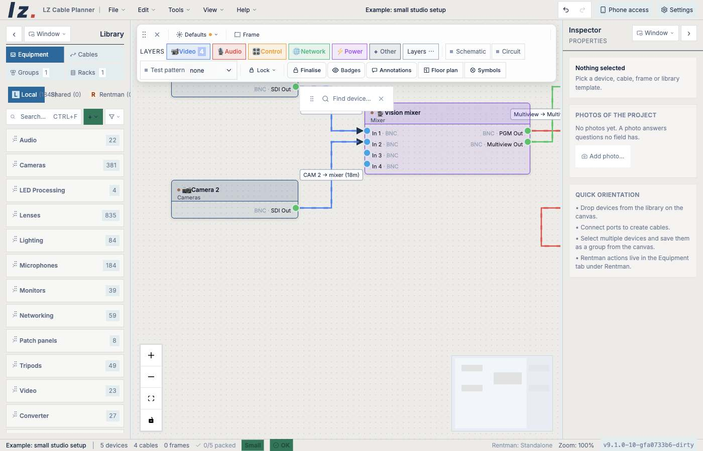

The main window has five areas:

| Area | Position | Contents |
|---|---|---|
| Header | top | menus *File*, *Edit*, *Tools*, *View*, *Help*, project name, undo/redo, theme button, *Phone access*, *Settings* |
| Library | left | equipment, cables, groups and racks to place in the plan |
| Canvas | centre | the plan with devices and cables, toolbar, search field, zoom buttons, overview map |
| Inspector | right | properties of the selection |
| Status bar | bottom | figures and notices about the project |

#### Header


Clicking the project name in the centre opens the dialog *Edit project metadata*.

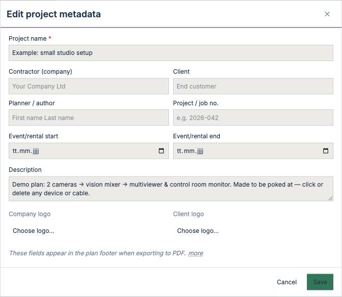

| Field | Effect |
|---|---|
| Project name (required) | name in the header, status bar and printouts |
| Contractor (company), Client, Planner / author, Project / job no. | details for the plan footer |
| Event/rental start, Event/rental end | period of the job |
| Description | free text |
| Company logo, Client logo | image file via *Choose logo…* |

These fields appear in the plan footer when exporting to PDF. *Save* applies them, *Cancel* discards them.

The undo and redo buttons sit on the right of the header. They are greyed out while there is no step to take.


In a narrow window the header contracts; the menus stay available.


#### File and Tools menus

The *File* menu holds new, open, save, the imports and the exports. Its entries are described in the chapters [File and Import](#8-file-and-import) and [Export & Print](#9-export--print).

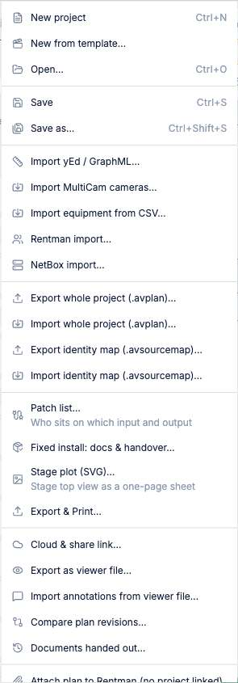

The *Tools* menu is divided into groups, among them *Calculate*, *Check* and *Plan*. The tools are described in the tools chapters.

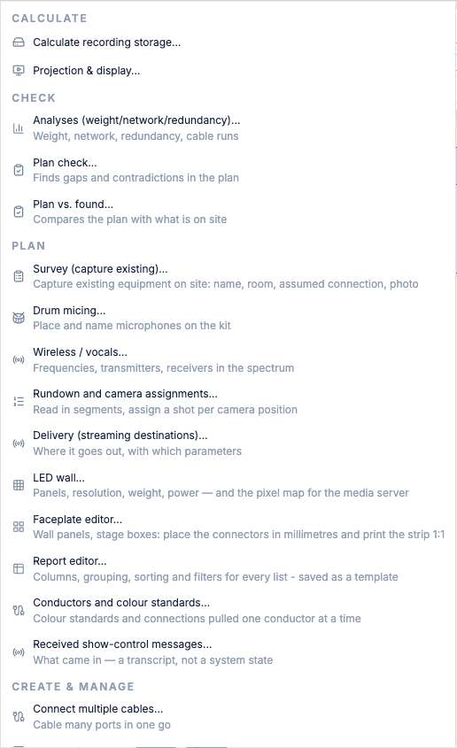

#### Inspector with nothing selected

With nothing selected, the inspector shows *Nothing selected*, the block *Photos of the project* with *Add photo…* and *Quick orientation* with four starting hints.

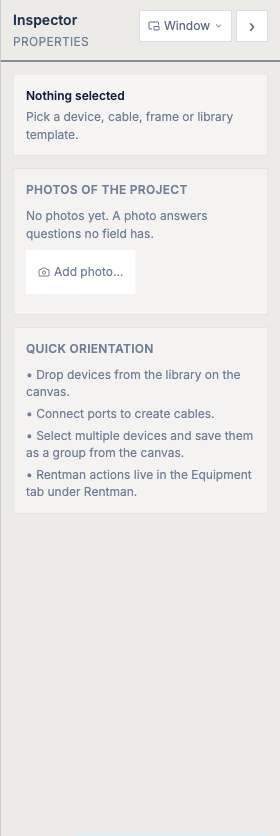

### Arranging the side panels

The library and the inspector can be collapsed, undocked, moved into a window of their own and resized.

#### Window menu

1. Click *Window* at the top of the side panel.

   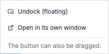

2. Choose *Undock (floating)*. The library floats above the canvas as a movable panel. *Dock* puts it back in place.

   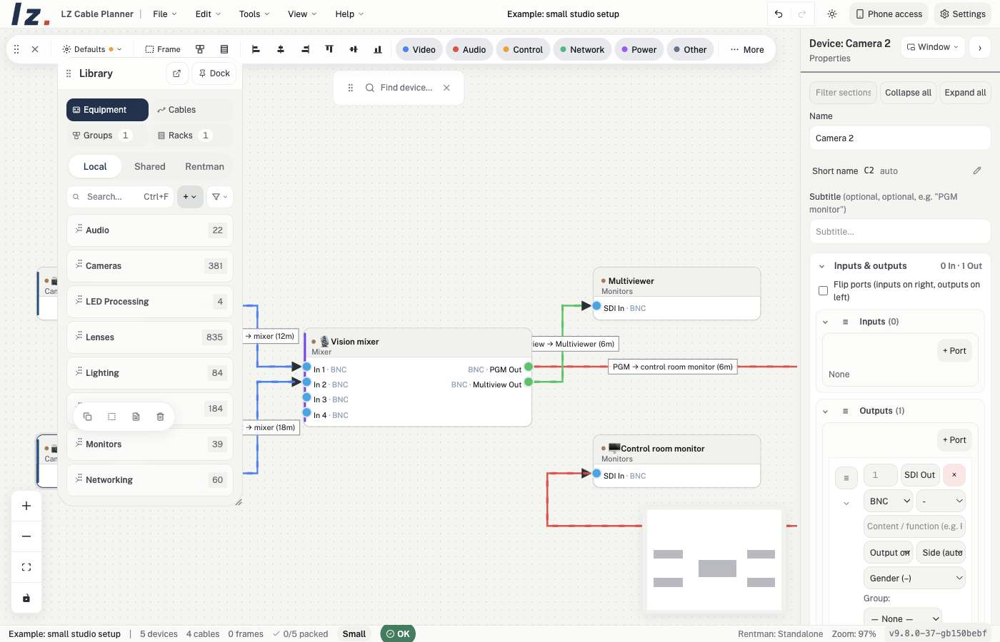

*Open in its own window* opens the side panel as a separate application window. The *Window* button can also be dragged. The menus of the inspector and of the annotations panel offer the same entries.

#### Collapsing and width

- The arrow button next to *Window* collapses the side panel. Clicking the arrow at the edge expands it again.

  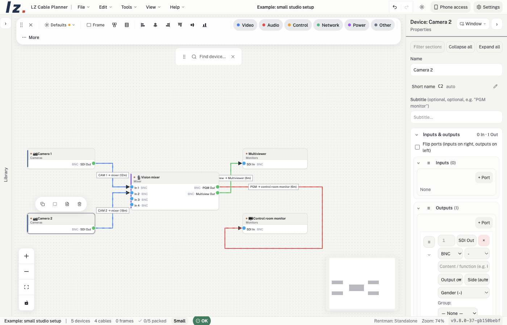

  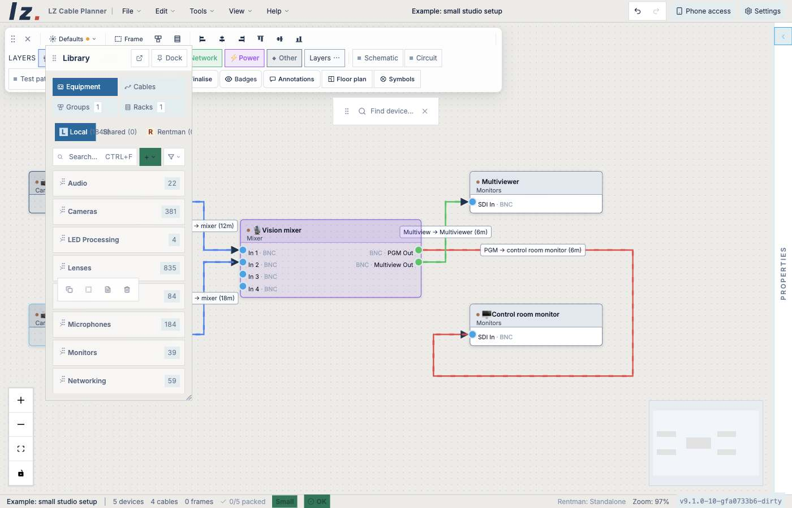

- The divider between side panel and canvas can be dragged with the mouse to change the width.

  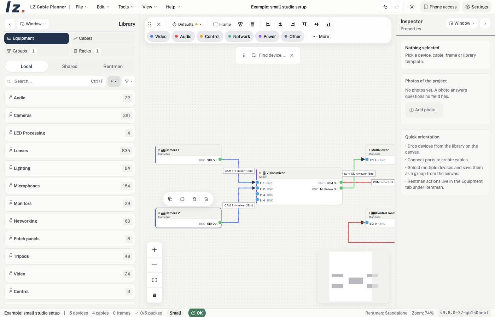

- **Ctrl+B** hides and shows the library, **Ctrl+I** the inspector.

The **P** key opens the patch list.

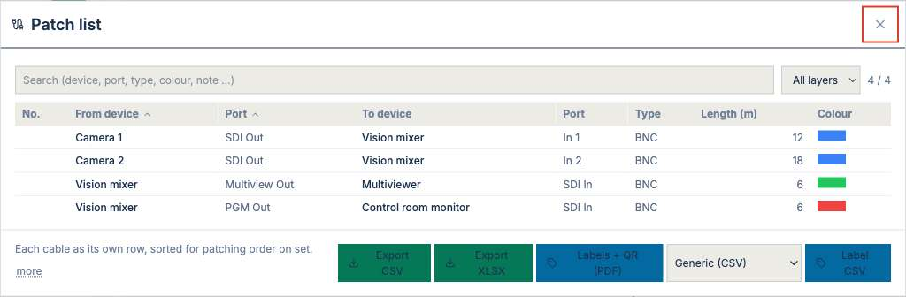

### Edit menu

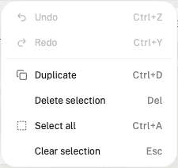

| Entry | Shortcut | Effect |
|---|---|---|
| Undo | Ctrl+Z | reverts the last step |
| Redo | Ctrl+Y | restores the reverted step |
| Duplicate | Ctrl+D | copies the selected elements |
| Delete selection | Del | deletes the selected elements |
| Select all | Ctrl+A | selects all elements of the plan |
| Clear selection | Esc | clears the selection |

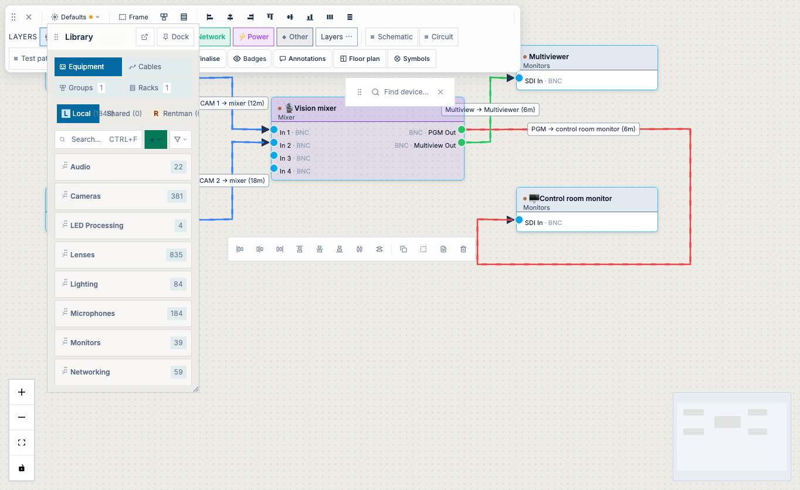

### View menu

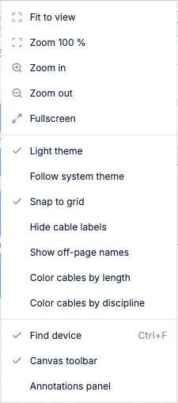

#### Zoom

| Entry | Effect |
|---|---|
| Fit to view | zooms so that all elements are visible |
| Zoom 100 % | sets the zoom to 100 % |
| Zoom in | zooms in |
| Zoom out | zooms out |
| Fullscreen | switches the window to fullscreen and back |

The current zoom level is shown in the status bar.

#### Theme

| Entry | Effect |
|---|---|
| Theme: follow system | light or dark according to the operating system |
| Light theme | always light |
| Dark theme | always dark |

The same choice is offered by the theme button in the header (sun, moon or screen) and by *Settings → Appearance*. The choice is remembered.

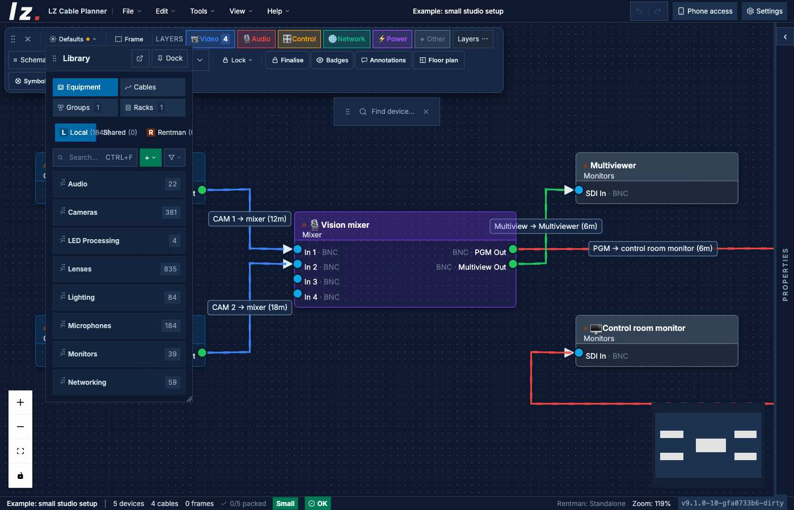

#### Grid and labels

| Entry | Effect |
|---|---|
| Snap to grid | devices snap to the grid while being moved |
| Hide cable labels | hides the labels on the cables |
| Show off-page names | shows the cable number or cable name on off-page connectors permanently; without the option it appears only on mouse-over |

A check mark in front of the entry shows that the option is on.

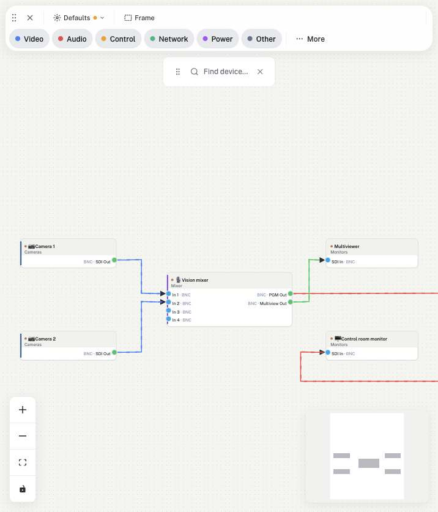

#### Color cables by length

*Color cables by length* colours the cables with the broadcast length colour code. The stored colour of each cable stays unchanged; a second click switches back.

| Length | Colour |
|---|---|
| 1 m | red |
| 2 m | yellow |
| 3 m | green |
| 5 m | white |
| 10 m | red |
| 20 m | yellow |
| 25 m | yellow/white dashed |
| 50 m | white |
| 100 m | red |

Cables of any other length appear grey.

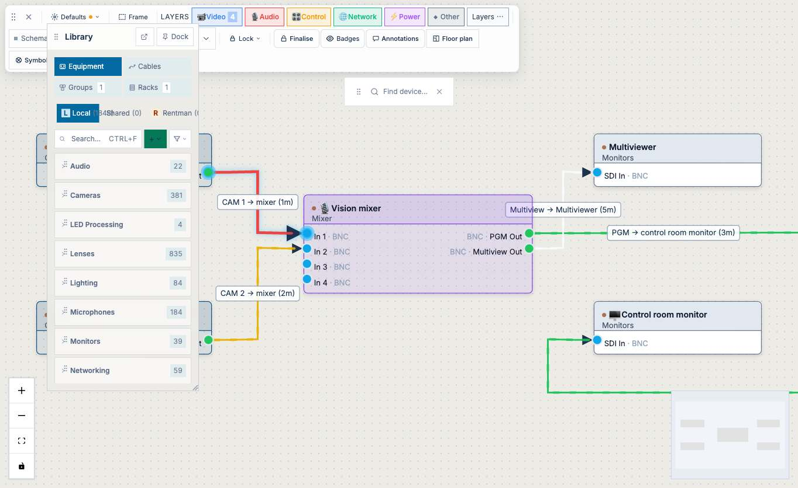

#### Color cables by discipline

*Color cables by discipline* colours each cable by its discipline: Video blue, Audio red, Control orange, Network green, Power violet, Other grey. Here too the stored colour stays unchanged. The two colour modes exclude each other.

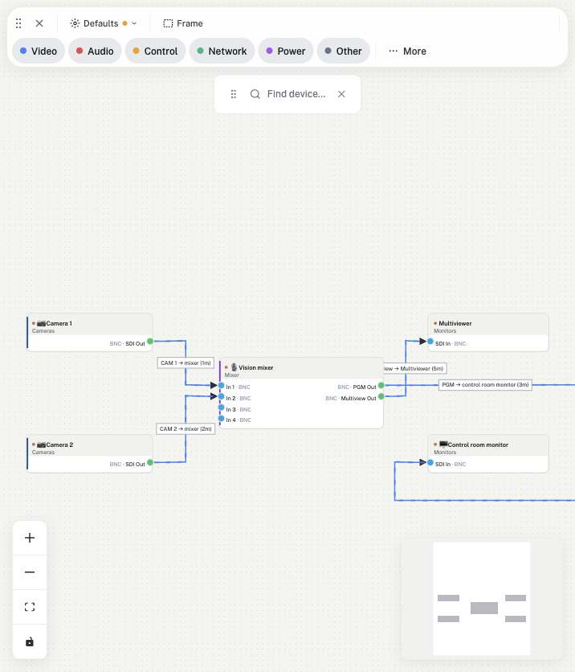

#### Search field, toolbar and panels

| Entry | Shortcut | Effect |
|---|---|---|
| Find device | Ctrl+F | shows and hides the search field above the canvas |
| Canvas toolbar | | shows and hides the canvas toolbar |
| Annotations panel | | opens and closes the *Annotations* panel |
| Floor plan | | shows and hides the floor plan panel |
| Symbols | | shows and hides the symbols panel |

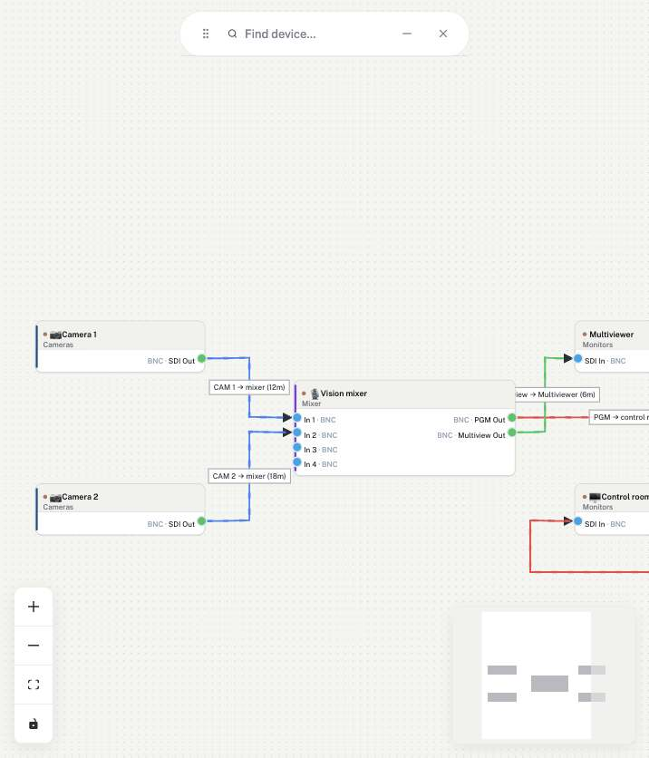

The *Annotations* panel appears on the right. It filters by status with *all*, *offen*, *gebaut* and *erledigt*; *+ New annotation* creates an annotation. *Close* hides it.

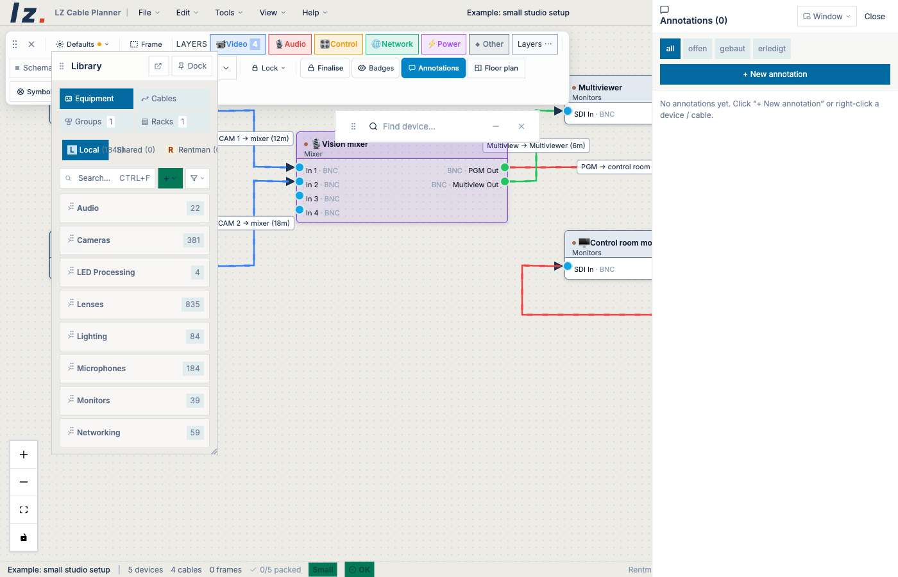

### Help menu

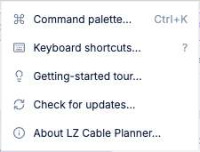

| Entry | Shortcut | Effect |
|---|---|---|
| Command palette… | Ctrl+K | opens the command palette |
| Keyboard shortcuts… | ? | opens the keyboard shortcut overview |
| Getting-started tour… | | starts the tour of the interface |
| Check for updates… | | asks for a newer version and reports the result |
| About LZ Cable Planner… | | opens the dialog with version and build |

#### Check for updates

*Help → Check for updates…* asks for a newer version and shows the result as a message:

| Message | Meaning |
|---|---|
| *Update check unavailable* | *Updates are only available in the installed desktop version.* In the browser and in a run that is not installed there is no check. |
| *Update available* | *Version … is downloading in the background and will install on quit.* When the download is finished, the app offers a restart. |
| *You are up to date* | The message names the running version. |
| *Update check failed* | The check ended with an error. |

Once an update is downloaded, *Update ready* asks: *Version … has been downloaded. Restart now to update?* with *Restart now* and *Later*. This also applies to updates the app downloaded by itself; without a restart it installs on quit.

#### Command palette

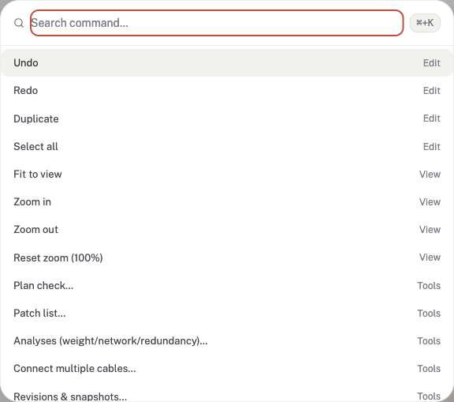

The command palette lists the commands from *Edit*, *View*, *File*, *Tools* and *Help*; each command shows its group on the right, some a short description below. Commands of disabled modules are left out.

1. Open the palette with **Ctrl+K** or via *Help → Command palette…*.
2. Type one or more search words. The search checks command name, group, short description and stored synonyms; every word must occur. Matches in the command name come first.

   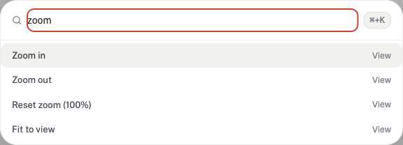

3. Pick a command with the arrow keys and run it with **Enter**.

Synonyms work in both languages: *qr*, for example, finds *Share to phone…*.

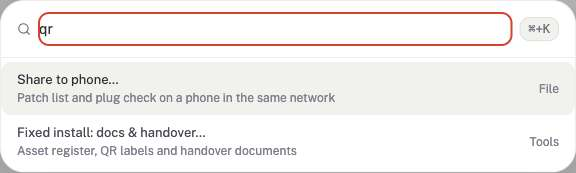

If nothing matches, the list shows *No commands found*.

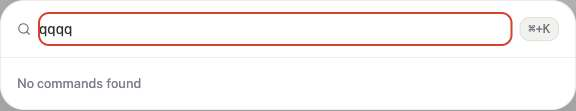

**Commands that exist only in the palette.** Some commands have no menu entry:

| Command | Group | Effect |
|---|---|---|
| *Reset zoom (100%)* | *View* | sets the canvas to 100 % zoom |
| *New project from template…* | *File* | opens the project templates |
| *Import from Rentman…* | *File* | opens the Rentman import (only with the module *Rentman* on) |
| *Import from NetBox…* | *File* | opens the NetBox import (only with the module *NetBox*) |
| *Share to phone…* | *File* | patch list and plug check on a phone in the same network (only with the module *Mobile*) |
| *Assign DMX addresses…* | *Tools* | assigns DMX addresses, see below |
| *Switch modules on or off…* | *Help* | opens *Settings → Modules* |
| *Settings…* | *Help* | opens the settings |

*Assign DMX addresses…* starts at universe 1, address 1 and hands out addresses one after another to all devices that have a DMX profile. Devices with a fixed address keep it. Afterwards the app reports *DMX addresses assigned* and says how many devices got an address and how many were skipped because no mode is set. Overlaps are listed by the plan check.

#### Keyboard shortcuts

*Help → Keyboard shortcuts…* or the **?** key opens the overview.

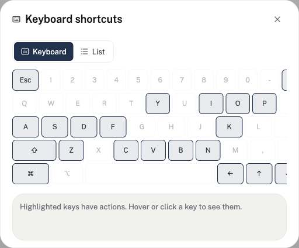

The *Keyboard* view shows a keyboard; highlighted keys have an action, shown on mouse-over or click. The *List* view lists all shortcuts. They include:

| Shortcut | Action |
|---|---|
| Ctrl+N, Ctrl+O, Ctrl+S, Ctrl+Shift+S | New project, Open, Save, Save as |
| Ctrl+C, Ctrl+V | Copy, Paste |
| Ctrl+K | Command palette |
| Ctrl+F | Find device |
| Ctrl++ | New device at cursor |
| Ctrl+B, Ctrl+I | Show/hide library or inspector |
| P | Open patch list |
| A | Toggle arrow display |
| ? | this overview |

#### Getting-started tour

The tour takes five steps through the interface: Library on the left, Properties on the right, Plan check, Export menu, Find any function. *Next* and *Back* page through it, *End tour* stops it. On the last step *Open command palette* ends the tour and opens the command palette. On the first start the tour opens by itself.

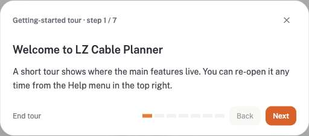

#### About LZ Cable Planner

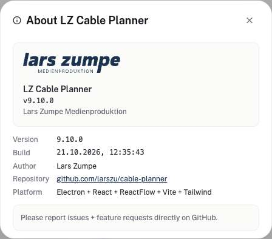

The dialog shows:

- Version
- Build: date and time the program was built
- Author
- Repository (github.com/larszu/cable-planner)
- Platform (Electron, React, ReactFlow, Vite, Tailwind)
- the note to report issues and feature requests on GitHub

The same dialog opens when you click the version number on the right of the status bar.

### Status bar

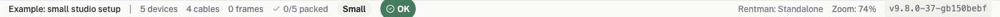

From left to right the status bar shows:

| Element | Meaning | Click |
|---|---|---|
| Project name | name of the project | |
| devices, cables | count in the plan | |
| frames | number of room frames | |
| packed | devices marked as packed in their properties, e.g. *0/5 packed*; grey for none, yellow for some, green for all | |
| Complexity | size estimate of the plan | |
| Plan check | result of the running plan check | opens the plan check |
| Rentman | connection to Rentman | |
| Zoom | current zoom level | |
| Version | program version | opens *About LZ Cable Planner* |

In a narrow window the status bar hides frames, packed and Rentman.

#### Complexity

The badge adds up devices and cables:

| Sum | Badge |
|---|---|
| below 8 | New |
| from 8 | Small |
| from 30 | Medium |
| from 80 | Large |
| from 200 | XL |

The badge is only a guide to readability and working speed.

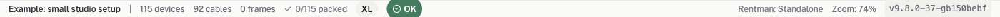

#### Plan check

The badge has three states:

| Colour | Meaning |
|---|---|
| green, *OK* | no findings |
| yellow with a number | warnings only |
| red with a number | at least one error |

The number is the sum of errors and warnings.

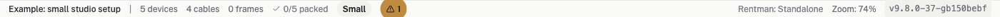

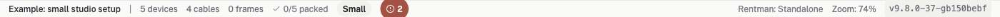

A click opens the plan check with all findings. Clicking a finding selects the affected element.

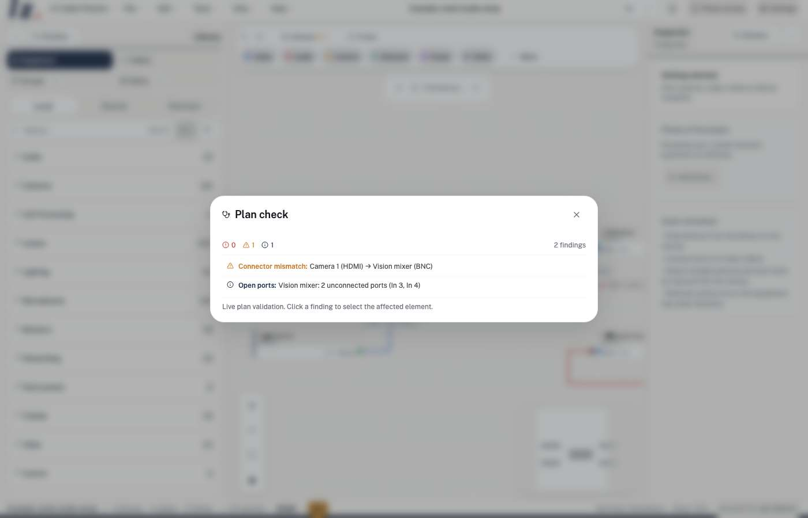

#### Notices that appear only when needed

| Badge | Appears when | Click |
|---|---|---|
| *Network* with a number | there are network findings: missing or duplicate addresses, masks, segments | opens the analyses on the network tab |
| *No recovery copy* | the browser store refused the project's recovery copy; the plan itself is not affected, save it to a file | |
| *Photos* with MB | the photos in the plan exceed 40 MB; the file still opens but is hard to send by mail | |
| *Due* with a number | returns, check-outs, hours, receipts or costs are overdue or due today | opens the analyses on *What is due* |
| *Live* with participant count | a live collaboration is running | opens the settings on the network sync tab |
| *MCP* | the local MCP server is running; next to it *· read only* or *· can edit*, during an active request *MCP · asking* | opens the settings on the MCP tab |


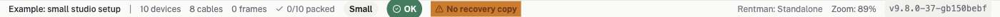


#### Rentman indicator

The Rentman indicator appears only when the Rentman module is enabled. It shows the name of the linked Rentman project, otherwise *Token ready* when an access token is stored, otherwise *Standalone*.


### Phone access

The *Phone access* button in the header opens the dialog *Mobile access*. It starts a small web server on the local network; a phone opens the mobile view of the project via the QR code.

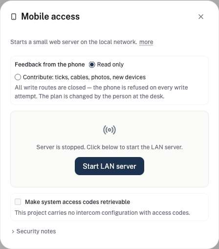

| Element | Effect |
|---|---|
| Feedback from the phone: *Read only* | the phone cannot write anything back |
| Feedback from the phone: *Contribute: ticks, cables, photos, new devices* | the phone may send back ticks, cables, photos and new devices |
| *Start LAN server* | starts the server and shows the QR code |
| *Make system access codes retrievable* | releases intercom access codes via a second code; selectable only for projects with an intercom configuration |
| *Security notes* | expands the security notes |

The server stops when the app closes or via the Stop button. The mobile view is described in the chapter [Web edition and tablet](#15-web-edition-and-tablet).

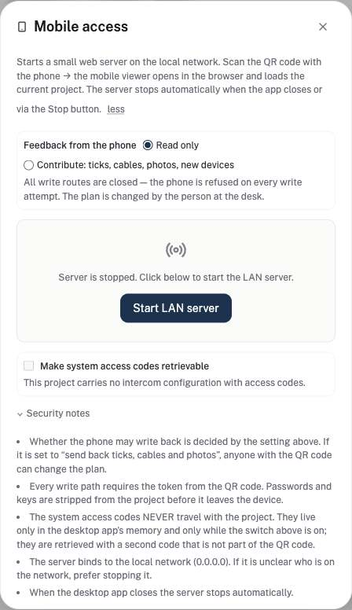

### First start

On the first start with an empty project the dialog *Welcome — what are you planning?* appears.

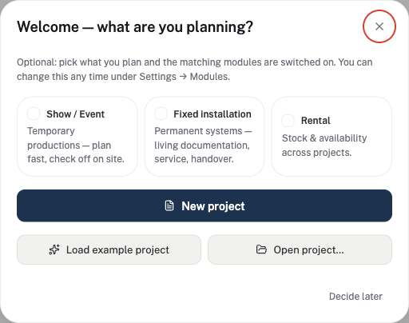

1. Optionally choose one or more use cases. They enable the matching modules:

   | Use case | enables the modules |
   |---|---|
   | Show / Event | Mobile-Companion, Rentman |
   | Fixed installation | Fixed installation, Mobile-Companion, NetBox |
   | Rental | Rental / Stock, Rentman |

   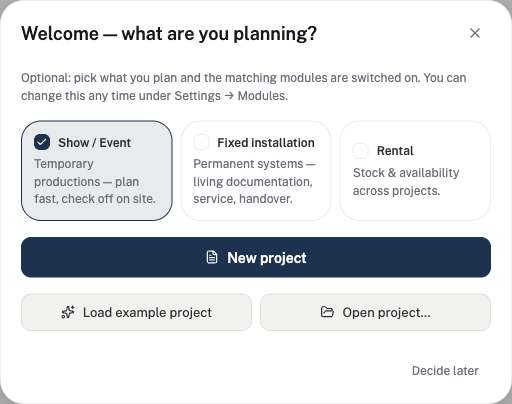

2. Choose how to begin:

   | Button | Effect |
   |---|---|
   | New project | opens the project metadata for a new project |
   | Load example project | loads the example project and fits the view |
   | Open project… | opens an existing `.cableplan` file |
   | Decide later | closes the dialog |

   Without a use case the modules stay as they are. Everything can be changed under *Settings → Modules*.

3. The [Getting-started tour](#getting-started-tour) starts afterwards.

   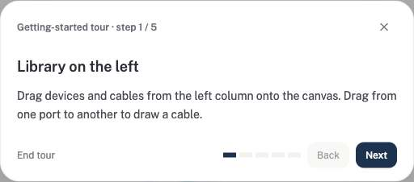

---

## 3. Canvas

The canvas is the working area on which devices stand, cables run and frames form rooms. This chapter describes the area itself, the floating toolbar, selection, drawing and editing cables, frames, floors, layers, operating modes, annotations, floor plan and plan symbols. The properties of a selected device, cable or frame are described in the chapter [Inspector](#6-inspector); the library on the left in the chapter [Library](#4-library).

### The empty plan and the example project

A plan without devices shows the note *No devices yet* in the middle: drag a device from the library on the left onto the canvas. Below it is *Load example project*.

1. Start with an empty plan.

   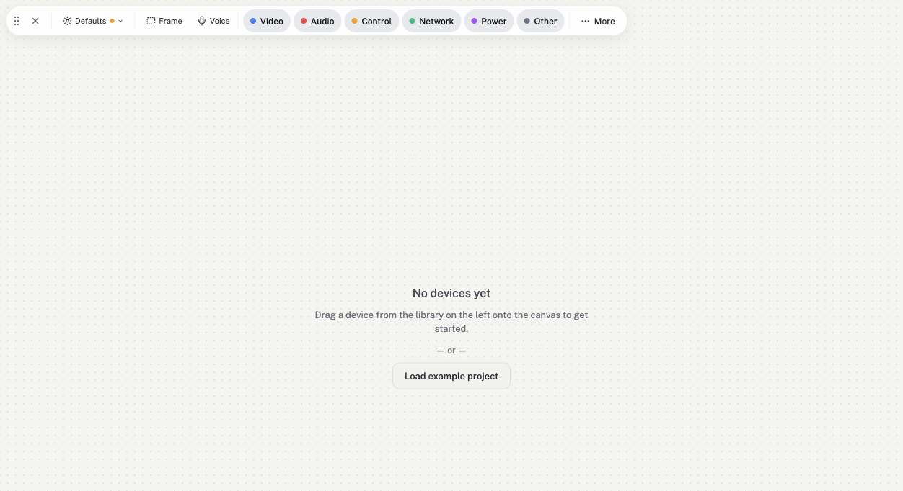

2. Click *Load example project*. The plan then shows Camera 1, Camera 2, Vision mixer, Multiviewer and Control room monitor with four cables. The following sections work on this example.

   

The area can be moved by dragging on empty ground, zoomed with the mouse wheel, and shows an overview map at the bottom right.

### The toolbar

The toolbar floats at the top left above the plan. From left to right it contains:

- the grip for moving and the close button,
- *Defaults* (presets for new cables and the appearance),
- *Frame*,
- *Voice* (create cables from a sentence),
- buttons for the selection while devices are selected (connect cables, save group, rack, align),
- the layer chips *Video*, *Audio*, *Control*, *Network*, *Power*, *Other* and custom layers,
- the chip of the operating mode that is switched on (signal path, circuit, test pattern),
- *More*.


Under *More* are the less frequent switches: *Layers ⋯* (manage layers), *Lock*, *Schematic* or *Live*, *Circuit*, *Test pattern*, *Finalise*, *Badges*, *Annotations*, *Floor plan* and *Symbols*. The buttons *Rooms* and *3D* appear there as soon as the plan contains frames.

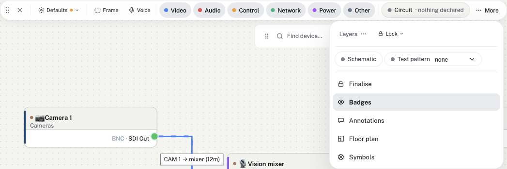

On a phone the toolbar shows only the grip, *Defaults* and *More*; frame, layers and selection buttons are then under *More*.

#### Moving, closing and reopening the toolbar

1. Drag the toolbar by the grip (six dots on the left) to another place.
2. The **×** next to the grip closes the toolbar.
3. Open the menu *View*.

   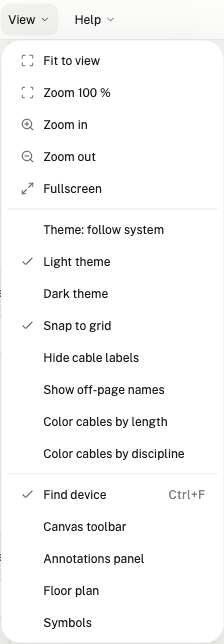

4. Choose *Canvas toolbar*. The toolbar reappears.

### Defaults

*Defaults* (tooltip: *Default behaviour for new cables + appearance*) determines how new cables are created and how the plan looks. A dot on the button shows that at least one value has been changed.

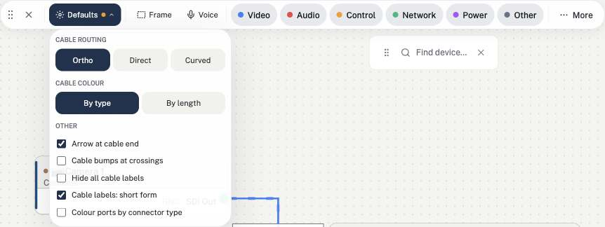

| Group | Option | Effect |
|---|---|---|
| *Cable routing* | *Ortho* | New cables run horizontally and vertically. |
| | *Direct* | New cables run in a straight line. |
| | *Curved* | New cables run as a curve. |
| *Cable colour* | *By type* | The colour comes from the cable type. |
| | *By length* | The colour depends on the length; the *?* button shows the legend *Length colours*. |
| *Other* | *Arrow at cable end* | Newly drawn cables get an arrow. |
| | *Cable bumps at crossings* | Crossings are drawn as a small bump. This can be overridden per cable in the context menu. |
| | *Hide all cable labels* | The labels of all cables disappear; their position stays saved. |
| | *Cable labels: short form* | The format suffix (for example "(1080p50/60)") is removed from the display. The full name stays in the cable properties. |
| | *Colour ports by connector type* | Ports take the colour of their connector type (SDI amber, HDMI violet, Ethernet green and so on). |

The routing applies to cables created afterwards. Cables already drawn keep their shape (see [Editing cables](#editing-cables)).

1. Under *Cable colour* choose *By length*. The cables appear in length colours.

   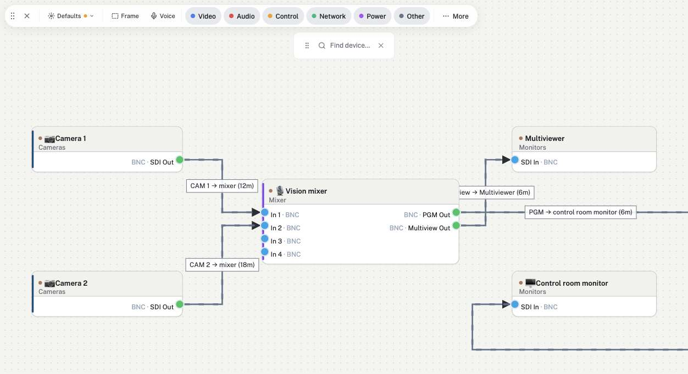

2. The *?* button next to *By length* shows the legend *Length colours*: 1 m red, 2 m yellow, 3 m green, 5 m white, 10 m red, 20 m yellow, 25 m yellow/white dashed, 50 m white, 100 m red. *Close* hides it.

   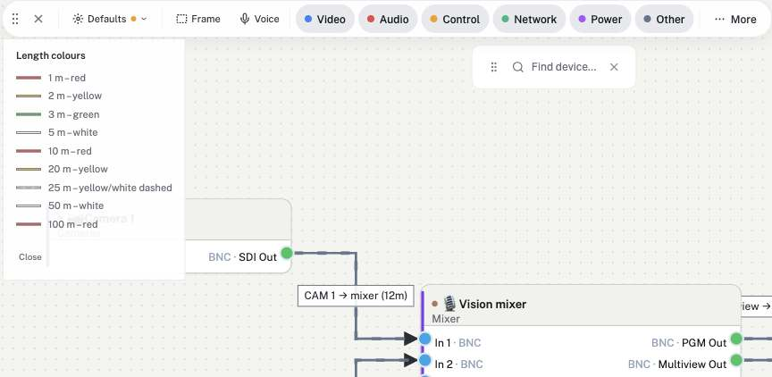

3. *Cable bumps at crossings* draws a bump at crossings.

   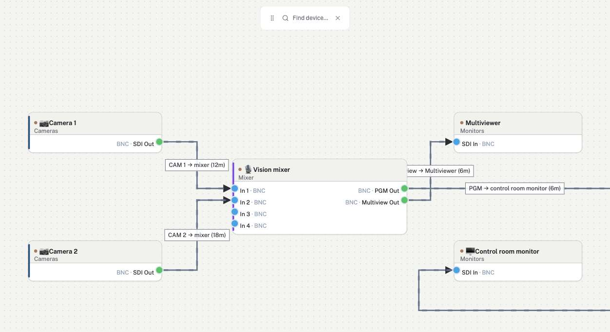

4. *Colour ports by connector type* colours the ports by connector type.

   

In addition, the entry *Color cables by discipline* in the *View* menu colours the cables by their layer (video, audio and so on).

### Selecting devices

- **Click** on a device selects it; the inspector on the right shows its properties.
- **Shift**, **Ctrl** or **Cmd** plus click adds further devices or removes them again.
- Holding **Shift** and dragging on empty area draws a selection rectangle.
- *Edit → Select all* selects all devices.
- A click on empty area clears the selection.

1. Click Camera 2.

   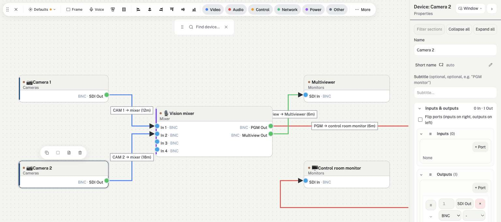

2. Click the Vision mixer while holding Shift.

   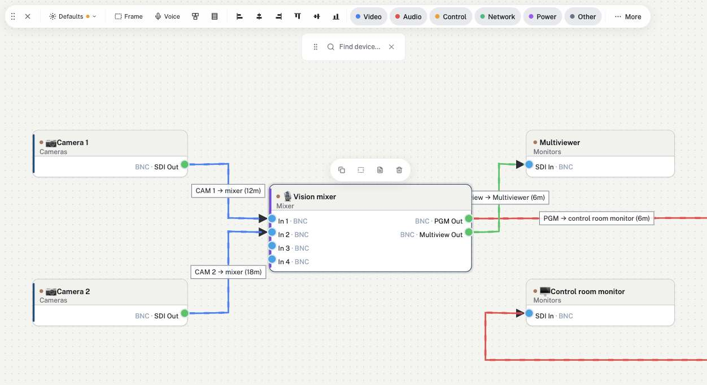

3. Drag a rectangle over several devices while holding Shift.

   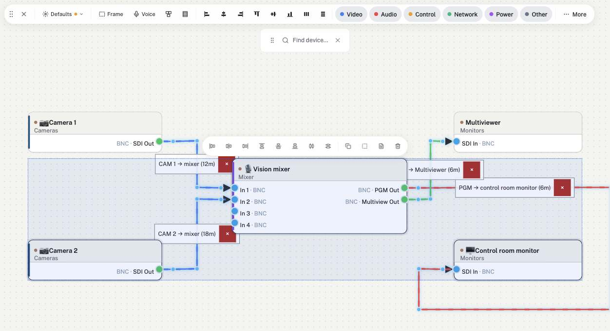

4. *Edit → Select all* selects all five devices.

As soon as devices are selected, the buttons for selection actions appear in the toolbar and the [selection bar](#selection-bar-at-the-device) appears above the selection.

### Aligning devices

The align buttons are in the toolbar as soon as at least one device is selected. All results snap to the grid when *Snap to grid* is on.

| Button (tooltip) | With one device | With several devices |
|---|---|---|
| *Left align* / *Align to left viewport edge* | At the left edge of the visible area | Left edges flush |
| *Centre horizontally* | In the middle of the visible area | On a common vertical centre axis |
| *Right align* | At the right edge of the area | Right edges flush |
| *Top align* | At the top edge of the area | Top edges flush |
| *Centre vertically* | In the middle of the area | On a common horizontal centre axis |
| *Bottom align* | At the bottom edge of the area | Bottom edges flush |
| *Distribute horizontally* | – | From three devices: equal gaps |
| *Distribute vertically* | – | From three devices: equal gaps |

1. With one device selected, *Align to left viewport edge* aligns it to the edge of the visible area.

   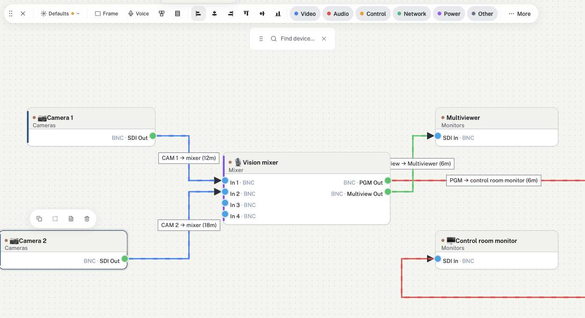

2. Select Camera 2, Vision mixer and Multiviewer and click *Left align*.

   

3. *Distribute horizontally* evens out the gaps.

   

Aligning can be undone with *Edit → Undo*.

### Saving a device group

The button *Save N selected devices as a group* stores the selection with its cables as a template. The group then appears in the library under *Groups* and can be dragged onto the plan.

1. Select several devices and click the button with the three rectangles. The field *Group name…* appears in the toolbar.

   

2. Enter a name and click the green tick (*Save group*). The group appears in the library under *Groups*.

   

3. If the name already exists, the app asks *A template named "…" already exists. Overwrite?* With *Overwrite* you replace the template.

### Arranging the selection in the rack builder

The button *Arrange the N selected devices in the 2D rack builder* opens the rack builder with the selection (the device context menu has the same as *Arrange in rack builder*). If the selection already contains a rack, the button is missing; if exactly one rack is selected, the button *Edit this rack in the 2D rack builder* opens the builder for that rack instead. The builder itself is described in the chapter [Rack Builder](#rack-builder).


### Several cables between two devices

When exactly two devices are selected, the toolbar shows the button *Connect cables* (tooltip: *Create several cables between the two selected devices at once*). Without a selection, *Tools → Connect multiple cables…* opens the same dialog with two lists for source and target.

1. Select two devices, for example Camera 2 and Vision mixer.

2. Click *Connect cables*. The dialog *Connect multiple cables* explains: it creates N cables at once, source port i → target port i; occupied target ports are skipped.

   

| Field | Meaning |
|---|---|
| *Source → Device*, *Side* | Device and side (*Outputs* or *Inputs*) the cables start from. |
| *Start Outputs (1..n)* | Number of the first source port. |
| *Target → Device*, *Side* | Device and side (*Inputs* or *Outputs*) where they end. |
| *Start Inputs (1..n)* | Number of the first target port. |
| *Cable count* | How many cables are created. |
| *Cable type* | The cable type of all new cables; the colour comes from the type. |
| *Length per cable (m)* | Length of all new cables. |
| *Preview (x/y cables)* | Lists the pairs. If the count exceeds the free ports, it says *Count exceeds available ports — extras are skipped.* |

3. Set *Start Inputs* and *Cable count*. The preview shows which pairs are created.

   

4. Click *Create N cables*. A message states how many cables were created and how many were skipped (*target port occupied or invalid*).

   

### Cables by voice

The button *Voice* (tooltip: *Create cables from a spoken or typed sentence*) opens the dialog *Cable by voice*. A sentence of the form "<source> to <target>" is read against the names of the devices, their rooms and ports in the plan. There is no language model and no network connection. Separate several cables with a full stop.

1. Click *Voice*. The input field is active; with the microphone button you dictate if speech recognition is available, otherwise you type or use system dictation (macOS: press Fn twice, Windows: Win+H).

2. Enter a sentence, for example "SDI 1 from Camera 1 to Vision mixer In 3".

3. Click *Preview* or press Enter. For each sentence the preview shows source device and port, target device and port. Every choice can be changed. The button at the bottom gives the number of ready cables (*Connect N cables*).

   

4. Several sentences appear one below the other. A sentence without a match shows *No match - pick a device*; as long as nothing is chosen there, it does not count. If several devices fit, the preview asks *Which one? (n match)*. If a named device exists only in the library, the preview offers *Add from library: name*; it is created in the plan when connecting. If a target port is occupied, the preview asks *This input already has cable …. Replace it?*. If the signal families do not fit, a note says a converter is probably needed and a converter can be inserted.

   

5. *Connect N cables* creates the cables in one step. One undo takes all of them back.

   

### Keyboard shortcuts on the canvas

| Key | Effect |
|---|---|
| Click, Shift/Ctrl/Cmd + click | Select, add to the selection |
| Arrow keys | Move selected devices by one grid cell |
| Shift + arrow keys | Move by four grid cells |
| Ctrl/Cmd + C, Ctrl/Cmd + V | Copy and paste selected devices |
| Ctrl/Cmd + D | Duplicate the selection |
| Ctrl/Cmd + Plus (or =) | Create a new device at the mouse position; a dialog asks for the name. The device gets the category *Other* and no ports. |
| Delete or Backspace | Delete the selection (devices and cables together in one step) |
| Esc | Cancel a cable being drawn |
| Ctrl/Cmd + F | Device search |

The keys have no effect while the cursor is in a text field.

1. Ctrl/Cmd + Plus asks for the name of the new device.

   

### Drawing cables

Cables are created by dragging from one port to another.

1. Press the port dot of an output (for example SDI Out of Camera 2) and drag it onto a free input (for example In 3 on the Vision mixer).

   

2. On release the dialog *New cable* opens. At the top are *From:* and *To:*. The list *Cable* shows all cable types; ✓ marks types that fit both connectors, ✕ those that do not. *★ Custom cable…* creates a custom type. Further fields are *Signal standard*, *Name*, *Length (m)*, *Colour* and *Notes*; a green note confirms that the type fits the connectors (for example *SDI 3G (1080p50/60) fits BNC ↔ BNC.*).

   

3. Choose a type and click *Create*. The cable appears with label and length.

   

Special cases when dragging:

- An **occupied input** is not silently overwritten. After *Create* the app reports *Port already in use* and names the existing cable. *Replace* removes the existing cable and creates the new connection, *Cancel* discards the new connection and everything stays as it is.

  

- Releasing **on empty area** gives an open end: the app creates a device "Open …" there with a port *Open End* of the same connector type and opens the dialog *New cable* for it.

  

- Releasing **on the body of another device** creates a matching new port there and connects it. This also allows cabling a device that has only a name so far.

  

- **Two clicks instead of dragging:** a click on a port starts the cable; clicks on empty area set bends, a click on a port finishes it. The banner says *Draw cable: tap the canvas for a bend, tap a port to finish.* *Undo bend* takes back the last bend, *Cancel* discards the cable; Esc also cancels. An input can only be connected to an output, not to another input. While the cable is pending, the right side shows *Quick suggestions (connector type)*: up to eight library devices with a matching port, those most often connected in the project first. A click on a suggestion places the device at the mouse position and finishes the cable at the first matching port.

  

The defaults for *Cable routing* and *Arrow at cable end* from [Defaults](#defaults) apply to every new cable.

### Editing cables

A click on a cable selects it; the inspector shows its properties, a double click opens the edit dialog. Handles appear on the selected cable.

1. Click a cable.

   

2. Drag a segment to move the route.

3. Drag a corner to relocate the bend.

   

4. A right click on the cable opens the cable menu.

   

| Entry | Effect |
|---|---|
| *Change label…* | Asks for the label of the cable. |
| *Add annotation…* | Attaches an annotation to the cable. |
| *Accept into plan (mobile suggestion)* / *Remove mobile check* | Only for cables suggested or ticked off from the phone. |
| *Measure signal* | Opens the scopes for the stream the device sends at the start of the cable. Greyed out when the source device has no stream the app can open (RTSP, RTMP, SRT, HLS, MJPEG; Properties → Streams). |
| *Add waypoint here* | Inserts a waypoint at the click point. |
| *Remove nearest waypoint* | Removes the waypoint closest to the click. |
| *Clear all waypoints (n)* | Removes all waypoints of the cable. |
| *Auto-reroute* | Calculates the route again. |
| *Routing:* *Orthogonal* / *Direct* / *Curved* | Sets the shape of this cable. |
| *Cable jumps for this cable* | Overrides the global setting; *Remove override (follow global)* takes that back. |
| *Arrow at end*, *Arrow at start* | Shows or hides the arrow. |
| *Bidirectional* | Turns arrows at both ends on or off. |
| *Create off-page connection…* | See [Off-page connectors](#off-page-connectors). |
| *Delete cable* | Asks *Delete cable "…"?* and removes it after confirmation. |

5. A double click on a cable opens the dialog for editing the cable; its fields are described in the chapter [Inspector](#6-inspector).

   

### Off-page connectors

An off-page connection replaces the continuous line of a cable at each end with a small connector symbol. This keeps plans readable in which two devices are far apart. All off-page cables with the same net name form a net.

1. Right click the cable, *Create off-page connection…*. The app asks *Net / signal name for the off-page connection:*; the cable name is prefilled.

   

2. With *OK* the cable becomes an off-page connection. Each connector symbol names the counterpart (*device · port*); an arrow shows the signal direction. A click on the arrow jumps to the nearest counterpart.
3. The net name appears when you point at the symbol; the entry *Show off-page names* in the *View* menu shows it permanently.
4. A right click on a symbol opens the net info: number of endpoints, a jump list and *Resolve off-page (show line)*, which restores the line.

### Frames

A frame is a coloured rectangle that groups devices into a place or room. The button *Frame* in the toolbar creates a new frame ("New location") in the middle of the visible area. If devices are selected, the button has the tooltip *Frame around the N selected devices* and draws the frame around them.

1. Click *Frame* without a selection.

   

2. A double click on the frame asks *Rename location:*.

3. A click on the frame shows the frame properties in the inspector (name, width, depth, area, floor, colour, riser, room number, address, notes); they are described in the chapter [Inspector](#6-inspector).

4. Change the size with the handles of the selected frame.

5. Drag the frame by its title. Devices whose centre lies inside the frame move with it.

   

6. The lock at the frame title blocks moving and resizing; the settings stay reachable.

7. A right click on the frame opens the menu with *Lock position* (or *Unlock position*) and *Delete frame*.

   

8. *Delete frame* asks *Delete frame "…"?* — only the frame disappears, the devices stay.

9. Select several devices and click *Frame* to draw a frame around them.

   

### Rooms, floors and the 3D building view

Every frame is a room. Frames can be assigned to floors; floors determine visibility in the plan and stacking in the 3D view. The buttons *Rooms* and *3D* are under *More* as soon as the plan contains at least one frame.

1. Create frames (here Studio, Control room, Machine room).

2. Select a frame. In the inspector, the entry *Add floor…* in the *Floor* selection opens the prompt *Name of the new floor (e.g. "3rd floor")*.

   

3. The floor is then in the *Floor* field.

4. In the inspector, the section *Floors (n)* shows the floors from bottom to top with their floor level in metres; the arrows change the order, the bin removes a floor, *Add floor…* adds another.

   

5. *Riser / vertical cable route* marks a frame that runs through all floors in the 3D view; cables between floors then run through it instead of as a straight line.

6. *More → Rooms* opens a list grouped by floor (topmost first). Each floor and each room has a tick; rooms without a floor are under *Without floor*.

   

7. Remove the tick of a room: its devices and cables disappear from the plan. The button then reads *Rooms (n hidden)*.

8. The tick of a floor hides all rooms of that floor.

9. *Show all* shows everything again. Several rooms can be hidden at the same time.

10. *More → 3D* opens *Building 3D*: the rooms stacked by floor, with the connections in between.

    

11. Under *Show* you switch between *Room connections* and *Single cables*.

    

12. *Labels* shows or hides the names. *Storey height (m)* applies only to floors without an entered height; the view points out that this is an assumption.

Devices can be dragged in the 3D view. Floor boxes appear as a flat plate in the floor, other devices as cubes. Dragging beside a device rotates the view, the mouse wheel zooms.

### Layers

The layer chips show and hide the cables of a layer. Only the cables are filtered, the devices stay. A coloured dot marks the signal type; the tooltip gives the number of cables (for example *Video — 4 cables · visible (click to hide)*).

1. The toolbar shows *Video*, *Audio*, *Control*, *Network*, *Power* and *Other*.

   

2. Click *Video*: the video cables disappear.

   

3. *More → Layers ⋯* opens the management menu: *Create custom layer…* and *Show all layers again*.

   

4. *Create custom layer…* asks for the name (for example "intercom"). The new layer appears as a chip with a diamond symbol.

   

5. A right click (on a phone a long press) on the chip of a custom layer asks *Remove custom layer "…"?*.

### Signal path

The signal path highlights the whole chain a cable is part of and dims the rest.

1. Select a cable.

2. Click *Show signal path* in the inspector.

   

3. The toolbar shows the chip *Signal path: n cables, m devices*. A click on it or Esc ends the view.

### Operating modes: schematic, circuit, test pattern

#### Schematic and live

The button *Schematic* under *More* shows where the plan gets its picture from: *Schematic* means it is the planned path without a connection to an installation; *Live* means the observed state of a switcher or router is shown (with its age in seconds). If the connection drops, it says *· connection lost* and the view falls back to the planned path. A click on the chip does not change the mode but turns the motion of the display on or off; if the operating system has motion turned off, the view stays still.

#### Circuit

*Circuit* calculates electrical circuits: which luminaires are lit, which switch positions apply, which lines are live. The result is calculated, not measured; the switch positions are not part of the plan. Only devices that carry a circuit type in their properties are taken into account; it is never guessed from the category. If no device with a type is in the plan, the chip shows *· nothing declared*.

1. Switch *Circuit* on. The chip gives the lit luminaires out of all luminaires (for example "1/1").

2. *Reset switches* puts all switches back to their default; the plan does not change. *Suggestions* explains why the circuit does not do what it should and which wire would change that; every suggestion brings its truth table, nothing is entered without a click.

#### Test pattern

*Test pattern* is an expectation, not a video image: after choosing a source, the plan shows at every arrival point which image should be there. The app does not see what actually arrives.

1. Open *More* and choose a source under *Test pattern* (the list contains every device with an output, first *none*).

2. The plan shows the test pattern at the source and at every arrival point, labelled *Expected per plan*. The toolbar shows the chip *Test pattern* with the source, the number of arrival points and the counters *· n open*, *· n swapped*, *· n unchecked*.

   

3. At each arrival point you record what you saw on site: *correct*, *different image…* (then the name on it, and *record*), *no image* or *no monitor*. The finding is then shown in colour at the arrival point (correct, still open, swapped or another deviation) and feeds into the counters of the toolbar.

   

4. *Save…* offers three files: *Test pattern image (SVG)* for a media player, the switcher stills store or a laptop (the app feeds nothing in), *Check sheet (CSV)* as a walk-around list, also with paths the plan cannot follow to the end, and *Sign-off sheet (CSV)* with what was seen, including the time.

5. *Switch path…* appears when a router lies on a path of the source. The dialog sets the crosspoints of the plan on the live installation.


   Under *Where should the image go?* you choose the target; the dialog shows the path (for example Camera 1 → Videohub 12x12 → Control room monitor) and the commands sent. If no control protocol is declared for the device (Properties → Control), nothing is sent. *Switched by* records a name. *switch now* is only possible if the plan contains commands, nothing is in the way (for example a missing control protocol) and the tick *I have read which outputs will be switched, and I am switching the live installation.* is set.

The choice *none* ends the test pattern.

### Locking

*More → Lock* protects against accidental moves. The menu has three switches:

| Switch | Effect |
|---|---|
| *Frames* | No frame moves |
| *Devices* | No device moves |
| *Cables* | No waypoint editing (the handles on the cable disappear) |

The button shows the number of active switches (for example *Lock 1/3*).

1. Open *Lock*.

   

2. Switch *Devices* on. The devices can no longer be dragged.

   

3. With *Cables* locked, a selected cable shows no handles.

   

Individual devices and frames can also be fixed with *Lock position* in the context menu.

### Finalising the plan

*More → Finalise* locks the whole plan: no moves, no new connections, no deletions. The entry then reads *Finalised*.

1. Click *Finalise*. The app asks *Finalise plan?* and explains that the canvas will be locked and that the lock can be lifted at any time.

   

2. After *Finalise*, the banner *Plan is finalized — changes are locked.* appears above the plan with the button *Release for editing*.

   

3. *Release for editing* asks *Re-open the plan for editing?*; *Release* lifts the lock. The entry under *More* asks *Re-enable plan editing?* (*Re-enable*).

   

A viewer file (`.cpviewer`) is permanently read-only; the entry then reads *Viewer* and cannot be operated.

### Annotations

Annotations are notes on the plan, free or attached to a device or cable. Two entries under *More* belong to them: *Badges* shows or hides the markers of the annotations on the plan (the data stays), *Annotations* opens the panel.

1. Open *Annotations*. The panel shows the filters *all*, *open*, *built*, *resolved* at the top and the button *+ New annotation*.

   

2. Click *+ New annotation* and write the text.

3. *Add* asks for your name the first time; it is attached to all annotations you create.

4. The annotation is then in the list.

   

5. Each annotation has a status (*open*, *built*, *resolved*); the filters show only the annotations of one status.

6. The button for placing at the canvas centre puts the marker in the middle of the plan; drag the handle of an annotation onto a device to attach it there.

   

7. A click on the marker on the plan shows the annotation.

8. *Badges* hides the markers.

9. Deleting asks *Delete annotation?*.

A right click on a device or cable also offers *Add annotation…*: after asking for the text (and the first time for your name) the annotation is attached to the device or cable. In viewer mode the entry *Annotations* invites reviewers to leave notes (tooltip: *Annotations — leave reviewer notes*).

### Floor plan

*More → Floor plan* (also in the *View* menu) puts an image or a PDF under the plan. It serves as a scale for cable lengths and as a spatial template.

1. Open *Floor plan*. The panel offers *Load floor plan image or PDF…*, *Import venue from MultiCam / Light Planner…* and the note that an image or PDF can also be dropped here or onto the canvas.

   

2. Load an image (PNG, JPG, WebP, GIF, BMP or AVIF up to 40 MB). It lies under the devices. The app says *Floor plan loaded. Set the scale next — until then lengths use "metres per 100 px".*

   

3. *Opacity* controls how strongly the image shows through.

4. *Lock position (clicks go through to the devices)* makes the image insensitive to clicks.

You set the **scale** in two ways.

5. *Two points* (for plans seen from above, CAD export, scan): enter the known distance in metres and click *Two points*. The app says *Click both ends of a distance of N m.*

6. After the second click the panel says *Scale from N m reference: … cm per canvas pixel.*

   

7. *Four corners* (for photos, signs and isometric drawings): enter width × depth of a rectangular floor area in metres and click the four corners in turn: top left, top right, bottom right, bottom left. If the points do not form a rectangle, the app says so.

   

8. Afterwards the panel says *Perspective scale from a W × D m area.*

9. *Recalculate cable lengths* determines the lengths along the drawn routes (*n cable lengths recalculated along their drawn routes.*).

10. *Replace image…* asks *Replace the floor plan?* — the scale calibration is lost and has to be set again.

11. A file that is not an image is rejected by the app: *This file is not a floor plan image. Use PNG, JPG, WebP, GIF, BMP or AVIF.*

**PDF.** A PDF is loaded as an image of the page. If it has several pages, the panel shows *PDF page* with the page number and *of n*; another page replaces the plan in the same place with the same opacity.

12. Load a PDF.

13. Choose another page.

    

14. *Crop…* opens a preview in the panel with the note *Drag a rectangle over the part of the plan you want to keep.* Draw the rectangle and click *Crop plan*; *Cancel* discards it.

    

15. The plan now shows only the chosen part.

    

**One plan per floor.** As soon as the plan has floors, the panel shows the selection *Floor* at the top with *All floors* and the floor names; each floor has its own floor plan. For cable lengths the scale of the plan applies to all floors (*Cable lengths use the scale of the plan for all floors.*).

**Venue exchange.** *Import venue from MultiCam / Light Planner…* reads a venue file of the sister apps including floor plan and scale. The panel reports error cases: *This is not a venue exchange file (MultiCam / Light Planner).*, *The venue file carries no floor plan image.*, *The venue file carries a floor plan without real dimensions.* *Export venue for MultiCam / Light Planner* writes the plan back; the exchange carries one scale per plan, so the button is disabled after a four-corner calibration.

16. *Remove floor plan* takes the image away again.

### Plan symbols

*More → Symbols* (also in the *View* menu) opens the panel *Symbols* with plan symbols that are not devices: sockets, detectors, loudspeakers, network outlets and the like.

1. Open *Symbols*. At the top are the categories *Electrical*, *Intrusion alarm*, *Fire alarm*, *Voice alarm / PA*, *IT / network*, *Automation*, *AV* and *Custom*; below are the search field *Search symbols…* and the symbols of the category.

   

2. Each category contains fixed symbols, for example under *Electrical* socket outlet, socket outlet with protective contact, switch, push button, luminaire, distribution board, fuse, residual current device, energy meter, earth, motor, transformer, junction box and CEE socket; under *AV* camera, monitor, projector, projection screen, stage box, rack, floor box and cable ramp.

   

3. A click on a symbol (tooltip *Place on the canvas*) puts it on the plan.

   

4. A selected symbol has the fields *Label*, *Size*, *Rotation* (0°, 90°, 180°, 270°), *Lock position* and *Delete symbol*.

   

5. *Import symbol (SVG, PNG, JPG, WebP)…* stores your own symbols under *Custom*. SVG may be at most 200 KB, raster images at most 512 KB. An unused custom symbol can be removed from the library again with the **×** on its tile.

6. With an AI provider set up, *Generate symbol* creates a symbol from a description and stores it under *Custom*. The app points out that the result must be checked: it is a model's drawing, not a standard symbol.

7. *Symbol list as CSV (n)* exports the placed symbols with category, count and labels.

   

### Device search

*Ctrl/Cmd + F* or *View → Find device* opens the search bar *Find device…* above the plan. It can be moved, collapsed to a pill and closed (*Close search*); Ctrl/Cmd + F and the *View* menu bring it back.

1. The search sits as a pill above the plan.

   

2. Ctrl/Cmd + F expands it.

3. Type a term. The list shows matches with the field in which it was found. Searched are name, short name, IP, MAC, VLAN, asset no., internal no., serial number, label code, switch port, category, subtitle and note.

   

4. A click on a match centres the plan on the device and closes the search. Without matches it says *No matches*.

   

### Zoom and navigation

At the bottom left are the controls for zooming in, zooming out, fit view and the button for locking the interaction. At the bottom right the overview map shows the whole plan; a click on it or dragging jumps to the place. The mouse wheel zooms between 10 % and 400 %; dragging on empty area moves the plan. The *View* menu offers *Fit to view*, *Zoom 100 %*, *Zoom in*, *Zoom out* and *Fullscreen*.


1. *Zoom in* zooms in.

2. *Fit to view* shows all devices.

   

3. The lock button locks the interaction: the plan can then neither be moved nor zoomed.

4. *View → Zoom 100 %* resets the scale.

### Context menus

**Device** (right click on a device):

| Entry | Effect |
|---|---|
| *Open rack editor* | Only for a rack: opens the rack builder for it. |
| *Add annotation…* | Asks (the first time) for your name and for the text and attaches the annotation to the device. |
| *Device datasheet…* | Opens the datasheet (one A4 page) for the device or the selection. |
| *Scopes…* / *Compare scopes* | Only in the desktop app and when the devices have streams the app can open. |
| *Arrange in rack builder* / *Arrange N devices in rack builder* | Opens the rack builder with the device or the selection. |
| *Lock position* / *Unlock position* | Keeps the device in its place. |
| *Delete device* | Asks *Delete device "…"?* — the device and all connected cables are deleted. |


**Empty area:** a right click offers *New device here …*. It opens *Create your own device* with name, category, port groups and the buttons *Save to library*, *Place in project only* and *Save + place*; the dialog is described in the chapter [Create your own device](#create-your-own-device).


**Cable** and **frame:** see [Editing cables](#editing-cables) and [Frames](#frames).

### Selection bar at the device

Above a selection a small bar with quick actions appears.

| Selection | Buttons |
|---|---|
| One device | *Duplicate*, *Frame around selection*, *Device datasheet (A4 PDF / print)*, *Delete* |
| Two devices | additionally the six align buttons |
| Three and more devices | additionally *Distribute horizontally* and *Distribute vertically* |

For devices with readable streams, *Compare scopes (one parade per source)* is added.


### Still image under the device

For a device that delivers a stream or a still image, the canvas shows a tile under the device. It is switched on in the inspector under *Streams* (*Show a still image under the device on the canvas*, with a *Still image address for the preview*). The tile does not start by itself: *Start preview · name* fetches a still image, then every 10 seconds while the tile is visible. For a live stream the tile plays it until *Stop live* is chosen. The tile names the reason when no image arrives, for example *No preview: the address is not in the local network.*, *No preview: ffmpeg was not found …* or *No preview: the device cannot be reached.* Still images are fetched by the desktop app only.


### Adapters and converters in the cable

When a cable is created, the app checks whether the connectors fit together. The dialog *New cable* then names the reason and what belongs in between:

- same gender at both ends: a gender changer,
- connectors that do not mate: an adapter,
- different signal families: a converter, a device with power and a bandwidth limit that you choose yourself.

After creating the cable, the inspector of the cable offers *Insert*; it puts the adapter into the run as a device of its own (*Insert it into this run — one undo step removes it again*). An adapter belongs in the plan as a device, otherwise it is neither in the signal path nor on the pick list.


---

## 4. Library

The library is the column to the left of the plan. It holds the templates the plan is built from: devices (local, from the shared device library and from Rentman), cable types, device groups and racks. Templates are put on the [canvas](#3-canvas) with a click or by dragging; the properties of an entry appear in the [Inspector](#6-inspector).


### The library column

The head of the column has the arrow *Hide library* on the left and the *Window* menu next to it. Below are the four tabs *Equipment*, *Cables*, *Groups* and *Racks*; for groups and racks a number shows how many entries there are.

1. The arrow at the top left hides the column and gives the width to the plan.

   

2. A button *Show library* appears at the edge; it brings the column back.

   

3. The *Window* menu offers *Undock (floating)* and *Open in its own window*. The button can also be dragged.

   

4. Undocked, the library floats above the plan; *Dock* (back to the side column) puts it back in its place.

   

5. You change the width of the column by dragging its divider to the plan (*Resize column*).

   

### Equipment

The *Equipment* tab has three sub-tabs for the source of the templates: *Local* (own and imported templates plus the built-in catalogue), *Shared* (the shared device library, read-only) and *Rentman* (only when the Rentman module is on).

#### Local

The sub-tab *Local* shows the templates by category. Each category is a collapsible strip with the number of entries; a click opens or closes it.


Each entry shows the name and below it the category with the number of inputs and outputs. The **L** before the name marks a local device (not from Rentman). A click selects the entry and shows its template in the Inspector; a double click or dragging onto the canvas places the device. When you point at an entry, four buttons appear:

| Button | Effect |
|---|---|
| Star (*Mark as favorite* / *Remove favorite*) | Highlights the entry with a star. |
| Eye (*Hide* / *Show again*) | Hides the entry from the list; with *Show hidden* in the filter menu it reappears dimmed. |
| Arrow down (*Export*) | Saves the entry as a file (`.cpdevice`) in the Downloads folder. |
| Red **×** (*Remove from library*) | Asks "Remove … from the library?" and deletes the template after *OK*. |


#### Searching

The search field above the list filters in real time by name and category. It carries the hint *Ctrl+F*: while the sub-tab *Local* is open, Ctrl+F puts the cursor in this field. The **×** in the field clears the search term.


If the search finds nothing, it says *No devices found* with *Clear search*.


#### Filter menu

The funnel symbol opens the filter menu.


| Entry | Effect |
|---|---|
| *Collapse all categories* / *Expand all categories* | Closes or opens all categories at once. |
| *Sorting* → *Manual (drag & drop)* | The categories stand in the order you drag them into. |
| *Sorting* → *Alphabetical A → Z* / *Z → A* | Sorts the categories by name. |
| *Show hidden (n)* | Shows the hidden entries dimmed; the number says how many there are. |
| *Show empty categories* | Also shows categories without entries. |
| *Only own material* | Shows only devices that match the own inventory (by model). The entry is greyed out as long as the inventory contains nothing matching. |


#### Categories

Categories order the templates. A pencil appears when you point at the category strip.

1. The pencil opens *Rename category*. The window has two fields, *English* and *German*; when the interface language is switched, the respective name appears. An empty field is allowed, the display then falls back to the other language.

   

2. With the grip to the left of the name you drag a category to another place (with the sorting *Manual*).

   

3. Entries can be dragged onto another category; an empty category says *Drag a device here to move it*.

   

4. New categories are created with the **+** menu (see below).

   

#### The + menu

The **+** button next to the search field (tooltip: *Create new device or category*) opens a menu with five entries.


| Entry | Effect |
|---|---|
| *New device…* | Opens the dialog [Create your own device](#create-your-own-device). |
| *New category…* | Shows a field *Category name…* in the list; *OK* creates the category, **×** cancels. |
| *Import file…* | Reads a `.cpdevice` or `.cpgroup` file (see below). |
| *Submit templates…* | Opens the dialog [Submit templates](#submit-templates). |
| *Open library folder…* | Opens the folder of the library in the file manager. |

1. *New category…* shows the name field above the list.

   

2. After *OK* the category is in the list and can be named in both languages with the pencil.

   

##### Create your own device

*New device…* opens the dialog *Create your own device*. It is a single continuous form without tabs. A right click on empty area of the plan (*New device here …*) and the key combination Ctrl/Cmd + Plus on the plan lead to the same form or to a name dialog respectively.


| Field | Meaning |
|---|---|
| *Name* | Name of the device. While you type, the form lists matching devices of the library (name, category, number of inputs and outputs) with *Use as template*. |
| *Category* | Choice from the existing categories; *+ New category…* creates another one. The default is *Other*. |
| *19" rack device* → *Is a rack device* | Marks the device as a rack device; the field *U* for the height then appears. |
| *Recognise ports from a photo* | Appears as soon as an AI provider is set up; otherwise the note says to enter one under *Settings → Integrations → AI*, with the button *Open settings*. |
| *Guess the ports from the device name* | The buttons *Fill in* (fills the port groups from the source chosen in the settings) and *Datasheet…* (reads the port groups from a PDF, HTML or text file). The source is named next to it: *from a web search — no API key needed* or *from the AI model — needs an API key*. *Add API key (AI)* opens a field for the key; it is stored locally only. |
| *Port groups* | The connectors in groups. *+ Input group* and *+ Output group* add a row. |

A port group has four entries: the direction (*Input* or *Output*), the count, the connector type and the name (label prefix). When saving, individual ports are created from them. A group without a count produces no ports; the message *No ports yet — that is fine.* says that ports can also be added later: a cable dropped onto the device adds one.

1. Type a name. Matching devices of the library appear below the field.

   

2. *Use as template* takes over category and port groups of the entry; the name gets the suffix *(copy)*. The form says *Fields taken from "…". Adjust what differs.*

   

3. With the tick at *Is a rack device* the field *U* appears.

   

4. *+ Output group* adds another row; the red **×** removes a group.

   

Four buttons are at the bottom:

| Button | Effect |
|---|---|
| *Cancel* | Closes the dialog without saving. |
| *Save to library* | Stores the template in the local library (for re-use); the device does not go onto the plan. |
| *Place in project only* | Puts the device into this project without creating a template. Meant for loan gear, placeholders and one-offs; nothing is uploaded. |
| *Save + place* | Both. |

With photo recognition the section *Recognise ports from a photo* appears: *Choose photos* or *Take photo* (photos of the connector side can also be dropped or pasted; they are sent to the chosen provider for recognition), *Recognise*, *Remove photo* and the tick *Keep the photos on the device when placing it*. The suggestions stand as a table (*Include*, *Direction*, *Count*, *Connector*, *Label*, if needed *Read as: …*); unsure rows are unticked and marked *unsure*. If the app recognises the model, it names the catalogue device with datasheet ports (*In the catalogue with datasheet ports: …*) and offers *Place catalogue device*. *Apply N port group(s) to the form* enters the chosen rows into the port groups.

#### Import file

*Import file…* reads only `.cpdevice` and `.cpgroup` files (the format *Export* writes entries in).

1. After choosing the file, the app says *Device imported: "…" was added to the library.*

   

2. If the name exists, it asks *A device named "…" already exists. Overwrite?* — *Cancel* or *Overwrite*.

   

3. Any other file is rejected by the app: *File not recognised: This file is not a valid .cpdevice or .cpgroup export.*

   

An imported group appears in the *Groups* tab (see there).

#### Submit templates

*Submit templates…* checks your own templates and sends them to the device library or saves them as a submission file. The dialog states at the top how many of the templates can be submitted (*3 of 3 templates can be submitted.*) and points out that the device library lists manufacturer and model separately: the split suggested from the template name is to be checked. Per template there are a tick, the fields for manufacturer and model, the datasheet link and notes, for example *Power draw not stated.*

The **datasheet link is mandatory**: a template without a link cannot be submitted. To send to the device library you must be signed in (*Sign in…*); a submission file can also be saved without an account. The buttons at the bottom are *Close*, *Save submission file* and *Send N to device library*.


#### Changing, placing and removing entries

1. Find the entry.

   

2. The button *Remove from library* (red **×**) asks for confirmation.

   

3. A double click on an entry puts the device on the plan; a click shows the template in the Inspector.

   

4. Drag an entry onto the plan to place it at the drop position.

   

#### Shared

The sub-tab *Shared* shows the shared device library (devices.zumpelars.de), read-only. Signing in is needed to fetch or update the devices (*Sign in…*); devices already fetched stay usable. *Update* fetches the current state. The line *N devices stored locally* states how many devices are on this computer; they are ordered by category. Each entry carries the name, the status (*verified*, *confirmed*, *unconfirmed* or *disputed*), the number of confirmations and the link *Page* to the detail page. The status is set by the device library, not by the planner.


*Sign in…* opens *Settings → Device library* with the server and the account.


#### Rentman in the library

The sub-tab *Rentman* belongs to the Rentman module. Without a linked project it says *No Rentman project linked.* with the button *Link Rentman project…*; below, the views *Imported*, *Catalog* and *Reconcile* are selectable.


1. *Link Rentman project…* opens *Import from Rentman*, where the projects are loaded and one is chosen.

   

2. With a linked project the tab shows *Currently linked Rentman project* at the top with the counters *n imported*, *n without Rentman ID* and *n removed*, plus the buttons *Refresh from Rentman / import new items* and, if needed, *Rebuild N missing library entries* (reconstructs the templates from the data of the plan).

   

3. The view *Imported* lists the imported devices by project (the active one carries the badge *AKTIV*) and category. With *Collapse all* / *Expand all* and the search field *Search Rentman devices…* you keep the overview.

   

4. The view *Catalog* shows, after *Load catalog*, all equipment created in your Rentman account, organised by the Rentman folders, with the Rentman ID. *+ Project* asks *Add "…" to Rentman?* and points out that this changes the Rentman project and is not automatically reversible.

   

   

5. The view *Reconcile* (*Reconcile canvas ↔ Rentman*) states how many devices of the plan are not tracked: first those *No longer in Rentman* (*removed*), then the devices without a Rentman ID (*no Rentman ID*).

   

A Rentman device for which a local device of the same name exists can be linked with its ports (button *Link* on the entry).

### Cables

The tab *Cables* (*Cable library*) lists the cable types, grouped by connector type (for example *Audio / XLR*, *SDI*, *Ethernet*, *Fiber*). Behind each group is the number of types. At the top the line *N installed* states how many cables are in the plan, how many custom cable types there are and which SDI recommendation applies.


1. A click on a group opens it. Each type shows colour, name, connector with maximum length and signal standards.

   

2. Custom types carry the badge *Custom*, adjusted built-in types the badge *Adjusted*.

   

3. The pencil opens *Edit cable type*. The form has the fields *Name*, *Connector type* (with **+** for a new connector type), *Cable colour*, *Also compatible with (optional)*, *Signal standards* (with *+ Standard* for a new standard), *Max. length (m) — optional* and *Note (optional)*. *Save* is only possible when a name and at least one standard are set. For a built-in type the change is saved as a local adjustment (*Adjusted*); the button with the arrow (*Remove override*) asks *Reset override for "…"?* and restores the original values with *Reset*.

   

4. The red **×** on a custom type asks *Delete cable type "…"?* — installed cables are not affected (if a cable refers to the type, it keeps connector and standard but loses the link to the template).

   

5. The groups can be moved by the grip in front of the name.

   

You create new custom cable types under *Settings → Cable types*.

### Groups

The tab *Groups* (*Device groups: Multiple devices + cables as a template*) shows saved device groups. A card names the name, the number of devices and cables, the height in RU and the device names. A group is created on the canvas: select several devices and click the button *Save N selected devices as a group* in the toolbar (see [Saving a device group](#saving-a-device-group)).


1. When you point at a card, *Rename* (pencil), *Export* (arrow down) and *Remove group from library* (red **×**) appear.

   

2. A click on the card places the group on the canvas; when dragged, it lands at the drop position.

   

3. *Rename* asks *New template name:*. If the name exists, the app asks for another one.

   

4. *Export* saves the group as a `.cpgroup` file in the Downloads folder; *Import file…* in the **+** menu of the *Equipment* tab reads it again. If the name is already taken, the app asks about overwriting.

5. The red **×** asks *Delete group "…"?*.

   

6. The cards can be re-ordered by the grip in front of the name.

   

Without groups it says *No groups saved yet.*


### Racks

The tab *Racks* (*2D Rack Builder: Rack slots in RU, saved as a placeable group*) shows saved rack layouts as cards with the number of devices, RU and cables and the device names. At the top are the buttons *For the warehouse* and *+ New rack*.


1. A click on the card places the rack as a black box on the canvas; when dragged, it lands at the drop position. When you point at it, *Edit* (pencil, opens the rack builder), *Export* and the red **×** (*Remove rack from library*, asks *Delete rack "…"?*) appear.

   

2. *For the warehouse* saves what sits in each rack as a file for the Inventory Planner, which checks it against the rack case. Afterwards the app says how many racks were handed over and how many devices sit outside their rack and were left out. Without racks it says *No rack layout to hand over yet.*

   

3. Without saved racks it says *No rack layout saved yet.*

   

#### Rack Builder

*+ New rack* opens the 2D rack builder with an empty rack; the pencil on a card opens it with that rack. On the left the builder has the library of devices (*Patch panel*, *Rack shelf*, search, *Include non-rack devices*), in the middle the rack layout (*2D* or *3D*; *Front*, *Rear*, *Both*, *Side*) and on the right the live preview as a black box on the canvas. At the top are *Rack name*, *Height (HE)* and *Depth (mm)*, at the bottom *Wire internally*, *Cancel* and *Save*. Devices come with *+ Into rack* or by dragging into a slot; *Conflicts* names what does not fit. The saved rack is a placeable group.


---

## 5. Create a device

A device the library does not know is created by yourself: by hand, with the help of a photo of the connector side, or through the Rentman import. This chapter shows which way fits when and where the new device ends up. The individual fields of the dialog *Create your own device* are described in the chapter [Library](#4-library); the connectors of a placed device are edited in the [Inspector](#6-inspector).

| Way | When | Result |
|---|---|---|
| By hand | You know the connectors or first need only a placeholder. | Device in the library, in the project or both |
| With a photo | You have a photo of the connector side and have set up an AI provider. | Suggestion for the port groups that you check |
| With Rentman | The device is in a Rentman project. | Templates in the library, with a Rentman ID |

### By hand

The dialog *Create your own device* opens in three ways:

- in the **+** menu of the library with *New device…*,
- with a right click on empty area of the plan and *New device here …* (the device lands at the click position),
- with **Ctrl/Cmd + Plus** over the plan. This way asks only for the name; the device gets the category *Other* and no connectors.

1. Type the name. Matching devices of the library appear below it with *Use as template*; this takes category and port groups of a similar device and you change only what differs.

   

2. At the bottom, choose where the device should end up:

   | Button | Library | Plan |
   |---|---|---|
   | *Save to library* | yes | no |
   | *Place in project only* | no | yes |
   | *Save + place* | yes | yes |

   *Place in project only* suits rental devices, placeholders and one-offs: no template is created that stays in the library afterwards.

   

   

3. With *Save to library* the template is in the library and the plan stays unchanged. The library search finds it at once.

   

4. A device without port groups is allowed. The library shows it with *0 in / 0 out*, and the dialog says that connectors can be added later.

   

#### Adding connectors later

A device that was created with a name only gets its connectors in the Inspector.

1. Place the device and select it. The section *Inputs & outputs* shows *0 In · 0 Out*, with *None* under *Inputs* and *Outputs*.

   

2. *+ Port* adds a connector. Enter the name, choose the connector and, if needed, enter the function.

   

   

3. More connectors come with *+ Port*; the red **×** removes one. A cable dropped onto the device also adds a connector.

### With a photo

This way needs an AI provider with a key. The photo shows the connector side; the app sends it to the chosen provider for recognition. The suggestions are guesses and are never taken over without your confirmation.

1. Set up the provider under *Settings → Integrations*. There you also choose where the button *Fill in* takes its suggestions from: a *Web search* (no key) or the *AI model* (with key).

   

   

   Without a key the dialog shows, instead of the photo function, the note to enter the provider, with the button *Open settings*. The key can also be stored in the dialog itself; it is saved locally only.

   

2. Open *Create your own device*. The section *Recognise ports from a photo* takes photos with *Choose photos*, by dropping or by pasting.

   

3. With a photo, *Recognise*, the preview and the tick *Keep the photos on the device when placing it* appear. Several photos of the same device are possible; the **×** on the preview removes one.

   

4. *Recognise* sends the photos. While the request runs, the button reads *Recognising…*.

   

5. The result is a table: *Device:* names the recognised model. If the catalogue has a device with datasheet ports for it, *Place catalogue device* offers it. Every row has a tick, direction (*Input*, *Output*, *Both ways*), count, connector and label. Unsure rows are unticked and marked *unsure*.

   

6. Tick or untick unsure rows and change what is wrong. *n port group(s) to the form* enters the ticked rows as port groups.

   

   

7. Save as usual. With the tick *Keep the photos on the device when placing it*, the photos afterwards hang under *Photos* on the device.

   

If the photo shows nothing readable, the app reports *Nothing recognised* and advises a sharper photo, straight on, with the labels readable. If the provider rejects the request (for example because of an invalid key), its error message appears under the section.


For an already placed device without connectors, the Inspector offers the same as *AI port suggestion* with the button *Suggest ports*. The suggestions appear as a list; *Adopt* enters them, *Discard* leaves the device unchanged.


The examples in these pictures use invented answers and a sample picture, no real key.

### With Rentman

If the device is in a Rentman project, you do not create it yourself but import it. The flow starts with the Rentman token under *Settings → Integrations*, followed by *File → Rentman import…*, the choice of devices, the *Category mapping before import* and, where needed, a conflict dialog for devices that already exist under this name. The steps with all pictures are in the chapter [File and Import](#rentman-import); the views of the tab *Rentman* in the library are described in [Rentman in the library](#rentman-in-the-library).


In the conflict you decide per device whether the local version stays, the device is linked to another local device, overwritten by the Rentman version, merged with it in its connectors or skipped. Merging opens the dialog [Merge devices](#merge-devices).

### Building on a library device

An existing device is the starting point for a new one.

1. Drag the library entry onto the plan or click it. It appears as a device with all connectors of the template.

   

2. *Edit → Duplicate* (**Ctrl/Cmd + D**) copies the selected device with its connectors.

   

   

3. In the Inspector, the section *Replace device* swaps a placed device for an entry of the library. *Choose another device…* opens a search; the confirmation says how many connectors are mapped and how many cables lose their port and would be deleted.

   

   

   

---

## 6. Inspector

The inspector is the right-hand side panel. It shows the properties of the selection: a device, a cable, a frame or a library template. The header names the selection, for example *Device: Camera 1*, *Cable: CAM 1 → mixer* or *Frame: Control room*.

### Nothing selected


With nothing selected the inspector shows:

- *Nothing selected* with the hint to pick a device, cable, frame or library template.
- *Photos of the project*: photos that belong to the whole plan rather than to one device. *Add photo…* opens the file picker. Each photo shows its size and source (*from the planner* or *from the phone*) and has a *Note* field.
- *Quick orientation* with four hints: drop devices from the library on the canvas, connect ports to create cables, select multiple devices and save them as a group from the canvas, Rentman actions live in the Equipment tab under Rentman.


The *Window* button at the top offers *Undock (floating)* and *Open in its own window*; the arrow next to it collapses the inspector. Both are described in [Arranging the side panels](#arranging-the-side-panels).


### Device properties

Clicking a device on the canvas shows its properties.


In viewer mode and in a finalised plan the fields are locked; the inspector says so at the top. A finalised plan becomes editable again via *Re-enable editing* in the canvas banner. Filtering, expanding and collapsing still work.

Fixed at the top, in this order: name, short name, subtitle, *Inputs & outputs* and *Note*. The collapsible sections follow below. Which sections appear depends on category, device and enabled modules.

#### Filtering, expanding and collapsing sections

- The *Filter sections …* field hides every section whose title, subtitle or identifier does not contain the search text. Matching sections expand. The × clears the field.
- *Collapse all* collapses every section, *Expand all* expands them.


#### Reordering sections

Sections with the ⠿ handle can be dragged to another position. The order applies to all devices and is remembered. Name, short name, subtitle, *Inputs & outputs* and *Note* are fixed and have no handle.

#### Name, short name, subtitle

| Field | Effect |
|---|---|
| Name | name of the device in the plan |
| Short name | short form for port and endpoint labels; without your own entry it is derived from the name (*auto*). The pencil opens the field; *auto* restores the derived short name |
| Subtitle | optional line under the name on the node, e.g. “PGM Monitor” |


#### Inputs & outputs

The section has two lists, *Inputs* and *Outputs*. The header counts them, e.g. *0 In · 1 Out*.


1. *+ Port* creates a port in the list.

   

2. Enter number and name and choose connector type and signal standard.

   

3. Further fields per port:

   | Field | Values |
   |---|---|
   | Content / function | free text, e.g. “PGM” |
   | Direction | Direction (auto), Input only, Output only, Bidirectional (e.g. network) |
   | Side | Side (auto), Left, Right |
   | Gender | Gender (–), ♂ Male / plug, ♀ Female / socket |
   | Group | — None —, existing groups, *+ New group…* |

   

4. For SDI ports, *SDI capabilities (port-specific)* expands: *Max single-link* overrides the device value for this port; *Quad-link set* and *Dual-link set* combine ports into a set (*+ New set…*). A new set reports how many ports are already assigned to it.

   

A group combines ports that belong together. Its kind is stereo (L/R), M/S, sum (A/B), bridged (+/-), Powerlock set (L1/L2/L3/N/PE) or other; each port picks its role in the group, for stereo L or R.

Fibre ports additionally show *Breakout* (DUO (2), QUAD (4)) with one row per fibre (TX (sending), RX (receiving), not stated, *Add fibre*) and the SFP module with connector (LC, SC, ST, FC, E2000, MPO-MTP, opticalCON, LEMO) and fibre class (OM1–OM5, OS1, OS2).

An entry at the end of the connector type list creates a new connector type; the app asks for its name. The × deletes a port.

The ≡ handle in front of *Inputs* and *Outputs* swaps the two lists; *Flip ports (inputs on right, outputs on left)* puts the inputs on the right side of the node.


#### Note

Free field for anything that has no field of its own, such as web interface, firmware or location.

#### Rentman notice and category

With the Rentman module enabled and the device missing from the linked Rentman plan, the inspector shows *Not tracked in Rentman plan*. Below it, *Category* picks the kind of device; *+ New category…* creates your own. The section *Specs — <category>* shows the fields of that kind, for monitors panel type, HDR, brightness, frame rate and colour space.


#### Optional fields


| Field | Effect |
|---|---|
| Verify as correct | confirms with your name that the ports are correct; the number of confirmations is shown next to it |
| Rental price / day | price with currency |
| Manufacturer link | address of the datasheet; *Open* opens it |
| Price / rental (€) | value for the quote export |
| Reference image | image, e.g. of the port layout |
| Icon | glyph or emoji on the node, at most 2 characters; empty means automatic |


#### Photos

*Add photo…* attaches a photo to the device. If the device has a device type from the library, the app asks *Also use for the device type?*. With *Also for the device type* the photo shows on every device of this type in the plan and is stored only once; *Only this device* attaches it here only. The section then shows two lists: *This device* and *Device type* with the number of devices of that type.


#### Display & flags


| Field | Effect |
|---|---|
| Compact display | node shows only icon and name, ports as dots |
| Device colour | colour of the node; *Reset* resets it |
| Packed / pack status | marks the device as packed: ✓ on the canvas and a column in the device BOM |
| Converter (patch list follows pass-through cable) | the patch list skips the device and shows the next real target |
| Patch panel (through-path follows the position) | input and output at the same position count as connected through |
| Distribution amp (1→N) | one input is split to several outputs of the same source |
| Timecode | —, Source, Sink |
| Tally | —, Source, Sink |
| Embedding | —, Embedder, De-embedder |


#### Signal source (role)

A role is the editorial name of a source, e.g. “Camera 1”. It survives a device swap. *Role* picks an existing role or *Create new role from device name…*. A role has an editorial name, a number and a TSL UMD address; *Rename* and *Discard* change the name, *Delete role* releases all bindings.


#### Network & access


| Field | Contents |
|---|---|
| IP Address, Subnet mask, Gateway, VLAN ID, MAC address | network data of the first interface |
| Serial number, Asset tag, Internal number | identifiers of the device |
| Unit from stock | the specific unit standing in this place |
| Username, Password | login of the device |
| Role of the first interface | Media primary, Media secondary, Control, Management, not stated |
| Additional network interfaces | *Add* creates further interfaces, each with role, switch, PTP profile (ST 2059-2, AES67, IEEE 1588 default) and PTP role (Grandmaster, Boundary clock, Slave) |

Username and password are stored in the project file. The app removes them on export and when sharing.


#### Streams

Streams this device sends or receives. User name, password or passphrase in an address are taken out and kept in this computer's keychain, never in the plan.

1. *Add stream* creates an entry.
2. Choose protocol (RTSP, SRT, RTMP, NDI, NDI-HX, HLS, MJPEG, WebRTC, WHIP, WHEP, RTP, ST 2110, Dante, AES67, Other) and direction (*Sends*, *Receives*, *Sends and receives*), then label, address, preview address, port, codec and format.

   

3. Options:

   | Element | Effect |
   |---|---|
   | Show a still image under the device on the canvas | shows the preview image on the node |
   | Live view | plays the stream while it is open |
   | Scopes | shows waveform and vectorscope of the stream live; *Large scopes* shows waveform, vectorscope, parade and histogram in one large panel |
   | Show live waveform under the device on the canvas | shows the waveform on the node |

The desktop app plays RTSP, RTMP, SRT, HLS and MJPEG (needs ffmpeg), the browser HLS, MJPEG and WebRTC (WHEP). The address must be on the local network; at most four streams run at the same time. When it cannot play, the view names the reason.

#### Lifecycle / maintenance

Appears when the Fixed installation or Rental module is enabled.


| Field | Values |
|---|---|
| Status | — no status —, Planned, Installed, Tested, Operational, Fault, Retired |
| Warranty until | date |
| Maintenance interval (days) | number |
| Ownership (Rental only) | — n/a —, owned, rented, sub-hire |
| Purchase date, Storage location, Supplier (Rental only) | date or text |
| Service history | entries with date, kind (Installation, Inspection, Repair, Replacement, Note), text and author; *Add* creates one |


#### Optics (MultiCam plan)

For cameras from a MultiCam plan this section shows, read-only: lens, focal range, set focal length, extender, horizontal field of view, lens and body mount, height, pan, tilt and a table of presets. The values are set by the MultiCam planner; the next camera import updates them.

#### Controllable functions

For cameras the section lists, per control function (pan and tilt, zoom, focus, iris, gain, shutter, ND filter, white balance, colour temperature, red and blue gain, detail, recall and store preset), whether the model supports it. *not on record* means nobody has checked it.


#### Controlled via

For devices whose control interfaces the app knows (for example cameras with VISCA or AW protocol, HyperDeck, KUMO), this section shows, read-only, per interface: protocol, transport (serial, SDI or IP), connector, baud, format, pinout, flow control, multidrop, network port and, for a network bridge, mode, port and packets. Details not found in the manufacturer documentation are marked *Not in manufacturer documentation*. *Source* links to the documentation.

#### Camera control (bridge)

For cameras this section sits below the interfaces. A camera head is driven by the LZ Camera Bridge, a process in the control room. The section tells it how to reach the head, sends it the room and shows what it reports. The line beside the title gives the state: *not on the bridge yet*, *bridge slot n* or *bridge slot n · online*.


| Field or button | Meaning |
|---|---|
| *Bridge (room)* and *Port* | Address of the bridge in the room; the port is set to 9700. They apply to the whole project. |
| *Connect* / *Disconnect* | builds up or tears down the connection; the state beside it reads *bridge connected* or *bridge not connected*. *Connect* stays disabled while no address is entered. |
| *Control path* | how the bridge reaches this head: *– not declared –*, *Not remote-controlled*, *VISCA over IP*, *HTTP-CGI (Vissonic / PTZOptics, Sony SRG)*, *Panasonic AW PTZ*, *BirdDog*, *JVC ConnectedCam*, *Canon CCAPI*, *Blackmagic REST*, *Z CAM*, *Panasonic Lumix*, *Sony Monitor & Control*, *Sony CCU (700PTP)*, *VISCA RS-232 (at the bridge)*, *Sony RS-422 (at the bridge)*, *Sony USB (at the bridge)*, *DJI Ronin gimbal* and *DJI Osmo Pocket gimbal* |
| *Firmware family* | only for *HTTP-CGI*: *Vissonic / PTZOptics* or *Sony SRG / BRC* |
| *Control port* | port of the head; empty means *auto* |
| Hint line | the IP address comes from the section *Network*; without it the line reads *no IP address yet — set it in the Network section* |


*Send room to bridge* works while the connection exists. It replaces the bridge's cameras with the cameras of this plan, with address, control path, stream, heading and shots. The bridge connects them itself and keeps them across restarts. Afterwards it says *n camera(s) sent*; cameras without an IP address or without a control path appear under *left behind:*. Each camera sent gets its slot number from the bridge.

If the camera has a slot and the bridge is connected, these come in addition:

- *head online* or *head offline* with the button *Connect head*, the tally *PGM* or *PVW*, the pose (*pan … ° · tilt … °*, and the zoom share if there is one) and *Read pose*;
- *Show live picture from the bridge*, provided the slot has a stream address;
- a cross: holding drives, releasing stops; *⌂* drives to the home position. There are also keys for zoom and focus (*T/W* zoom, *N/F* focus) and *AF*;
- the *Zoom curve* with *Record point* (focal length in mm, read off the lens) and *Clear curve*;
- *Planned shots*: per shot *Recall* (the preset stored in the head), *Drive* (the planned pose) and *Head is here* with a following confirmation, which makes the difference to the plan the offset of all shots. *Store all shots in head* needs a second click to confirm; *Clear offset* takes the offset away again.

#### Video wall

*Video wall (live pictures)…* in the section *Camera control (bridge)* opens the dialog *Video wall*. It shows the live pictures of all cameras of this plan that have a slot on the bridge, as tiles. The window has no menu entry.


At the top right are the address of the bridge with the state (without an address: *no bridge address in this project*) and the button *Reload pictures*. Without a camera on the bridge it says *No camera of this plan is on the bridge yet. Open a camera, set its control path and stream, and send the room to the bridge.* Each tile carries *CAM n* at the bottom, the device name and, with tally, *PGM* or *PVW*; the top edge colours for program and preview. If the camera lacks a stream address, it says *no stream address*, if it is not on the bridge, *not on the bridge*. Up to four tiles stand in two columns, up to nine in three, more in four.

#### Power consumption

Fields voltage (V), current (A) and power (W). When voltage and current are set, the app computes the power (P = U × I).


#### Circuit (mains)

*Role in the circuit* defines what the device counts as in the mains diagram: none, Feed, On/off switch, Two-way switch, Intermediate switch, Dimmer, Luminaire, Junction / box, Power distro, Push button, Contactor, Relay, Emergency stop, RCD, Circuit breaker. Each connector is then assigned to a terminal of that role. The terminal belongs to the connector, not to its position in the list.


#### Adapter

*This device is an adapter* opens the fields:

| Field | Values |
|---|---|
| Side facing the source, Side facing the sink | connector types |
| Direction | one direction only, both directions, not declared |
| Power | passive, active with own supply, active powered by the source, not declared |
| Passes at most | highest signal standard |
| Requires at the source | capability the source device must list under *Can* |
| Note | text |

*Can* lists the capabilities a device declares. Empty means “not declared”, not “cannot”.


#### DMX

*This device is addressed via DMX* opens manufacturer, model, the list of modes, and universe and address. *+ Mode* creates a mode with name, channel count and source (Manual, GDTF file, Console patch, Read off the device, Estimate). With a mode chosen, the header shows mode, channel count and address. *Keep this address* protects the address from automatic assignment.


#### House connection

*Load building file…* reads an `.avfacility` file from the building tool. *House outlet* then picks an outlet or feed of the building; the app shows fuse, continuous rating and whether the outlet is switched or dimmed. *Control address* links an address of the building, such as KNX or DALI.


#### Format profile (sink)

*For this device it is declared which formats it accepts* opens the profile. *Source (required)* says where the statement comes from; without a source the app discards the profile on the next load. *+ Format* adds a row: format, bit depth (8, 10, 12 bit), colour format (RGB, YCbCr 4:4:4, 4:2:2, 4:2:0) and dynamic range (SDR, HDR10, HLG, Dolby Vision). Without a profile the plan says “not declared”.


#### Dimensions

Width, height and depth in mm. The header shows the dimensions.


#### Operating modes

An operating mode is a port layout of its own.

1. *+ New mode (editor)* opens *New operating mode* with name, description, power and weight in this mode and separate input and output lists (*+ Port*). *Adopt current device layout* copies the device's ports. *Create mode* saves.

   

2. *+ Save from current layout* creates a mode from the current ports; the app asks for a name.
3. Per mode, *Editor* opens the dialog and *Capture ports* sets the mode's layout on the device. Deleting a mode keeps the ports on the device.


#### Library

*Save as new default template* overwrites, after confirmation, this device's template in the library. *Save as new device in library* asks for a name and creates a new template.


#### Catalogue & source

Links the device to a model in the built-in catalogue; datasheet link, stock matching and BOM use it. *Choose manually* opens a list of all catalogue models.


#### Replace device

*Choose another device…* opens a list of the library with category filter and search. After the choice the app shows how many cabled connections exist and how many inputs and outputs it maps. *Replace* swaps the device and keeps the cabling.


#### Print / documentation

| Button | Effect |
|---|---|
| Device datasheet (A4)… | opens this device's datasheet |
| Print patch sheet (A4 PDF) | prints the A4 patch sheet |
| Print patch sheet (A3 PDF) | prints the A3 patch sheet |

The device datasheet is one A4 page. It is divided into photos, general, technical data, category data, operation and tables; each field has a check box. *Filled ones*, *All* and *None* set the check boxes; *Print* and *Save PDF* output the sheet.


#### Switching (signal path)

On devices with inputs and outputs, such as mixers and routers, this section defines per output which input sits on it. The header counts the planned outputs.


*Control protocol* decides where the switching goes:

| Protocol | Extra fields |
|---|---|
| none — nothing will be sent | none |
| Blackmagic Videohub | target; switch *ATEM input names follow this Videohub's routing* |
| Blackmagic ATEM | target; numbers on the device per input and output (program, preview, aux) |
| Bitfocus Companion | Companion IP, port, *Fetch connections*, page, row, column and two variables for output and input |
| Documented text protocol | command line from the device manual, line start, line end, counting start, numbers, level, acknowledgement, port and templates such as Quartz / Evertz; a preview shows the line sent |

*Target* is the system (the device on the network) or the test bench (emulator).


With *ATEM input names follow this Videohub's routing* switched on for a Videohub, the section lists each hub output that ends at an ATEM input via cables. *Start following* keeps the connection to the hub open; on every switch the ATEM input takes the name of the new hub source (long name up to 20 characters, short name 4 characters). Only names are written. Desktop app only.

#### Rack / 19" settings

*Is a 19" rack device* opens height in RU, *View* (Front only, Rear only, Front + rear), *Import front graphic + crop*, *Import rear graphic + crop* and a 2D preview with the ports.


#### Display

For monitors: resolution and diagonal in inches.


#### Several devices selected

The inspector always edits one device. Actions for several selected devices, such as saving them as a group or aligning them, are on the canvas.

### Cable properties

Clicking a cable shows its properties.


| Field | Effect |
|---|---|
| Set cable type / standard | opens the choice of cable type and standard |
| Photos | photos of this cable |
| Name | label; *from source → destination* builds it from source and destination |
| Length (m) | length of the cable |
| Colour | colour on the canvas |
| Layer | Video, Audio, Control, Network, Power, Other; works with the layer filter in the toolbar |
| Multicore / snake | name of the multicore the cable belongs to |
| Tie-line / permanent link | marks a permanent connection |
| Off-page connection (arrow connector) | draws two arrow connectors with a *Net / signal name* instead of the line |
| Show signal path | highlights the signal path on the canvas |
| House run | assigns the cable to a run of the building |
| Notes | text |
| Delete cable | removes the cable |


#### Show signal path

*Show signal path* highlights all cables and devices of the signal path on the canvas and dims the rest. The toolbar shows the number of cables and devices; the × there ends the highlight.


#### Fixed install / lifecycle

| Field | Values |
|---|---|
| Status | — no status —, Planned, Installed, Tested, Operational, Fault, Retired |
| Pathway / route | text |
| Jacket/fire rating | text |
| Term. A, Term. B | termination at both ends |
| Fibre A, Fibre B | for fibre, the strand used at each end |
| Measurement/test result | — not tested —, PASS, FAIL; plus *Margin dB*, *Standard/limit* and *Report file*; *Clear* empties the result |


#### Conductors (power)

*Belongs to connection* assigns the cable to a connection from *Tools → Conductors and colour standards*. *+ Conductor* adds a conductor: role (L1, L2, L3, N, PE, spare), colour (empty means from the standard) and reason for a deviation.


#### Connection

Shows source and destination. *From device*, *Port*, *To device* and *Port* change the ends; ports in use carry *in use*, and the app warns when a port is already taken.


#### Cable appearance

| Field | Values |
|---|---|
| Routing | Ortho, Line, Curve |
| Stroke width | line width in px, slider |
| Label position | Start, Center, End; clicking the active position hides the label; the slider fine-tunes it along the cable |
| Endpoint labels | Auto (follows *Settings → Editing*), Show, Hide |
| Dashed, Arrow ◄, Arrow ► | dashed line and arrows |
| Bidirectional cable ⇌ | arrows on both ends |


#### Wireless connection

*Wireless connection (no cable)* turns the cable into a wireless link. *Max. reach (m)* replaces the length; frequency and channel are added.


#### Adapter suggestion

When the connectors at both ends do not mate, or have the same gender, the cable shows a notice and matching adapters or converters from the library. *Insert* puts the adapter into the run; one undo step removes it again.


### Frame properties

Clicking a frame shows its properties.


| Field | Effect |
|---|---|
| Name | name of the room |
| Width (m), Depth (m) | size; the area below |
| Floor | floor of the room; *Add floor…* creates one |
| Colour | colour of the frame |
| Riser / vertical cable route | marks the frame as a vertical route between floors |
| Room number, Address, Notes | text |
| Floors | list of floors bottom to top with floor level in metres; the 3D view stacks rooms by it. *Take floors from the building statement* reads them from a building file |


| Button | Effect |
|---|---|
| Export BOM | opens the room's BOM with devices, internal cables and external connections; *Combine cables*, *Embed plan* and *Export PDF* |
| Delete frame only | deletes the frame, the devices stay |
| Delete frame + contents | deletes, after confirmation, the frame with all its devices and their cables |


---

## 7. Rack

A rack combines devices in 19-inch rack units (RU) and behaves on the plan like a single device. This chapter follows the path of a rack: create, save, place, edit afterwards, hand over to the warehouse and delete. The details of the rack builder (patch panel, shelf, 3D, STL, conflicts, export) are in the chapter [Tools: Build](#11-tools-build), the cards of the tab *Racks* in the chapter [Library](#4-library).

| Step | Where | Described in |
|---|---|---|
| Create | *Tools → Create new rack…*, *+ New rack* in the tab *Racks*, or arrange selected devices in the rack builder | [Tools: Build](#11-tools-build), [Canvas](#3-canvas) |
| Save | *Save rack* in the rack builder puts a card into the tab *Racks* | [Tools: Build](#11-tools-build) |
| Place | Click on the card | this chapter |
| Edit | *Open rack editor* on the placed rack, pencil on the card | this chapter |
| For the warehouse | *For the warehouse* in the tab *Racks* | this chapter |

### Saved racks

The tab *Racks* of the library (heading *2D Rack Builder*) shows every saved rack as a card with the number of devices, RU and cables and the device names. Without saved racks it says *No rack layout saved yet.*


When you point at the card, three buttons appear: the pencil (*Edit in the 2D rack builder*), *Export* (a copy as a file in the Downloads folder) and the red **×** (*Remove rack from library*).


### Placing a rack on the plan

1. Open the tab *Racks* and click the card. The rack stands on the plan as one device, with *(Rack)* added to its name.

   

   On the plan the rack shows every device it contains in its RU order with its connectors. The dashed lines inside the rack are the internal cables that were taken along when saving. From outside you connect the connectors of the contained devices like those of any other device.

2. A right click on the header of the rack opens the context menu. *Open rack editor* exists only for a rack; the other entries are those of a device (*Add annotation…*, *Device datasheet…*, *Lock position*, *Delete device*).

   

### Editing a placed rack

*Open rack editor* opens the rack builder for this rack. The header names the rack and carries the mark *Editing*. You rearrange devices, add or remove some and change *Height (HE)* and *Depth (mm)*. On the right the *Live-Preview* shows how the rack looks on the plan; the footer counts devices, occupied RU and internal cables. *Save* takes over the change, *Cancel* discards it.


### For the warehouse

*For the warehouse* in the tab *Racks* hands over what sits in each saved rack, as a file, to the Inventory Planner, which checks it against the rack case. Afterwards the app says how many racks were handed over (*1 racks handed over.*) and, if there are any, how many devices sit outside their rack and were therefore left out. Without saved racks it says *No rack layout to hand over yet.*


### Deleting a rack

The red **×** on the card asks *Delete rack "…"?* with *Cancel* and *Delete*. Deleting removes the card from the library.


---

## 8. File and Import

The *File* menu has four parts. At the top are creating, opening and saving a project. Below them come the imports (*Import yEd / GraphML*, *Import MultiCam cameras*, *Import equipment from CSV*, *Rentman import*, *NetBox import*) and the exchange of whole projects (*.avplan*, *.avsourcemap*). Next come the outputs *Patch list…*, *Fixed install: docs & handover…*, *Stage plot*, *Export & Print…*, the cloud, the viewer file and the Rentman entries. The chapter *Export & Print* describes these outputs. *Rentman import…* and *NetBox import…* appear in the menu only when the integration is switched on under *Settings → Integrations*. *View linked venue plan…* appears only when the project contains a linked venue plan.


### New project

*File → New project* (`Ctrl+N`) opens the *New project* form. It needs a project name; without one *Create project* stays disabled. If the current plan contains devices, cables or locations, a notice at the top says that a new project discards the current one and unsaved changes are lost. With an empty plan the notice is absent.


Besides the name, the form asks for *Contractor (company)*, *Client*, *Planner / author*, *Project / job no.*, *Event/rental start*, *Event/rental end*, *Description*, *Company logo* and *Client logo*. These entries appear in the title block at the bottom right of the PDF export. You can change them later with *Edit project metadata* in the header bar.


*Create project* replaces the current plan with an empty one that carries these entries. With an empty plan the form shows no warning.


### New from template

*File → New from template…* opens the *New from template* dialog. It loads a copy of the chosen template as a new project.


Under *Bundled templates* there are five show setups. Each card gives the number of devices, cables and locations.

| Template | Content |
|---|---|
| *OB van* | OB van with stage and FOH, separate location frames |
| *TV-Studio* | Studio with control room and studio floor |
| *Live stage* | Stage, FOH and monitor world for live events |
| *Konferenz / Corporate* | Hall and control room for conferences and corporate events |
| *Houses of Worship* | Sanctuary/stage and tech gallery for church services |

Under *My templates* are the templates you saved yourself. They live in the local storage of this app on this computer, not in the project file.

**Loading a template**

1. Click *Use*. If the current plan has content, *Discard current project?* asks first. *Load template* confirms.

   

2. Enter the name of the new project. The template name is pre-filled.

   

3. *Template loaded* reports the new project. It is unsaved and has no file path yet.

   

If a venue template brings answers for a different venue than the current project carries, *Answers from a different venue* asks before the name. *Load anyway* continues.

**Saving the current project as a template**

*Save current project as template* asks for the template name; the project name is pre-filled.


If the project carries venue-bound entries, that is answers from the venue's IT or the address, *Bind this template to the venue?* asks. *Neutral (shape only)* leaves them out. *For this venue* takes them along and records which venue they apply to. Without venue-bound entries the question is skipped.


*Saved as template* confirms.


The template then appears under *My templates*. A venue template shows *Venue template* with the venue and the number of answers; one made from the as-built shows *Basis*. The bin icon on the card deletes the template after a confirmation.


**As-built as template**

*As-built as template* takes not the current plan but the state committed as "as built". The button is always active; its hint names the difference. The dialog first asks for the template name.


If no as-built is committed, *No as-built committed* refuses: commit an as-built revision first, otherwise the template would be the plan from before load-in under another name. The chapter *Tools: Build* describes revisions. With a committed as-built the dialog reports *Template … created from the as-built …*.


### Open

*File → Open…* (`Ctrl+O`) opens the operating system's file dialog. It shows files with the extensions `.cableplan`, `.json` and `.cpviewer`. The chosen file replaces the current plan in the window.

The app checks the file before loading it. It rejects valid JSON that contains no equipment and cable list. *This file is not an LZ Cable Planner project* reports this; the open plan stays unchanged.


A `.cpviewer` file, or a project with the mode *viewer*, opens as a review file. First *Viewer file — enter name* asks for your name. It is attached to every annotation you create in this session.


Without a name the app does not load the file. *Name missing* says that without a name no annotations can be made. The chapter *Export & Print* describes how to create viewer files and bring annotations back.


If the opened project is named *Untitled Project* or has no name, the app takes the file name as the project name.

### Save and Save as

*File → Save* (`Ctrl+S`) writes the project to its file. If the project has no file path yet, the *Save as* dialog opens first. The app appends `.cableplan` unless you give `.cableplan` or `.json`.

*File → Save as…* (`Ctrl+Shift+S`) writes the project under a new name or path. The new project is then the active one; the earlier file stays unchanged. The file name becomes the new project name.

Every write is atomic. The app writes a temporary file first, renames the previous file to `<name>.cableplan.bak` and then puts the temporary file in its place. After the second save the `.bak` file with the previous state therefore sits next to the project file. An interruption in the middle of writing destroys neither the old nor the new file.

### Autosave and status bar

Independently of saving to a file, the app continuously backs up the open plan in the program's local storage. After a change it waits briefly before writing; the default is 400 ms. The interval is under *Settings → Advanced* in the field *Autosave interval (ms)*. At the next start the app loads this backup again if it is valid.


Local storage holds only about 5 MB. If the plan gets larger, the storage refuses the backup. The status bar at the bottom then shows *No recovery copy*. Hovering over it gives the size of the plan. Nothing is missing from the plan itself; save to a file. As soon as a backup succeeds again, the indicator disappears.


### The `.cableplan` file format

A `.cableplan` file is a JSON document. The app writes it with two-space indentation. The top-level fields are `metadata` (name, description, timestamps, defaults, `projectId`), `equipment`, `cables`, `locations`, `canvasState`, `floors`, `revisions`, `changelog`, `sourceIdentities`, `tallyPositions`, `patternChecks`, `hubSwitches`, `cableStock`, `ledPanelTypes`, `ledWalls`, `fotos` and further ones for standards, report templates, address layers and delivery destinations. New fields get a default value on load, including in older files. Photos are stored in the file; with many photos it grows accordingly.

Passwords and keys of external services (Rentman, NetBox, device library, stream keys) are not in the file but in the operating system's keychain.

### Import yEd / GraphML

*File → Import yEd / GraphML…* reads a diagram from yEd or another GraphML file. Nodes become devices, connector cells become ports and edges become cables. The dialog first shows a preview; nothing enters the plan until you start the import.


*Pick file…* opens the file dialog. The parser needs about 250 ms per MB. Afterwards the dialog header shows the file name, the number of nodes and edges and the counters *Devices*, *Cables*, *Skipped* and *Edges without target*. *Devices: 3/3* means three of three devices are selected for import. *Another file* returns to the file choice.


The *yEd preview* tab shows the drawing as read. The mouse wheel zooms, dragging pans. The *Devices* tab lists the detected devices.


| Column | Meaning |
|---|---|
| Checkbox | import the device or leave it out |
| *Name* | name from the diagram; editable in the field |
| *Category* | detected category; editable in the field |
| *IP* | the IP address found in the diagram |
| *In/Out* | number of detected inputs and outputs |
| *Status* | detection confidence: *HIGH* when a name and at least one port are detected, *MED* when the name is detected but no port, *LOW* when no name could be determined |

A deselected device is greyed out. The import does not take its cables.


Name and category can be changed before the import.


The *Cables* tab shows *Source*, *Target*, *Type*, *Standard* and *Length* for every edge. The app derives the type from the label. If a length is missing, the import sets 1 m. The import takes the bend points of the lines from yEd as waypoints of the cables.


The field *Filter: name / IP / category / cable type* at the top right hides rows that do not match.


The *Skipped* tab names what is not imported. *Nodes skipped* lists nodes such as legends and decorative shapes, with the reason. *Edges with unresolved ports* lists edges whose ends could not be assigned to a connector.


**Target and mode**

*Target* decides where the import writes.

- *Canvas* places the devices with their cables in the plan.
- *Library* stores the devices only as reusable templates in the local library. Cables and canvas placement are left out.


With *Canvas* the *Mode* also applies. *Append to project* adds the devices and cables to the plan. *Replace GraphML import* replaces only devices that an earlier GraphML import created; devices you added by hand stay untouched.


The button at the bottom right names what will happen, for example *3 devices & 2 cables onto canvas* or *2 devices into library*. The import onto the canvas is a single step for *Undo*. Afterwards the app selects the first new device and shows the area with the imported devices.


When importing into the library, *Added to the library* reports how many devices were created and which names already existed. The import never overwrites existing templates.


On a second run with the same file, the import creates nothing and names the existing ones.


If you click the background outside the dialog, *Discard import?* asks: anything not yet applied here will be lost. *Keep editing* returns, *Discard* closes. The cross at the top right closes the dialog without a question.


A file that is not valid XML shows *Import failed* with the file name and the parser's message.


### Import MultiCam cameras

*File → Import MultiCam cameras…* opens the file dialog directly; there is no dialog of its own. It reads the camera list (`camera-list`, version 1 to 3) that the MultiCam planner exports. Each entry becomes a device of the category *Kameras*.

If the model clearly matches a catalog entry, the camera inherits its connectors. If it does not match clearly, the camera stays without ports and counts as "ports unknown". The app does not invent connectors; the plan check then asks for the datasheet values.

A message gives the result: *MultiCam cameras: 2 new, 0 updated, 0 unchanged.*


A further import is a reconciliation, not an append. The app recognises cameras by their origin in the MultiCam plan. From the list it takes the name, the optics and, from version 3, the PTZ presets. Position, ports and cables stay as you set them. Cameras that are no longer in the MultiCam plan are marked and not deleted, because cables may hang on them. If the model has changed, ports and cables are kept; you swap the body via *Choose another device…* in the properties.


A file that is not a valid camera list reports *Camera import failed — not a valid MultiCam camera list.*


### Import equipment from CSV

*File → Import equipment from CSV…* creates device templates in the local library. Only templates are created; nothing is placed on the canvas.


You paste the CSV text into the field or choose a file with *Choose CSV file…*. The first row holds the column headings. The separator is a semicolon or a comma, whichever occurs more often in the header row. The app reads quotation marks and a BOM at the start of the file.


The app assigns the headings to a field. The whole text is compared in lower case, not a fragment.

| Field | recognised headings |
|---|---|
| Name | `name`, `gerät`, `geraet`, `device`, `bezeichnung`, `artikel` |
| Category | `kategorie`, `category`, `typ`, `type`, `gruppe` |
| Power (W) | `watt`, `watts`, `leistung`, `power`, `w` |
| Weight (kg) | `gewicht`, `weight`, `kg` |
| Serial number | `seriennummer`, `serial`, `s/n`, `sn` |
| Asset tag | `asset-tag`, `asset tag`, `assettag`, `asset_tag`, `inventarnummer`, `inventar-nr`, `inventar-nr.` |
| Internal number | `interne nummer`, `interne nr`, `interne nr.`, `internal number`, `internal no`, `internal no.`, `hausnummer` |
| IP | `ip`, `ip-adresse`, `ipaddress`, `ip address`, `ip adresse` |
| Rack units | `he`, `rackunits`, `ru`, `höheneinheiten`, `hoeheneinheiten` |
| Subtitle | `untertitel`, `subtitle`, `hersteller`, `manufacturer`, `marke`, `brand` |

A device with rack units counts as a rack device. If the category is missing, the app sets *Imported*. If the name column is missing, the first column counts as the name.

The box *What happens to the rest* lays open what does not arrive as a field:

- Columns without an assignment go into the device's notes, as lines of the form `Heading: value`. Empty cells are dropped.
- A second column on the same field loses the assignment: the first wins, the second becomes a note.
- Rows without a name are skipped; the box names their row numbers.
- Names that already exist in the library stay unchanged. This also applies to names that occur twice in the file: only the first row counts.

The button *Import 2* gives the number of new templates. Afterwards *CSV imported* reports how many devices were created, how many names already existed and how many rows without a name were skipped.


If you repeat the import with the same names, the templates stay unchanged and the dialog lists the existing names.


The file can also come through *Choose CSV file…*; the content lands in the same field.


### Rentman import

*File → Rentman import…* loads the devices of a Rentman project into the library. The import creates templates but places nothing on the canvas.

**Setting up.** Under *Settings → Integrations* switch on *Enable Rentman integration*. On the card *Rentman API* enter the API token and save it. It is stored in the operating system's keychain.

**Choosing a project.** *Load projects* fetches the projects of the account. The list shows number, name, period and status; *Sort:* orders by number or date, the search field filters by name, number or status.


A click on a project loads its equipment. The header shows the project; *change* returns to the list, *Reload & sync* fetches the quantities again.


The box *Plan vs. reservation* compares the plan with the Rentman reservation: devices that are only in the plan, only reserved, or whose quantity differs. It does not count lines without device character (comments, set contents, cancelled). *CSV* saves the comparison.

**Selection.** The list shows the devices grouped by category. Next to each row are the quantity in the Rentman project and the *Link…* choice, which connects a Rentman device to an existing local device. Badges show what the app knows about the device:

| Badge | Meaning |
|---|---|
| *⊕ catalog* | match in the built-in catalog; the import creates the template from it |
| *linked* | already connected to a local template by Rentman ID; a repeated import changes only category and project link, the ports stay |
| *in library* | local template with the same name but no Rentman ID; the import then asks |

*Select all* and *Deselect all* set all ticks. Combinations appear as *Physical combi*, *Virtual combi* or *Set*. A physical combination is one stock unit and is taken over as one device. *+ as rack* takes it over as a rack, *+ main device only* leaves out the accessories. *Expand all sets* shows the contents.


**Cable quantities.** The block *Cable quantities from Rentman* sums up the cable lines by type and length. It can be opened. For each type there are a tick, the length, an editable quantity and the number of Rentman entries.


*Adopt cable quantities* stores the chosen types with their quantities as the cable plan in the project and links the project to the Rentman project. This also works without a device import. The message reads *2 cable type(s) adopted as plan.* With *Send cables to Rentman…* in the File menu these quantities can later go back; the chapter *Export & Print* describes that.


**Adopting.** *Add to library (n)* gives the number of chosen devices.


Next, *Category mapping before import* opens. You assign each device a local category. The app recognises and remembers matching categories; you create missing ones with *+ New*. *Back* keeps the selection.


*Next* without a complete mapping reports *Category missing*.


If devices already exist under the same name, a conflict dialog appears per device. The default is *Keep local version (recommended)*, so your own port assignments are kept. Further actions are *Link to another local device*, *Overwrite with Rentman version*, *Merge ports* and *Skip (do not import)*. *Set all:* applies *Keep local*, *Take Rentman* or *Skip* to all rows. The message at the end says how many devices were added to the library.

#### Merge devices

If you choose *Merge ports* in the conflict dialog for a device, the dialog *Merge devices* opens for each such device after *Next*. It builds a new template from the local and the Rentman version. At the top it says *Pick which inputs/outputs to take from Local and Rentman.*

| Element | Meaning |
|---|---|
| *Target category* | Category of the merged template; it starts with the category from the category mapping |
| *Selected ports* | Number of ticked connectors |
| *Preview* | Result as *n In / m Out* |
| Column *Local* | Inputs and outputs of the local template, each with a tick, name and connector type; all are ticked at the start |
| Column *Rentman* | Inputs and outputs of the Rentman version; none is ticked at the start |

*Save merge* creates the template. It keeps the name of the local template. It takes the height in RU and the front and rear pictures from the Rentman version if that one has them; the notes of both versions are stacked. Without a target category the app says *Choose category*, without a ticked connector *Choose port*. *Cancel* discards all merges and ends the import before anything is written to the library. If several devices are to be merged, the dialog follows once per device; after the last one the import continues.

### NetBox import

*File → NetBox import…* reads a site or a rack from NetBox and creates devices, ports and connections as a cable plan.

**Setting up.** Under *Settings → Integrations* switch on *Enable NetBox integration*. On the card *NetBox API* enter the *Instance URL* and the *API token*. The token is stored in the keychain. *Test connection* checks the connection. Without a URL the dialog shows *Please configure the instance URL and an API token first under Settings → Integrations → NetBox.* The button *Build preview* stays disabled.


**Choosing.** Under *Site* you choose the site, optionally under *Rack (optional)* a single rack. The number in brackets is the number of devices. The icon next to the site reloads the lists. The default *— import the whole site —* takes all racks.


Under *Options* there are three switches:

- *Only import cabled ports* leaves out unused ports. Recommended: a 48-port switch would otherwise bring 48 unused ports.
- *Import connections* creates the cables.
- *Create a frame per rack* creates a frame in the plan for each rack.


**Preview.** *Build preview* loads the data and computes the reconciliation. Four counters are at the top: *New devices*, *New connections*, *New ports on existing devices* and *Unchanged*. Below, a line gives the numbers from NetBox. *skipped objects* can be expanded and names each object with the reason; in the example one cable end lies outside the imported area. *Devices that will be created* lists name, type and port count.


*Back* returns to the choice, *Add to project* writes.

**Reconciliation instead of appending.** The reconciliation only ever adds: existing devices and cables stay with all their adjustments. The project remembers the site. The next time you open the dialog it shows *This project is linked to site "…". Last reconciliation: …*.


In the example one device has been added in NetBox. The second preview shows only this device as new; the five devices from the first run are under *Unchanged*.


### Exporting and importing a whole project (`.avplan`)

*File → Export whole project (.avplan)…* writes the project in the exchange format `.avplan`. The file is JSON with the fields `kind` (*avplan*), `formatVersion`, `app`, `appVersion`, `exportedAt`, `venue` and `domains`. The Cable Planner enters its part under `domains.cabling`. It keeps the parts of other planners (cameras, lighting, venue) unchanged. The file name is `<project name>.avplan`; the app replaces characters other than letters, digits, `_` and `-` with `_`. The file is written as a download of the program window.

If devices carry a user name or password, *Include credentials?* asks: the `.avplan` goes to other trades. *Without credentials* removes them; re-importing into this planner then loses them. *Include* keeps them, *Cancel* aborts the export. The question is skipped when no device carries credentials.


*File → Import whole project (.avplan)…* loads an `.avplan` or `.json` file and replaces the current plan. If the file knows sections that this app does not, for example from a newer version, *This file contains unknown sections* asks for each section. The choices are *Carry through (unchanged, preserved on export)*, *Take over as* into a free known section, and *Discard*. *Carry all through* is the cautious default; if you close the dialog without choosing, it applies as well.


If the file contains the camera list of the MultiCam plan, *This file contains the cameras of the MultiCam plan. Apply them to the signal plan?* asks. The text below gives the reconciliation result as in the MultiCam import. It asks because a camera you deleted on purpose would otherwise come back on every opening.


A file without a valid `.avplan` format reports *Import failed — not a valid .avplan file.*


### Identity map (`.avsourcemap`)

The identity map is a small, flat format for runtime programs such as a tally computer or a UMD sender. It should not have to read the whole project to learn that "Kamera 1" sits on switcher input 3. The file carries `kind` *av-source-map*, `formatVersion`, `app`, `appVersion`, `exportedAt`, the sources (`sources`) and the open points (`unresolved`). Every value names its origin: *planned* (from the planning), *commanded* (sent to a device) or *confirmed* (reported back by the device). The Cable Planner writes only *planned*.

*File → Export identity map (.avsourcemap)…* writes `<project name>.avsourcemap` as a download in the same way. Two notices appear after writing when they apply. *Map written — with one limitation* names roles with more than one device: the file carries the target label only once per role. *Map written — without a switcher input* names roles that reach a router without the crosspoint to the switcher being planned; for them the file holds no input number.

*File → Import identity map (.avsourcemap)…* reads a map and reconciles it with the sources of the plan. A report *Identity map imported* lists the result:

| Line | Meaning |
|---|---|
| *Newly created* | sources the plan did not know yet |
| *Filled in* | fields that were empty in the plan |
| *Not applied* | fields where plan and file carry different values; the plan keeps its value |
| *Discarded* | values the app rejects, with the reason (for example a UMD address outside the range 0 to 126) |
| *No field for this in this app* | entries that stay only in the file |
| *Nothing to do* | the map says what the plan already says |


A file that is not an identity map reports *Import failed* with the reason.


### View linked venue plan

If a project comes from an `.avplan` that carries room, camera or lighting data of another planner, the menu contains *View linked venue plan…*. The dialog *Linked venue plan (view only)* names the room, the number of walls, persons and stage elements, and the cameras and fixtures. It changes nothing.


---

## 9. Export & Print

Everything that leaves the plan as a sheet, list or file is in the *File* menu. The entries at a glance:

| Entry | Result |
|---|---|
| *Patch list…* | every cable as a row; CSV, Excel, labels, channel lists |
| *Fixed install: docs & handover…* | lists and documents for installer and operator, QR labels |
| *Stage plot (SVG)…* and *Stage plot, light (SVG)…* | the stage top view as a one-page sheet |
| *Export & Print…* | the export centre with seven sections |
| *Cloud & share link…* | a copy with revisions and read links |
| *Export as viewer file…* | review file for reviewers |
| *Import annotations from viewer file…* | bring the reviewers' annotations back |
| *Compare plan revisions…* | differences between two states |
| *Documents handed out…* | register of the sheets handed out |
| *Attach plan to Rentman…*, *Send cables to Rentman…* | the way back to Rentman |


The command palette (`Ctrl+K`) finds entries such as *Patch list…* by name.


**File names.** Files the app downloads are named `YYYYMMDD_<project name>_NNN.<extension>`, with the sheet name after it for lists, for example `20260519_Demo-Show_007_patchliste.csv`. `NNN` counts up per day. Characters a file system does not accept are replaced by `_`.

**Stamp.** The lists of the fixed install, the sheets of the document packet and the raster PDF of the plan carry a stamp with the state of the plan. It lets you check later whether a sheet handed out still matches the plan; the register *Documents handed out* uses it for that.

### Patch list

*File → Patch list…* shows every cable as its own row, sorted for the order of patching.


The columns are *No.*, *From device*, *Port*, *To device*, *Port*, *Type*, *Length (m)* and *Colour*. A click on a heading sorts. If a port has a content label such as *PGM*, it is the main line and the port name sits below it. The connector gender (♂/♀) is shown at the port where it is set. If a cable leads into a device marked as a converter that has only one onward cable, the row shows the end device with *via* and the converter; the onward cable then does not appear a second time. The *Fibre* column appears only if the plan contains a split socket (breakout).

The search field filters by device, port, type, colour and note.


If the plan has cables with a layer, the choice *All layers* appears next to it.


To the right of the filter is the number of cables shown and of all cables, for example *12 / 12*. If no row matches, it says *No cables match the filter.*


**Outputs.** The footer offers four outputs. All of them take the rows currently filtered.


- *Export CSV* writes the table with a semicolon as separator and a UTF-8 BOM for Excel. It has 13 columns: *No.*, *From device*, *From port*, *To device*, *To port*, *Type*, *Length (m)*, *Layer*, *Multicore*, *Fibre*, *Colour*, *Cable name* and *Notes*; the port columns carry the content label in brackets and the connector gender.
- *Export XLSX* writes the same 13 columns as an Excel file with a bold header row.
- *Labels + QR (PDF)* prints an A4 sheet with two columns and nine rows. Each cable gets two labels, one per end, with number, type, cable name, route, length, colour strip and a QR code. The QR code carries the cable number or name and the route; both ends share it.
- *Label CSV* writes one row per cable end for label printers. You choose the format next to it: *Generic (CSV)*, *Brother P-touch (TXT)* or *Dymo (CSV)*. The texts are ASCII-safe, the connector gender is written as *(M)* or *(F)*.


Labelling of patch panels (strips and labels) is described in the chapter *Tools: Plan*, under the analyses.

**Channel list.** If the plan contains audio channels, the footer shows the choice *View of the channel list* and the button *Channel list*. One channel list, five views, each as CSV:

| View | For whom |
|---|---|
| *Band (rider)* | the band's rider |
| *Venue (patch)* | patch at the house input |
| *Stage (position)* | layout on stage |
| *Console (names)* | channel names for the console |
| *Monitor paths* | paths to the monitors; only if the plan has any |
| *Venue / band (who owns what)* | puts both halves side by side: the stagebox input belongs to the house, the microphone to the band |

The monitor view shows paths, not the mix; the plan does not know that.


Above the table the dialog reports three oddities in the channels before a sheet is printed: a channel without a house port, a number that appears as a name, and two channels on the same socket.

**Console scene file.** *Read scene file* reads the file a mixing console writes (X32, M32, WING; extensions `.scn`, `.txt`, `.snap`, `.shw`). The app only reads and writes nothing back to the console. Afterwards *Console scene file* appears above the table with the format and the number of channels, and the number of unreadable lines if there are any. *Match to the plan* matches the channels to the plan *by name* or *by channel number (only if it holds)*.


Three buttons write CSV: *Channels* (the channels read), *Match* and, from the second reading on, *Changes*. The first import stays the reference state; every further one is compared against it. That turns the rehearsal into the list of changes that otherwise exists only in someone's head. If nothing changes, it says *Nothing changed in the channel names between the two states.*


### Fixed install: docs & handover

*File → Fixed install: docs & handover…* collects the documents an installer and an operator need. The dialog has no tabs, but sections from top to bottom.


**Basis of this handover.** The box at the very top says whether the handover carries the built state (*as-built*) or the quote state (*As planned (no as-built)*), and names the findings, such as *No as-built recorded* or *No venue named*; without a venue the file cannot be assigned to the venue next year, and the answers of the venue IT apply nowhere. The reason is given alongside: next year the same event will be planned from this file. If it carries the plan from before load-in, every on-site change gets rediscovered. Commit an as-built revision for that; the chapter *Tools: Build* describes revisions.

**Editor.** The field *Editor (author for changelog & service)* holds the name that appears in log and service entries. It applies to the whole app.


**Recipient and reserve.** *Recipient of this sheet (department or person)* is free text, not a required field. The entry appears in the register *Documents handed out*; without one it says *Recipient not named* there. *Reserve markup for BOM (%)* (0 to 100, default 10) is added to the quantities of the cable BOM.


**Lists and documents.** Each card under *Lists & handover documents* produces a file with the stamp of the plan. A click on the title writes the file in its basic format. A CSV carries a column glossary at the end and a stamp line with project, time and the identifier of the state.

| Card | Format | Content |
|---|---|---|
| *Pull/run list* | CSV | per cable: from→to, length, pathway, status |
| *Termination list* | CSV | per cable end: device, port, connector |
| *Cable schedule (register)* | CSV | master register of all cables |
| *Cable BOM + reserve* | CSV | by type and length, with reserve markup |
| *Asset register* | CSV | devices: asset tag, location, serial, warranty, service |
| *Handover document* | Markdown | operator overview: scope, status, BOM, assets |
| *Acceptance record* | HTML, printable as PDF | scope, test results, defects and open items from the plan, result boxes and signature block |
| *Defects and open items* | CSV | faults, failed tests, open field reports, items still planned |
| *Maintenance schedule* | CSV | next due date per device from its interval and the last service or the handover date |
| *Configuration settings* | CSV | per device and interface: address, mask, gateway, VLAN, switch port, patch panels in between, web interface |
| *Device cards* | HTML, printable as PDF | one card per device: location, identity, network, switcher input, cables, service history |
| *Operator overview* | HTML, printable as PDF | which source lies on which switcher input, where the outputs go, contacts, web interfaces |
| *Camera positions* | HTML, printable as PDF | per camera: location, height, aim, optics, switcher input and the PTZ presets from the camera plan |
| *Attachment index* | CSV | every attachment with kind, target, stored file and SHA-256, plus cables whose test result has no report |
| *Signal paths* | CSV | every chain from source to target with floor and room at each station |
| *Route plan per floor* | HTML, printable as PDF | top view per floor: rooms, riser, the connections between them, and the crossings list |
| *Crossings (fire protection)* | CSV | every room boundary, riser entry and floor slab a cable passes, with jacket rating and pathway |
| *House run occupancy* | CSV | per core of every house run: which cable uses it, which are free; only if the plan knows house runs |

The dialog shows no preview of the files; the following captures show a selection.


**PDF and Excel.** The cards that are tables (pull list, termination list, cable schedule, cable BOM, asset register, defects and open items, maintenance schedule, configuration settings, attachment index, signal paths, crossings and house runs) carry the buttons *PDF* and *Excel* under the title. They write the same table in a designed form instead of CSV; the CSV remains the backup. The PDF is A4 landscape, repeats the table header on every page, carries bookmarks as well as stamp and page number and is set in Public Sans. The Excel file has one sheet per table with a frozen header row and an autofilter. *All lists as one PDF* and *All lists as one Excel workbook* combine all of these cards. The PDF then gets a cover page with a linked table of contents.


**QR/asset IDs and labels.** The section *QR/asset IDs & labels* assigns short, stable IDs and prints labels that tie the physical label to the record.


- *Assign QR/asset IDs* gives cables and devices without an ID one. The message gives the number; if everything already has an ID, it says *All elements already have an ID.*
- *QR labels (PDF)* prints an A4 sheet with three columns, one label per cable and per device. On a cable the QR code carries the ID. On a device it leads to the device's page in the device library if it is known there, otherwise to the stored manufacturer or datasheet URL, otherwise it carries plain text with name, manufacturer, model and asset tag, which any phone reads without a network. The label names manufacturer and model even without a link. Scanning in the app finds the record in all three cases.
- *Cable labels "source → destination" (AVIXA F501.01)* names cables after their route. If a cable already has a name, it stays unless *overwrite existing names* is ticked. The message gives the number of labels; if nothing changed, it says so.


**Attachments.** The section *Attachments* manages files attached to the plan and feeds the *Attachment index*. Choose the *Kind* (*Test report*, *Manufacturer document*, *Configuration backup*, *Other*) and what the file belongs to (*Whole installation*, *Cables*, *Devices*) and click *Attach files…*. This exists only in the desktop app. The files live in a folder beside the project; a project not yet saved has none. The app does not accept files over 100 MB. An entry shows the file in its folder (*Show in folder*) or is removed, the file staying in the folder. The section names cables that have a test result but no report.


**Field feedback.** If the phone view reports corrections from the field, they arrive as open entries in the section *Field feedback*, newest first. Each entry names the cable, the device or the note. *Apply (merges + logs)* brings the change into the plan and enters it in the changelog, *Discard* deletes the entry.


**Changelog.** The last section lists the latest 30 entries: who, what, when. *Clear* deletes them. Without entries it says that status and service changes are logged here.


### Stage plot

*File → Stage plot (SVG)…* writes the stage top view as an SVG on one sheet. *Stage plot, light (SVG)…* writes the same graphic with a white background and dark text, for print and email. The entry without the addition follows the canvas theme.

The sheet contains drawing and legend from the same objects. The number on a device is the channel number of the channel list, the same as in the patch list. Devices that are not a channel, such as stagebox, console or wedge, carry no number; they are destination, not source. The legend carries the input list. If the plan has no audio cables, the sheet shows all devices without numbers and says so in its subtitle.


### Export & Print

*File → Export & Print…* opens the export centre. On the left you choose one of seven sections: *Plan*, *Patch sheets*, *Cable BOM*, *Device BOM*, *Racks & groups*, *Tally map* and *Document packet*. Each section has a line at the top that says what it does. After an output the dialog closes.


#### Plan as a file

*Plan* outputs the canvas as a file. Five formats are available.

| Format | Property |
|---|---|
| *PDF* | printable; the title block is only in raster mode (see below) |
| *PNG* | transparent possible, sharp |
| *JPEG* | smaller, good for email |
| *SVG* | scalable, for web and further processing |
| *DXF* | CAD/plotter: devices, cables and text on layers |

For PDF these settings are added:

- *PDF theme*: *Dark theme (like canvas)* or *Light theme (recommended for print)*.
- *Monochrome-safe (layer spelled out, one line colour)* writes the layer in plain text on every cable and gives all lines the same colour. On a black-and-white printer video and audio are otherwise hard to tell apart.
- *Render mode*: *Raster (classic)* is a JPEG snapshot of the canvas, reliable, but text blurs at high zoom. It carries the title block with the project data and the stamp. *Vector* uses Chromium's print path: text stays selectable and sharp at any zoom, the file stays small. It has no title block; revision, state fingerprint and QR code are only in the raster PDF.
- *Page size* exists only for the vector PDF: *Auto — A0 landscape (compatible with all viewers)*, *A4 Landscape* to *A0 Landscape*, *A0+ Plotter* and *Original — full canvas size for plotter*. Edge and Preview sometimes display pages above A0 as white; Acrobat and plotter software print them. The canvas is scaled vectorially to the page, text stays sharp.
- *Layers (included in PDF)*: the chips Video, Audio, Control, Network, Power and Other toggle a layer for canvas and PDF. For a PDF with video only, switch the others off, export and switch them on again.


At the bottom the dialog shows the name under which the file is saved. *Download as PDF* writes the file. *Print* opens the plan PDF in the system's print dialog and applies to PDF only; for PNG, JPEG, SVG and DXF the button is disabled.


The results, shown here as a preview of the file written:


Every PDF output of the plan, printing included, makes an entry in the register *Documents handed out*. PNG, JPEG, SVG and DXF do not.

#### Patch sheets

*Patch sheets* creates a port assignment list per device, meant to be stuck on the device.


At the top is the compact patch list: one line per cable, sorted by source device, for the technician in the field. *Open patch list…* jumps into the *Patch list* dialog. Below it you choose devices: a tick per device, *Select all*, *Deselect all* and a filter by name or category.


With devices selected, three buttons offer the output: *Individual PDF (n)* one PDF per device, *Combined PDF (n)* one PDF with one device per page, and *Print* the combined PDF in the print dialog. After the click a bar asks, for example *Individual PDFs — Pick paper format:*, with *A4*, *A3* and *Cancel*.


*Datasheets (n)…* opens the device datasheet: photos and chosen properties, one A4 page per device. The properties are arranged in groups (*General*, *Technical data*, *Category data*, *Operation*, *Tables*). The properties filled on at least one device are preselected. *Filled ones*, *All* and *None* change the selection. A ticked but empty property prints as a dash. *Print* opens the print dialog, *Save PDF* writes the file.


#### Cable BOM

*Cable BOM* is the bill of materials of all cables, combined by type and length.


The table gives per row *Type*, *Length (m)*, *Installed*, *Total (m)*, the Rentman planning (*Rentman planned*, editable) and the *Difference*. The column *Pieces* is added as soon as stock lengths are stored. The difference shows whether more or less is installed than planned. Below are the sum per discipline and the number of connectors by type.


A changed planning stays a draft. *Save Rentman plan* adopts it into the project, *Discard* takes it back. The planned quantities come from the Rentman import; the chapter *File and Import* describes it.


*Download as CSV* writes the table as CSV in UTF-8 with a BOM for Excel, *Download as PDF* as PDF, *Print* opens it in the print dialog.


If stock lengths are stored in the project (*Settings → Project*, section *Available stock lengths*), the BOM splits a run into pieces in stock. The column *Pieces* names the parts, plus the couplers per run and the excess length. If the stock does not suffice, *Stock short* appears with the shortfall; CSV and PDF carry the columns *Pieces*, *Couplers* and *Stock short*.


#### Device BOM

*Device BOM* counts the devices the plan needs by model and checks them against stock. Three states stay separate: *covered* (via catalogue identity), *proposals* (name match, awaiting confirmation) and *not in stock*. The rows give *Qty*, *Model*, *Coverage*, *Stock* and *Location*. *Assign type…* assigns a type to a device without a catalogue type, *Confirm* adopts a proposal. *Device BOM as CSV* writes the list; *Pick list (CSV)* contains only safely covered items, sorted by storage location, for packing.


#### Racks & groups

*Racks & groups* outputs saved racks and groups individually as PDF: one patch page per contained device with the internal wiring. A filter searches racks and groups; the card shows *Rack · n U* or *Group* and the number of devices. *Format* chooses the paper, *PDF* writes, *Print* opens the print dialog. Without saved racks or groups it says how to create them: select devices on the canvas and use *Save as rack* or *Save group*.


#### Tally map

*Tally map* shows the chain role, device, switcher input and UMD address, derived from the plan and checked. The table has the columns *No.*, *Role*, *Device(s)*, *Switcher*, *Input* and *UMD*. The lamp itself, that is which GPIO pin of which box, belongs to the hardware and is deliberately not included.


The box *Validation: n errors, m notes* names what is wrong with the map, for example a role without a switcher input, a role without a device or a device without a UMD address. *Tally map as CSV* writes the table for proofreading. *tally-pi devices (JSON)* writes the part of `tally.json` that the plan owns: id, name, input. ATEM address and GPIO pins stay with the box. Next to the JSON file the app writes a provenance file (`.herkunft.txt`) with checksum and state.


If the plan has devices with a multiviewer, the box *Multiviewer layout (who is in which window)* shows a button per device that writes the window layout as CSV: multiviewer, window, position, size, source (ATEM) and role. The names come from the same roles as tally and UMD, not from a second, hand-kept list. Below are findings, for example a window whose source has no role in the plan.


The box *Pre-show check: path, lamp, and what was seen* records what the plan cannot derive. For each position you choose the *Path* of the tally, enter the *Address* and the *Lamp* and note what *Program* and *Preview* showed. The button *seen* writes the observation with a timestamp into the column *Last*. Below it says how many positions are checked, and the findings, for example a missing tally path. *Pre-show list* writes the check as CSV.


If the direct route and the address of the Pi are entered in the settings, a block *Straight to the Pi* appears below. *Read the Pi* fetches the list from the Pi and shows the difference (*n stay, m are added*) and which roles disappear from the Pi, including their GPIO assignment. Only then is *Send to the Pi* available. Without these settings the block is absent; the file remains the default route.

#### Document packet

*Document packet* puts several sheets together into one printable stack, for the binder that travels to the event. One page per sheet, the column header repeats on every following page. Every sheet carries its stamp, so a stack of stamped sheets can be held against the plan tomorrow.


The sheets offered are those that carry a stamp, for example *Pull list*, *Termination list*, *Cable schedule*, *Asset register*, *Network sheet*, *Spectrum plan*, *Delivery*, *Tally map*, *Handover to post*, *Faceplates*, *Signal paths*, *House run occupancy*, *Crossings (fire protection)*, *Defects and open items*, *Maintenance schedule*, *Configuration settings* and *Attachment index*. Initially the pull list and the cable schedule are selected.


*Paper* chooses A4, Letter or A3. *Colour* chooses *colour* or *black and white*; in black and white the name of a group stays, even where colour mode shows a colour swatch. *Print column glossary* appends a glossary of the columns. If a sheet has columns the glossary does not explain, the app reports it as a finding, because the stack goes to someone who does not know the columns. *Print packet* opens the print dialog.


### Cloud & share link

*File → Cloud & share link…* is optional. Your file stays the master copy; the server keeps a copy with revisions, encrypted at rest. Credentials are removed before upload. The cloud uses the device library account.

Without signing in, the dialog shows *Cloud projects use your device library account.* and the button *Sign in under Settings → Device library…*, which opens the settings.


Once signed in, the dialog has three sections. These sections are not captured because they need an account; they are described from the program.

- *This project.* *Put this project in the cloud* creates the first revision. Afterwards the dialog gives revision and time: *Changes are saved to the cloud automatically.* *Save to cloud now* saves at once, *Stop syncing* cuts the link, *Delete from cloud* removes the project with all revisions and share links; the local file stays. Under *Revisions* every revision appears with time and device. *Restore* makes an older one the newest revision; nothing is lost. If another device saved in the meantime, the app merges both changes and says so.
- *Share link.* A link lets anyone read the plan in the browser, without an account; credentials are not included. The dialog warns that the plan leaves the computer. *Always show the newest revision* keeps the link current, otherwise it shows the revision that was newest when it was created. *Expires* chooses *never* or *after 7*, *30* or *90 days*. *Create link and copy* creates the link and copies it. The list of links gives the number of openings and the expiry for each; *Copy* copies again, *Revoke* makes the link invalid.
- *Your cloud projects.* Every other project of the account with *Open* and *Download .cableplan*. The list has no delete button; only the linked project can be deleted.

### Viewer file

*File → Export as viewer file…* writes a `.cpviewer` file for reviewers and helpers. The content equals the project file, with the mode forced to *viewer*; device credentials are removed because the file goes to outsiders. Existing annotations stay, so the owner can pre-mark tasks for freelancers. Afterwards *Viewer file saved* names the path.


Whoever opens the file enters their name on first opening (chapter *File and Import*); every annotation carries it.


### Import annotations

*File → Import annotations from viewer file…* reads the annotations from a `.cpviewer` or `.json` file and merges them into the plan. The ID of an annotation is compared: new ones are added, ones changed by the reviewer (status, text) are updated. *Annotations imported* names both: *n new annotation(s) imported.* and *n updated from reviewer changes.*


Reading the same file a second time adds nothing.


### Compare plan revisions

*File → Compare plan revisions…* holds the open plan against an earlier state. The chosen state is the old one, the open plan the new one (*The open plan counts as the newer revision. Nothing is loaded or overwritten.*): the question is what has changed since the earlier state.


The earlier state comes from one of two sources.

- *Choose comparison file…* reads a plan file. It is only read, not loaded, and does not enter the list of recently opened projects. A file without an equipment and cable list reports that it contains no readable plan.
- *or committed revision:* chooses a revision of the project. That needs no second file.


Afterwards the dialog names the earlier state (*Earlier revision: file* or *Earlier revision: revision*) and both stamps (*Revision of the chosen file*, *Revision of the open plan*), plus a summary line with the counts: substantive changes, presentation-only changes, other areas, and the sheets superseded or impossible to judge. Two blocks follow. *Documents* says for each kind of sheet whether the comparison has superseded it: *superseded*, *cannot tell* (with the reason) or *unchanged*. *Differences* lists devices and cables as *new*, *gone* or *changed*. *Other project areas (not itemised)* names areas that have changed without being listed individually. *Export as CSV* writes the differences.


### Documents handed out

*File → Documents handed out…* is the register of the sheets the app has output: the lists of the fixed install and every PDF output of the plan. Only sheets whose state can be computed are entered; an entry without a state could never say whether it still holds. The register lies beside the app, not in the project: it records what was output on this computer and does not travel with the plan.

Without outputs a note says *Nothing has been handed out for this project yet — or the exports came from another machine.*


With outputs, a summary line gives how many entries belong to this project and how many of them are superseded. The table groups by recipient (from the field *Recipient of this sheet*; without one it says *Recipient not named*) and shows for each entry *Document*, *Handed out*, *Revision on the sheet*, *Still valid?* and *What changed since*. The status is *current*, *superseded — hand out again* or *cannot tell*; for superseded sheets the last column explains what has changed. *Refresh* reads the register again, *Clear register* deletes the entries after a confirmation. Older entries fall out of the register; a note says so, and a second one names entries of other projects.


### Way back to Rentman

*Attach plan to Rentman…* attaches the current plan as a PDF, with stamp, to the linked Rentman project. The file name carries the project name and the time; beforehand a confirmation asks about the target project. *Send cables to Rentman…* opens a dialog that sets *Built*, *Planned* and *Already sent* side by side per cable type and length, lets you choose the Rentman mapping and sends the difference as an addition; fewer built than last sent must be corrected in Rentman by hand. Both entries are greyed out as long as no Rentman project is linked (*no project linked*). The link is created in the Rentman import, see *File and Import*. Neither path is captured because they need a Rentman account.

---

## 10. Tools: Plan

The *Tools* menu has five groups: *Calculate*, *Check*, *Plan*, *Create & manage* and *Device configuration*. This chapter describes the calculators, the checks and the tools for capturing and planning on site. The other entries of the groups *Plan* and *Create & manage* are in the chapter "Tools". Every dialog opens from *Tools* and closes with the **×** or Esc.


The menu entries and their hint lines:

| Group | Entry | Hint line |
|---|---|---|
| *Calculate* | *Calculate recording storage…* | – |
| | *Projection & display…* | – |
| *Check* | *Analyses (weight/network/redundancy)…* | Weight, network, redundancy, cable runs |
| | *Plan check…* | Finds gaps and contradictions in the plan |
| | *Plan vs. found…* | Compares the plan with what is on site |
| *Plan* | *Survey (capture existing)…* | Capture existing equipment on site: name, room, assumed connection, photo |
| | *Drum micing…* | Place and name microphones on the kit |
| | *Wireless / vocals…* | Frequencies, transmitters, receivers in the spectrum |
| | *Rundown and camera assignments…* | Read in segments, assign a shot per camera position |
| | *Delivery (streaming destinations)…* | Where it goes out, with which parameters |

### Calculate

#### Recording storage calculator

*Tools → Calculate recording storage…* calculates the storage a recording needs: codec bitrate × duration × channels. The values are guide figures without file system overhead.


| Field | Meaning |
|---|---|
| *Codec / bitrate preset* | A preset with resolution, frame rate and bitrate in its name, for example *ProRes 422 HQ (1080p25) — 220 Mbps*. The list holds ProRes 422 HQ, 422, 422 LT and 4444 (1080p25), ProRes 422 and 422 HQ (2160p25), DNxHD 220, 145 and 36 (proxy), H.264 1080p (high), H.265 2160p (high), XDCAM HD422 50, AVC-Intra 100 and *Custom (own bitrate)*. |
| *Custom bitrate (Mbps)* | Appears with *Custom*. |
| *Hours*, *Minutes*, *Channels* | Duration and number of recorded channels. |

The result shows *Effective bitrate*, *Duration*, *Per channel*, the total for all channels and the *Write rate* with a rating (for example *uncritical* or *single HDD borderline*).

1. Pick another preset, here *ProRes 422 HQ (2160p25)*.

   

2. With *Custom (own bitrate)* you enter the bitrate yourself.

   

3. Enter duration and channels.

   

4. The block *Array sizing* works out the drives: *Redundancy* (*None (JBOD)*, *RAID 5 (+1)*, *RAID 6 (+2)*, *Mirror (×2)*), *Slack (%)* and *Drive (TB)*. The result shows *Usable need incl. headroom* and *Drives needed*.

   

5. *Formula* unfolds the calculation rule.

   

#### Projection & display

*Tools → Projection & display…* works out image size, throw distance and viewing distances, and the resolution of an LED wall. Two tabs: *Projection & display* and *LED wall*.

##### Tab Projection & display

A second selection chooses the kind: *Projector* or *Display / LED*.


| Field | Meaning |
|---|---|
| *Diagonal* (″) | Image diagonal in inches. |
| *Aspect ratio* | *16:9 (HD/UHD)*, *16:10 (WUXGA)*, *4:3 (XGA)*, *21:9 (UltraWide)*, *2.39:1 (CinemaScope)* or *1:1*. |
| *Bottom edge above floor* (m) | Height of the image's bottom edge. |
| *Throw ratio* | Projector only: ratio of throw distance to image width. |
| *Lens shift vertical* / *horizontal* (%) | Projector only. |
| *Available depth* (m) | Projector only: room depth for checking the distance. |

Below, *2D plan* and *3D view* select the preview. The 2D plan shows a side view with projector, image area and the viewing distances (*First row*, *Optimal*, *Last row*) and a front view with dimensions. The result fields:

| Result | Meaning |
|---|---|
| *Image area (W × H)* | Width and height of the image. |
| *Top edge above floor* | Height of the image's top edge. |
| *Throw distance (lens → image)* | Throw ratio × image width (projector only). |
| *Lens height above floor*, *Lens offset from screen centre* | Position of the lens (projector only). |
| *Max. image width in room* | Largest image width at the available depth (projector only). |
| *Min. viewing distance (THX 36°)* | Smallest distance by THX. |
| *Optimal viewing distance (SMPTE 30°)* | Distance by SMPTE. |
| *Max. viewing distance (6 × image height)* | Largest distance. |

If the projector does not fit the available depth or the lens ends up below the floor, the dialog says so.

1. Enter diagonal, throw ratio and available depth. The preview and results follow at once.

   

2. *3D view* shows the room with projector, image and seat positions in three dimensions.

   

3. *Display / LED* hides the projector fields; diagonal, aspect ratio and bottom edge remain.

   

##### Tab LED wall

The tab works out the resolution of an LED wall from *Pixel pitch* (mm), *Width* (m) and *Height* (m): *Resolution* in pixels and *Total pixels* with megapixels. The rule of thumb: the minimum viewing distance in metres is roughly the pixel pitch in millimetres; with 2.6 mm that is from about 2.6 m.


### Check

#### Analyses

*Tools → Analyses (weight/network/redundancy)…* opens a dialog with 14 tabs in two rows: *Was ansteht*, *Kunden-Übersicht*, *Kosten: Plan gegen Ist*, *Crew: Stunden & Auslagen*, *Namensregel*, *Dante-Patch*, *Gewicht & Wärme*, *Netzwerk*, *Redundanz*, *RF / Funk*, *Kabelwege*, *Signalwege*, *Anschlussliste* and *Blatt prüfen*. The tab labels appear in German in every interface language; the contents of the tabs are translated. The examples show a project in which a lot is deliberately unfinished.


##### Was ansteht

*Was ansteht* says what is due and edits nothing. The page gathers findings from the other analyses by urgency: *Due*, *State* (for example *today* or *no date*), *Source* (for example receipts, costs, crew) and *What*. Without findings it reads *Nothing open — there is nothing to report on this state.*


##### Kunden-Übersicht

The *Kunden-Übersicht* is a table of key figures (*Range*, *Metric*, *Value*, *Share*, *Basis*) for devices, cables and other areas of the plan, with *Export CSV*. A selection decides whether it shows the plan as planned or as built.


##### Kosten: Plan gegen Ist

The tab compares estimate and actual value per cost line. Each row has a reference device (*— no anchor —* or a device), *Estimate*, the actual value and its origin (*Where it comes from*). The total row shows the project estimate (calculated), the lines without estimate or actual value and the deviation in percent. If it exceeds the set tolerance, the tab says so. An actual value without a stated origin is reported as well.


##### Crew: Stunden & Auslagen

The tab works out hours, rates and expenses for a period (*from* … *to*) and produces the sheet for the accounts (*Sheet as CSV*). A line at the top sums up: *Hours*, *Labour*, *Billable expenses*, *own expenses* and *to the client*. The sections:

| Section | Content |
|---|---|
| *People* | Name and company / freelance; add a person. |
| *Surcharge bands* | Band name, start, end, surcharge in percent, *Sundays only*; add a band. |
| *Rates* | Per person an activity with hourly rate, optionally a flat fee, hours from and surcharge; add a rate. |
| *Shifts* | Date, person and activity, start, end and booking state (for example *confirmed*); the row shows hours, amount and overtime. Add a shift. |
| *Expenses* | Date, kind (travel, accommodation, per diem, material, other), job, amount, receipt, *goes to the client*; add an expense. A receipt text (till-slip mail, PDF text) can be pasted; the app reads date, amount, issuer, currency and tax rate and *Create expense from receipt* creates an expense. |
| *Receipt coverage per cost line* | How much of the actual values the receipts cover. The documented sum is not written into the actual value. |
| *Approvals* | Paste a message; time and sender are read as far as they are in the text. *Record approval*. |
| *Handover to the accounts (net)* | The items per person and the call-out flat fees. |

The tab reports overtime without an approval as a hint.


##### Namensregel

The tab forms device names from a rule instead of from a feeling. A row with separator, case (*as generated*, *UPPER*, *lower*) and category (*— all categories —* or one) controls the naming; the table shows *Old name*, *New name* and the character count. *Apply (n)* renames the devices, *Export CSV* writes the table.

Below, *Recording names* produces the file name of every recording from the plan: *Take*, *Separator* and a *Sheet for the deck (CSV)*. The table lists per role the recorder, the channel and the file name. If a role reaches no recorder, no recording is made; a hint beside it says so.


##### Dante-Patch

*Read matrix* reads the subscription matrix of a Dante network and shows the number of receive channels; *Export CSV* writes it as a sheet. When a second matrix is read, *Changes* shows the comparison.


##### Gewicht & Wärme

The tab shows weight (kg), power (W), heat load (BTU/h) and value (€) per category from the device properties, with a total row. A line says how many devices have no weight stated. *Heaviest devices (rigging/transport)* lists the heaviest devices; *Export CSV* writes the table. The button *Calculate power consumption…* opens the [Power calculator](#power-calculator).


###### Power calculator

The calculator adds up the power ratings of the devices (devices without a value do not count). *Connection type* (for example *CEE 32 A (3-phase, red)*) and *Safety margin (%)* determine the sizing. The result shows the devices counted, the total consumption plus margin in W and kW, the current, the generator size and the heat in BTU/h and kW; *Fits on* names the connections that suffice. *Phase distribution* shows the load per phase and the neutral current; *Devices → Phase* assigns devices to a fixed phase or leaves them on *Auto* (the balancer distributes, sorted by power). *EU colour code (DIN VDE 0293-308)* names the conductor colours. *Export CSV* and *PDF report* write the result. Further sections: *UPS / battery backup* (apparent power, power factor, battery data, load, recommended UPS, estimated backup time), *Voltage drop (feeder)* (cable length, cross-section, load current, voltage drop in percent rated ≤ 3 %, > 3 %, > 5 %) and *Top consumers*.


##### Netzwerk

The *Netzwerk* tab gives an IP/VLAN overview of all network-capable devices with a duplicate-IP check. At the top are *Calculate bandwidth* (see below) and the findings: *Duplicate IP addresses* and *Check Dante/AES67 names (≤31 chars, a–z/0–9/-)* with a suggestion for a valid name. Below follow the table *Device*, *IP*, *Mgmt VLAN*, *VLANs* and the sections:

| Section | Content |
|---|---|
| *Segments (VLAN, purpose, timing, way in)* | One segment per VLAN with name, *Purpose* (media primary, media secondary, control, management, not stated), *PTP domain* and *Way in*. Adopting VLANs from the plan creates the segments; *Segments* exports, *Who sits where* lists the devices per segment. A VLAN number alone does not say whether Dante may go there; the tab therefore reports segments without a name. |
| *Streams* | Sent and received streams of the devices (protocol, address, format); *CSV*. |
| *Patch panel labels* | Strips and labels for patch panels: *Template: automatic* (or a template), *Print strips*, *Generic (CSV)* (format selectable) and *Label-printer file*. If a patch panel is in no rack, the tab says so. |
| *Address ranges (standing plan + venue overlay)* | A standing layer and the *venue layer*; the venue layer replaces a standing range with the same key. *Ranges* exports. |
| *Subnets* | The subnets of the plan with their devices. |
| *Address plan* | How many network devices are addressed; hints on missing or duplicate addresses. |
| *Switch port map* | Per switch the ports with device, interface, address and kind of connection; *CSV* and *Labels*. |
| *Request to the venue IT* | The wishes towards the venue network (VLANs, address ranges, network ports, media bandwidth, multicast standards, PoE, IGMP querier, PTP, DHCP, QoS / DSCP). For each point the answer can be recorded: *granted*, *with a condition* (with a field *condition or workaround, in plain words*), *refused* or *no answer yet*. *CSV*. |
| *Timing (PTP)* | The PTP domains and the question which device sets the clock. |
| *Which box fills which slot* | Devices with a network identity but without a named unit. |
| *Multicast address plan* | *Pool (CIDR)* and *UDP port*; assigning gives the streams addresses. |


###### Calculate bandwidth

*Calculate bandwidth* works out the gross data rate of a video stream before compression and names the smallest SDI tier that carries it (pixels × lines × fps × bits per pixel). If it exceeds 12G-SDI, the dialog says it is possible only over IP transport (ST 2110, NDI, JPEG-XS …). Unfoldable lists name the SDI tiers and the IP/digital signal standards. The section *Project network budget* adds up the gross bandwidths of all cables with an IP media signal (NDI, Dante/AES67, ST 2110); Ethernet cables do not count as load, their capacity is shown separately below.


##### Redundanz

The table *Device* / *Finding* names per device what is missing in redundancy, for example *only one power connection (no PSU redundancy)*, *no power connection in the plan* or *ST 2110 without 2110-7 redundancy (only one network path)*. *Export CSV* writes it.


##### RF / Funk

*RF / Funk* calculates everything in the plan that transmits — the wireless mic rig and the radio links — in one calculation. The tab names the number of transmitters in the plan, transmitters without a frequency (they are in no calculation) and lists *Possible RF conflicts* (for example the same WLAN channel) and *Frequency findings across the whole spectrum* (carrier spacing and intermodulation of 2nd and 3rd order).

Below are *Free frequencies in band* (band selectable), the *Frequency bands (Sennheiser / Shure / …)* as a table with manufacturer, series, band, MHz range and notes (for example restricted in the EU), and the *Spectrum scan from the analyser*: *Read scan* reads a CSV with measurement points, *occupied from (dBm)* sets the threshold, *Sync* checks the carriers against the scan. Carriers outside the measured range are listed separately; "not measured" does not mean "free".


##### Kabelwege

The tab reports cables whose length is doubtful: estimated lengths carry their origin. It names cables whose estimated length has changed since the estimate and cables beyond the range of their type, each with the services running in the run. *CSV* writes the list.


##### Signalwege

The tab lists the multi-stage paths: source, port, cable number, intermediate device (converter, patch panel) and *End device reached*.


##### Anschlussliste

The connection list shows every network connection with device, interface, IP, VLAN, path and the switch port reached, with the source (*Cables*, *Interface*, *Cable + interface*). Connections whose path ends at a device other than a switch are listed under *Without a reached switch*. *Only open ones* shows just the unresolved ones; *CSV* exports.


##### Blatt prüfen

*Blatt prüfen* takes a printed sheet in hand: type the eight-character state from its foot, or read the whole document code; *Check* says whether the sheet matches the current plan, cannot be read or belongs to another project.


#### Plan check dialog

*Tools → Plan check…* finds gaps and contradictions in the plan. The check runs continuously against the current plan, not only on saving. At the top are the counts of findings by severity (errors, warnings, infos) and the total. Each row names the kind (for example *Duplicate cable number*, *Duplicate IP*, *House outlet*, *Fibre breakout*) and the finding. Clicking a row selects the affected object in the plan. In the status bar at the bottom, three coloured counters show the same state.


#### Plan vs. found

*Tools → Plan vs. found…* compares the plan with what is on site: what came off the truck, under which names and with which addresses — against what the plan says. *Load file* reads a CSV file of the finds. Each row shows the result (*matches*, *address differs*, *not found*, *not in the plan*, *not unique — no match made*), the device found with its address and how it was matched (by IP or by name). A line at the top counts the results. The button *As-built* writes the as-built sheet (as planned / as built); the line "n of m entries verified" says how many entries have been checked. *CSV* exports the comparison.


### Plan

#### Survey

*Tools → Survey (capture existing)…* is for the walk through the room: write down what you see. The fields: *Device* (required), *Room* (stays for the next entry), *Connected to (assumed)* and *Note*. *Capture (Enter)* creates the entry; if a device of the same name is already in the plan, the app says so.

Two lists: *From the phone (n)* shows entries a phone has reported (on the phone set "Contribute" and choose "Report" → "New device"; phone access must be on beforehand). A tick adopts the entry, **×** discards it. *Captured, not worked out yet (n)* gathers the captured entries; *Done* takes an entry off the list. On an entry, *Photos* with *Add photo…* attaches a photo.


#### Drum micing

*Tools → Drum micing…* places and names the microphones on the drum kit. On the left is the kit as a top view with the zones *Kick*, *SN Top*, *SN Bot*, *HiHat*, *Tom 1*, *Tom 2*, *Floor Tom*, *Ride*, *OH L*, *OH R*, *Room L* and *Room R*. At the top, the *Technique* presets set a starting point: *Minimal (Kick + Overheads)*, *Glyn Johns (4 Mics)*, *Recorderman (Kick, Snare, 2 OH)* and *Full Close*; *Remove all mics* empties the kit.


1. A preset places the microphones of the technique (here *Glyn Johns*).

   

2. Clicking a zone shows its microphones on the right. Adding a mic puts one in, *— pick microphone —* assigns it a model (dynamic, condenser and ribbon microphones of common makers), the bin removes it.

   

3. On the right are also *Subsnake* (the stage box size: 8, 12, 16, 24 or 32 in), *Patch list* and *Labels* (output of the channel list and of the labels) and *Channel list & requirements* with the number of channels, of 48 V channels and of channels without a microphone. The material list names microphones, XLR cables, stands and rim clamps and can be copied to the clipboard.

   

4. *Edit kit* opens the kit editor: move, rename and delete zones in the picture and add new zones (kick, snare, tom, hi-hat, ride, crash, overhead, room). *Kit done* ends editing.

   

5. *Full Close* places all drums, overheads and room microphones: twelve channels.

   

If the plan lacks mic inputs for the kit, the [Plan check](#plan-check-dialog) reports it.

#### Wireless / vocals

*Tools → Wireless / vocals…* plans wireless microphones and checks their frequencies. The header has the channel add button, the number of channels, the number of RF conflicts, the selection *— country —* (Germany, Austria, Switzerland, Netherlands, France, USA) with the button *Frequency table*, *CSV* and *Print / PDF*. Each channel has a row with:

| Column | Meaning |
|---|---|
| *Channel* | Name of the channel. |
| *Transmitter (body)* | Handheld or bodypack transmitter (for example Shure AD2, ULXD2, QLXD2, Sennheiser SKM 6000, SK 6000). |
| *Capsule / headset* | The capsules compatible with the transmitter; a tick shows that the combination fits. |
| *Band* | The frequency band of the device; the selection can be narrowed by country. |
| *Frequency (MHz)* | The carrier frequency. |
| *Bandwidth (kHz)* | The occupied bandwidth. |

The box *RF coordination — conflicts* lists what does not fit: *spacing* (carriers too close, spacing smaller than the bandwidth) and *IMD3·3* or *IMD3-2* (third-order intermodulation with three or two transmitters). Carrier spacing and intermodulation are checked. The plan is included: radio links from the plan, such as camera wireless or WLAN, appear too.


##### Mic plot

The section *Mic plot — who wears which channel* records for each session who wears which link. The channel plan above belongs to the production; who wears which link changes with each performance — that is what this section is for.

| Control | Effect |
|---|---|
| *Session* (selection) and add session | Picks or creates a session. |
| Take over from the previous one | Takes over the assignments of the previous session; they count as unconfirmed for today. |
| *Session sheet* | Exports the sheet of the session. |
| Add person | Adds a row with *Person*, *Role*, *Channel*, *Transmitter* and *Battery fitted*. |

The app points out gaps: when the battery change was not recorded, and two people on the same channel.


#### Rundown and camera assignments

*Tools → Rundown and camera assignments…* reads the editorial rundown and gives each camera position an assignment per segment. The rundown belongs to the editorial team and is only read here.

1. Enter the origin (for example "ablauf.xlsx, mail of 9 Sept.") and *Version of the source* (for example "v4").

   

2. Paste the rundown into the text field — per line number, title and note, separated by tab or semicolon — and click *Read in*.

   

3. The result names the number of segments with origin and version. Lines that cannot be read are reported by the app and not taken over.

   

4. The table *Who does what* has a column per camera position for each segment. Enter the assignments (for example "Wide", "Close presenter"). The assignment hangs on the role, not on the device — if the spare camera steps in, it stays. The line below counts the assignments per camera.

   

5. When the rundown is read in again, the assignments of matching segments are kept.

   

#### Delivery

*Tools → Delivery (streaming destinations)…* records where the programme goes out, with which parameters and which path is the fallback path. At the top are *CSV*, *Run sheet* and *Delivery path*; the dialog is one long scrolling sheet. Without a destination it reads *No delivery destination yet. Add one.* with *Add destination*.


The sheet has these sections:

| Section | Content |
|---|---|
| *Independent archive recording* | The question where the archive recording lives: *— not answered yet —*, *on this device* (then with a device choice and a remark) or *deliberately none*. Unanswered, it is an open question, not a warning about a device. *Sheet* exports the archive sheet. |
| *Event details* | Title, *Visibility* (*public*, *unlisted*, *private*; there is no default), start, time zone, thumbnail, tags, description. Below, deliberate deviations per destination (empty means "as on the project"; a deviation needs a reason). |
| *Transmission record* | What the broadcast did, as far as someone wrote it down: add an *Entry* (start, end, dropout, degradation, switchover, back to normal, change during the broadcast, observation) with time, destination and origin (*seen*, typed from a log, reported), a summary for the client (deliberately by hand) and *Sheet*. |
| *Fallback behaviour (safety net)* | Which device runs the watchdog (*Watchdog runs on*), the statistics source and the scenes in the encoder (*Apply*); per destination *Normal*, *Low bitrate*, *Offline* and thresholds. *Sheet* and *Skeleton* write the documents. |
| *Uplink (Mbit/s)* | The available uplink; the line sets planned against usable kbit/s (after 40 % headroom). |
| Destinations | Per destination platform (*YouTube Live*, *Twitch*, own destination), transport (*RTMP*, *SRT*, *HLS*), encoder (a device of the plan) and path (own path or a fallback path), the address, the *Stream key* (*Save key* stores it in the keychain; it is not in the project), width, height, fps, video kbit/s, keyframe interval, audio, codec and for SRT mode and measured RTT with the recommended latency. For control of the encoder, give OSC address, Companion page and slot. |

For each destination the app checks and reports, for example *No stream key stored*, a bitrate above the platform limit, or *No fallback path*.


---

## 11. Tools: Build

The *Tools* menu has five groups: *Calculate*, *Check*, *Plan*, *Create & manage* and *Device configuration*. This chapter describes the entries of the *Plan* group from *LED wall…* onwards, plus the groups *Create & manage* and *Device configuration*. The calculators, the checks and the other entries of the *Plan* group are in the chapter [Tools: Plan](#10-tools-plan). Patch list, fixed install, stage plot and *Export & Print…* are in the *File* menu and in the chapter [Export and Print](#9-export--print).

The group *Device configuration* appears only when the plan contains a matching device: *ATEM multiviewer layout…* for an ATEM or a multiviewer, *ATEM audio routing…* and *ATEM input labels…* for an ATEM, *Videohub routing / labels…* for a Videohub and *GreenGo intercom…* for a GreenGo device. The same tools are in the Inspector in the section *Tools for this device*. *Inventory / stock…* appears when the rental module is switched on.


### LED wall

*Tools → LED wall…*

The *LED wall* dialog plans a wall of identical tiles. From the datasheet values of the panel type it calculates tile count, resolution, size, weight and power of the wall, checks whether the ports of the sending card can carry the pixels, calculates the crop of a standard source onto the wall and delivers the pixel map as a PNG. Panel types and walls belong to the project. A missing value appears as a sentence where the number would otherwise be: if a panel type carries no weight, the weight of the wall is unknown, not 0 kg.

1. Open *Tools → LED wall…*. Without a panel type it says *No panel type recorded.* with the hint to take the figures off the datasheet; under *Walls* it says *A wall needs a panel type first.*

   

2. *Add panel type* creates a type with the defaults *New panel type*, 3.9 mm pitch, 128 × 128 pixels and 500 × 500 mm.

   

3. Enter the datasheet values. Each number is applied when you leave the field.

   

   | Field | Meaning |
   |---|---|
   | *Name* | Name of the type; it appears in the wall's selection. |
   | *Pitch (mm)* | Pixel pitch. |
   | *Pixels across* / *Pixels down* | Resolution of one panel. |
   | *Width (mm)* / *Height (mm)* | Size of one panel. |
   | *Weight (kg)* | Weight of one panel; empty means not stated. |
   | *Power, average (W)* / *Power, peak (W)* | Power draw of one panel on average and at peak; empty means not stated. |
   | *Datasheet (URL)* | Link to the datasheet. |

   The **×** next to the first fields (*Remove*) deletes the panel type.

4. *Add wall* creates a wall *New wall* with the first panel type, 4 columns and 3 rows. With several walls, the buttons with the wall names choose which wall is shown below.

   

5. The wall has the fields *Name*, *Panel type* (a choice among the types), *Columns* and *Rows*. The totals below change as soon as you change *Columns* or *Rows*.

   

6. Instead of counting the grid, enter the opening: *Opening width (mm)* and *Opening height (mm)*. Next to the button it says what fits, for example *6 × 3 tiles, 300 mm across and 200 mm up left over*. The result is rounded down: a tile that is only half inside the opening does not count. The remainder stays visible so that you can decide whether to hang the wall centred or change the opening.

   

7. *Fit the grid* applies columns and rows. The button is active only when both dimensions are greater than 0.

   

#### Wall totals

Six values appear under the fields: *Panels*, *Resolution* (total pixels), *Size (mm)*, *Weight*, *Power, average* and *Power, peak*. If the panel type lacks weight or power, this place says *panel type carries no weight* or *panel type carries no power figure*. A hint reminds you to size the breaker on the peak, not on the average.


#### Source crop

The section *Source crop* calculates which part of a standard source the processor has to show so that it fills the wall without distortion and centred. *Source width (px)* and *Source height (px)* default to 1920 × 1080. The source is scaled so that it fills the whole wall; the axis that overhangs is cropped centrally. Four tiles give the values in source pixels: *X*, *Width*, *Y* and *Height*. The axis that is not cropped carries the full source size, not 0. Below there is a sentence such as *Cropped: top and bottom (Y). Scale 30 %, layer 1152 × 576.* The axis is called *none, same aspect ratio*, *sides (X)* or *top and bottom (Y)*. If the wall has no resolution yet, it says *The wall needs a resolution first.*

1. Enter the resolution of the source, here 3840 × 2160.

   

2. A click on a tile copies its value to the clipboard; the tile then shows *· copied*.

   

#### Sending card

*Ports on the sending card* and *Pixels per port* describe the sending card. The dialog calculates only the number of ports, not which tile hangs on which port. The verdict appears next to the fields: *2 of 4 ports carry it*, *Not enough — 2 ports needed, 1 there* or, as long as nothing is entered, *Nothing recorded about the sending card — so nothing is claimed.*


#### Building outlet

If the project contains a building record with outlets, the selection *Fed from (building outlet)* appears, defaulting to *not stated*. The continuous power then joins the load at that outlet; the peak gets its own finding.

#### Pixel map

*Pixel map as PNG* saves an image that is as large as the wall has pixels. The tiles are numbered row by row from the top left. The button is disabled without panels. The file is named `<date>_<project name>_<no.>_pixelmap.png`.

### Faceplate editor

*Tools → Faceplate editor…*

The faceplate editor places the connectors of a wall panel, a floor box, a stage box or a panel in millimetres and prints the label strip at 1:1. The connectors are the ports of the device, not a drawing of them: what you move is the same position the rack view reads.

1. Open *Tools → Faceplate editor…*. If the chosen device has no size in millimetres, it says *This device has no size in millimetres yet.* Without width and height there is no plate, and *Print 1:1* is disabled.

   

2. Choose the *Device*. The selection lists all devices of the plan.

   

3. Under *Kind* choose what the device is: *Wall panel*, *Floor box*, *Stage box*, *Rack panel* or *Other*. *not a faceplate* removes the setting. The *Floor box* is a floor outlet: it passes through like a wall panel and connects like a connection point; the 3D view of the building lays it flat on the floor.

   

4. Enter *Width (mm)* and *Height (mm)* of the plate. Both values apply to the device.

   

5. Every connector without a position appears in the table with the button *place*; it puts the connector in the middle of the plate.

   

6. Drag the connectors to their positions with the mouse. The table shows the position in millimetres from the top left (*Position (mm)*).

   

7. For each connector enter the *Cutout (mm)* from the manufacturer's document; it appears as a dashed circle around the connector. The program does not guess the cutout. Without a cutout the connector is not checked against the others, and the findings say so.

   

8. *Grid (mm)* snaps dragged connectors to a grid; 0 or empty means free. *Strip (mm)* is the height of the strip holder; empty means no strip. *Print 1:1* prints the strip at original size.

   

The findings appear under the table: *… sits outside the plate*, *… overlap by … mm* (both red), *… connectors have no position on the plate yet* and *… connectors carry no cutout size — they were NOT checked against each other.* For a pass-through panel (patch panel) there is also the field *On the plate* with *Inputs (n)* and *Outputs (n)*: only one side sits on the plate; position n in front is position n behind.


### Report editor

*Tools → Report editor…*

The report editor defines how a list looks: columns, order, grouping, sorting and filters. The table in the dialog is the content of the CSV file and of the printed sheet, not a preview of them.

1. Open *Tools → Report editor…*. At the top you choose the *List*; it is *Pull list* when you open it. *Group by* and the counter (*4 of 4 rows · 24 columns*) are next to it, and the buttons *CSV* and *Print* are on the right.

   

   There are 17 lists to choose from: *Pull list*, *Termination list*, *Cable schedule*, *Asset register*, *Network sheet*, *Spectrum plan*, *Delivery*, *Tally map*, *Handover to post*, *Faceplates*, *Signal paths*, *House run occupancy*, *Crossings (fire protection)*, *Defects and open items*, *Maintenance schedule*, *Configuration settings* and *Attachment index*.

2. Choose another list, here *Cable schedule*. The form changes with the list; it belongs to the list.

   

3. The table *Column | Order | Sort | Filter* has one row per column. The checkbox before the name hides the column (the name appears struck through) or shows it again.

   

4. The arrows under *Order* move the column up (*Move up*) or down (*Move down*).

   

5. *Sort* advances with each click: *ascending*, *descending*, *off*. Several columns sort in the order in which you switched them on; a hidden column sorts too.

   

6. Type a text into *Filter* (placeholder *contains…*); only rows whose cell contains it remain. The counter gives the rows, here *2 of 4 rows*.

   

7. *Group by* chooses a column; under the table the groups appear with their row count, for example *BNC (2)*. Without a value in the group column it says *not stated*.

   

8. Under *Save as template* enter a name, for example *Pull list without room*.

   

9. *with this project* stores the template in the project file; it travels with it. *for all projects* stores it in the installation; it applies to the next project. The templates of the chosen list appear below as chips with the suffix *project* or *global*. A click on the name loads the template; the wastebasket asks *Delete report template?* and removes only this saved view.

   

10. *CSV* saves the table as a CSV file with a semicolon as separator, named after project and list. *Print* opens the sheet for printing. Both output exactly the rows and columns that the table shows.

    

If a list is empty in the project it says *This list has no rows in this project yet.*; if no row matches the filters it says *No row matches the filters.*

### Conductors and colour standards

*Tools → Conductors and colour standards…*

The dialog *Conductors, colour standards, connections and fibre polarity* has three tabs. No standard is built in: which colour assignment or polarity method applies to the installation is not something the program knows. A preset standard would look like a checked entry. You therefore enter the standard yourself, and every standard carries a source.

#### Tab Colour standards

1. Without an entry it says *No colour standard entered yet.* Without a standard the conductor colours stay unchecked; the plan check says so.

   

2. *Enter colour standard* creates a standard *New colour standard*. The wastebasket deletes it after the question *Delete colour standard?*; connections that had chosen it are then left without a standard.

   

3. Enter the *Name of the standard* and the *Source (required)*, for example a regulation with edition and page, or "house standard, set by …". Without a source the field is red and the standard is discarded on the next load. Then enter the colour for each conductor: *L1*, *L2*, *L3*, *N* and *PE*.

   

#### Tab Connections (bundles)

A connection is a link that is pulled one conductor at a time: five lines make up a 400 A connection, for example. Enter which conductors it must have; only then can the plan notice that the fourth line is missing. A connection is not the same as the multicore name of a cable: the multicore name counts cables in one jacket as one piece, the connection defines which conductors must be present.

1. The tab starts empty; *Add connection* creates a connection.

   

   

2. A connection has a name, the conductors *L1*, *L2*, *L3*, *N*, *PE* and *free* that it must have, the *Colour standard for this connection* (default *none chosen*) and a *Note (e.g. connector coding)*. The coding is in the manufacturer's document; it is entered, not guessed. The wastebasket asks *Delete connection?*; the lines remain and then belong to no connection.

   

#### Tab Fibre polarity

Here too no method is built in: TIA-568 knows the methods A, B and C, and they differ in where the fibres are crossed. Which one applies is in the installation document.

1. Without an entry the fibre direction stays unchecked.

   

   

2. Enter *Name of the method* and *Source (required)*. *This method crosses the fibres: TX at one end meets RX at the other.* switches the crossing on. *This method applies to this project.* chooses the method for the project. Deleting asks *Delete polarity method?*; if it was the chosen one, the fibre direction is unchecked again afterwards.

   

### Received show-control messages

*Tools → Received show-control messages…*

The window keeps a transcript of incoming OSC messages. It is not a monitor of the installation: a line says that something arrived, not that anything is in order. An empty window therefore only means that nothing arrived here, not that nothing was sent.

1. At the top is the state of the listener: *Listener: off*, *Listener: listening — address:port* or *Listener: switched on, but not bound* with the reason. In the last case nothing arrives, even if someone is sending.

   

2. Enter the *Address to listen on* and the *Port* (default 9000). There is deliberately no default for the address: one that listens on every interface would be a decision nobody made, even on the customer network. The setting belongs to the project. A loaded project file does not switch the listener on by itself.

   

3. *Listen for this project* switches the listener on.

   

4. Every message appears in the *Transcript* with address, time, sender and age, for example */cue/12/go at 06:29:01 from 127.0.0.1:57060 received (2 s ago)*, plus the size of the payload. The age keeps running so that an old line does not look like a current one.

   

5. *Clear* deletes the transcript.

   

Below the transcript is the section *Read back Companion variable values*. It has no button that queries Companion: it names the command lines that you type into the TCP control of Companion, and takes the answers back through the field *Paste the answers here* with *Take as a reading*. Every reading carries the time of reading. As long as no device in the plan is switched through Companion, it says *No device in the plan is switched through Companion — there is no variable to read back.*

### Connect multiple cables

*Tools → Connect multiple cables…*

The dialog creates several cables in one go: port *i* of the source goes to port *i* of the target. Occupied target ports are skipped. It also opens from the command palette (Ctrl+K) and from the button *Connect cables* in the toolbar of the canvas when exactly two devices are selected; the two devices are then preset as source and target.

1. Open *Tools → Connect multiple cables…*. The dialog has the blocks *Source* and *Target*, below them *Cable count*, *Cable type* and *Length per cable (m)*.

   

2. Under *Source* choose the *Device*, the *Side* (*Outputs* or *Inputs*) and the start port (*Start Output (1..n)*).

   

3. Under *Target* choose device, side (*Inputs* or *Outputs*) and start port in the same way. The sides can be combined freely, even output to output, for example with a patch panel.

   

4. Enter the *Cable count* (1 to 256; default 8). The *Preview* shows the pairs, up to 12; if there are more, the number of the rest appears. If the ports are not enough, the dialog warns *Count exceeds available ports — extras are skipped.*

   

5. Choose the *Cable type* from the catalogue including custom cable types, and the *Length per cable (m)*. The cable name is made from the two port names, the colour from the cable type.

   

6. *Create 8 cables* creates the cables; the button names the number of pairs in the preview. If target ports have to be skipped, a message says how many cables were created and how many were skipped. The cables count as one step for undo. The status bar then shows the new cable count.

   

### Create new rack

*Tools → Create new rack…*

The entry opens the 2D rack builder with an empty rack and switches the library to the tab *Racks*. The builder assembles a rack from devices, shows it from the front, the rear, the side and in 3D, and saves it as a placeable group in the library. The cards on the tab *Racks*, editing saved racks and placing them on the canvas are described in the chapter [Library](#rack-builder); how a rack looks on the canvas is in the chapter [Canvas](#3-canvas).

The draft of a new rack is saved continuously; the footer shows *Autosave active* while there are unsaved changes, otherwise *Saved*.

1. Open *Tools → Create new rack…*. The header says *New rack* with the badge *New*, after the first change also *Unsaved*. On the right are *Export* and **×**.

   

2. Enter the *Rack name* (required), the *Height (U)* (1 to 60) and the *Depth (mm)* (200 to 1500; default 800; common values are 350, 450, 600, 800, 1000 and 1200).

   

3. On the left is the *Library* with the number of hits. The search field *Search device…* filters by name; **×** in the field clears the search. Each card shows name, category and *n U · x In · y Out*.

   

4. *+ Into rack* puts the device in the first free place. A device can also be dragged from the library into the rack; the place where it drops determines the start U and, in the view *Both*, the side. If the device is already in the rack, the button says *+ Add more*, and a counter *n×* shows how often it stands there.

   

   The small arrow on the button opens the mount type: *Full-depth* (front + rear, default), *Front only* (*Front-mount*) or *Rear only* (*Rear-mount*, for example for a patch panel).

5. More devices are added in the same way. The footer counts how full the rack is: *Devices:* and *U occupied:*.

   

#### Views

Above the rack are the tabs *2D* and *3D*. In the tab *2D* the buttons *Front*, *Rear*, *Both* and *Side* change the view; the zoom (**−**, percentage, **+**, *Fit*) works only in 2D. *Show connector symbols* shows or hides the drawn connectors in 2D and 3D.

1. *Rear* shows the rear.

   

2. *Both* puts front and rear side by side.

   

3. *Side* shows the depth: each device is a strip from its front edge to its rear edge within the rack depth (*Front to rear: 800 mm*); the front and rear rails are marked.

   

4. *3D* shows the rack spatially: rotate with the left button, pan with the right, zoom with the wheel; *Shift* moves the view up, *Space* down. The selection *View:* chooses *All* (all devices, free ports and patch panels), *Free ports* (only devices with free ports and patch panels) or *Released* (patch panels and externally cablable devices). The 3D view is read-only; editing happens in 2D.

   

#### Special cases when filling a rack

- **Patch panel.** *+ Patch panel* opens *Create patch panel*. The tab *Basics* has *Name*, *Height (U)*, *Mount* (*Full-depth (front)*, *Front only*, *Rear only*), *Port count* (12, 16, 24, 32 or 48, or your own value), the checkbox *Adapter patch panel* (front and rear carry different connectors, with an internal adapter cable) and the *Connector type*. In the tab *Per-port detail (n)* label and connector can be overridden per port; empty means default. *Create patch panel* puts it in the rack.

  

  

  

- **Rack shelf.** *+ Rack shelf* opens *Create rack shelf* with *Name*, *Height (U)* and *Depth (mm)*. A shelf carries devices that are not 19 inch: put them on the same start U as the shelf, and in the view they stand on it.

  

  

- **Devices without a rack size.** With the checkbox *Include non-rack devices* the library also shows devices that are not marked as 19-inch devices; they carry the badge *No-HE*.

  

  When you add one, *Add "…"* asks for the type: *As 19″ device* (with *U height*) or *On a shelf* (with *Width (mm)*, *Height (mm)* and *Depth (mm)*; quick choices 1/3, 1/2 and 2/3 rack width). *Save dimensions to template permanently* remembers the answer so that it is not asked again.

  

  

#### Properties of a device in the rack

A double-click on a device in the rack opens *Properties · device name*. The window has *Name*, *Category*, *Height (RU)*, *Start RU* (with the maximum), *Depth (mm)*, *Mount* (*Full-depth*, *Front only*, *Rear only*), for half-width devices *Half (front view)* (*Left* or *Right*), *3D model (STL, optional)*, the sections *Depth position (Z)* and *Port side (front/rear)* and *Panel images (import + crop)*. At the bottom are *Remove from rack* (with a question) and *Close*.


- *Port side* defines per port whether it sits at the front or the rear; *all to rear*, *mirror* and *all to front* change all ports at once.
- *Pick STL…* takes a 3D model up to 5 MB; without a model the 3D view draws the device as a box with front and rear photo. *Remove* takes the model away again.
- The panel images can be imported, cropped (*Apply crop*), swapped (*Swap front/rear*) and removed.


#### Conflicts

If two devices overlap, the box *Conflicts (n)* appears above the rack with the cases, for example *Luminex GigaCore 12 overlaps with Blackmagic Smart Videohub 12x12.* The footer gives the number as well (*n Conflicts*). Other cases: a device that is not marked as a rack device, a start U smaller than 1 and a device that no longer fits into the rack from its start U. Conflicts do not block saving; the rack is saved anyway.


#### Export, wiring and saving

- *Export* in the header offers four ways: *2D as PNG* (the current view), *3D from 4 perspectives* (PNG: front, rear, iso, top; the tab *3D* must have been opened beforehand), *3D as STL* (the whole rack as binary STL for 3D printing and CAD) and *Download .cpgroup* (the complete rack with STL and photos for transfer to another computer).

  

- *Wire internally* in the footer opens *Rack cabling: rack name*, a canvas view of the devices of the rack: drag lines from an output to an input; on the right the Inspector (*Properties (rack scope)*) shows the selected device or cable. *Done* returns to the builder. The button is active only when at least one device is in the rack. If there are internal cables, the footer gives their number (*n cables*).

  

- *Save rack* stores the rack as a new group in the library. It requires a name (*Please enter a rack name.*) and at least one device (*Please add at least one device to the rack.*). *Cancel* and **×** ask when there are unsaved changes (*Discard unsaved rack changes?*). When editing a saved rack the button is called *Save*.

  

The field *Live-Preview* on the right shows the rack as *Black box on canvas* with *n devices · m internal cables*: this is how it appears on the canvas.

### Generate AI plan

*Tools → Generate AI plan…*

The dialog *AI plan generation* creates a draft from a description or completes the open plan from documents. Nothing is inserted without confirmation: a preview appears first. The request goes to the provider you chose under *Settings → Integrations → AI*; the recordings in this chapter show invented answers, no request leaves the computer.

1. Without a stored key it says *No AI API key set. Add a provider key under Settings → AI.* at the top, and *Generate* is disabled.

   

2. **From a description.** Describe the installation under *Describe the system in plain language*, for example one camera over SDI into a switcher and the programme output to a recorder.

   

3. *Generate* shows the preview: *Preview: 3 devices, 2 cables* with the list of the devices and their category, plus warnings, for example when a connection pointed to an unknown device. *Insert into plan* takes over devices and cables.

   

4. After inserting, the dialog closes; the status bar gives the new number of devices and cables.

   

5. **From documents.** *Choose files* or dropping files in the dashed field accepts block diagrams, IP lists, bills of materials and floor plans: PDF, Excel, CSV, images and `.cableplan`. The files appear with their size; **×** removes one again. All attachments together must not exceed 20 MB; otherwise it says *Together … — more than one request can carry. Send the documents in several rounds.* With documents the text field is called *Note for the AI (optional)*.

   

6. *Complete plan* compares the documents with the open plan and delivers only what is missing: *Preview: 1 new rooms, 1 new devices, 0 cables, 0 devices completed* with the new rooms (+) and devices (•, with category and IP) and warnings. If the documents contain nothing new it says *The documents add nothing the plan does not already contain.*

   

7. *Insert into plan* takes over the completion.

   

### Revisions & snapshots

*Tools → Revisions & snapshots…*

A revision stores a complete state of the plan under a name. Restoring keeps the history. The latest revision appears in the title block of the outputs, for an as-built revision with the suffix *(As-Built)*. You compare two states with *File → Compare plan revisions…*, see [Export and Print](#9-export--print).

1. Open *Tools → Revisions & snapshots…*. The section *Commit current state* has *Label* (for example "A" or "Rev 2"), *Note: what changed?* and the checkbox *As-built*. As long as no revision exists it says *No revisions committed yet.*

   

2. *Commit* creates the revision. Without a label it is called *Rev n*.

   

3. With the checkbox *As-built* you mark the state as it was built; the list marks it with *As-built*. The list is newest first, each row with label, note and time.

   

4. The arrow in the row (*Restore*) asks *Restore this state?*: the current plan is replaced by the revision, the history stays.

   

5. The wastebasket (*Delete*) asks *Delete revision?*; the revision is removed permanently.

   

### Inventory / stock

*Tools → Inventory / stock…*

The entry appears when the rental module is switched on. The window manages your own equipment: items with quantity and price, storage locations and cases, individual serialised units, sets, the check-out of containers, QR labels and a report.


Above the tabs is the field *Scan / type code (item, location, unit)…*. *Resolve* looks the code up; a hit reports *Item: …*, *Location: …* or *Unit: model · serial*, otherwise it says *No match for “…”.* The camera button (*Scan with camera*) reads the code with the camera. The footer gives the stock figures (*n items · m units · k locations · s sets*) and offers *Export* and *Import*: *Export* saves the inventory as a portable file (avplan-inventory) that other applications can read as well; *Import* reads such a file and asks *REPLACE the existing stock? “Cancel” merges instead.* with the buttons *Replace* and *Merge*. If the file is not an inventory, it says *Not a valid inventory file (avplan-inventory).*

#### Tab Items

An item is a model with a quantity. The list shows *Model*, *Quantity*, *Location / case*, *Code (QR/barcode)* and *Ownership*; the search field filters it. The pencil edits an item, the wastebasket deletes it after the question *Delete item?* When empty it says *No inventory items yet. Add some or import them from the plan.*

1. *Import from plan* creates an item for every device of the plan that does not exist yet; existing ones are not duplicated. A message then gives the number of new items. If the plan has no devices it says *No equipment in plan*.

2. *+ Item* opens the form *New item*.

   

3. Fill in the fields.

   

   | Field | Meaning |
   |---|---|
   | *Model* (required) | Name of the item. |
   | *Manufacturer*, *Category* | Free text. |
   | *Quantity* | Number of pieces. |
   | *Rent price/day (€)* | Rent price per day; the report calculates with it. |
   | *Ownership* | *Owned*, *Rented* or *Sub-hire*. With the last two, *Return by* appears. |
   | *Location / case* | Choice among the locations; cases are marked with a package symbol. |
   | *Supplier* | Where the equipment comes from. |
   | *Country of origin* | For example DE, JP, US; it goes into the carnet sheet. |
   | *Code (QR/barcode)* and *Code type* | The code a label carries; *QR code* or *Barcode*. |
   | *Material type* | *Rental* or *Consumable*. |
   | *Dimensions (W×H×D · weight)* | Width, height and depth in mm and weight in kg. |
   | *Note* | Free text. |

4. *Save* creates the item.

   

Third-party equipment that has to go back is reported by a box above the list: *Third-party gear: n item(s) to return* with the rows *qty× model → supplier · due back since date* or *· no return date*.

#### Tab Locations

Storage places and cases are nodes in a tree; every node is scannable and can be nested at will: case in case in transport case.

1. *Locations (n)* shows the nodes. *+ Location* opens the form *New location* with *Name*, *Type* (*Depot*, *Room*, *Shelf*, *Bin / box*, *Case*, *Transport case*), *Parent* (*— root —* or another node), *Code (QR/barcode)*, *Code type* and *Dimensions (W×H×D · weight) — mainly for cases*.

   

2. The row of a node offers *Stock-take at this location*, *Add child node*, *Edit* and *Delete*; *Delete* asks *Delete location?* — child nodes move up one level, the items lose their location. For a case, *Print pack list* and *Copy pack list (recursive)* are added; the copied list names everything in the case and its sub-cases.

   

3. The *Stock-take at this location* opens the field *Scan a code — a location label switches the location* under the node. Every scanned code is recorded as *expected here*, *in the wrong place* or as unknown; the row names the model and, where it differs, the expected location. Without a scanner, the list *Tick off without a scanner — expected here: n, still open: m* is ticked off (*here*); it records the row as *from the list*. *CSV* writes the sheet including the items not found, *Adopt location (n)* writes the location onto all objects that were in the wrong place.

#### Tab Units

Units are individual serialised copies of an item with their own serial number, code, condition and history. The buttons *Insurance* and *Carnet* at the top right produce the lists for the insurance and the carnet; they are disabled without units.

1. *+ Unit* opens the form *New unit*. Without items it says *Create items first, then you can serialize individual units.*

   

2. Enter *Item model*, *Serial number (manufacturer)*, *House reference*, *Code (QR/barcode)* with *Code type*, the *Purchase price* (with *Currency* and *Bought on*), the *Insured value* (with *Currency* and *Value as of*) and a *Note*.

   

3. A saved unit shows the condition (*OK*, *defective*, *in repair*, *retired*) with *Change condition*, *Change location*, *Report a fault* (with *Fault description*; *Record*) and the *History* of moves and repairs. The row counts open faults (*n open faults*); a fault is closed with *resolved*.

   

#### Tab Sets

A set is a logical kit of items. Its availability results from the scarcest component (*n× buildable*).

1. *+ Set* opens the form *New set* with *Set name* and the list *Components*: choose *Pick item…* and *Add*. Without an entry it says *No components yet.*

   

#### Tab Check-out

A container goes out as a whole; what lies in it follows through all levels. Only cases and transport cases can be checked out.

1. Choose the container under *— pick a container —*, enter *To (person, truck, client)* and optionally *Show (optional)* as well as *Handed out on* and *Due back*. The preview names which positions go with it (*n positions go with it: …*); an empty container reports *This container is empty — nothing would go out.*

   

2. *Check out* books the container out. Under *Out (n)* every container that has been checked out appears with recipient, number of positions and, if overdue, the mark *overdue*. Per entry the buttons offer *Move return date* (*New return date*; it counts how often it was moved), *Sheet* (the handover sheet), the signature *Sign out* or *Counter-sign return*, *Damage (n)* (*Record damage*), *Check in* and *Delete record*. When checking in, the window checks the label codes of the contents (*Check*); the *Return findings* name what is missing and what came back in addition. A counter-signature is possible only when the container is back; an existing signature cannot be overwritten. *CSV* above the list saves the checked-out containers; a list *Damage (n)* names recorded damage and, where it accumulates, to whom the equipment went.

#### Tab Labels

*Print QR labels — on A4 sheets (Avery/Zweckform) or continuous label printers. Only objects with a stored code.* Choose the *Source* (*Items with code*, *Locations / cases with code*, *Units with code* or *Contents of a case (recursive)* with the selection *Case / container*), the *Code type* (*Per code type (auto)*, *QR code* or *Barcode (Code128)*) and the *Format* (A4 sheets by Avery and Zweckform or continuous label printers). If the code does not fully fit on the label, the dialog names the formats it fits on. *First label position (partially used sheet)* skips labels already used. The counter gives *n labels · p page(s)*; *Print* produces the sheet. If the source contains no objects with a code, it says *No codes*.


#### Tab Reports

The report counts the inventory: *Item positions*, *Units (bulk)*, *Serialized* and *Rental vol./day (€)*, plus the distribution *By category*, *By location (root)*, *By ownership*, *By material type* and *Units by condition*. If items lack a rent price it says *n items without rental price — rental volume incomplete.*


### Device configuration

The tools of this group are in the *Tools* menu and at the device itself; the audio router of an ATEM opens via the Inspector. When you select an ATEM, Videohub, GreenGo or multiviewer device on the canvas, the Inspector shows, below the ports and the note, a card with the name of the detected device (for example *Blackmagic ATEM detected*) and the buttons of that device, and further down the section *Tools for this device* with the same entries as the menu.


All dialogs of this group work on the plan offline first. Connecting, reading and sending need a device on the network and the desktop app; without a connection the corresponding buttons are disabled. The recordings in this chapter show only the state without a connection; nothing is searched, connected or sent. Reading from the device never replaces the plan by itself: the state that was read appears next to the plan, with the number of differences, and only *Adopt into the plan* takes it over after a question; *Discard reading* leaves the plan as it is.

#### ATEM multiviewer layout

*Tools → ATEM multiviewer layout…*, in the Inspector *Configure multiviewer layout*

The dialog plans which source is in which window of the multiviewer outputs of an ATEM switcher.

1. The menu *Tools → ATEM multiviewer layout…* first opens the selection *ATEM multiviewer — pick device*. If the plan contains no ATEM switcher it says *No ATEM mixer in the plan. Add an ATEM from the library first — its multiviewer config will then be selectable here.* From the Inspector of a switcher the dialog opens directly with that device.

   

2. If there is an ATEM, the selection shows it (*Which ATEM mixer multiviewer do you want to configure?*). A click on the name opens the editor.

   

3. The editor is called *Multiviewer layout · device name*. At the top are the tabs *MV 1*, *MV 2* … for the multiviewers of the device; **+** (*Add multiviewer*) and **−** (*Remove last multiviewer*) change their number (1 to 4). The layout shows four quadrants; each window carries the name of its source and the ID.

   

4. A click on a window opens the source selection. It has a search field (*Search…*), a field for any ID with *Apply* and the sources by group, each with name and ID. Without a connection it lists the inputs of the device and the usual internal sources (Black, Color Bars, Color 1 and 2, Media Player 1 and 2, Super Source, Program and Preview of ME 1 to 4, AUX 1 to 24); with a connection the sources of the switcher.

   

   

5. The small preview next to *Layout* switches each quadrant between one large window and four small ones (*1 → 4* and *4 → 1*). The ATEM layout is derived from it.

   

6. The row *Model capabilities: device · n MVs · m layouts* expands: it shows which layouts the model knows and lets you change this by hand if the detection by device name is wrong. The boxes switch layouts (*Default*, *Program Top*, *Program Bottom*, *Program Left*, *Program Right*, *Top-Left Small*, *Top-Right Small*, *Bottom-Left Small*, *Bottom-Right Small*, *Grid (16 small)*, *Quad (4 big)*) on and off; *MV count:* (0 to 4) and *Max windows:* (0 to 32) set the numbers; *Reset override* returns to the detection. The setting is saved with the project.

   

7. The buttons at the bottom: *As PNG* saves the view of the current multiviewer as an image; *Save draft* writes the draft into the plan (the message *Saved* confirms); *Load from ATEM* reads the multiviewers of the connected switcher; *Push to ATEM* sends the draft. The last two are disabled without a connection; the status line then says *ATEM not connected.*, with a connection *ATEM connected — ready to push.* A change is kept only if you pressed *Save draft* or *Push to ATEM*.

   

#### ATEM audio routing

In the Inspector of an ATEM switcher: *Configure audio router*

The dialog *ATEM audio configuration — device name* plans the audio assignment of an ATEM offline. It reads and writes the profile XML of the ATEM software and changes only audio entries in it; all other sections of the profile are preserved.

1. Open the dialog via the Inspector of an ATEM switcher (*Configure audio router*).

   

   Without a configuration it shows *ATEM audio routing* with two ways: *Load profile XML* reads an ATEM profile; the editor recognises whether it contains a crosspoint matrix or a classic mixer. *Matrix manual* creates a new matrix with the ATEM default inputs and 8 output busses; sources, outputs and mappings can then be edited freely.

   

2. The matrix shows the sources on the left (rows) and the outputs at the top (columns). A click on a cell routes the source to the output; a second click removes the crosspoint. A routed cell is green; an output that is occupied otherwise carries a dot. Next to the name of a source it says on how many outputs it lies (*×n*). The line above the matrix gives *n × m visible · k crosspoints*.

   

3. *Filter sources…* and *Filter outputs…* hide rows and columns by a part of the text.

   

4. *Source picker* and *Output picker* open a list with checkboxes: individual sources or outputs can be hidden, entire groups of same-named entries at once (*Show all*, *Hide all*). The button says how many are hidden. This only changes the view.

   

5. *Reset all routings* asks *Reset all routings to "No Audio"?* and sets every output to *No Audio*. If the matrix exceeds 12,000 visible crosspoints, the dialog asks whether to draw it anyway (*Render anyway*); with the pickers it can be made smaller.

   

6. The buttons at the top: *Load XML* and *Save XML* (the changed profile as a file, with a provenance sheet next to it), *Read (offline)* or *Read from ATEM* and *Send (offline)* or *Send to ATEM*. Sending takes effect immediately on the switcher and is not stored as startup state; for that *Save Startup State* has to be triggered in the ATEM software. At the bottom *Save in project* writes the matrix into the plan and closes the dialog; *Cancel* discards it.

#### ATEM input labels

*Tools → ATEM input labels…*, in the Inspector *Connect ATEM / push setup*

The dialog *ATEM live integration* enters the names of the inputs: it connects to the switcher over UDP and writes the port names of the plan as long and short names.

1. The window starts with the *ATEM IP address* and the buttons *Search* (looks for ATEM switchers on the local network via mDNS) and *Connect*. Below is the *Event log (n)*.

   

2. After connecting, the dialog shows model and number of M/E and AUX and the table *Input names (n)* with *ID*, *Type*, *Live (long / short)*, *New long (max 20)* and *New short (4)*. The new names are preset from the port names of the plan, for inputs with the bound source (role). The long name has at most 20 characters, the short name 4. *Send n changes* writes only the changed rows. Media players, audio inputs (XLR, RJ45 talkback) and internal sources (Black, Bars, Color, SuperSource) are not overwritten; their rows are locked. The names go into the working memory of the switcher; to survive a restart, *Save Startup State* has to be triggered in the ATEM software. With an existing connection, *MV Layout →* leads to the multiviewer layout.

#### Videohub routing / labels

*Tools → Videohub routing / labels…*, in the Inspector *Configure Videohub · Labels + Routing*

The dialog *Configure Videohub · Labels + Routing* plans labels and crosspoints of a Blackmagic Videohub and outputs them as a file or directly to the hub.

1. Choose the *Device on the canvas* and the *Videohub model*. The list names the models from *Micro Videohub 16x16* to *Universal Videohub 288* with their size; the last entry of the list (a custom size) asks for *Inputs* and *Outputs*. If the device has more ports than the model, the dialog warns that surplus ports are truncated.

   

   

2. *File export format* chooses what the preview and the file contain: *Full routing dump (Protocol 2.5)* or *Labels only (Input, n, name)*. It affects only the file; direct sending is independent of it. *Friendly Name* is the name of the hub in the dump; in the format *Labels only* it is ignored.

3. The *Routing view* shows the crosspoints. *Matrix* is the crosspoint matrix, *List* a list with a selection per output. A click on a crosspoint routes the output to that input. *Swap Out·In* swaps the axes; *Cabling on* or *off* shows after the names the device that hangs on the port (*← device*), and *Input label on*/*off* adds the port name. Row and column sizes can be dragged as in Excel (*Reset layout*). If the matrix is too large for the matrix display, the dialog switches to the list by itself.

   

   

4. *Smart routing* suggests a routing from the cables in the plan: per output the input with the most similar device name, otherwise diagonal. *Reset* restores the diagonal (output n to input n).

   

5. *Salvos (routing snapshots)*: *+ Save current routing* asks *Salvo name (= save routing snapshot):* and stores the state; a click on the name recalls it, **×** (*Delete salvo*) removes it. Salvos belong to the device and the model and are stored locally.

   

   

   With two salvos the row *Changeover from — pick a set — to — pick a set —* appears. It calculates the difference of two salvos: *n of m crosspoints change.* (or *No difference — nothing to re-patch for this changeover.*). *Changeover sheet* saves the changed crosspoints as CSV, *Full set* all crosspoints of the chosen salvo.

6. *Send to Videohub (TCP)* connects only when you press a button. The fields *IP address* and *Port* (default 9990) take the address; the arrow next to it names the recently used connections. *Search* looks for hubs via mDNS, *Load status* fetches labels, routing and locks from the hub. *Send labels*, *Send routing* and *Send labels + routing* send only what is chosen. After reading, the dialog compares the routing of the hub with the plan (*Routing matches the plan.* or *n crosspoint(s) differ from the plan* with *adopt into the plan*); it counts locked outputs (*n outputs locked*). The *Activity log* names the latest send attempts.

7. At the bottom the *Preview* shows the content of the file. *To clipboard* copies it, *Save as file* writes the `.txt` file; next to the file a provenance sheet with the ending `.herkunft.txt` is created that names project, state and a checksum. In the format *Labels only*, *Import Labels.txt* reads a labels file (for example from Videohub Setup) and writes the names onto the ports of the device; *Labels PDF* produces printable label strips in the Smart Control grid.

   

#### GreenGo intercom

*Tools → GreenGo intercom…*, in the Inspector *Intercom planning / export .gg5*

The dialog *GreenGo Intercom planning* plans a Green-GO system: stations, talk groups and the assignment between them. It exports a `.gg5` file that is loaded into the Green-GO software. Under the title is the system name.

1. The tab *Overview* is empty as long as there are neither stations nor groups (*No stations or groups yet — switch to the "Stations" and "Groups" tabs.*). At the bottom are *GreenGo devices on the canvas* with the hint *unassigned*.

   

2. In the tab *Stations (n)*, *+ Station* creates a station (up to 12). Enter the name (placeholder *Station name (e.g. control room)*) and assign a device on the canvas (*— Device —*).

   

   

3. In the tab *Groups (n)*, *+ Group* creates a talk group (up to 9) and gives the number of members.

   

4. The *Overview* is the matrix of stations and groups: a click on a circle adds the station to the group or removes it; the row *Members* counts per group. For each station the column *Device (canvas)* chooses the device; *— unassigned —* means no device.

   

5. The tab *System* has *System name*, *Description*, *Multicast address* (default 239.1.160.1, must be unique on the network) and *Sample rate* (*32000 Hz (GreenGo default)* or *48000 Hz*).

   

6. The footer gives *n stations · m groups* and the number of devices on the canvas and offers: *Import .gg5* (reads a `.gg5` and links its stations to devices on the canvas), *Import Excel matrix* and *Export Excel matrix* (users and groups as an Excel matrix, also for printing), *Import neutral* and *Export neutral* (a vendor-neutral intercom file with stations, conferences and who talks or listens), *Save in project* and *Export as .gg5*. Without at least one station or group no valid `.gg5` is produced (*Without at least one station or group there is no valid .gg5 — create one first.*). Outputting the file also writes a provenance sheet (`.herkunft.txt`).

   

---

## 12. Collaboration

Several people can work on one plan. The app has two ways for it: **live collaboration**, where everyone edits the same plan at the same time, and the **sync directory**, through which a plan is handed on in turns. This chapter describes how to use both. All fields of the settings are described in the chapter [Settings](#13-settings), tab *Network sync*.

| Way | When | Working at the same time |
|---|---|---|
| Live collaboration | Everyone is at the plan right now: in the same set of windows, on the same network or over the internet. | yes |
| Sync directory | The plan travels through a network folder from person to person. | no, one person at a time |

### Live collaboration

The changes of all participants are merged without a server, even after a short disconnect. The function is marked *beta*. It is under *Settings → Network sync*.

#### Starting a session

1. Open *Settings → Network sync*. The box *Live collaboration (beta)* shows the state *Off* at the top right.
2. Under *Your display name* enter how the others see you, and under *Room name* a name for the session, for example `show-2026`. The room name is required: without it *Start session* stays disabled.

   

3. Under *Mode*, choose where the others sit:

   - *This device (multiple windows)*: only windows on this computer.
   - *Network (LAN/WAN, P2P)*: other computers, on the same network or over the internet. This mode additionally shows *Signaling server*, *Local only*, *Room password (optional)* and *STUN/TURN servers (optional)*; the fields are explained in the chapter [Settings](#13-settings).

   

   In the mode *Network* without a *Room password* the app warns in red: the room is then unencrypted, and anyone who knows the room name and the signaling server or finds the session on the LAN can read the entire project. Set a password and give it only to your team.

4. *Start session* opens the session. The box shows *Connected — changes are shared live*, below it the participants as coloured circles with initials. As long as you are alone, it says *Only you in the room* and the note that others join by using the same room name.

   

While the session runs, *Mode* and *Room name* are locked.

#### The state in the status bar

As long as a session runs, the green mark *Live · n* is in the status bar at the bottom; *n* is the number of participants. A click on it opens *Settings → Network sync* with participants and invitation.


#### Joining

There are two ways to join a running session. In both cases **joining replaces your current plan with the host's**; if a plan is already in the window, the app asks first (*Join and replace*).

- **Search the network** (desktop app only): the box *Sessions on the network* has the button *Search the network*. It searches the local network for running sessions. Each one found appears in the list with project name, host and room and has a button *Join*. Without a hit it says *No open session found yet.*

  

- **Invitation link**: in the running session the host clicks *Copy invite*; the button briefly reads *Copied*. The clipboard then holds the line *Join the LZ Cable Planner live session:* and a link. Room, mode, signaling server and password are encoded in the part of the link after `#join=`, which is not sent to a server. A room password that is set is in the link as well; hand it on to your team only. Whoever opens the link sees *Join live session “room · host”? Your current plan will be replaced by the host’s.* and joins with *Join*. STUN/TURN credentials are not in the link.

  

#### Leaving the session

*Leave* (red button in the box) ends your participation. The state goes back to *Off*, the fields are free again, and the mark *Live* disappears from the status bar.


### Sync directory

A shared directory (mounted FTP drive, network path or local folder) carries project, library and presets as JSON files. This way needs the desktop app and has no simultaneous working: whoever writes locks the directory.

1. In *Settings → Network sync* enter the *Sync directory* and your *User name (for lock display)* and save.
2. *Push* and *Pull* appear in the top bar.

   

3. *Push* writes your state into the directory: `cable-planner.project.json`, `cable-planner.library.json` and `cable-planner.presets.json`. *Pull* loads these files into your current state. The message says what was loaded (project, library, presets), or that no sync files are in the directory.
4. A lock file prevents two people from writing at the same time. If the directory is locked, the message says *Directory is locked by: name*. The lock expires after two hours.

*Sync library now* also compares device templates, groups and categories with `cable-planner.library.json` in the directory, by name; local templates are never overwritten.

### Other ways to share a plan

- The plan as a file: *File → Export whole project (.avplan)…* and on the other side *File → Open…*, described in the chapter [File and Import](#8-file-and-import).
- A phone on the same network: *Phone access* shows the patch list and plug check, described in the chapter [Web edition and tablet](#15-web-edition-and-tablet).
- The report back to Rentman: [Export & Print](#9-export--print).

---

## 13. Settings

### Opening the settings

The *Settings* button sits on the right of the header bar.


Other ways into the dialog:

- Command palette (*Ctrl+K*), entry *Settings…*; the entry *Switch modules on or off…* opens the *Modules* tab directly.
- While the MCP server runs, the status bar shows an indicator for it; clicking it opens the *MCP* tab.
- During a live collaboration, the *Live* indicator in the status bar opens the *Network sync* tab.

The dialog lists the 15 tabs on the left and shows the selected tab on the right. It opens on the *Project* tab.


Two buttons sit at the top right: the arrow button pops the settings out into a separate window (for example on a second monitor), the cross closes the dialog. Clicking the dimmed background also closes it. Drag the header to move the dialog.


Almost every setting takes effect immediately. The exceptions are the project metadata in the *Project* tab (button *Save*) and individual fields with their own *Save* button.

| Tab | Contents | Applies to |
|---|---|---|
| Project | metadata, plan defaults, logos, cable numbering, length estimation, stock lengths, library export | the open project (library export: this computer) |
| Modules | show or hide feature areas | this computer |
| Appearance | language, theme, colours, canvas background | this computer |
| Editing | cable routing, grid, behaviour when connecting | this computer |
| Hotkeys | keyboard shortcuts | this computer |
| Integrations | Rentman, NetBox, Tally-Pi, fill-in source, AI providers, GreenGo presets | this computer |
| Device library | server, account, uploads and sync | this computer |
| MCP | local server through which Claude queries the plan | this computer |
| Configurations | library of device configuration files | this computer |
| Cable types | own and changed cable types | this computer |
| Master data | own connector types, signal standards, cable layers | this computer |
| Categories & fields | own categories and domain fields | this computer |
| Network sync | live collaboration and sync directory | this computer |
| Credentials | qualifications, insurance, safety briefings | this person |
| Advanced | autosave, category management, caches, data export | this computer |

### Project

#### Project metadata

The fields at the top are saved with the project file:

| Field | Contents |
|---|---|
| Project name | name of the project |
| Description | free text |
| Client | end customer |
| Contractor | executing company |
| Author | name of the planner |
| Project no. | e.g. 2026-042 |

Changes to these fields and to the logos are applied only by *Save* at the bottom of the tab; *Reset* restores the saved values. The dialog that opens when you click the project name in the header bar edits the same data.

#### Plan defaults

Technical defaults for this plan, by discipline. The three lists take effect immediately.


| List | Values | Effect |
|---|---|---|
| Video format (SDI) | 576i50 (PAL) up to 2160p59.94/60 plus DCI 4K p24 and p60, each with the SDI standard it needs (3G, 6G, 12G or quad 3G) | drives the default SDI cabling |
| Power / mains standard | Europe / IEC 230 V single-phase, Europe 400 V three-phase, UK 230 V (BS 1363), North America 120 V, 208 V three-phase and 240 V split-phase, Japan 100 V, Australia / NZ 230 V | voltage used by the power calculator (watts ↔ amps) |
| Lighting control (default) | DMX512 / RDM (5-pin XLR), Art-Net (Ethernet), sACN — ANSI E1.31 (Ethernet) | default lighting control |

#### Plan signature (logos)

One logo each for *Contractor* and *Client*. *Choose…* loads an image file, the cross next to it removes the logo. The logos are stored in the project file and appear in the PDF export and in the signature on the canvas.

#### Linked Rentman project

Shows name and ID of the linked Rentman project. If none is linked, a note says that the link is made in the *Integrations* tab.


#### Cable numbering

Automatic, collision-free cable IDs from a fixed scheme; they appear on the canvas, in the patch list and on the labels.


| Option | Effect |
|---|---|
| Auto-assign a number to new cables | every new cable gets the next free number |
| Prefix | text before the number, default "C" |
| Separator | up to two characters between prefix and number, default "-" |
| Digits | number of digits (1 to 6) |
| Start number | first number assigned |
| Separate counter per layer (V/A/N/P …) | counts each cable layer separately |

*Example* shows the number the current scheme produces. *Renumber all cables* reassigns the numbers of all cables according to the scheme; the number of cables is shown in brackets. Without cables the button is disabled.

#### Estimate cable lengths

Estimates lengths from the distance between devices on the canvas: straight line × scale plus slack. The estimate overwrites existing lengths; wireless links are left alone.

| Option | Effect |
|---|---|
| Metres per 100 px | scale of the canvas |
| Slack (%) | surcharge in percent, 0 to 200 |
| Round up to whole metres | rounds every estimated length up |

*Estimate lengths now* runs the estimate and reports how many lengths were changed.

#### Available stock lengths

This is where you record which cable lengths (drums) this production runs. The cable bill of materials splits every run into these lengths — fewest couplers first, least excess second — and reports what the stock cannot cover.

1. Pick the cable type under *Type for a new entry*. The list shows the types used in the plan.
2. *Add length* adds a row with 100 m.
3. Adjust *Cable type*, *Length (m)* and *In stock* in the row. The cross removes the row.


Leave *In stock* empty when nobody has counted. Empty means "not counted", not zero: the bill of materials only warns about a shortfall somebody actually established.

#### Library Export / Import


*Export library* saves your own device templates, groups and categories as a JSON file; the counts are shown in brackets. *Import library…* reads such a file. Only new entries are created: a template whose name already exists stays unchanged. The report after the import names the created templates and group presets and the skipped names.

### Modules

Modules show or hide whole feature areas. This only affects the visibility of menu entries, panels and dialogs; saved project data is always kept in full. Canvas, devices, cables, properties and export are always present and are not modules.


| Module | Contents |
|---|---|
| Festinstallation | lifecycle/service, asset register and QR labels, handover documentation, field feedback |
| Mobile-Companion | phone patch list, plug check, QR scan lookup, field reports |
| Rentman | import/export link to Rentman (catalogue and cable quantities) |
| Rental / Lager | stock, ownership and availability, rental calculation (under construction) |
| NetBox | import a site or rack from a NetBox instance as a cable plan and later add new devices and connections |

Each module has a checkbox *Module enabled*.

### Appearance


| Section | Control | Effect |
|---|---|---|
| Language | *Deutsch* / *English* | interface language, takes effect immediately |
| Theme | *Auto* / *Light* / *Dark* | theme of the whole app including the canvas; *Auto* follows the system |
| Device card colors | per theme (*Light*, *Dark*) colour fields for card body, header strip, border, main text, secondary text; *Reset* per theme | colours of the device nodes. A device colour set on a device still overrides the body value. |
| Default device color | colour field, *Reset* | starting colour of newly added devices; empty: body colour of the theme |


| Section | Control | Effect |
|---|---|---|
| Port label font size | slider, default 11 px, button to reset | font size of the input and output labels on the device nodes; larger is easier to read when zoomed out but makes devices wider |
| Port colours | *By direction (default)* / *By connector type* | colouring of the port handles |
| Cable colour | *Manual* / *By length* / *By discipline* | manual: colour per cable from the properties; by length: length colour coding; by discipline: the layer colours. The colour stored on the cable is kept in every mode. |
| Arrows on cables | *Show arrow at the target end (signal flow direction)* | default for newly drawn cables; changeable per cable in the properties |
| Connection warnings | *Connect any inputs and outputs without warning* | Normally the app asks for confirmation on a connector-type conflict. With this box ticked the connection is created without asking and marked as adapter/converter. |


| Section | Control | Effect |
|---|---|---|
| Identifier on the device node | *Asset tag* / *Internal number* / *None* | which number of the unit is shown next to the category; shown only where one is entered |
| Canvas background | *Pattern*: *Dots*, *Lines*, *Crosses*, *No grid*; slider *Opacity* | pattern and opacity of the canvas grid. The grid size is set in the *Editing* tab. |


**Custom background image:** *+ Upload image…* loads an image as the canvas background, separately as *Dark-mode image* and *Light-mode image*. Once an image is set, *Replace…* and *Remove image* take the place of the button. *Scaling* chooses between *Cover* (fills completely, crops), *Contain* (fully visible, with margin) and *Tile* (repeated). The grid pattern is drawn on top of the image.

**Custom palette:** *Enable custom palette* shows two colour fields: *Background* and *Grid stroke* of the canvas. They override the defaults of the light and dark themes, but only on the canvas; dialogs keep the theme.


**Connector-type colors:** one colour field per connector type. The colour is only visible when *Port colours* is set to *By connector type*. An empty field means default; *Reset all* resets every connector colour.


**Device colors per category:** a default colour per device category for all devices of that category without their own colour. A colour set on the device wins. *Reset all* removes all category colours.

### Editing


| Section | Control | Effect |
|---|---|---|
| Default cable routing | *Ortho* / *Linie* / *Kurve* | shape of new cables; changeable per cable. *Apply to all existing cables* sets the selected shape on every existing cable (their number in brackets). |
| Grid | *Snap equipment to grid*; *Grid size in pixels (6-60)* | one grid for everything: devices snap to it, port rows sit on it, automatic routing searches on it |
| Inline selection toolbar | *Show inline toolbar on selection* | floating quick actions (align, duplicate, frame, delete) next to the selection on the canvas |
| Label travels with the cable | *Swap port labels on reconnect* | When re-plugging, the new port takes over the user-assigned name of the old port; the old one falls back to the name from the template. Off by default. Only affects ports with a user-assigned name. |


| Section | Control | Effect |
|---|---|---|
| Cable type follows port connector | *Derive cable type from port connector* | When a port's connector changes (e.g. BNC → XLR), connected cables take the new type, also when re-plugging to a port with a different connector. Cables with a converter hint stay untouched. On by default. |
| Endpoint labels at cable ends | *Show endpoint labels* | small label at each cable end: at the source end "→ target device · target port", at the target end "← source device · source port". Off by default. Works together with "Hide all labels" and the label position of a cable. |
| Cable rendering | *Crossing bridges on orthogonal cables*; *Automatically offset center lines when cables overlap* | bridges where orthogonal cables cross; automatic offset of overlapping centre lines |

### Hotkeys

The tab lists the assignable keyboard shortcuts with their current binding. The action names are currently shown in German.


| Action (as shown) | Meaning | Default |
|---|---|---|
| Rückgängig | undo | Ctrl+Z |
| Wiederherstellen | redo | Ctrl+Y |
| Projekt speichern | save project | Ctrl+S |
| Projekt speichern unter… | save project as | Ctrl+Shift+S |
| Neues Projekt | new project | Ctrl+N |
| Projekt öffnen | open project | Ctrl+O |
| Auswahl löschen | delete selection | Delete |
| Alles auswählen | select all | Ctrl+A |
| Auswahl aufheben | clear selection | Escape |
| Library ein-/ausblenden | show/hide library | Ctrl+B |
| Eigenschaften ein-/ausblenden | show/hide properties | Ctrl+I |
| Längen-Legende anzeigen | show length legend | L |
| Zu Patches springen | jump to patches | P |
| Pfeil-Anzeige umschalten | toggle arrows | A |
| Routing umschalten | toggle routing | R |

To rebind a shortcut:

1. Click the field showing the key combination. It shows *Press key…*.
2. Press the desired combination, e.g. Ctrl/Shift/Alt plus a letter or a function key. It is applied at once.


The cross next to the field clears the binding; an empty field disables the shortcut. Duplicate bindings are allowed; the first match wins. *Reset to default* restores all defaults.

### Integrations

#### Rentman


- *Enable Rentman integration* shows or hides the library tab, menu entries and status badges for Rentman. When off, the app shows only local devices and cables.
- *Rentman API*: field *API token* for the bearer token from your Rentman account. *Save token* stores it encrypted in the operating system keychain, never in the project file. *Test connection* checks it, *Delete token* removes it. Status and *Token stored* show the current state; the endpoint is https://api.rentman.net.
- *Linked Rentman project*: *Link to a Rentman project…* links the open project to a Rentman project. A saved token is required.

#### NetBox


- *Enable NetBox integration* shows or hides the menu entry and import dialog for your own NetBox instance.
- *Instance URL*: base URL of the NetBox instance, applied with *Save*.
- *API token*: token with read access. *Save token* stores it encrypted in the keychain; it never leaves the main process. *Test connection* and *Delete token* as for Rentman.
- *Import site/rack…* opens the import that takes over a site or rack as a cable plan. The app only reads (`/api/dcim/…`).

#### Tally-Pi (direct path)

Sends the tally map from the export dialog straight to the tally Pi instead of downloading a file. The file remains as the way that works without a network path. The Pi keeps its wiring; roles missing from the plan disappear there.

1. Switch on *Allow the direct path to the tally-pi*.
2. Enter the address under *Address of the Pi*.
3. *Check the connection* reports *The Pi answers.* or *No answer.*


The Pi asks for no credential on this path: whoever can reach it can write to it. Use the direct path only on a network you trust.

#### Fill-in source and AI providers

*Fill-in source (the "Fill in" button)* decides where the *Fill in* button in the create dialog and in the Rentman assistant takes its port groups from:

| Source | Property |
|---|---|
| Web search | Wikipedia and DuckDuckGo, no API key. Source and text excerpt stay stored on the device. |
| AI model | the provider selected below; needs an API key and names itself as the origin, but no source |

Both sources guess and replace no datasheet.


*AI provider (AI port suggestions)* lists Google Gemini, Anthropic Claude and OpenAI with the model each uses. The radio button makes a provider active. Each provider has its own key field with *Show*/*Hide*, *Save* and delete; *Create key ↗* opens the provider's page. Anthropic Claude also has the field *Workspace ID (only if the API asks for it)*. These keys are stored locally in the app's storage.

#### GreenGo intercom presets


A library of reusable intercom configurations. *Save current configuration as preset* asks for a name and saves the project's GreenGo configuration with beltpack names, groups and routing; without a GreenGo configuration in the project the button is disabled. Each preset shows its number of users and groups; *Load* applies it to the project after confirmation, *Delete* removes it.

### Device library

The device library is a shared server the planner syncs device templates with and submits its own templates to.


**Server:** leave empty to use the default server https://devices.zumpelars.de. *Save* applies a different address; *Restore default* goes back to the default. The line *In use* shows the active server. In the browser edition the sign-in is kept in the browser's storage, in the desktop app in the system keychain.

**Account:** the device library can only be used with an account. Accounts are created on the website, where you confirm your email address and accept the guidelines.

1. Enter *Email or username* and *Password*, then *Sign in*.
2. If two-factor sign-in is set up for the account, the field *Two-factor code from your authenticator app* appears; *Confirm code* completes the sign-in, *Cancel* aborts.

*Create account* and *Forgot password* open the website. When signed in, the section shows name and email address and the button *Sign out*.

**My devices:** templates you created or changed are uploaded and go to moderation first.

- *Upload my own devices automatically* uploads at start and after every change to a template, while you are signed in.
- *Sync now* uploads what changed, then fetches updates. The button requires a sign-in.
- *Own templates (n)* expands the list of your own templates. Each shows its state, e.g. *not uploaded yet*, *changed since the last upload*, *uploaded — waiting for moderation*, *uploaded — live* or *blocked — fix the points below*. If manufacturer or model are missing, fields for them appear below; without both the template is not uploaded.


**Sync:** *Update from device library* fetches only what changed since the last sync (requires a sign-in). The devices appear read-only in the library under *Shared* and stay available offline. Below it are the number of devices stored locally and the time of the last sync. The report names new, updated and removed devices as well as entries skipped because they fail the template check of this app.

### MCP

Through the MCP server Claude queries this plan: devices, ports, signal paths, cables and the result of the plan check. The server runs only in the desktop app, listens only on 127.0.0.1 and requires a pairing token.


1. *Start server* starts the server. The address appears next to it, e.g. *Listening on http://127.0.0.1:4187/mcp*; *Stop server* stops it. While a client is asking, it says *a client is asking*. If the configured port is busy, the server runs on a random port and the line says so.
2. The state is remembered: if the server was running when the app closed, it starts again on the next launch on the same port.
3. *Port* sets the port; it takes effect when the server is next started.


**Claude may also change the plan:** a separate switch, off by default. When on, Claude may place library and custom devices, connect and remove cables, set cable details and rack heights, save racks and rename devices. Every call is one undo step and leaves a line in the list *What Claude changed*, which appears in the tab as soon as there are entries. Switching commands to devices (Videohub, ATEM) are never offered. The switch takes effect when the server is next started.

**Pairing token:** *Show pairing token* reveals the token, *New token* creates a new one. The token lives in the operating system credential store. A new token takes effect after the server is restarted, and every client has to be given the new one.


While the server runs, the tab shows three ready-made templates with address and token, each with *Copy*:

| Template | Purpose |
|---|---|
| Add it to Claude Code | the command `claude mcp add --transport http cable-planner …` |
| JSON for .mcp.json or other clients | configuration block for other clients |
| Without restarting the client: call it with curl | a `curl` call that lists the tools |


**claude.ai and the Claude app** cannot reach this computer. For them: put the project into the cloud (*File → Cloud & share link…*), then add a custom connector in claude.ai with the address shown (default: https://devices.zumpelars.de/mcp) and sign in with your device library account. This connector only reads cloud projects and never changes anything.

### Configurations

A library of device configuration files (ATEM, Videohub, GreenGo), independent of the project.


1. *Choose file…* loads a file (XML, JSON, TXT, CSV or .gg5). The type is guessed from the file name.
2. The file appears in the *Configuration library*, grouped by type.


Each entry has:

- a name field,
- the type list: *ATEM Multiviewer Layout*, *ATEM Audio-Routing*, *Videohub Labels*, *Videohub Routing*, *GreenGo Intercom (.gg5)*, *Sonstige* (other),
- the device list, which assigns the configuration to a device on the canvas (*(unassigned)* for none),
- the file name, a button *Download original file* and the cross to remove it (with confirmation).

The filter buttons above the list (*All* and one per type, with counts) narrow the view. *Export library as JSON* saves the whole library to one file; *Import JSON library…* reads such a file and asks whether to replace or append to the existing library.

### Cable types

Cable types are the presets the plan offers while drawing: connector, signal standards, colour and maximum length. They belong to the installation, not to a project.


- **Your own cable types:** *+ New cable type* opens the dialog *New cable type*. Created types are available in every project on this computer and each have *Edit* and *Delete*.
- **Changed built-in types:** a built-in type is never deleted, only overridden. *Reset to the built-in default* puts the shipped values back.

The cable library in the left sidebar can also edit a type in place.


| Field | Contents |
|---|---|
| Name | e.g. CAT6a patch 5m |
| Connector type | list of all connector types; *+* creates your own |
| Cable colour | colour field |
| Also compatible with (optional) | further connector types to click |
| Signal standards | standards to click; *+ Standard* creates your own |
| Max. length (m) – optional | maximum length |
| Note (optional) | free text |

*Create* saves the type, *Cancel* discards it.

### Master data

Your own connector types, signal standards and cable layers in one place. They appear in every picker next to the built-in ones and travel with the shared library (Network sync), so a team uses the same names.


Each of the three sections *Connector types*, *Signal standards* and *Cable layers* works the same way:

1. Type the name into the input field (e.g. "SMPTE 2110-20" for signal standards).
2. *Add* creates the entry. A name that already exists is not accepted.


Own entries can be renamed (the app asks for the new name) and removed (after confirmation). Renaming an entry also renames it on all ports, cables and library templates that use it.

*Built in (n)* expands the shipped entries. Built in are 127 connector types, 64 signal standards and six cable layers: video, audio, control, network, power, other.


### Categories & fields

This is where you create your own device categories and domain fields (e.g. a polar pattern). Own fields appear automatically in the device properties and in the bill of materials and export. Built-in fields are locked (*built-in*).


**Choose or create a category:** the *Category* list shows the fields of a category. A new category is created with *New category (DE)*, optionally *Name (EN)*, and *Create category*.


**Create a field:**

1. *Add field* opens the form *New field*.
2. Enter *Label (DE)*, *Label (EN)* and *Key*.
3. Choose the *Type*: *Text*, *Number*, *Select*, *Yes/No* or *Polar pattern (diagram)*. For *Select*, add at least one choice with *Option*.
4. Optionally *Unit* and *Placeholder*.
5. *Create field* saves, *Cancel* discards.


A key may occur only once per category. Own fields are deleted with the bin icon; a created field is not edited afterwards but deleted and created again. Categories are renamed in the *Advanced* tab.

### Network sync

The tab holds two separate ways of working together: live collaboration and the shared sync directory.

#### Live collaboration (beta)

Several planners edit the same plan in real time. Changes are merged without a server, even after a brief disconnect.


| Field | Contents |
|---|---|
| Your display name | the name the others see |
| Mode | *This device (multiple windows)* or *Network (LAN/WAN, P2P)* |
| Room name | name of the shared room |

In *Network* mode further fields appear:

| Field | Contents |
|---|---|
| Signaling server | empty: wss://relay.zumpelars.de; it only sees connection metadata, never the plan |
| Local only | no remote relay, nothing leaves the LAN |
| Room password (optional) | encrypts the room |
| STUN/TURN servers (optional) | one server per line: `URL|user|password`; only needed when the other side sits in a different network. The credentials stay on this computer and are not part of the invite link. |

Without a room password the room is unencrypted: anyone who knows the room name and signaling server or finds the session on the LAN can read the entire project.


*Sessions on the network*: *Search the network* looks for running sessions on the local network (desktop app only). Sessions found have a *Join* button. Joining adopts the host's plan and, after confirmation, replaces your own.

*Start session* opens the session. The section then shows *Connected — changes are shared live*, the participants in the room and the button *Copy invite*, which puts an invite link on the clipboard. *Leave* ends your participation.


#### Sync directory

A shared directory (mapped FTP drive, network path or local folder) in which project, library and presets are exchanged as JSON files. This path requires the desktop app.

1. Enter the *Sync directory*.
2. Enter *User name (for lock display)*; the others see it while you hold the lock on the directory.
3. *Save*. *Reset* restores the saved values.


With a directory set, the buttons *Push* and *Pull* appear in the header bar:

- *Push* writes `cable-planner.project.json`, `cable-planner.library.json` and `cable-planner.presets.json` to the directory.
- *Pull* loads these files into the current state. If the directory holds no sync files, the app says so.
- A lock file (`.cable-planner-sync.lock`) prevents simultaneous overwrites; it expires after two hours. If the directory is locked, the message names whoever holds the lock.


**Shared library (workgroup):** *Sync library now* syncs device templates, groups and categories with the file `cable-planner.library.json` in the sync directory. Matching is by name; local templates are never overwritten. The message names what was pulled and shared, and name conflicts where the local version was kept.


### Credentials

Qualifications, insurance and safety briefings of the person using the app, each with an expiry date. They belong to the person, not to the plan, and never go into a project file.


**Adding a credential:**

1. *Credential* opens the form.
2. Choose the *Kind*. The list currently shows the German names: Qualifikation (qualification), Versicherung (insurance), Unterweisung (safety briefing), Ausweis (ID card), Sonstiges (other).
3. Enter the *Name* (required), optionally *Issued by*, *Number*, *Issued on*, *Valid until* and *Scan file name*.
4. *Save*.


Without *Valid until*, a credential does not count as open-ended but as "no expiry stated"; the cover sheet says exactly that. Each entry shows its state, kind and expiry with the remaining days and has *Edit* and *Delete*.

**Advance warning:** the number of *days* before expiry from which a warning is given. Below it are the credentials that expire within that window. With no figure, nothing is reported.

**Cover sheet:** saves a CSV file `nachweise-deckblatt.csv` with all credentials (kind, name, issuer, number, valid until, state, file) and summary lines for expired credentials, credentials without expiry and credentials without a named file. The column headings of this file are in German. Without credentials the button is disabled.


### Advanced


**Autosave:** *Autosave interval (ms)* sets how often the project is saved automatically to local storage. Default 400 ms.

**Category management:** the table lists all library categories with their number of templates.

- *Rename* opens the dialog *Rename category* with one field each for *English* and *German*. The matching name is shown for the current interface language; an empty field falls back to the other language. If the name changes, all assigned templates and placed devices move along. *OK* applies.
- *+ New category* creates a category with the same dialog.


**Caches & local data:** *Clear Rentman template cache* and *Clear web search history* clear the respective cache after confirmation; it is reloaded on demand, project data is not lost. *Show welcome dialog on next start* shows the welcome dialog again on the next start, after confirmation.

**Data export:** *Export all localStorage data* saves all data the app stores locally as a JSON file, for example to move it to another computer.


---

## 14. Claude (MCP)

Claude can answer questions about the open plan — devices, ports, signal paths,
cables and the plan check — search the device library and check the plan
against a cable list (missing, extra, wrong port, wrong direction).

**On this computer**

1. *Settings → MCP* → switch on. The server listens on `127.0.0.1` only and
   uses a pairing token from the keychain.
2. Copy the command shown there, for example:

   ```
   claude mcp add --transport http cable-planner http://127.0.0.1:<port>/mcp --header "Authorization: Bearer <token>"
   ```

3. Reading is the default. **Writing** is a second switch: Claude can then
   build a system — place library devices, create custom devices from port
   groups, draw cables one at a time or many per call, set rack heights and
   save devices as a rack with their internal cables — and remove cables, set
   cable details and rename devices. Ports are named exactly; the cable type is
   chosen as in the cable dialog. Input to input is refused, a reversed pair
   is flipped, an occupied input stays as it is unless Claude is told to
   replace it. Each call is one undo step and is listed under *What Claude
   changed*.

**From claude.ai, the phone or another machine**

1. Put the project into the cloud (*File → Cloud & share link…*).
2. In claude.ai: *Settings → Connectors → Add custom connector* with
   `https://devices.zumpelars.de/mcp` and sign in with your device library
   account.
3. Read-only, over your own cloud projects. Disconnect under *Account →
   Security → Connected apps* on devices.zumpelars.de.

Switching commands for ATEM or Videohub are never offered.

---

## 15. Web edition and tablet

- Open **https://larszu.github.io/cable-planner/** and add it to the home
  screen; it runs full-screen with its own icon.
- Touch: pinch zooms the plan, two fingers pan, a **long press** opens the
  context menu.
- Not available in the browser (no socket, listening port or keychain): ATEM,
  Videohub, NetBox, LAN sync, phone access, MCP server, show control,
  switching, Tally-Pi, Rentman export, update check. *Settings → Integrations*
  lists them with the reason.

---

## 16. Data, safety and troubleshooting

- **Projects**: local JSON files. The app writes them atomically with a backup
  copy.
- **App data** (library, recent projects, settings) lives in the app-data
  folder `Cable Planner`.
- **Secrets** (API tokens, stream credentials, device library sign-in) live in
  the operating system's keychain. The web edition keeps the device library
  sign-in in the browser's storage.
- **"No recovery copy"** in the status bar: save the project to a file.
- **No still image preview**: install ffmpeg, and check the device is in the
  local network.
- **Device library unreachable**: the app keeps working with the devices from
  the last sync.

Questions and bug reports:
[GitHub Issues](https://github.com/larszu/cable-planner/issues).


© 2026 Lars Zumpe Medienproduktion · free to use, proprietary licence
